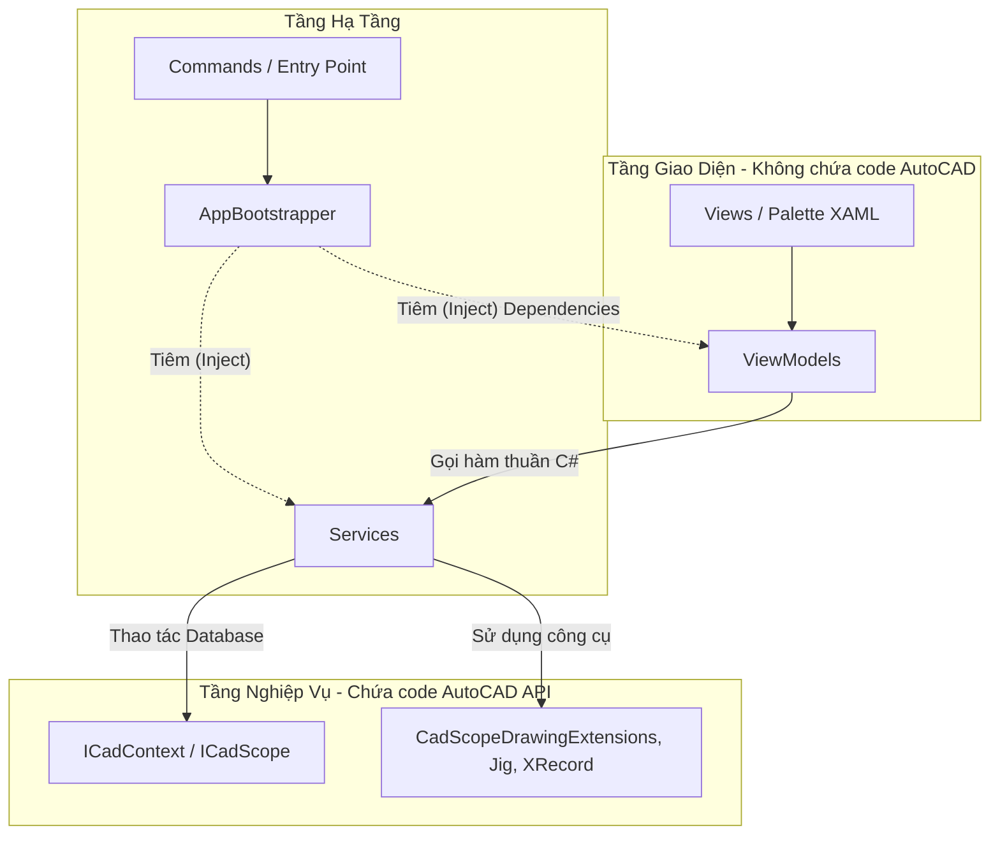

> **📚 Hệ Sinh Thái Tài Liệu CadCoreFramework:**  
> [🏠 Trang chủ](README.md) \| [📑 Mục Lục Toàn Thư](docs/00_TOC.md)
> ---

# 🚀 CadCoreFramework - The 10/10 Enterprise AutoCAD .NET Template

Chào mừng bạn đến với **CadCoreFramework**! Đây là một khung mẫu (Template) chuyên nghiệp dành cho việc phát triển các ứng dụng/plugin AutoCAD bằng C# (.NET). 

Cuốn tài liệu này được viết theo dạng **"Giáo trình thực chiến"**, không chỉ hướng dẫn bạn làm *như thế nào*, mà còn giải thích *tại sao* phải làm như vậy để giúp bạn tránh khỏi 99% các lỗi kinh điển (Fatal Error) của AutoCAD API.

---

## 📖 Đường Dẫn Học Tập (Learning Path)

Chúng tôi đã cấu trúc lại toàn bộ tài liệu thành một bộ giáo trình từ A-Z. Hãy đọc theo thứ tự dưới đây:

| Phần | Link | Nội dung chính |
| :--- | :--- | :--- |
| **Mục lục** | [00_TOC.md](docs/00_TOC.md) | Mục lục tổng quan của toàn bộ hệ thống tài liệu. |
| **Phần 1** | [01_GETTING_STARTED.md](docs/01_GETTING_STARTED.md) | Khởi động nhanh (Quickstart), Tư duy chuyển đổi, Lộ trình Fresher. |
| **Phần 2** | [02_CORE_ARCHITECTURE.md](docs/02_CORE_ARCHITECTURE.md) | Quản lý Transaction an toàn, Dependency Injection, CommandBase. |
| **Phần 3** | [03_DRAWING_AND_INTERACTION.md](docs/03_DRAWING_AND_INTERACTION.md) | Tương tác người dùng (Prompt), Jigs, Vẽ hình, Lọc đối tượng (Selection). |
| **Phần 4** | [04_METADATA_AND_SERVICES.md](docs/04_METADATA_AND_SERVICES.md) | XData vs XRecord, Dynamic Blocks, Dịch vụ lõi (Plot, Settings, Logger). |
| **Phần 5** | [05_WPF_UI_AND_MVVM.md](docs/05_WPF_UI_AND_MVVM.md) | MVVM Palette, Ribbon, Theme Động (Dark/Light), EventAggregator. |
| **Phần 6** | [06_DEVOPS_AND_STANDARDS.md](docs/06_DEVOPS_AND_STANDARDS.md) | Bắt lỗi (Troubleshooting), WPF Hot-Reload, Unit Test, Coding Conventions. |
| **Phần 7** | [07_API_REFERENCE.md](docs/07_API_REFERENCE.md) | Tài liệu tham khảo nhanh API, CadScopeDrawingExtensions, Utils, Builders. |

---


## 🏗 1. Sơ Đồ Kiến Trúc (Architecture Diagram)

Dự án tuân thủ nghiêm ngặt mô hình **MVVM (Model-View-ViewModel)** kết hợp **Dependency Injection (DI)**. Tuyệt đối không để UI (Giao diện) dính dáng đến logic vẽ của AutoCAD.



---

## 🧠 2. Triết Lý Thiết Kế (Tại sao phải làm thế này?)

1. **Bọc kín mọi giao dịch (Transaction Management)**
   - *Tại sao?* AutoCAD yêu cầu mọi thao tác tạo/sửa bản vẽ phải được khóa (Lock Document) và đưa vào Transaction. Nếu bạn mở Transaction mà quên `Commit()` hoặc `Dispose()`, AutoCAD sẽ bị treo hoặc văng lỗi.
   - *Giải pháp:* Bạn bắt buộc phải gọi logic vẽ bên trong `ICadContext.ExecuteAsync(scope => { ... })` hoặc `CadCommandBase.ExecuteWithScope(...)`. Khung mẫu sẽ tự động khóa và dọn dẹp Transaction cho bạn!

2. **Cấm "Hỏi đáp" (Prompt) bên trong Transaction**
   - *Tại sao?* Khi bạn yêu cầu người dùng nhấp chuột chọn điểm (`Editor.GetPoint()`) khi đang mở Transaction, AutoCAD sẽ đứng hình chờ người dùng. Nếu người dùng nhấn ESC hoặc chuyển sang phần mềm khác, Transaction bị kẹt vô thời hạn!
   - *Giải pháp:* **Thu thập thông số trước -> Chạy Transaction vẽ hình sau.**

3. **MVVM Đóng Gói (Encapsulation)**
   - *Tại sao?* Nếu bạn viết lệnh `DrawLine` thẳng vào ViewModel, bạn không thể tạo Unit Test, và mã nguồn sẽ trở thành mớ hỗn độn (Spaghetti code) khi dự án phình to.
   - *Giải pháp:* Tách ra một file `Service` riêng, ViewModel chỉ làm nhiệm vụ giao tiếp dữ liệu.

---

## 🛠 3. Cài Đặt Môi Trường & Cấu Hình `.csproj` (Bẫy Lỗi Kinh Điển)

Trước khi code, hãy đảm bảo bạn setup đúng môi trường:

### Yêu cầu hệ thống
- Visual Studio 2022 (khuyến nghị).
- AutoCAD 2021-2024: Sử dụng **.NET Framework 4.8**.
- AutoCAD 2025+: Phải nâng cấp lên **.NET 8.0**.

### Cấu hình file `.csproj` (Cực Kỳ Quan Trọng)
Nếu cấu hình sai, AutoCAD sẽ "văng" (Fatal Error) ngay lập tức khi bạn chạy lệnh `NETLOAD`. Hãy mở file `.csproj` và đảm bảo:

1. **`CopyLocal="False"` (Private = False)**: Toàn bộ thư viện cốt lõi của AutoCAD như `AcDbMgd.dll`, `AcMgd.dll`, `AcCoreMgd.dll` bắt buộc phải set `CopyLocal = False`. Nếu để `True`, nó sẽ chép đè file DLL của Autodesk ra thư mục output và tranh chấp bộ nhớ!
2. Thiết lập đúng `<TargetFrameworkVersion>v4.8</TargetFrameworkVersion>`.

### Hướng dẫn nâng cấp lên AutoCAD 2025+ (.NET 8.0)
AutoCAD 2025 đánh dấu bước ngoặt khi Autodesk chuyển sang `.NET 8.0`. Do dự án này đã dùng chuẩn SDK-style, bạn chỉ cần thay đổi **4 chỗ** trong file `.csproj`:
1. Thay `<TargetFramework>net48</TargetFramework>` thành `<TargetFramework>net8.0-windows</TargetFramework>`.
2. Nâng cấp 3 gói NuGet `AutoCAD.NET`, `AutoCAD.NET.Core`, `AutoCAD.NET.Model` lên phiên bản `25.0.0` hoặc cao hơn.
3. Xóa các Reference cũ đã được tích hợp sẵn trong .NET 8: Xóa dòng `<Reference Include="System.IO.Compression" />` và `System.IO.Compression.FileSystem`.
4. Nếu có trỏ cứng đường dẫn `HintPath` của `Newtonsoft.Json`, hãy trỏ lại vào thư mục cài đặt CAD 2025 hoặc dùng thẳng qua NuGet.

### Chế độ Build (Debug vs Release)
- **Chế độ Debug**: Dự án đã được thiết lập Post-build event sao chép file `.dll` thành tên ngẫu nhiên (ví dụ `CadCoreFramework_1234.dll`). Việc này cho phép bạn biên dịch lại mã và `NETLOAD` file mới vào AutoCAD mà không cần khởi động lại AutoCAD! Để Debug, mở Visual Studio -> `Debug` -> `Attach to Process` -> chọn `acad.exe`.
- **Chế độ Release**: Khi Build ở Release, dự án tự động sinh ra thư mục `.bundle` theo đúng chuẩn của Autodesk (bao gồm file `PackageContents.xml`). Bạn chỉ việc chép thư mục bundle này vào `%APPDATA%\Autodesk\ApplicationPlugins` là plugin tự chạy.

---

## 🚀 4. Workflow: Quy Trình 7 Bước Tạo Chức Năng Mới

Để tạo chức năng mới (VD: "Vẽ Tủ Điện") mà không vi phạm kiến trúc, hãy tuân thủ 7 bước:

**Bước 1: Khởi tạo Interface Service** (`Services/ITuDienService.cs`)
```csharp
public interface ITuDienService {
    Task<bool> VeTuDienAsync(string tenTu);
}
```

**Bước 2: Viết Logic AutoCAD** (`Services/TuDienService.cs`)
Đặt toàn bộ lệnh `Prompt` và logic vẽ `ExecuteAsync` tại đây:
```csharp
public async Task<bool> VeTuDienAsync(string tenTu) {
    var pt = CadPromptHelper.GetPoint("Chọn điểm đặt Tủ Điện:");
    if (pt == null) return false;

    // Sử dụng undoMarkName để AutoCAD gom toàn bộ thao tác vẽ vào 1 bước Ctrl+Z duy nhất
    await _cadContext.ExecuteAsync(async () => {
        Action<ICadScope> action = scope => {
            scope.DrawRectangle(pt.Value, pt.Value + new Vector3d(100, 200, 0));
        };
        return Task.FromResult(action);
    }, autoRegen: false, undoMarkName: "Vẽ Tủ Điện");
    
    return true;
}
```

**Bước 3: Đăng ký Service** (`Core/AppBootstrapper.cs`)
```csharp
services.AddSingleton<ITuDienService, TuDienService>();
```

**Bước 4: Khởi tạo ViewModel** (`ViewModels/TuDienViewModel.cs`)
Inject Service qua constructor, tuyệt đối không dùng namespace AutoCAD ở đây:
```csharp
public partial class TuDienViewModel : ViewModelBase {
    private readonly ITuDienService _tuDienService;
    public TuDienViewModel(ITuDienService tuDienService) { _tuDienService = tuDienService; }

    [RelayCommand]
    private async Task DrawAsync() {
        await _tuDienService.VeTuDienAsync("Main Panel");
    }
}
```

**Bước 5: Đăng ký ViewModel** (`Core/AppBootstrapper.cs`)
```csharp
services.AddTransient<TuDienViewModel>();
```

**Bước 6: Xây dựng UI (WPF)** (`Views/TuDienControl.xaml`)
Gắn DataContext trong code-behind bằng cách gọi `AppBootstrapper.ServiceProvider?.GetService<TuDienViewModel>()`.

**Bước 7: Kích hoạt từ AutoCAD CLI** (`Commands/TuDienCommands.cs`)
```csharp
[CommandMethod("VE_TU_DIEN")]
public void VeTuDienCommand() {
    ExecuteCommand(() => {
        PaletteService.TogglePalette("TuDienUI", () => new Views.TuDienControl(), "Tủ Điện");
    });
}
```

---

## 🛠 5. Cẩm Nang Lập Trình (Snippets & Cheatsheet)

### 1. Vẽ Đối Tượng Nhanh Chóng
Mọi Entity khi gọi qua Extensions đều được tự động cấu hình `SetDatabaseDefaults()`:
```csharp
// Vẽ hình chữ nhật
scope.DrawRectangle(p1, p2, layer: "MyLayer", lineWidth: 2.0);

// Vẽ chữ tự động wrap text
scope.DrawMText("Nội dung...", p1, textHeight: 2.5, width: 50.0);
```

### 2. Dữ Liệu Ẩn (XRecord JSON Metadata)
Lưu trữ một đối tượng JSON vào bất cứ khối hình AutoCAD nào mà không sợ giới hạn 16KB của XData:
```csharp
var myData = new { Name = "Máy bơm", Power = 55.0 };
entity.SetMetadata(scope.Transaction, "APP_KEY", myData); // Lưu
var data = entity.GetMetadata<dynamic>("APP_KEY"); // Đọc
```

### 3. Hiệu ứng Di Chuột (Jigs)
Tạo hiệu ứng Preview mượt mà khi người dùng kéo chuột (kế thừa `CadEntityJigBase`):
```csharp
var jig = new BlockPlacementJig(blockId);
var result = Editor.Drag(jig);
```

---

## 💣 6. Xử Lý Sự Cố (Troubleshooting)

Là người mới, bạn sẽ gặp các lỗi này thường xuyên: `eLockViolation`, `eNotOpenForWrite`, v.v.
👉 **Hãy xem hướng dẫn cứu hộ tại:** [Cẩm Nang Gỡ Lỗi (Troubleshooting)](docs/08_TROUBLESHOOTING.md)

---
*Chúc bạn có một trải nghiệm lập trình AutoCAD dễ chịu, khoa học và đạt chuẩn kỹ nghệ phần mềm cùng CadCoreFramework!*
