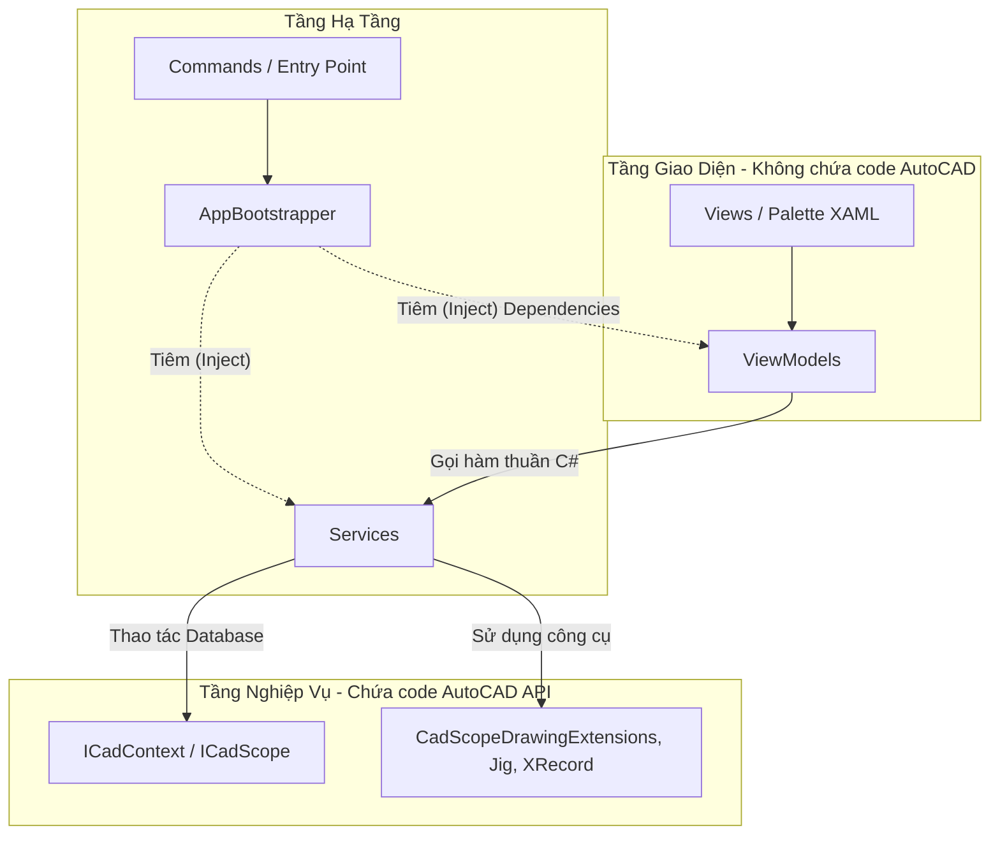

> **📚 Hệ Sinh Thái Tài Liệu CadCoreFramework:**  
> [🏠 Trang chủ](README.md) \| [📑 Mục Lục Toàn Thư](docs/00_TOC.md) \| [🎓 Học viện (Nhập môn → Senior)](docs/training/README.md)
> ---

# 🚀 CadCoreFramework - AutoCAD .NET Plugin Template

[](https://github.com/Tmphi/CadCoreFramework/actions/workflows/build-and-test.yml)

Chào mừng bạn đến với **CadCoreFramework**! Đây là một khung mẫu (Template) chuyên nghiệp dành cho việc phát triển các ứng dụng/plugin AutoCAD bằng C# (.NET). 

Cuốn tài liệu này được viết theo dạng **"Giáo trình thực chiến"**, không chỉ hướng dẫn bạn làm *như thế nào*, mà còn giải thích *tại sao* phải làm như vậy để giúp bạn tránh khỏi 99% các lỗi kinh điển (Fatal Error) của AutoCAD API.

---

## 📖 Đường Dẫn Học Tập (Learning Path)

Chúng tôi đã cấu trúc lại toàn bộ tài liệu thành một bộ giáo trình từ A-Z. Hãy đọc theo thứ tự dưới đây:

| Phần | Link | Nội dung chính |
| :--- | :--- | :--- |
| **Mục lục** | [00_TOC.md](docs/00_TOC.md) | Mục lục tổng quan của toàn bộ hệ thống tài liệu. |
| **Phần 1** | [01_GETTING_STARTED.md](docs/01_GETTING_STARTED.md) | Khởi động nhanh (Quickstart), Tư duy chuyển đổi, Lộ trình Fresher. |
| **Phần 2** | [02_CORE_ARCHITECTURE.md](docs/02_CORE_ARCHITECTURE.md) | Quản lý Transaction an toàn, Dependency Injection, CommandBase. |
| **Phần 3** | [03_DRAWING_AND_INTERACTION.md](docs/03_DRAWING_AND_INTERACTION.md) | Tương tác người dùng (Prompt), Jigs, Vẽ hình, Lọc đối tượng (Selection). |
| **Phần 4** | [04_METADATA_AND_SERVICES.md](docs/04_METADATA_AND_SERVICES.md) | XData vs XRecord, Dynamic Blocks, Dịch vụ lõi (Plot, Settings, Logger). |
| **Phần 5** | [05_WPF_UI_AND_MVVM.md](docs/05_WPF_UI_AND_MVVM.md) | MVVM Palette, Ribbon, Theme Động (Dark/Light), EventAggregator. |
| **Phần 6** | [06_DEVOPS_AND_STANDARDS.md](docs/06_DEVOPS_AND_STANDARDS.md) | Bắt lỗi (Troubleshooting), WPF Hot-Reload, Unit Test, Coding Conventions. |
| **Phần 7** | [07_API_REFERENCE.md](docs/07_API_REFERENCE.md) | Tài liệu tham khảo nhanh API, CadScopeDrawingExtensions, Utils, Builders. |
| **Phần 8** | [08_COOKBOOK.md](docs/08_COOKBOOK.md) | Công thức giải quyết các bài toán thường gặp. |
| **Phần 9** | [09_GOLDEN_SAMPLE.md](docs/09_GOLDEN_SAMPLE.md) | Golden Sample — khuôn mẫu chuẩn để copy khi làm tính năng mới. |
| **🎓 Học viện** | [docs/training/](docs/training/README.md) | **Đào tạo chuyên sâu cho người kế thừa dự án, kể cả người chưa biết lập trình**: Giai đoạn 0 dạy C# theo quy tắc 20/80 trên chính code dự án ([bắt đầu từ đây](docs/training/C00_START_HERE.md)), rồi lộ trình 12 tuần; khung năng lực 5 cấp Nhập môn → Senior, nền tảng AutoCAD .NET, mổ xẻ kiến trúc, sổ tay sự cố thật, debug, kiểm thử, phát hành, hiệu năng, ADR & backlog kỹ thuật, 16 bài lab, đề đánh giá. |

---

## 🧩 0. Tạo Dự Án Mới Từ Template

**Cách 1 — `dotnet new` (khuyến nghị):**

```powershell
dotnet new install .                      # chạy trong thư mục repo này, một lần
dotnet new cad-plugin -n MyElectricalPlugin --GitHubRepo acme/electrical-plugin --IncludeDemos false
```

**Cách 2 — clone trực tiếp rồi chạy script:**

```powershell
.\init-template.ps1 -ProjectName "MyElectricalPlugin" -GitHubRepo "acme/electrical-plugin" -RemoveDemos
```

Cả hai cách đều: đổi tên toàn bộ project/namespace/file, sinh GUID mới (assembly, solution, ProductCode/UpgradeCode của bundle và MSI), điền repo vào badge CI, và — nếu chọn — bỏ thư mục `Demos/` (lệnh `DEMO_*`). Golden Sample (`Samples/GridMarker`) luôn được giữ lại làm khuôn mẫu.

---


## 🏗 1. Sơ Đồ Kiến Trúc (Architecture Diagram)

Dự án tuân thủ nghiêm ngặt mô hình **MVVM (Model-View-ViewModel)** kết hợp **Dependency Injection (DI)**. Tuyệt đối không để UI (Giao diện) dính dáng đến logic vẽ của AutoCAD.



---

## 🧠 2. Triết Lý Thiết Kế (Tại sao phải làm thế này?)

1. **Bọc kín mọi giao dịch (Transaction Management)**
   - *Tại sao?* Mọi thao tác tạo/sửa bản vẽ phải nằm trong Transaction. Từ Palette (application context), bạn còn phải tự khóa bản vẽ (Lock Document), nếu không sẽ gặp `eLockViolation`. Quên `Commit()` thì **mọi thay đổi bị hủy âm thầm**. Quên `Dispose()` thì đối tượng không được đóng đúng cách, gây lỗi khó lường.
   - *Giải pháp:* Gọi logic vẽ bên trong `ICadContext.Execute(scope => { ... })` (ném lỗi), `ICadContext.TryExecute(...)` (trả `CadResult`), hoặc `CadCommandBase.ExecuteWithScope(...)` trong lệnh. Khung mẫu tự động khóa, mở/commit Transaction, gom Undo khi có `undoMarkName`. `ExecuteAsync` chỉ dùng khi **thật sự có việc async** (I/O, API).

2. **Cấm "Hỏi đáp" (Prompt) bên trong Transaction**
   - *Tại sao?* Khi bạn yêu cầu người dùng nhấp chuột chọn điểm (`Editor.GetPoint()`) khi đang mở Transaction, AutoCAD sẽ đứng hình chờ người dùng. Nếu người dùng nhấn ESC hoặc chuyển sang phần mềm khác, Transaction bị kẹt vô thời hạn!
   - *Giải pháp:* **Thu thập thông số trước -> Chạy Transaction vẽ hình sau.**

3. **MVVM Đóng Gói (Encapsulation)**
   - *Tại sao?* Nếu bạn viết lệnh `DrawLine` thẳng vào ViewModel, bạn không thể tạo Unit Test, và mã nguồn sẽ trở thành mớ hỗn độn (Spaghetti code) khi dự án phình to.
   - *Giải pháp:* Tách ra một file `Service` riêng, ViewModel chỉ làm nhiệm vụ giao tiếp dữ liệu.

---

## 🛠 3. Cài Đặt Môi Trường & Cấu Hình `.csproj` (Bẫy Lỗi Kinh Điển)

Trước khi code, hãy đảm bảo bạn setup đúng môi trường:

### Yêu cầu hệ thống
- Visual Studio 2022 (khuyến nghị).
- AutoCAD 2021-2024: Sử dụng **.NET Framework 4.8** (target `net48`, đã kiểm chứng trên AutoCAD 2024).
- AutoCAD 2025+: target **`net8.0-windows`** đã có sẵn trong dự án (build + test được) nhưng **chưa chạy thử trên AutoCAD thật**.

### Cấu hình file `.csproj` (Cực Kỳ Quan Trọng)
Nếu cấu hình sai, plugin có thể không nạp được hoặc gây lỗi khó chẩn đoán khi `NETLOAD`. Giải phẫu từng dòng `.csproj`: [T06 §2](docs/training/T06_BUILD_RELEASE_DEVOPS.md#2-giải-phẫu-cadcoreframeworkcsproj). Hãy đảm bảo:

1. **`<ExcludeAssets>runtime</ExcludeAssets>`**: Toàn bộ thư viện cốt lõi của AutoCAD như `AcDbMgd.dll`, `AcMgd.dll`, `AcCoreMgd.dll` bắt buộc phải thêm `<ExcludeAssets>runtime</ExcludeAssets>` trong PackageReference (SDK-style). Nếu không, NuGet sẽ chép đè DLL của Autodesk ra thư mục output và tranh chấp bộ nhớ!
2. Dự án đã cấu hình **multi-targeting** sẵn: `<TargetFrameworks>net48;net8.0-windows</TargetFrameworks>` — tự động build cả hai TFM cùng lúc.

### Hỗ trợ AutoCAD 2025+ (.NET 8.0)
Dự án đã **multi-target** sẵn cả `net48` (AutoCAD 2021–2024) lẫn `net8.0-windows` (AutoCAD 2025+). Một lần `dotnet build` sinh ra cả hai TFM, và `package.ps1` đóng gói cả hai vào bundle đúng thư mục. Bản `net8.0-windows` **chưa được chạy thử trên AutoCAD 2025** (ngoài phạm vi hiện tại).

### Chế độ Build (Debug vs Release)
- **Chế độ Debug**: tên assembly có **timestamp** (`CadCoreFramework_yyyyMMdd_HHmmss.dll`), và Post-build copy nó về tên cố định `CadCoreFramework.dll`. Mỗi lần build là một assembly mới, nên bạn `NETLOAD` lại được mà không cần khởi động lại AutoCAD. Để Debug: Visual Studio → `Debug` → `Attach to Process` → `acad.exe` (Managed .NET Framework 4.x). Chi tiết: [T04](docs/training/T04_DEBUGGING_TROUBLESHOOTING.md).
- **Chế độ Release**: Sau khi Build Release, chạy `.\package.ps1` để đóng gói thành thư mục `.bundle` đúng chuẩn Autodesk. Chép thư mục bundle vào `%APPDATA%\Autodesk\ApplicationPlugins` là plugin tự chạy.

---

## 🚀 4. Workflow: Quy Trình 7 Bước Tạo Chức Năng Mới

Để tạo chức năng mới (VD: "Vẽ Tủ Điện") mà không vi phạm kiến trúc, đi đúng **các tầng của [Golden Sample](docs/09_GOLDEN_SAMPLE.md)**. Khi phân vân, copy `Samples/GridMarker/`. Bản đầy đủ có checklist: [T08 §2](docs/training/T08_RECIPES_EXTENDING.md#2-thêm-một-tính-năng-trọn-vẹn).

**Bước 1: Model + logic thuần** (không kiểu AutoCAD → test được 100%)
```csharp
public sealed class TuDienSpec
{
    public TuDienSpec(string tenTu, double rong, double cao) { TenTu = tenTu; Rong = rong; Cao = cao; }
    public string TenTu { get; } public double Rong { get; } public double Cao { get; }
    public IReadOnlyList<string> Validate()
    {
        var errors = new List<string>();
        if (string.IsNullOrWhiteSpace(TenTu)) errors.Add("Tên tủ không được trống.");
        if (Rong <= 0 || Cao <= 0) errors.Add("Kích thước phải lớn hơn 0.");
        return errors;
    }
}
```

**Bước 2: Interface Service** (chỉ kiểu của plugin, **không prompt**)
```csharp
public interface ITuDienService
{
    CadResult<ObjectId> Draw(TuDienSpec spec, double x, double y);
}
```

**Bước 3: Service**: vỏ mỏng quanh `ICadContext`, đồng bộ, luôn có `undoMarkName` (vì còn được gọi từ palette)
```csharp
public sealed class TuDienService : ITuDienService
{
    private readonly ICadContext _cad;
    public TuDienService(ICadContext cad) => _cad = cad;

    public CadResult<ObjectId> Draw(TuDienSpec spec, double x, double y)
        => _cad.TryExecute(scope =>
        {
            ObjectId frame = scope.DrawRectangle(new Point3d(x, y, 0),
                new Point3d(x + spec.Rong, y + spec.Cao, 0), layer: "E-PANEL");
            scope.DrawMText(spec.TenTu, new Point3d(x, y + spec.Cao + 50, 0), textHeight: 50, layer: "E-PANEL");
            return frame;
        }, undoMarkName: "Vẽ Tủ Điện");
}
```

**Bước 4: Lệnh**: prompt **trước**, rồi validate, rồi gọi service
```csharp
[CommandMethod("VE_TU_DIEN")]
public void VeTuDien()
{
    ExecuteCommand(() =>
    {
        Point3d? pt = CadPromptHelper.GetPoint("Chọn điểm đặt Tủ Điện:");   // đã đổi UCS → WCS
        if (pt == null) return;                                               // ESC
        var spec = new TuDienSpec("MSB-01", 600, 2000);
        var errors = spec.Validate();
        if (errors.Count > 0) { foreach (var e in errors) GetRequiredService<INotificationService>().Warn(e); return; }

        var result = GetRequiredService<ITuDienService>().Draw(spec, pt.Value.X, pt.Value.Y);
        if (!result.IsSuccess) throw new InvalidOperationException(result.ErrorMessage, result.Exception);
    });
}
```

**Bước 5: ViewModel**: không kiểu WPF/AutoCAD; nhập toạ độ trên form (palette không prompt)
```csharp
public partial class TuDienViewModel : ViewModelBase
{
    private readonly ITuDienService _service;
    [ObservableProperty] private string _tenTu = "MSB-01";
    [ObservableProperty] private double _x;
    [ObservableProperty] private double _y;
    public TuDienViewModel(ITuDienService service) => _service = service;

    [RelayCommand]
    private void Draw() => RunSafe(() =>
    {
        var result = _service.Draw(new TuDienSpec(TenTu, 600, 2000), X, Y);
        if (!result.IsSuccess) ErrorMessage = result.ErrorMessage;
    });
}
```

**Bước 6: Palette WPF**: XAML chỉ có Binding, dùng `{DynamicResource …}` cho style và màu (không mã màu cứng). Code-behind copy mẫu [`GridMarkerPalette.xaml.cs`](Samples/GridMarker/GridMarkerPalette.xaml.cs): `ThemeManager.Attach(this)` ngay sau `InitializeComponent()` (nạp Styles + theme tối/sáng theo `COLORTHEME`, tự đổi khi người dùng đổi theme), rồi lấy ViewModel từ DI và **ném lỗi nếu thiếu** (`?? throw new InvalidOperationException(…)`).

**Bước 7: Đăng ký + test**
```csharp
// Core/AppBootstrapper.cs → ConfigureServices
services.AddSingleton<ITuDienService, TuDienService>();
services.AddTransient<TuDienViewModel>();
// Properties/AssemblyInfo.cs
[assembly: Autodesk.AutoCAD.Runtime.CommandClass(typeof(MyPlugin.Commands.TuDienCommands))]
```
Test: `TuDienSpec` bằng xUnit thuần; `TuDienService` bằng `FakeCadContext { ExecuteAction = false }` (đúng một `TryExecute`, đúng undo mark); ViewModel bằng Mock `ITuDienService`; palette bằng `XamlPaletteTests` ([T05](docs/training/T05_TESTING_STRATEGY.md)). Lệnh mới thêm vào `Deployment/PackageContents.xml`; nút Ribbon (tùy chọn) là một dòng trong `Commands/CadCoreRibbon.cs`. Analyzer CAD001–CAD003 chạy trong build và báo nếu Service/ViewModel prompt, dùng `MdiActiveDocument`, hoặc ghi trong `ExecuteRead`.

**Kiểm thử trên AutoCAD thật không cần mở giao diện:** `.\tests\integration\run-headless-lab.ps1` chạy các kiểm thử HeadlessLab trong accoreconsole (profile cô lập, không đụng thiết lập AutoCAD của bạn) — [tests/integration/README.md](tests/integration/README.md).

---

## 🛠 5. Cẩm Nang Lập Trình (Snippets & Cheatsheet)

### 1. Vẽ Đối Tượng Nhanh Chóng
Mọi Entity khi gọi qua Extensions đều được tự động cấu hình `SetDatabaseDefaults()`:
```csharp
// Vẽ hình chữ nhật
scope.DrawRectangle(p1, p2, layer: "MyLayer", lineWidth: 2.0);

// Vẽ chữ tự động wrap text
scope.DrawMText("Nội dung...", p1, textHeight: 2.5, width: 50.0);
```

### 2. Dữ Liệu Ẩn (JSON Metadata: XRecord hoặc XData)
Dữ liệu lớn dùng **XRecord** (Extension Dictionary, không vướng giới hạn 16 KB/đối tượng của XData):
```csharp
var myData = new { v = 1, Name = "Máy bơm", Power = 55.0 };
scope.SetXRecord(entityId, "APP_KEY", myData);              // Lưu (XRecord)
var data = scope.GetXRecord<dynamic>(entityId, "APP_KEY");  // Đọc
```
Dữ liệu nhỏ, cần lọc chọn theo app (`SelectionFilterBuilder.WithXData`) thì dùng **XData**: `entity.SetMetadata(scope.Transaction, "APP_KEY", myData)` / `entity.GetMetadata<dynamic>("APP_KEY")` (≤ 15.000 ký tự JSON). So sánh: [T08 §8](docs/training/T08_RECIPES_EXTENDING.md#8-lưu-metadata-xdata-hay-xrecord).

### 3. Hiệu ứng Di Chuột (Jigs)
Jig xem trước khi người dùng kéo chuột. Entity của jig **chưa nằm trong database**: hủy thì phải `Dispose()`, chốt thì append. Ví dụ đầy đủ: lệnh `DEMO_JIG_BLOCK` ([`Demos/DemoInteractionCommands.cs`](Demos/DemoInteractionCommands.cs)).
```csharp
var blockRef = new BlockReference(Point3d.Origin, blockDefId);    // blockDefId: ObjectId của định nghĩa block
var jig = new BlockPlacementJig(blockRef, "\nChọn vị trí đặt Block: ");
if (Editor.Drag(jig).Status != PromptStatus.OK) { blockRef.Dispose(); return; }
CadContext.Execute(scope => { scope.AppendEntityToCurrentSpace(blockRef); });
```

---

## 💣 6. Xử Lý Sự Cố (Troubleshooting)

Là người mới, bạn sẽ gặp các lỗi này thường xuyên: `eLockViolation`, `eNotOpenForWrite`, v.v.
👉 **Hướng dẫn cứu hộ:**
- [T04: Debug & chẩn đoán](docs/training/T04_DEBUGGING_TROUBLESHOOTING.md): cây quyết định từ triệu chứng tới nguyên nhân, đọc log, attach debugger, phân tích crash.
- [T03: Sổ tay sự cố](docs/training/T03_PITFALLS_CASEBOOK.md): 16 sự cố thật của dự án + 31 bẫy AutoCAD API kinh điển.
- [Bảng ErrorStatus thường gặp](docs/training/T01_AUTOCAD_NET_FOUNDATIONS.md#14-phụ-lục-errorstatus-thường-gặp) · [DevOps & Standards](docs/06_DEVOPS_AND_STANDARDS.md)

---
*Chúc bạn có một trải nghiệm lập trình AutoCAD dễ chịu, khoa học và đạt chuẩn kỹ nghệ phần mềm cùng CadCoreFramework!*
