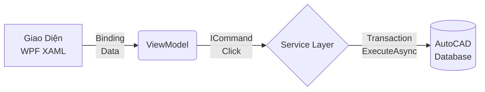

# Phần 1: Bắt Đầu & Tư Duy (Getting Started)

Chào mừng bạn đến với **CadCoreFramework**! Đây là một khung mẫu (Template) chuyên nghiệp dành cho việc phát triển các ứng dụng/plugin AutoCAD bằng C# (.NET). Cuốn tài liệu này được viết theo dạng "Giáo trình thực chiến", giải thích *tại sao* kiến trúc lại được thiết kế như vậy.

---

## 1.1 Khởi Động Nhanh (Quickstart)

Tài liệu này hướng dẫn bạn từ lúc mở Visual Studio cho đến khi thấy kết quả đầu tiên bên trong AutoCAD. Không cần hiểu kiến trúc ngay — cứ chạy được cái đã.

> [!IMPORTANT]
> **Yêu cầu:** Visual Studio 2022, AutoCAD 2021–2024 (64-bit), .NET Framework 4.8. 
> Nếu bạn dùng AutoCAD 2025+, vui lòng nâng cấp dự án lên **.NET 8.0**.
> Đảm bảo AutoCAD đang **mở** và **có ít nhất 1 bản vẽ đang active** trước khi NETLOAD.

### Sơ đồ Cấu trúc Thư mục (Folder Tree)
Trước khi Build, hãy lướt qua cấu trúc thư mục của Framework để hiểu vai trò của từng tầng. Dự án áp dụng kiến trúc **Separation of Concerns (SoC)** (Tách biệt mối quan tâm):

```text
📁 CadCoreFramework
├── 📁 Commands/       # Điểm đón lệnh AutoCAD (Entry Points). Chỉ chứa [CommandMethod].
├── 📁 Core/           # Trái tim của Framework: Bootstrapper, Context, Service cơ sở.
├── 📁 Extensions/     # Các hàm vẽ (DrawLine, DrawCircle) móc trực tiếp vào ICadScope.
├── 📁 Models/         # Các class dữ liệu thuần tuý (DTO, Entity Model). Không chứa logic CAD.
├── 📁 Services/       # Nơi chứa Logic nghiệp vụ (Business logic) thực sự. 
├── 📁 Themes/         # Quản lý giao diện Sáng/Tối (Light/Dark mode) của AutoCAD.
├── 📁 Utils/          # Tiện ích rời: PromptHelper, CoordinateHelper, Jigs.
├── 📁 ViewModels/     # Cầu nối giữa giao diện WPF và Logic C#.
└── 📁 Views/          # Giao diện WPF (XAML). TUYỆT ĐỐI KHÔNG chứa code xử lý AutoCAD.
```

### Bước 1: Build Plugin
Mở Terminal tại thư mục gốc của project và chạy:
```powershell
dotnet build CadCoreFramework.sln -c Debug
```

> [!NOTE]
> **WPF Hot-Reload (Không cần tắt AutoCAD):** Trong chế độ Debug, `.csproj` tự sinh ra file DLL mới kèm Timestamp (ví dụ: `CadCoreFramework_20261010_120000.dll`). Nhờ đó file mới không đụng độ với bản cũ đang bị Windows lock. Sau đó PostBuild event tự copy về tên chuẩn `CadCoreFramework.dll`.
> Chi tiết trong Phần 6.1.

### Bước 2: Nạp Plugin Vào AutoCAD
1. Mở AutoCAD, gõ lệnh `NETLOAD` vào Command Line.
2. Điều hướng đến file: `<thư mục project>\bin\Debug\net48\CadCoreFramework.dll`.
3. Nhấn **Open**. (Sẽ không có bảng thông báo nào hiện ra, điều này là bình thường).

### Bước 3: Kiểm Tra Plugin
Gõ lệnh `CORE_INFO`. Nếu thành công, Command Line sẽ in ra:
`[CadCoreFramework] Plugin infrastructure is ready.`

---

## 1.2 Tư Duy Chuyển Đổi (Mindset Shift)

🎯 **Mục tiêu:** Bỏ lại phía sau tư duy viết Script rời rạc, làm quen với tư duy "Kỹ nghệ Phần mềm" (Enterprise Software).

### Từ Scripting đến Enterprise
Nếu bạn đã quen với AutoLISP hoặc VBA, bạn thường viết code theo kiểu "kịch bản": Hỏi người dùng một câu -> Vẽ một nét -> Hỏi tiếp -> Vẽ tiếp. Mọi thứ được nhồi nhét vào một hàm duy nhất.
Khi bước vào .NET và **CadCoreFramework**, bạn đang xây dựng một **Hệ thống**. Trong hệ thống này, Giao diện (UI) và Logic vẽ hình không bao giờ được phép "nói chuyện" trực tiếp với nhau.

### Luồng Dữ Liệu Một Chiều (One-way Data Flow)



> [!CAUTION]
> Giao diện (Màu xanh) chỉ quan tâm đến việc hiển thị. AutoCAD Database (Màu đỏ) chỉ quan tâm đến lưu trữ nét vẽ. Việc lấy biến `TextBox.Text` và ép kiểu ngay bên trong thân hàm AutoCAD Transaction là **tội ác** trong kiến trúc MVVM. Luôn dùng `ViewModel` và Data Binding làm trung gian!

### Async/Await: Phép Ẩn Dụ "Nhà Hàng & Bồi Bàn"
AutoCAD là phần mềm **Đơn luồng (Single-thread)** đối với giao diện. Hãy tưởng tượng AutoCAD là một **Người Bồi Bàn (UI Thread)** duy nhất trong nhà hàng.
* ⛔ **Code Đồng Bộ (Đợi chết trân):** Bồi bàn đứng nguyên tại bếp chờ 30 phút thịt chín mới đem ra. Khách khác bị bỏ lơ (AutoCAD Not Responding).
* ✅ **Code Bất Đồng Bộ (Async/Await):** Bạn yêu cầu nướng thịt (`Task`). Bồi bàn giao việc, ghi chú lại bằng chữ `await`, rồi quay ra phục vụ khách khác. Khi thịt chín, bồi bàn sẽ quay lại lấy thịt. Đừng bao giờ dùng `Thread.Sleep()`.

---

## 1.3 Lộ Trình Cho Người Mới (Fresher Roadmap) & Bài Toán Thực Tế

Để nhanh chóng làm chủ Framework, Fresher nên tự thực hành bài toán **Vẽ Tủ Điện MSB** với lộ trình 3 tuần sau:

### Tuần 1: Tư Duy & Kiến Trúc
- Đọc kỹ tài liệu này và Phần 2 (Kiến trúc cốt lõi). 
- Mở [`AppBootstrapper.cs`](../Core/AppBootstrapper.cs) để xem "Menu" đăng ký các Services (`AddSingleton`, `AddTransient`).
- Mở [`SampleCommands.cs`](../Commands/SampleCommands.cs) để chạy thử lệnh `SHOW_PALETTE`.

### Tuần 2: Thực Hành "Vẽ Tủ Điện MSB"
Đây là bài tập giúp bạn "chạm tay" vào toàn bộ luồng dữ liệu của Framework.
1. **Tạo View & ViewModel:**
   - Tạo file `TuDienViewModel.cs`. Thêm một Property `TenTu` (kiểu string) và `ChieuCao` (kiểu double).
   - Tạo file `TuDienControl.xaml`. Kéo thả 2 TextBox (bind vào `TenTu` và `ChieuCao`) và 1 Button (bind vào lệnh `DrawCommand`).
2. **Tạo Service Xử Lý:**
   - Tạo `TuDienService.cs` (Kế thừa `ITuDienService`).
   - Viết hàm `VeTuDienAsync(string tenTu, double chieuCao)`.
   - Trong hàm này, gọi `CadPromptHelper.GetPoint("Chọn điểm đặt tủ")` để lấy toạ độ `(X, Y)`.
   - Tiếp theo, gọi `_cadContext.ExecuteAsync(...)` mở Transaction.
   - Bên trong `ExecuteAsync`, sử dụng `scope.DrawRectangle` để vẽ thân tủ, và `scope.DrawMText` để in Tên Tủ lên vị trí vừa chọn.
3. **Đăng Ký Khởi Tạo:**
   - Đăng ký `TuDienService` và `TuDienViewModel` vào `AppBootstrapper.cs`.
   - Tạo một `CommandMethod` mới trong thư mục Commands để hiển thị Palette chứa `TuDienControl.xaml` của bạn.

### Tuần 3: Trở Thành Senior
- Tìm hiểu về XRecord (Phần 4). Sau khi vẽ xong Tủ Điện MSB ở trên, hãy tự viết code đính kèm một cục dữ liệu JSON chứa giá trị `TenTu` và `ChieuCao` vào đúng cái Line của cái tủ vừa vẽ.
- Viết Unit Test cho lớp `TuDienService` bằng cách Mock lại `ICadContext`.
