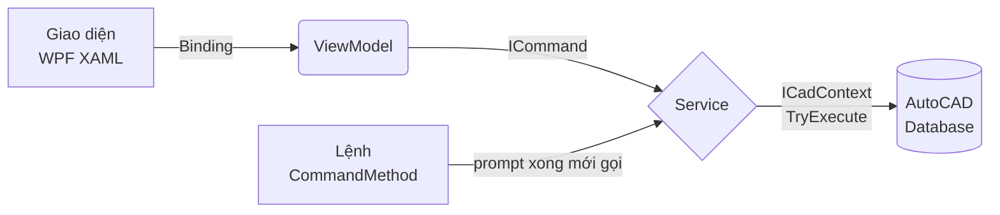

> **📘 Tra cứu CadCoreFramework** · [Mục lục tài liệu](../README.md) · **R01** · [R02 →](R02_ARCHITECTURE.md)

# R01 — Khởi Động Nhanh

> **Dùng khi:** lần đầu build và nạp plugin, hoặc cần nhớ lại thư mục nào chứa gì · **Học bài bản:** [T01 — Nền tảng AutoCAD .NET](../training/T01_AUTOCAD_NET_FOUNDATIONS.md) · **Chưa biết C#:** [C00 — Bắt đầu từ đây](../training/C00_START_HERE.md)

Trang này đưa bạn từ lúc mở Visual Studio tới khi thấy kết quả đầu tiên trong AutoCAD. Chưa cần hiểu kiến trúc: cứ chạy được đã, rồi đọc [R02](R02_ARCHITECTURE.md).

---

## Mục lục

1. [Yêu cầu](#1-yêu-cầu)
2. [Cấu trúc thư mục](#2-cấu-trúc-thư-mục)
3. [Build, nạp, kiểm tra](#3-build-nạp-kiểm-tra)
4. [Các lệnh có sẵn](#4-các-lệnh-có-sẵn)
5. [Luồng dữ liệu một chiều](#5-luồng-dữ-liệu-một-chiều)
6. [Đọc tiếp](#6-đọc-tiếp)

---

## 1. Yêu cầu

| Thành phần | Phiên bản | Ghi chú |
| :--- | :--- | :--- |
| AutoCAD | 2021–2024, 64-bit | Bản `net48`, đã kiểm chứng trên AutoCAD 2024 |
| AutoCAD 2025+ | — | Dự án build sẵn `net8.0-windows`, nhưng bản đó **chưa được chạy thử trên AutoCAD thật** |
| Visual Studio | 2022 | Workload ".NET desktop development" |
| .NET SDK | 8.x trở lên | CI dùng 8.0.x |

Môi trường đầy đủ cho người học (Git, GitHub CLI, quyền): [training/README §4](../training/README.md#4-chuẩn-bị-môi-trường).

---

## 2. Cấu trúc thư mục

Dự án tách mỗi loại trách nhiệm vào một thư mục. Vai trò của từng tầng và quy tắc phụ thuộc giữa chúng: [T02 §1](../training/T02_ARCHITECTURE_DEEP_DIVE.md).

```text
📁 CadCoreFramework
├── 📁 Commands/      Điểm vào lệnh AutoCAD ([CommandMethod]), CadCommandBase, Ribbon của dự án
├── 📁 Core/          Bootstrapper, ICadContext/CadContext, CadResult, các service hạ tầng (log, palette, ribbon, event…)
├── 📁 Extensions/    Hàm vẽ và truy vấn gắn vào ICadScope (DrawLine, EnsureLayer, SetXRecord…)
├── 📁 Models/        Lớp dữ liệu thuần, không chứa logic AutoCAD
├── 📁 Samples/       Golden Sample (GridMarker): khuôn mẫu chuẩn để copy khi làm tính năng mới
├── 📁 Demos/         Lệnh DEMO_* minh họa từng API; loại khỏi DLL bằng IncludeDemos=false
├── 📁 Services/      Nghiệp vụ dùng chung: Layer, Plot, Settings, Dialog, FileSystem
├── 📁 Themes/        ThemeManager + màu sáng/tối + Styles.xaml
├── 📁 Utils/         CadPromptHelper, SelectionFilterBuilder, XData/XRecord, Jigs, các helper khác
├── 📁 ViewModels/    ViewModelBase, NumberText và ViewModel của các palette có sẵn
├── 📁 Views/         XAML của các palette có sẵn; không chứa code xử lý AutoCAD
├── 📁 Properties/    AssemblyInfo.cs: nơi khai báo [assembly: CommandClass]
├── 📁 Deployment/    PackageContents.xml (bundle Autoloader), Install/Uninstall
├── 📁 Templates/     Template `dotnet new cad-command`
├── 📁 snippets/      Snippet Visual Studio: cadcmd, cadscope, cadsvc, cadvm
├── 📁 tests/         Kiểm thử tích hợp: smoke.scr, HeadlessLab
├── 📁 tools/docs/    Script kiểm tài liệu (link, thẻ ⏱, mermaid, code mẫu, bài tập), chạy trong CI
├── 📁 exercises/     Bài tập C01–C04, U01 có test chấm tự động (không thuộc plugin)
├── 📁 CadCoreFramework.Tests/       Unit test (xUnit), chạy trên cả net48 và net8.0-windows
├── 📁 CadCoreFramework.Testing/     FakeCadContext và các test double
├── 📁 CadCoreFramework.Analyzers/   Analyzer CAD001–CAD003 (R06 §5)
├── 📁 CadCoreFramework.Benchmarks/  Đo hiệu năng
└── 📁 docs/          Tài liệu này
```

---

## 3. Build, nạp, kiểm tra

**Bước 1 — Build.** Mở terminal tại thư mục gốc của dự án:

```powershell
dotnet build CadCoreFramework.sln -c Debug
```

Bản Debug có tên assembly kèm thời điểm build (ví dụ `CadCoreFramework_20261010_120000.dll`) rồi được copy về `CadCoreFramework.dll`, nhờ vậy bạn nạp lại được mà không phải tắt AutoCAD. Cơ chế và giới hạn của nó: [R06 §1](R06_STANDARDS.md#1-nạp-lại-plugin-không-cần-tắt-autocad).

**Bước 2 — Nạp vào AutoCAD.**
1. Mở AutoCAD và **một bản vẽ bất kỳ** (lệnh cần có bản vẽ đang mở).
2. Gõ `NETLOAD`, chọn `<thư mục dự án>\bin\Debug\net48\CadCoreFramework.dll`, bấm **Open**. Không có hộp thông báo nào hiện ra, điều này là bình thường.

**Bước 3 — Kiểm tra.** Gõ `CORE_INFO`. Command line in:

```text
[CadCoreFramework] Hạ tầng plugin đã sẵn sàng.
```

Không thấy dòng này, hoặc AutoCAD báo `Unknown command`? Đi theo cây quyết định ở [T04 §9](../training/T04_DEBUGGING_TROUBLESHOOTING.md#9-cây-quyết-định-triệu-chứng--nguyên-nhân). Log nằm ở `%AppData%\CadCoreFramework\Logs`.

---

## 4. Các lệnh có sẵn

Chín lệnh dưới đây là các lệnh được khai báo trong [`Deployment/PackageContents.xml`](../../Deployment/PackageContents.xml) (test `PackageManifestTests` kiểm danh sách này). Các lệnh `DEMO_*` trong `Demos/` không nằm trong bundle.

| Lệnh | Làm gì | Code |
| :--- | :--- | :--- |
| `CORE_INFO` | In dòng "Hạ tầng plugin đã sẵn sàng" | [`SampleCommands.cs`](../../Commands/SampleCommands.cs) |
| `CORE_TEST_ALL` | Tạo layer, vẽ khung + chữ, ghi và đọc lại XData | [`SampleCommands.cs`](../../Commands/SampleCommands.cs) |
| `DRAW_CIRCLE_SAMPLE` | Vẽ một đường tròn tại gốc tọa độ | [`SampleCommands.cs`](../../Commands/SampleCommands.cs) |
| `CORE_DEBUG` | Mở Debug Inspector: lịch sử lệnh, service trong DI, subscriber | [`SampleCommands.cs`](../../Commands/SampleCommands.cs) |
| `SHOW_PALETTE` | Bật/tắt palette Grid Marker (Golden Sample) | [`SampleCommands.cs`](../../Commands/SampleCommands.cs) |
| `SHOW_UI_TEMPLATE` | Bật/tắt palette trưng bày các control WPF theo theme | [`SampleCommands.cs`](../../Commands/SampleCommands.cs) |
| `SAMPLE_GRID` | Vẽ lưới ô đánh nhãn từ dòng lệnh (Golden Sample) | [`GridMarkerCommands.cs`](../../Samples/GridMarker/GridMarkerCommands.cs) |
| `CADCORE_LAYER_MANAGER` | Mở palette quản lý layer | [`LayerCommands.cs`](../../Commands/LayerCommands.cs) |
| `CADCORE_COUNT_LAYERS` | In số layer của bản vẽ và số layer đang tắt | [`LayerCommands.cs`](../../Commands/LayerCommands.cs) |

Kịch bản thử tay đầy đủ (17 bước): [T05 §7](../training/T05_TESTING_STRATEGY.md#7-những-gì-chỉ-autocad-thật-mới-kiểm-được).

---

## 5. Luồng dữ liệu một chiều

Nếu bạn quen AutoLISP hoặc VBA, bạn thường viết theo kiểu kịch bản: hỏi người dùng, vẽ một nét, hỏi tiếp, vẽ tiếp, tất cả trong một hàm. Dự án này tách các bước đó ra thành từng tầng, và dữ liệu chỉ đi theo một chiều:



- **View** chỉ hiển thị và binding. Không đọc `TextBox.Text` để vẽ.
- **Lệnh** hỏi người dùng (prompt) **trước**, rồi gọi Service.
- **Service** là nơi duy nhất chạm bản vẽ, qua `ICadContext`. Service không prompt, vì nó còn được gọi từ palette.

Vì sao phải tách như vậy, và cái giá nếu không tách: [R05 — Golden Sample](R05_GOLDEN_SAMPLE.md).

---

## 6. Đọc tiếp

| Bạn muốn | Đọc |
| :--- | :--- |
| Hiểu vì sao kiến trúc như hiện tại | [R02 — Kiến trúc cốt lõi](R02_ARCHITECTURE.md) |
| Bắt tay làm tính năng mới | [R05 — Golden Sample](R05_GOLDEN_SAMPLE.md), rồi [T08 — Công thức mở rộng](../training/T08_RECIPES_EXTENDING.md) |
| Tra một hàm | [R03 — API](R03_API.md) |
| Học có lộ trình, có lab và đánh giá | [Học viện CadCoreFramework](../training/README.md) |
