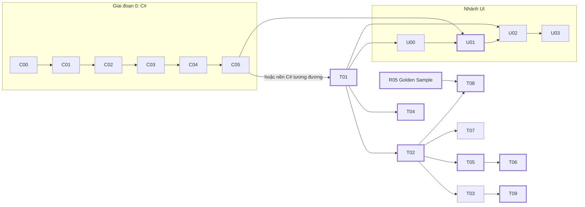

> **📚 Học viện CadCoreFramework** · [🌰 Bắt đầu từ đây](C00_START_HERE.md) · [🖥️ Nhánh UI](U00_UI_START_HERE.md) · [🏠 README dự án](../../README.md) · [📚 Mục lục tài liệu](../README.md) · [📘 Tra cứu](../README.md#-tra-cứu-reference) · [📖 Thuật ngữ](GLOSSARY.md)

# 🎓 Lộ Trình Đào Tạo: Từ Người Chưa Biết Lập Trình Đến Senior AutoCAD .NET

Bộ tài liệu này dành cho người **kế thừa và phát triển tiếp** CadCoreFramework — kể cả người **chưa từng lập trình**. Mục tiêu không dừng ở "chạy được dự án". Sau lộ trình, bạn phải **hiểu vì sao từng dòng code được viết như vậy**, **tự chẩn đoán được sự cố**, và **ra quyết định kiến trúc** như một Senior trong lĩnh vực plugin AutoCAD .NET (C#).

> [!TIP]
> **Chưa biết lập trình, hoặc chưa biết C#?** Bắt đầu ở [C00 — Bắt đầu từ đây](C00_START_HERE.md). **Giai đoạn 0** (6 tuần, không cần AutoCAD) dạy C# theo **quy tắc 20/80**: học đúng khoảng 30 tính năng mà chính dự án này dùng nhiều nhất (đã đếm trong code), luyện ngay trên code thật của dự án. Đã biết C#: làm [bài kiểm tra đầu vào](C00_START_HERE.md#6-bài-kiểm-tra-đầu-vào-bạn-nên-bắt-đầu-từ-đâu) để biết có bỏ qua được không.
>
> **Làm tool có giao diện** (palette, hộp thoại, xem trước trước khi vẽ)? **Nhánh UI** [U00–U03](U00_UI_START_HERE.md) dạy theo cùng quy tắc 20/80: API UI mà code AutoCAD công khai dùng nhiều nhất (đã đếm), WPF/MVVM, và hướng dẫn **vẽ thực thể lên UI** từng bước.

> [!IMPORTANT]
> **Nguyên tắc số 1 của bộ tài liệu: mọi khẳng định đều phải kiểm chứng được.**
> - Kiến thức về dự án luôn dẫn tới **file nguồn thật** (bấm vào link để mở).
> - Kiến thức về AutoCAD API đã được đối chiếu với metadata của `AcDbMgd.dll` / `AcCoreMgd.dll` (AutoCAD 2024, `AutoCAD.NET 24.0.0`).
> - Các sự cố ghi trong [T03](T03_PITFALLS_CASEBOOK.md) là **sự cố đã thật sự xảy ra** với dự án này, kèm cách tái hiện.
>
> Nếu bạn thấy tài liệu lệch với code: **code là sự thật**. Hãy sửa tài liệu bằng một PR. Đó cũng là một bài tập.

### Bắt đầu từ đâu?

| Bạn là | Bắt đầu ở | Lộ trình |
| :--- | :--- | :--- |
| Chưa từng lập trình | [C00 — Bắt đầu từ đây](C00_START_HERE.md) | Giai đoạn 0 (6 tuần) rồi Giai đoạn 1–3: khoảng 20 tuần |
| Biết một ngôn ngữ khác, chưa biết C# | [Bài kiểm tra đầu vào](C00_START_HERE.md#6-bài-kiểm-tra-đầu-vào-bạn-nên-bắt-đầu-từ-đâu) | Thường 2 tuần cho C01–C05, rồi Giai đoạn 1–3 |
| Vững C#, mới với AutoCAD .NET | [Đồ án nhập môn](C05_ASYNC_TESTING_GIT.md#5-đồ-án-nhập-môn-planner-dãy-tủ-điện), rồi [T01](T01_AUTOCAD_NET_FOUNDATIONS.md) | Giai đoạn 1–3: 12–14 tuần ([§3](#3-lộ-trình-đào-tạo)). Cần làm được việc sớm: [lộ trình nhanh](#lộ-trình-nhanh), đọc ≈ 3,5 giờ + lab |
| Đã làm AutoCAD .NET, mới vào dự án | [T02](T02_ARCHITECTURE_DEEP_DIVE.md) → [R05 — Golden Sample](../reference/R05_GOLDEN_SAMPLE.md) → [T08](T08_RECIPES_EXTENDING.md) | Đọc theo thứ tự đó; gặp sự cố thì tra [T03](T03_PITFALLS_CASEBOOK.md) |
| Cần làm giao diện: palette, hộp thoại, xem trước | [U00 — Nhánh UI](U00_UI_START_HERE.md), sau [T01 §5 và §7](T01_AUTOCAD_NET_FOUNDATIONS.md#5-document-lock-và-hai-ngữ-cảnh-thực-thi) | Nhánh UI: 3 tuần |
| Mentor | [§6 — Dành cho mentor](#6-dành-cho-mentor) | — |

---

## 1. Bộ tài liệu gồm những gì

| Module | Nội dung | Cấp độ |
| :--- | :--- | :---: |
| **Giai đoạn 0 — Nhập môn lập trình & C#** | | |
| [C00 — Bắt đầu từ đây](C00_START_HERE.md) | Quy tắc 20/80 (số liệu đếm trong code), lộ trình 6 tuần, cài đặt, cách học, bài kiểm tra đầu vào | 🌰 |
| [C01 — Chương trình đầu tiên](C01_FIRST_PROGRAM.md) | Chạy chương trình, đọc lỗi biên dịch, biến & kiểu, chuỗi, bẫy định dạng Việt Nam, `if`/`switch`, vòng lặp, hàm, debug | 🌰 |
| [C02 — Dữ liệu & collection](C02_DATA_AND_COLLECTIONS.md) | struct vs class (`Point3d` vs `Line`), mảng, `List`, `Dictionary`, `IReadOnlyList`, `null`, `enum`, `const`/`readonly`, chuỗi | 🌰 |
| [C03 — Hướng đối tượng](C03_OBJECT_ORIENTED.md) | Class, property, constructor, đóng gói, `static`, namespace, interface + bản giả, kế thừa, nhận phụ thuộc qua constructor; đọc trọn `GridSpec.cs` | 🌰 |
| [C04 — C# dự án dùng hằng ngày](C04_CSHARP_IN_THIS_PROJECT.md) | Delegate, lambda, closure, LINQ, extension method, generic, exception, `using`, event, attribute; giải mã 6 dòng code thật | 🌰 |
| [C05 — Async, test, Git & đồ án](C05_ASYNC_TESTING_GIT.md) | `async`/`await` và main thread, xUnit + FluentAssertions, đọc solution, Git & PR, đồ án nhập môn, đánh giá lên Fresher | 🌰 → 🌱 |
| **Giai đoạn 1–3 — AutoCAD .NET và dự án** | | |
| [T01 — Nền tảng AutoCAD .NET](T01_AUTOCAD_NET_FOUNDATIONS.md) | Object model, Database, Transaction, Lock, Command/Application context, Prompt & UCS, Threading, bộ nhớ, Events, Undo, vòng đời plugin, accoreconsole | 🌱 → 🌿 |
| [T02 — Mổ xẻ kiến trúc CadCoreFramework](T02_ARCHITECTURE_DEEP_DIVE.md) | Đọc code từng tầng: Bootstrapper, DI, `ICadContext`, `CadCommandBase`, Extensions, EventAggregator, Palette, Ribbon, Theme, Logger, Golden Sample | 🌱 → 🌳 |
| [T03 — Sổ tay sự cố & bẫy](T03_PITFALLS_CASEBOOK.md) | 16 sự cố thật của dự án + 36 bẫy API kinh điển. Format: Triệu chứng → Gốc rễ → Sửa → Phòng ngừa | 🌿 → 🏔️ |
| [T04 — Debug & chẩn đoán](T04_DEBUGGING_TROUBLESHOOTING.md) | Attach debugger, log, Debug Inspector, đọc `ErrorStatus`, phân tích crash (Event Viewer, mã lỗi), Fusion log, cây quyết định | 🌿 → 🏔️ |
| [T05 — Chiến lược kiểm thử](T05_TESTING_STRATEGY.md) | Kim tự tháp test cho plugin CAD, `FakeCadContext`, test ViewModel, test XAML trên STA, smoke test thủ công | 🌿 → 🌳 |
| [T06 — Build, phát hành & DevOps](T06_BUILD_RELEASE_DEVOPS.md) | Giải phẫu `.csproj`, CI, quy trình release theo tag, bundle Autoloader, template `dotnet new`, chính sách dependency | 🌿 → 🏔️ |
| [T07 — Hiệu năng & quy mô](T07_PERFORMANCE_AND_SCALE.md) | Mô hình chi phí, batch, lọc theo `ObjectClass`, side database, đo đạc | 🌳 → 🏔️ |
| [T08 — Công thức mở rộng dự án](T08_RECIPES_EXTENDING.md) | Checklist thêm lệnh / tính năng / service / palette / ribbon / overrule / metadata / settings | 🌱 → 🌳 |
| [T09 — Sổ tay Senior](T09_SENIOR_PLAYBOOK.md) | ADR (vì sao kiến trúc như hiện tại), checklist code review, **backlog kỹ thuật đã kiểm chứng**, lộ trình kiến trúc | 🌳 → 🏔️ |
| [T10 — Bài lab & đánh giá](T10_LABS_AND_ASSESSMENT.md) | 19 bài lab có tiêu chí đạt, đồ án cuối khóa, ngân hàng câu hỏi, đề đánh giá lên cấp | Mọi cấp |
| **Nhánh UI — giao diện & vẽ thực thể lên UI** (tuần 7–9 của Giai đoạn 2) | | |
| [U00 — Nhánh UI: bắt đầu từ đây](U00_UI_START_HERE.md) | Bản đồ UI của tool AutoCAD, quy tắc 20/80 (đếm trên code công khai và trong dự án), 7 quy tắc vàng, lộ trình 3 tuần, bài kiểm tra đầu vào | 🌱 → 🌳 |
| [U01 — WPF & MVVM](U01_WPF_MVVM_BASICS.md) | XAML, `Grid`/`StackPanel`, 8 control, binding, **3 bẫy nhập số** (đã kiểm trên palette thật), CommunityToolkit.Mvvm, `ObservableCollection`, luồng, theme; không cần AutoCAD | 🌱 → 🌿 |
| [U02 — UI trong AutoCAD](U02_UI_IN_AUTOCAD.md) | Chọn bề mặt UI; prompt (mặc định, từ khóa, UCS); palette; hộp thoại modal có nút chọn điểm; Ribbon; chọn sẵn và zoom; bẫy | 🌱 → 🌳 |
| [U03 — Vẽ thực thể lên UI](U03_DRAWING_ON_UI.md) | Một kế hoạch, hai nơi vẽ; biến đổi tọa độ; control `CadPreview`; khung xem trước cho Golden Sample; đọc entity và block thành hình; jig, transient; hiệu năng; bẫy | 🌿 → 🌳 |
| [Thuật ngữ](GLOSSARY.md) | Từ điển Anh–Việt: lập trình & C# cho người mới (phần A), AutoCAD .NET & dự án (phần B), giao diện WPF & UI trong AutoCAD (phần C) | — |

Bộ **C00–C05** là *nền tảng lập trình và C#*, dạy trên chính code của dự án. Bộ **T01–T10** là tài liệu *đào tạo theo chiều sâu*. **Nhánh UI U00–U03** là *chuyên đề giao diện*, học trong Giai đoạn 2. Ngoài Học viện, lớp **Tra cứu** [R01–R06](../README.md#-tra-cứu-reference) (`docs/reference/`) là bản tóm tắt để mở nhanh khi đang làm việc: hợp đồng API, Golden Sample, quy ước. Các bộ bổ sung cho nhau: T-modules và U-modules dẫn sang R01–R06 khi cần bảng tóm tắt, và về C01–C05 khi cần nhắc lại cú pháp C#.

### Bản đồ phụ thuộc

Mũi tên `A --> B` nghĩa là "học A trước B", lấy từ dòng **Cần trước** ở đầu mỗi module. Viền đậm là các module của [lộ trình nhanh](#lộ-trình-nhanh).



T10 không có trong sơ đồ: mỗi lab ghi module cần học trước ở chính lab đó.

---

## 2. Khung năng lực 5 cấp

Mỗi cấp có **tiêu chí đo được**. Mentor dùng bảng này khi đánh giá (đề cụ thể ở [C05 §6](C05_ASYNC_TESTING_GIT.md#6-đánh-giá-nhập-môn--fresher) cho 🌰 → 🌱 và [T10 §4](T10_LABS_AND_ASSESSMENT.md#4-đề-đánh-giá-lên-cấp) cho mọi cấp).

| Năng lực | 🌰 Nhập môn | 🌱 Fresher | 🌿 Junior | 🌳 Middle | 🏔️ Senior |
| :--- | :--- | :--- | :--- | :--- | :--- |
| **C# & lập trình** | Biến, điều kiện, vòng lặp, hàm, collection, class/interface; đọc được lambda, LINQ, `using`, event trong code dự án | Viết đúng lambda, LINQ, extension method, generic; `async` theo 5 quy tắc ở C05 §1 | Dùng đúng `IDisposable`, exception ở biên, closure trong code async | Thiết kế API generic và extension có chủ đích; nhận ra chỗ tốn cấp phát bộ nhớ | Đặt quy ước C# của dự án (analyzer, `.editorconfig`, lộ trình chuyển nullable) |
| **AutoCAD API** | — (chưa cần) | Biết `Document`/`Database`/`Transaction`/`ObjectId`; vẽ được entity qua `ICadScope` | Hiểu OpenMode, lock, command vs application context; dùng Prompt, SelectionFilter, XData/XRecord đúng | Làm chủ events, Undo, dynamic block, side database, Jig, Overrule | Giải thích được hành vi "lạ" của AutoCAD từ gốc (threading, lifetime, AppDomain dùng chung) |
| **UI & tương tác** | — (chưa cần) | Sửa được XAML của palette có sẵn: thêm ô nhập, binding, nút có `Command` | Tự làm palette hoặc hộp thoại MVVM đúng chuẩn (`DynamicResource`, `CanExecute`, validate, ô số an toàn); prompt đúng UCS, từ khóa, ESC | Vẽ thực thể lên UI (khung xem trước, jig, transient); test ViewModel và test render; tránh được bẫy luồng và bẫy nhập số | Thiết kế UI cho nhiều bản vẽ và cả hai ngữ cảnh; đặt chuẩn trải nghiệm; xử lý hiệu năng UI lớn |
| **Kiến trúc dự án** | Đọc hiểu `GridSpec`/`GridPlanner`; biết vai trò từng project và thư mục | Chạy và đọc được Golden Sample | Tự làm tính năng trọn vẹn theo Golden Sample | Thiết kế service/abstraction mới, giữ đúng quy tắc phụ thuộc | Viết ADR, thay đổi kiến trúc có kiểm soát, mở rộng analyzer |
| **Chất lượng** | Viết unit test xUnit cho logic thuần; đọc được test fail | Code **trong dự án** build 0 warning (kể cả analyzer CAD001–CAD003) | Viết unit test cho Planner/Service/ViewModel | Review code người khác bằng checklist T09 | Đặt chuẩn, nâng mức đảm bảo chất lượng (test, CI, release) |
| **Chẩn đoán** | Đọc lỗi biên dịch; dùng breakpoint, Step Over/Into | Biết đọc log và Debug Inspector | Attach debugger, đọc `ErrorStatus`, tự sửa lỗi lock/open mode | Chẩn đoán lỗi nạp assembly, xung đột DLL với host | Phân tích crash không có stack trace (mã lỗi, dump, tái hiện cô lập) |
| **Vận hành** | Git: branch, commit, push, mở PR | Biết build & nạp plugin | Tạo PR đạt CI | Thực hiện release theo checklist | Chịu trách nhiệm phát hành, sự cố, chính sách dependency |
| **Con người** | Hỏi đủ ba phần: muốn làm gì, lỗi nguyên văn, đã thử gì | Hỏi đúng câu hỏi | Viết mô tả PR rõ ràng | Hướng dẫn Fresher | Mentoring, chuyển giao tri thức, quyết định ưu tiên |

Các cột **cộng dồn**: mỗi cấp gồm mọi thứ của các cấp trước cộng thêm cột của mình. Cột 🌰 là **đầu ra của Giai đoạn 0** — đạt đủ thì lên 🌱 Fresher.

> [!TIP]
> Dấu hiệu bạn đã là Senior **không phải** là thuộc API. Đó là khi bạn **dự đoán được** một thay đổi sẽ hỏng ở đâu *trước khi* chạy nó. Ví dụ: "palette này mở được từ lệnh, nhưng nếu người dùng bấm nút khi đang ở bản vẽ thứ hai thì sẽ vẽ nhầm bản vẽ".

---

## 3. Lộ trình đào tạo

Người **chưa biết lập trình** đi trọn khoảng **20 tuần**: Giai đoạn 0 (6 tuần) rồi Giai đoạn 1–3 (14 tuần, gồm 3 tuần của nhánh UI). Người **đã vững C#** làm [bài kiểm tra đầu vào](C00_START_HERE.md#6-bài-kiểm-tra-đầu-vào-bạn-nên-bắt-đầu-từ-đâu): đạt 7–8 điểm thì chỉ cần đồ án nhập môn rồi vào thẳng tuần 1 của Giai đoạn 1; có thể rút Giai đoạn 1–3 xuống khoảng 12 tuần bằng cách gộp tuần 1–2 và tuần 4–5. Đã quen WPF thì làm thêm [bài kiểm tra của nhánh UI](U00_UI_START_HERE.md#6-bài-kiểm-tra-đầu-vào), có thể gộp tuần 7 vào tuần 8.

### Giai đoạn 0 — Nhập môn lập trình & C# (6 tuần · 🌰 → 🌱)

Mỗi tuần 8–10 giờ, **không cần AutoCAD**. Kế hoạch chi tiết từng tuần ở [C00 §2](C00_START_HERE.md#2-lộ-trình-6-tuần).

| Tuần | Đọc | Đầu ra kiểm chứng được |
| :---: | :--- | :--- |
| 1–2 | [C00](C00_START_HERE.md), [C01](C01_FIRST_PROGRAM.md), [C02 §1–4](C02_DATA_AND_COLLECTIONS.md) | Bài tập C01; tự debug được `ToRowLetters(26)` |
| 3–4 | [C02 §5–9](C02_DATA_AND_COLLECTIONS.md), [C03](C03_OBJECT_ORIENTED.md), [C04 §1–4](C04_CSHARP_IN_THIS_PROJECT.md) | Class `PanelSpec` có `Validate()`; giải thích được từng dòng của `GridSpec.cs` |
| 5–6 | [C04 §5–13](C04_CSHARP_IN_THIS_PROJECT.md), [C05](C05_ASYNC_TESTING_GIT.md) | Giải mã 6 dòng code thật; **PR đồ án nhập môn**; vượt [đánh giá 🌰 → 🌱](C05_ASYNC_TESTING_GIT.md#6-đánh-giá-nhập-môn--fresher) |

### Giai đoạn 1–3 — AutoCAD .NET và dự án (14 tuần · 🌱 → 🏔️)

Mỗi tuần ≈ 60% đọc và thực hành, 40% làm lab. Đầu ra mỗi tuần là một **PR nhỏ** (lab, test, hoặc sửa docs) được mentor review. Từ đây cần AutoCAD 2024.

**Giai đoạn 1 — Nền tảng AutoCAD và kiến trúc** (tuần 1–5; đánh giá 🌱 → 🌿 cần L01–L06):

| Tuần | Đọc | Lab ([T10](T10_LABS_AND_ASSESSMENT.md)) | Đầu ra kiểm chứng được |
| :---: | :--- | :--- | :--- |
| 1 | README dự án, [R01](../reference/R01_QUICKSTART.md), [T01 §1–3](T01_AUTOCAD_NET_FOUNDATIONS.md) | L01 Môi trường | Chạy đủ 6 lệnh smoke; chỉ ra được file log |
| 2 | [T01 §4–6](T01_AUTOCAD_NET_FOUNDATIONS.md) | L02 Đọc database, L03 Thí nghiệm transaction | Giải thích được `eNotOpenForWrite`, `eLockViolation` bằng ví dụ tự chạy |
| 3 | [T01 §7–9](T01_AUTOCAD_NET_FOUNDATIONS.md), [R03 §1–3](../reference/R03_API.md) | L04 Prompt & UCS, L05 Selection filter | Lệnh vẽ đúng khi UCS xoay; chọn được dynamic block |
| 4 | [T02 §1–5](T02_ARCHITECTURE_DEEP_DIVE.md) | — | Vẽ lại sơ đồ khởi động (từ trí nhớ) và được mentor xác nhận |
| 5 | [T02 §6–12](T02_ARCHITECTURE_DEEP_DIVE.md), [R05](../reference/R05_GOLDEN_SAMPLE.md) | L06 Metadata | XRecord ghi/đọc/xóa đúng |

**Giai đoạn 2 — Xây tính năng, giao diện và chẩn đoán** (tuần 6–11; đánh giá 🌿 → 🌳 cần L07–L10 và L17–L19):

| Tuần | Đọc | Lab ([T10](T10_LABS_AND_ASSESSMENT.md)) | Đầu ra kiểm chứng được |
| :---: | :--- | :--- | :--- |
| 6 | [T05](T05_TESTING_STRATEGY.md), [T08 §1–3](T08_RECIPES_EXTENDING.md) | L07 Nhân bản Golden Sample (tiếp nối đồ án nhập môn) | Tính năng mới + ≥ 15 unit test |
| 7 | [U00](U00_UI_START_HERE.md), [U01](U01_WPF_MVVM_BASICS.md), [R04](../reference/R04_UI.md) | Bài tập U01 (không cần AutoCAD), L18 Sửa bẫy ô nhập số | Form WPF có validate và `CanExecute`; bản sửa B-31/B-32 (trên `632a6c1`) có test fail-trước, đối chiếu với PR #11 |
| 8 | [U02](U02_UI_IN_AUTOCAD.md), [T08 §4–6](T08_RECIPES_EXTENDING.md) | L08 Palette, L11 Ribbon | Palette nhớ vị trí; Ribbon sống sót qua `CUI` |
| 9 | [U03](U03_DRAWING_ON_UI.md) | L17 Xem trước trên palette, L19 Xem trước trên màn hình bản vẽ | Palette Grid Marker có khung xem trước (ảnh hai theme); lệnh xem trước bằng transient, đặt bằng jig |
| 10 | [T01 §10–11](T01_AUTOCAD_NET_FOUNDATIONS.md), [T03 Phần B](T03_PITFALLS_CASEBOOK.md#phần-b--bẫy-autocad-api-kinh-điển) | L09 Events, L10 Async | Palette tự cập nhật khi xóa entity; async không vẽ nhầm bản vẽ |
| 11 | [T04](T04_DEBUGGING_TROUBLESHOOTING.md), [T03 Phần A](T03_PITFALLS_CASEBOOK.md#phần-a--sự-cố-thật-của-dự-án) | L12 Sửa lỗi theme, L16 Pháp y crash | PR sửa một mục backlog thật (trên `v1.0.0`, đối chiếu với PR #6) + incident report |

**Giai đoạn 3 — Hiệu năng, phát hành và vai trò Senior** (tuần 12–14; đánh giá 🌳 → 🏔️ cần L11–L16 + đồ án cuối khóa):

| Tuần | Đọc | Lab ([T10](T10_LABS_AND_ASSESSMENT.md)) | Đầu ra kiểm chứng được |
| :---: | :--- | :--- | :--- |
| 12 | [T07](T07_PERFORMANCE_AND_SCALE.md) | L13 Hiệu năng, L14 Side database | Báo cáo đo đạc có số liệu trước/sau |
| 13 | [T06](T06_BUILD_RELEASE_DEVOPS.md), [T09](T09_SENIOR_PLAYBOOK.md) | L15 Release thử | Release candidate trên branch thử + release note |
| 14 | Ôn tập | **Đồ án cuối khóa** | Demo + ADR + bảo vệ trước mentor |

Lên cấp không tự động theo tuần: mỗi cấp phải vượt đề đánh giá ở [T10 §4](T10_LABS_AND_ASSESSMENT.md#4-đề-đánh-giá-lên-cấp). Riêng 🏔️ Senior còn cần kinh nghiệm thật (chủ trì release, incident report, ADR được chấp nhận), nên thường đến sau tuần 14.

### Lộ trình nhanh

Dành cho người **đã vững C#** (đạt 7–8 điểm [bài kiểm tra đầu vào](C00_START_HERE.md#6-bài-kiểm-tra-đầu-vào-bạn-nên-bắt-đầu-từ-đâu)) cần **làm được việc trong dự án** sớm. Đích đến là tự làm một tính năng trọn vẹn theo Golden Sample (lab L07), tức năng lực "Kiến trúc dự án" ở cột 🌿 Junior của [§2](#2-khung-năng-lực-5-cấp). Ở mỗi module chỉ đọc các mục 🎯 ([§5](#5-quy-ước-đọc)). Mục 🔍 để dành tới khi gặp đúng vấn đề, hoặc khi đi lộ trình đầy đủ.

| Bước | Đọc (chỉ mục 🎯) | Lab ([T10](T10_LABS_AND_ASSESSMENT.md#2-danh-sách-bài-lab)) | Đầu ra kiểm chứng được |
| :---: | :--- | :--- | :--- |
| 1 | README dự án, [R01](../reference/R01_QUICKSTART.md) | L01 Môi trường (2 giờ) | Chạy đủ 6 lệnh smoke; chỉ ra được file log |
| 2 | [T01](T01_AUTOCAD_NET_FOUNDATIONS.md) | L03 Transaction & context (3 giờ), L04 Prompt & UCS (2 giờ) | Giải thích được `eNotOpenForWrite`, `eLockViolation` bằng ví dụ tự chạy; lệnh vẽ đúng khi UCS xoay |
| 3 | [T02](T02_ARCHITECTURE_DEEP_DIVE.md), [R05](../reference/R05_GOLDEN_SAMPLE.md) | — | Theo dấu được `SAMPLE_GRID` qua mọi tầng ([T02 §13](T02_ARCHITECTURE_DEEP_DIVE.md#13-golden-sample-theo-dấu-một-lệnh-từ-đầu-đến-cuối)) |
| 4 | [T04](T04_DEBUGGING_TROUBLESHOOTING.md), [T05](T05_TESTING_STRATEGY.md), [T06](T06_BUILD_RELEASE_DEVOPS.md), [T08](T08_RECIPES_EXTENDING.md), [T09 §2](T09_SENIOR_PLAYBOOK.md#2-checklist-code-review); chưa biết WPF thì thêm [U01](U01_WPF_MVVM_BASICS.md) | — | Gắn được debugger vào AutoCAD; nói được mỗi phần của tính năng sắp làm sẽ test ở tầng nào |
| 5 | — | L07 Nhân bản Golden Sample (2–3 ngày) | Tính năng mới + ≥ 15 unit test, PR qua CI, tự review bằng [T08 §13](T08_RECIPES_EXTENDING.md#13-checklist-trước-khi-mở-pr) và T09 §2 |

**Tổng:** đọc ≈ 4 giờ, kể cả các khối ✅ tự kiểm tra sau mỗi mục 🎯 (thêm ≈ 40 phút nếu học U01), và lab ≈ 7 giờ + 2–3 ngày. Thời gian đọc tính như dòng ⏱ ([§5](#5-quy-ước-đọc)), cộng cả README dự án, R01 và R05; thời lượng lab lấy ở [T10 §2](T10_LABS_AND_ASSESSMENT.md#2-danh-sách-bài-lab). Chưa tính thời gian chạy thử các ví dụ 🧪. Ghi thời gian thực tế của bạn vào mô tả PR của lab để hiệu chỉnh các con số này.

**Cần làm giao diện xem trước?** Sau bước 5, học các mục 🎯 của [U00](U00_UI_START_HERE.md), [U02](U02_UI_IN_AUTOCAD.md), [U03](U03_DRAWING_ON_UI.md) (đọc ≈ 1 giờ 45 phút), rồi làm L17 Xem trước trên palette (1–2 ngày).

Lộ trình nhanh **không** thay cho lộ trình đầy đủ và không tự động lên cấp: nó đưa bạn tới chỗ làm được việc. Các mục 🔍, T03 và T07 học dần theo nhu cầu; đánh giá lên cấp vẫn theo [T10 §4](T10_LABS_AND_ASSESSMENT.md#4-đề-đánh-giá-lên-cấp).

---

## 4. Chuẩn bị môi trường

**Giai đoạn 0 không cần AutoCAD**: chỉ cần .NET SDK, Visual Studio 2022 Community (hoặc VS Code) và Git — hướng dẫn cho người mới ở [C00 §3](C00_START_HERE.md#3-chuẩn-bị-môi-trường). Bảng dưới là môi trường đầy đủ cho Giai đoạn 1–3.

| Thành phần | Phiên bản | Ghi chú |
| :--- | :--- | :--- |
| Windows | 10/11 x64 | AutoCAD chỉ chạy 64-bit |
| AutoCAD | **2024** (đã kiểm chứng) | 2021–2024 dùng bản `net48`. AutoCAD 2025+ (`net8.0-windows`) **chưa được kiểm chứng**, nằm ngoài phạm vi hiện tại |
| Visual Studio | 2022 (khuyến nghị) | Workload ".NET desktop development" |
| .NET SDK | 8.x trở lên | CI dùng 8.0.x; máy dev có thể dùng SDK mới hơn |
| Git + GitHub CLI | mới nhất | `gh` để tạo PR, xem CI |
| Quyền | Không cần admin | Plugin, log và settings đều nằm trong `%AppData%` |

```powershell
git clone https://github.com/Tmphi/CadCoreFramework.git
cd CadCoreFramework
dotnet build CadCoreFramework.sln -c Debug
dotnet test CadCoreFramework.Tests/CadCoreFramework.Tests.csproj
```

Nạp `bin\Debug\net48\CadCoreFramework.dll` vào AutoCAD bằng `NETLOAD` hoặc bằng tool nạp DLL của nhóm. Chi tiết ở [T04 §2](T04_DEBUGGING_TROUBLESHOOTING.md#2-vòng-lặp-phát-triển-build--nạp--thử).

---

## 5. Quy ước đọc

| Ký hiệu | Ý nghĩa |
| :--- | :--- |
| 🔎 **Đọc code** | Mở file được dẫn và đọc *trước khi* đọc tiếp |
| 🧪 **Thử ngay** | Thí nghiệm 5–15 phút trên AutoCAD hoặc unit test |
| ⚠️ **Bẫy** | Lỗi đã từng xảy ra (với dự án này hoặc rất phổ biến) |
| ✅ **Tự kiểm tra** | Câu hỏi ngay sau mỗi mục 🎯 (T01, T02, T04–T08) và cuối mỗi module. Đáp án nằm trong khối thu gọn. **Gấp tài liệu lại, tự trả lời** (nói ra hoặc viết ra) rồi mới mở: cố nhớ lại giúp nhớ lâu hơn nhiều so với đọc lại. Sai câu nào thì đọc lại đúng đoạn đó, và hỏi lại câu đó ở lần ôn sau || 💡 **20/80** | Điều đáng nhớ nhất của mục — phần nhỏ kiến thức dùng nhiều nhất trong dự án |
| 🎯 **Cốt lõi** | Nhãn ở cuối dòng Mục lục: mục cần để làm việc hằng ngày với dự án và để học module sau. [Lộ trình nhanh](#lộ-trình-nhanh) chỉ đọc các mục này |
| 🔍 **Đào sâu** | Giải thích gốc rễ hoặc chủ đề nâng cao. Học ở lộ trình đầy đủ, hoặc khi gặp đúng vấn đề. Mục tiêu đầu ra ở đầu module là của **cả** module, nên vài mục tiêu cần cả phần 🔍 |
| 📖 **Tra cứu** | Không học tuần tự, mở khi cần: bảng mã lỗi, công thức, backlog, đề đánh giá |
| ⏱ **Đọc** | Thời gian đọc kỹ cả trang và riêng phần 🎯, tính bằng số từ (kể cả code và các khối ✅) ÷ 100 từ/phút, làm tròn 5 phút. **Chưa** gồm mở file nguồn, chạy thử, bài tập và lab; thời lượng lab ghi ở [T10 §2](T10_LABS_AND_ASSESSMENT.md#2-danh-sách-bài-lab) |
| 🌰 🌱 🌿 🌳 🏔️ | Năm cấp: Nhập môn → Fresher → Junior → Middle → Senior ([§2](#2-khung-năng-lực-5-cấp)) |
| `B-xx` | Mã một mục trong [backlog kỹ thuật](T09_SENIOR_PLAYBOOK.md#3-backlog-kỹ-thuật-đã-kiểm-chứng): vấn đề thật đã kiểm chứng trong code. B-01…B-27 lập tại v1.0.0, B-28…B-30 tìm thấy khi sửa; hầu hết đã sửa ở PR #6/#7. B-31…B-34 tìm thấy khi viết nhánh UI; B-31…B-33 đã sửa ở PR #11, B-34 ở PR #13. Xem cột Trạng thái |
| Lab `TÊN` / HeadlessLab | Một kiểm thử trên AutoCAD thật trong [`tests/integration/HeadlessLab`](../../tests/integration/README.md#headlesslab--kiểm-thử-headless-trên-autocad-thật) |

---

## 6. Dành cho mentor

1. **Đừng đưa đáp án code.** Đưa *câu hỏi dẫn đường* ("Lambda này đang chạy trong context nào?"). Các câu hỏi chuẩn ở cuối mỗi module.
2. **Review bằng checklist** [T09 §2](T09_SENIOR_PLAYBOOK.md#2-checklist-code-review). Yêu cầu học viên tự review PR của mình bằng checklist trước khi gửi.
3. **Ưu tiên lab "sửa backlog thật"** (L06, L08, L11, L12…). Học viên học sâu hơn khi sửa vấn đề có thật. Các mục đó đã được sửa ở PR #6, nên học viên làm trên tag `v1.0.0` rồi **đối chiếu** với lời giải đã merge ([T10 quy tắc 6](T10_LABS_AND_ASSESSMENT.md#1-quy-tắc-làm-lab)) — chấm cả lời giải lẫn chất lượng phần so sánh. Lab L02–L06 có bộ chấm chạy trên AutoCAD thật trong [`labs/`](../../labs/README.md): bảo học viên dán kết quả của `run-lab.ps1` vào báo cáo lab. Kết quả xanh mới là phần máy kiểm được; bảng quan sát, câu phản tư, ESC và đường cao su vẫn do bạn chấm.
4. **Bắt buộc tái hiện trước khi sửa.** Mọi PR sửa lỗi phải mô tả cách tái hiện, như các mục trong T03.
5. **Đánh giá lên cấp** theo [T10 §4](T10_LABS_AND_ASSESSMENT.md#4-đề-đánh-giá-lên-cấp): phần vấn đáp nặng hơn phần trắc nghiệm.
6. **Với học viên Giai đoạn 0:** gặp 30 phút mỗi tuần, kiểm đúng "đầu ra" của tuần ở [C00 §2](C00_START_HERE.md#2-lộ-trình-6-tuần). Bắt học viên **gõ lại** ví dụ, không copy. Bài tập C01–C04 và ViewModel của U01-E1 có test chấm sẵn trong [`exercises/`](../../exercises/README.md): test xanh là điều kiện **cần**, chưa đủ. Chọn một bài, bảo học viên giải thích từng dòng. Chấm đồ án nhập môn bằng một bộ **test ẩn** do bạn viết (các giá trị biên, nguyên văn thông điệp lỗi — [C05 §5](C05_ASYNC_TESTING_GIT.md#5-đồ-án-nhập-môn-planner-dãy-tủ-điện)), và đừng công bố lời giải.
7. **Với nhánh UI:** chấm bằng **ảnh** palette ở cả hai theme và bằng **smoke trong AutoCAD**, không chỉ đọc code. Những bước chỉ AutoCAD có giao diện mới kiểm được có danh sách ở cuối [U02](U02_UI_IN_AUTOCAD.md#trạng-thái-kiểm-chứng) và [U03](U03_DRAWING_ON_UI.md#trạng-thái-kiểm-chứng): yêu cầu học viên ghi kết quả của chúng vào mô tả PR. Lab L18 và bài tập U02-E1 (B-31…B-33) làm trên commit `632a6c1` rồi đối chiếu với PR #11, như các lab sửa backlog khác ở mục 3.

---

## 7. Duy trì bộ tài liệu

- Tài liệu sống cùng code: **PR thay đổi hành vi phải cập nhật T-module liên quan** (checklist review có mục này).
- Khi gặp sự cố mới: thêm một mục vào [T03](T03_PITFALLS_CASEBOOK.md) theo đúng format, *sau khi* đã có cách tái hiện.
- Khi sửa một mục backlog `B-xx`: cập nhật trạng thái trong [T09 §3](T09_SENIOR_PLAYBOOK.md#3-backlog-kỹ-thuật-đã-kiểm-chứng) và mọi chỗ trong T-modules nhắc tới nó.
- Thêm hoặc đổi một mục `##` của module: gắn nhãn 🎯/🔍/📖 ở cuối dòng Mục lục, rồi cập nhật dòng ⏱ ở đầu module ([§5](#5-quy-ước-đọc)). Đổi nhãn 🎯 của module trong [lộ trình nhanh](#lộ-trình-nhanh) thì cập nhật cả con số "Tổng" ở đó.
- **CI kiểm tài liệu ở mọi PR** (job `docs`, [T06 §4](T06_BUILD_RELEASE_DEVOPS.md#4-ci-build-and-testyml)): link và anchor, nhãn và số phút trên dòng ⏱, sơ đồ mermaid. Khi sửa một module, số từ đổi nên số phút có thể phải đổi theo; CI báo đúng con số cần ghi. Chạy trước trên máy: `cd tools/docs`, `npm ci` (một lần), `npm run check`. Con số "Tổng" của lộ trình nhanh thì CI **không** kiểm. Đếm số từ của một trang bằng tay:
  ```powershell
  ((Get-Content docs\training\T01_AUTOCAD_NET_FOUNDATIONS.md -Raw -Encoding UTF8) -split '\s+' | Where-Object { $_ }).Count
  ```
- **C00–C05 trích nguyên văn code dự án** (nhiều nhất ở [C04 §12](C04_CSHARP_IN_THIS_PROJECT.md#12-giải-mã-dòng-code-thật) và [C03 §9](C03_OBJECT_ORIENTED.md#9-đọc-có-hướng-dẫn-gridspeccs)). PR đổi `GridSpec`, `GridPlanner`, `GridMarkerService`, `CadContext`, `RibbonService`, `ThemeManager`, `SelectionFilterBuilder` hay `DrawLine` phải kiểm lại các trích dẫn đó. Bảng số liệu 20/80 ở [C00 §1](C00_START_HERE.md#1-quy-tắc-2080-học-đúng-phần-dự-án-thật-sự-dùng) đếm lại được bằng lệnh ghi ngay dưới bảng.
- Ví dụ trong C01–C05 là chương trình hoàn chỉnh, đã chạy trên .NET 8 với `<LangVersion>10.0</LangVersion>`; kết quả ghi trong tài liệu là kết quả thật. **CI chạy lại chúng ở mọi PR** ([`check-snippets.mjs`](../../tools/docs/check-snippets.mjs)). Mỗi khối `csharp` trong C01–C05 và U01 phải có, ngay trước nó, một dòng chú thích mà GitHub không hiển thị:

  | Chú thích | CI làm gì |
  | :--- | :--- |
  | `<!-- doc-check: run -->` | Biên dịch như `dotnet new console` + C# 10 (cảnh báo là lỗi), chạy, phải thoát với mã 0 |
  | `<!-- doc-check: run output -->` | Như trên, và stdout phải trùng khối `text` ngay sau khối code. Culture là InvariantCulture (dấu chấm thập phân), như tài liệu |
  | `<!-- doc-check: compile -->`, `compile-error CS0029` | Chỉ biên dịch; hoặc phải lỗi đúng mã đó |
  | `<!-- doc-check: test -->` | File xUnit + FluentAssertions (version lấy từ csproj test của repo); `dotnet test` phải pass |
  | `<!-- doc-check: verbatim Samples/GridMarker/GridSpec.cs -->` | Trích code dự án: bỏ comment `//` và dòng trống, mọi dòng còn lại phải có trong file đó, đúng thứ tự |
  | `<!-- doc-check: skip <lý do> -->` | Không kiểm; bắt buộc ghi lý do (mã giả có "…", test cần lời giải của học viên…) |

  Thêm `pkg CommunityToolkit.Mvvm` nếu khối cần NuGet, `allow CS8602` nếu khối cố ý sinh một cảnh báo. Viết khối mới thì thử nhanh trước khi gắn chú thích: `node tools/docs/check-snippets.mjs C02 --assume-run`. Module khác (T, U02, U03) chưa bắt buộc chú thích, nhưng khối nào có chú thích cũng được kiểm.
- **Bài tập chấm tự động** ([`exercises/`](../../exercises/README.md)): đổi đề hay đáp án một bài trong C01–C04/U01 thì sửa luôn file bài làm, lời giải mẫu (`exercises/LoiGiai/`) và test. CI kiểm: lời giải mẫu qua mọi test, code khởi đầu đỏ ở **mọi** bài, mỗi bài có đúng một lớp test.
- **Lab chấm trên AutoCAD** ([`labs/`](../../labs/README.md)): CI không có AutoCAD nên chỉ biên dịch. Đổi bộ chấm, lời giải mẫu, đề L02–L06, hay API framework mà lab dùng (`CadContext`, `CadPromptHelper`, `DynamicBlockHelper`, `SelectionFilterBuilder`, `XRecordHelper`) thì chạy trên máy có AutoCAD: `.\labs\run-lab.ps1 -Solution` (mọi kiểm tra đạt) và `.\labs\run-lab.ps1` (mọi kiểm tra của L02–L05 phần 1 đỏ).
- **U01–U03 cũng trích nguyên văn code dự án**: `GridMarkerPalette.xaml(.cs)`, `GridMarkerViewModel`, `GridMarkerCommands`, `CadPromptHelper`, `WindowManagerService`, `SampleCommands`, `LayerManagerControl.xaml(.cs)`, `CommonControlsViewModel`, `DemoUiCommands`. PR đổi các file đó phải kiểm lại trích dẫn. Code hướng dẫn ở U03 (`PreviewShape`, `CadPreview`, `EntityPreviewBuilder`…) **chưa nằm trong repo**: người học tự thêm qua lab L17. Đã có người đưa nó vào repo thì sửa U03 cho trỏ tới file thật. Bảng 20/80 ở [U00 §2](U00_UI_START_HERE.md#2-quy-tắc-2080-số-liệu) đếm lại được bằng lệnh ghi dưới bảng.
### Trạng thái kiểm chứng

| Phần | Kiểm chứng thế nào |
| :--- | :--- |
| T01–T10 | Viết dựa trên `main` lúc phát hành **v1.0.0** (2026-10-13), AutoCAD 2024; cập nhật theo PR #6 và #7 (sửa backlog, HeadlessLab). Chỗ mô tả hành vi của v1.0.0 ghi rõ "trên v1.0.0". Các bước chỉ AutoCAD có giao diện mới kiểm được (T05 smoke 13–17: theme, Ribbon, vị trí palette, async nhiều bản vẽ, ô nhập số) đã kiểm trên AutoCAD 2024 ngày 2026-10-14 |
| C00–C05 (Giai đoạn 0) | Thêm ngày 2026-10-14: ví dụ chạy trên .NET 8 (C# 10), khác biệt trên .NET Framework 4.8 đã chạy thử, số liệu 20/80 đếm trên `main` cùng ngày |
| U00–U03 (nhánh UI) | Thêm cùng ngày. Hành vi WPF chạy thật trên net48 và net8. Các bước của U03 áp vào một bản sao của dự án; áp lại trên code của PR #11: 330/330 test, ảnh palette trùng từng byte. Hành vi AutoCAD chạy trong accoreconsole (HeadlessLab 20/20). Các mục chỉ AutoCAD có giao diện mới kiểm được đã kiểm bằng một DLL kiểm thử chứa nguyên văn code của tài liệu (danh sách ở cuối U02 và U03) |
| PR #11, #13 | Sửa B-31…B-34. Hành vi trước khi sửa được ghi rõ "trước PR #11". Bản sửa đã kiểm trong AutoCAD 2024 có giao diện: T05 smoke 17 và bước từ khóa của `DEMO_PROMPT` |
| Rà soát toàn bộ (PR #14, 2026-10-14) | Link và anchor; mọi khối code đối chiếu với nguồn; công thức T08 biên dịch thử trong một bản sao dự án; 68 ví dụ của Giai đoạn 0 chạy lại, output không đổi; số liệu đo lại (số test, coverage); sửa các chỗ đã lệch với code |
| T08 §12 (công thức thao tác bản vẽ, PR #16) | Code build sạch trên cả hai TFM; phần lõi chạy trên AutoCAD 2024 bằng HeadlessLab (19 kiểm thử). Cả 5 lệnh `TOOLS_*` chạy trên AutoCAD 2024 có giao diện ngày 2026-10-15, kể cả Ctrl+Z sau khi gộp layer và nhánh layer đích đóng băng |
| Bản đồ học (thẻ module, nhãn 🎯/🔍/📖, lộ trình nhanh; 2026-10-15) | Số phút trên mọi thẻ được một script đối chiếu với số từ thật của trang, sau lần sửa cuối; lệnh PowerShell ở §7 cho cùng số từ. Sơ đồ phụ thuộc parse được bằng mermaid 11.4.1, cùng 16 sơ đồ có sẵn. Link và anchor: 0 lỗi. Thời gian **làm** lab lấy từ T10 §2, chưa đo lại trên học viên thật |
| Kiểm tự động (job `docs` của CI, 2026-10-15) | Ba script trong `tools/docs` (link/anchor, thẻ ⏱ + nhãn, mermaid) chạy ở mọi PR. Mỗi script đã thử với lỗi cài sẵn trên một bản sao repo: link sai chữ hoa, anchor sai, số phút sai, mục thiếu nhãn, nhãn lẻ ở module không gắn nhãn, sơ đồ sai cú pháp; cả 6 đều bị bắt. Chạy được cả trong dự án sinh từ template `dotnet new cad-plugin` |
| Code mẫu C01–C05, U01 (job `docs`, 2026-10-15) | 76 khối có chú thích `doc-check`: 50 chạy (20 so output với khối `text`), 1 biên dịch, 1 test xUnit, 21 trích nguyên văn so với file nguồn, 3 bỏ qua có lý do. Đối chứng với 8 lỗi cài sẵn (thiếu chú thích, trích sai, khối không biên dịch, sai mã lỗi mong đợi, ném exception, output lệch, test fail; một khối đúng mã lỗi thì qua): cả 8 đều đúng kết quả |
| Bài tập chấm tự động (`exercises/`, 2026-10-15) | 14 bài, 521 test. Lời giải mẫu (giống đáp án trong tài liệu) qua cả 521 test; code khởi đầu đỏ ở cả 14 bài (513 test đỏ, 8 test xanh là các test kiểm phần đúng sẵn có, như luật cũ của `PanelSpec`). Đối chứng với lỗi cài sẵn (một bài có sẵn lời giải nên test xanh hết, lời giải mẫu in sai một chữ, file bài không có test, lớp test không có bài, lời giải không biên dịch): cả 5 đều bị bắt |
| Lab chấm trên AutoCAD (`labs/`, 2026-10-16) | 20 kiểm tra cho L02–L06, chạy trên accoreconsole của AutoCAD 2024. Lời giải mẫu đạt cả 20. Code khởi đầu đỏ ở 17 kiểm tra của L02–L05 phần 1; 3 kiểm tra framework (L05 B-17, L06) xanh trên `main` vì lỗi đã sửa ở PR #6, còn trên `v1.0.0` (qua `-FrameworkRoot`) thì đỏ, sửa xong thì xanh. Đối chứng với 16 bài làm sai mà trông hợp lý (đếm bằng `GetObject`, đếm theo `br.Name`, mở `LayerTable` `ForWrite`, đếm ModelSpace thay cho CurrentSpace, `Commit` ở TN1, `ForWrite` ở TN2, chỉ đọc thuộc tính ở TN3, `LockDocument` ở TN4, hai `Execute` nối tiếp ở TN5, không đổi màu ở TN6, không đổi UCS → WCS, bản thô có đổi hệ, prompt bên trong `Execute`, hỏi thừa một điểm, filter thiếu `` `*U* ``, không lọc lại theo tên thật): cả 16 đều bị bắt, đúng kiểm tra, đúng lý do. Bản vẽ mẫu lưu ra DWG 2018 rồi chấm lại trên chính file đó: đạt. Nhánh `[SKIP]` (máy không có bộ dynamic block mẫu) thử bằng cách tạm đổi tên file mẫu mà bộ dựng bản vẽ đi tìm. **Chưa thử** trên AutoCAD có giao diện: NETLOAD DLL lab, các lệnh `TRAIN_*` |
