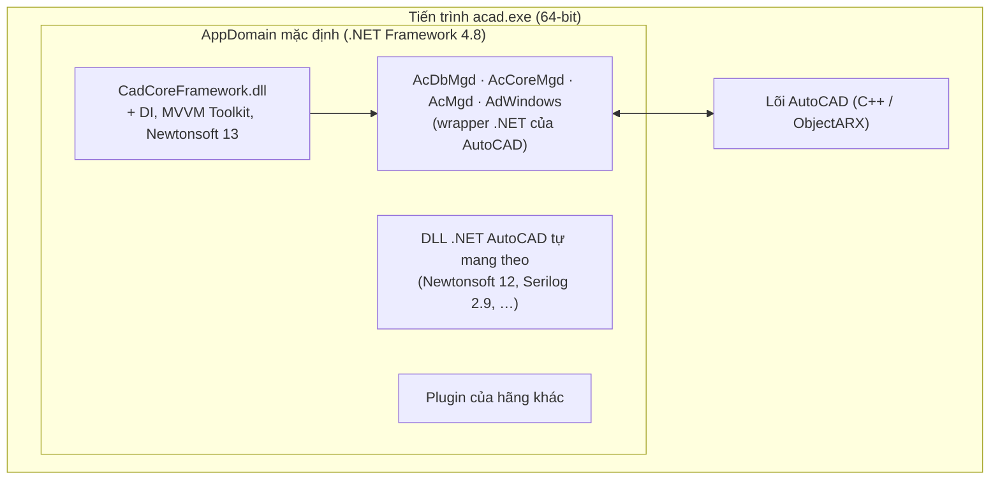
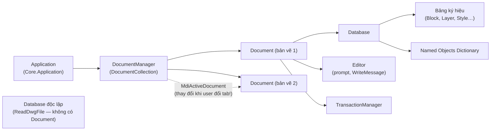
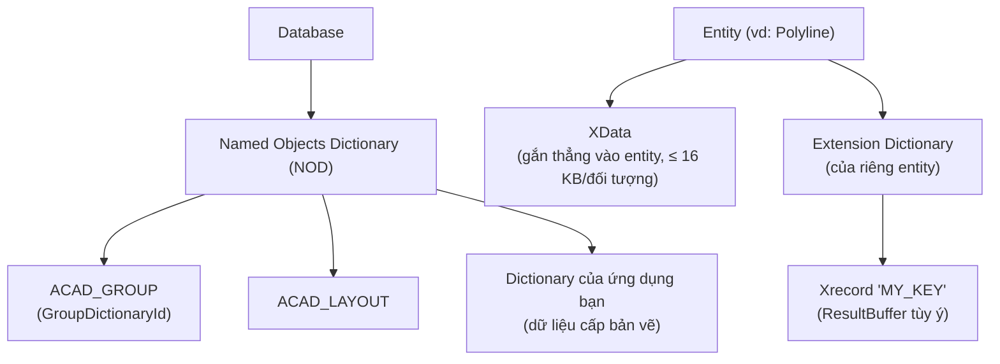
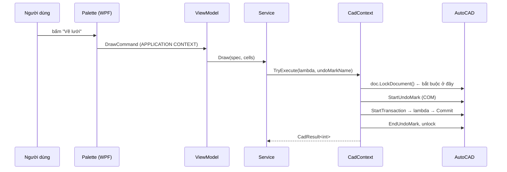

> **🎓 Học viện CadCoreFramework** · [Lộ trình](README.md) · [← C05](C05_ASYNC_TESTING_GIT.md) · **T01** · [T02 →](T02_ARCHITECTURE_DEEP_DIVE.md)

# T01 — Nền Tảng AutoCAD .NET

> **Cấp độ:** 🌱 Fresher → 🌿 Junior · **Cần trước:** [Giai đoạn 0](C00_START_HERE.md) (C00–C05) hoặc nền C# tương đương ([bài kiểm tra đầu vào](C00_START_HERE.md#6-bài-kiểm-tra-đầu-vào-bạn-nên-bắt-đầu-từ-đâu)); AutoCAD 2024 · **Trong lộ trình:** tuần 1–3 và 10 ([README §3](README.md#3-lộ-trình-đào-tạo))
>
> **⏱ Đọc:** ≈ 80 phút (phần 🎯 ≈ 50 phút) · **Thực hành:** L01–L05, L09, L10 ([T10 §2](T10_LABS_AND_ASSESSMENT.md#2-danh-sách-bài-lab)) · **Nhãn mục:** 🎯 cốt lõi · 🔍 đào sâu · 📖 tra cứu ([README §5](README.md#5-quy-ước-đọc))

Module này dạy **AutoCAD .NET API** ở mức đủ sâu để bạn hiểu *vì sao* CadCoreFramework được thiết kế như hiện tại. Mỗi khái niệm đều được nối với chỗ framework xử lý nó, để bạn thấy lý thuyết "sống" trong code.

**Sau module này bạn phải trả lời được:**
1. Một lambda đang chạy trong *command context* hay *application context*, và điều đó thay đổi gì?
2. Vì sao `Dispose()` một `Transaction` chưa `Commit()` **không** làm AutoCAD crash, và vì sao vẫn là lỗi?
3. Khi nào một đối tượng `new Line(...)` **phải** được `Dispose()` thủ công?
4. Vì sao plugin này không chạy được trong `accoreconsole.exe`?

---

## Mục lục

1. [Plugin sống ở đâu: AutoCAD, .NET và AppDomain dùng chung](#1-plugin-sống-ở-đâu-autocad-net-và-appdomain-dùng-chung) 🔍
2. [Object model: Application → Document → Database](#2-object-model-application--document--database) 🎯
3. [Bên trong Database: ObjectId, bảng ký hiệu, dictionary](#3-bên-trong-database-objectid-bảng-ký-hiệu-dictionary) 🎯
4. [Transaction: trái tim của mọi thao tác](#4-transaction-trái-tim-của-mọi-thao-tác) 🎯
5. [Document Lock và hai ngữ cảnh thực thi](#5-document-lock-và-hai-ngữ-cảnh-thực-thi) 🎯
6. [Lệnh (Command): đăng ký, instance, CommandFlags](#6-lệnh-command-đăng-ký-instance-commandflags) 🎯
7. [Editor: Prompt, hệ tọa độ, Selection](#7-editor-prompt-hệ-tọa-độ-selection) 🎯
8. [Threading và async trong AutoCAD](#8-threading-và-async-trong-autocad) 🔍
9. [Bộ nhớ và vòng đời đối tượng](#9-bộ-nhớ-và-vòng-đời-đối-tượng) 🎯
10. [Events (sự kiện)](#10-events-sự-kiện) 🔍
11. [Undo](#11-undo) 🔍
12. [Vòng đời plugin và cơ chế nạp assembly](#12-vòng-đời-plugin-và-cơ-chế-nạp-assembly) 🔍
13. [accoreconsole: AutoCAD không giao diện](#13-accoreconsole-autocad-không-giao-diện) 🔍
14. [Phụ lục: ErrorStatus thường gặp](#14-phụ-lục-errorstatus-thường-gặp) 📖

---

## 1. Plugin sống ở đâu: AutoCAD, .NET và AppDomain dùng chung

Plugin của bạn **không phải một chương trình độc lập**. Nó là một DLL được nạp *vào bên trong tiến trình* `acad.exe`, chạy chung với lõi C++ của AutoCAD, các DLL .NET của chính AutoCAD và **mọi plugin khác** mà người dùng cài.



Hệ quả trực tiếp:

| Sự thật | Hệ quả cho bạn | Framework xử lý ở đâu |
| :--- | :--- | :--- |
| Mọi plugin chung **một AppDomain** | Hai DLL cùng *identity* (tên + AssemblyVersion + public key) không thể nạp hai bản khác nhau | Gỡ Serilog, tự viết logger ([T03 A1](T03_PITFALLS_CASEBOOK.md#a1-serilog-missingmethodexception-ngay-khi-khởi-động)) |
| .NET Framework **không gỡ (unload) được** assembly | Nạp lại DLL cùng tên trả về bản cũ → muốn "hot reload" phải đổi tên assembly | `AssemblyName` có timestamp ở bản `DebugAcad` ([T02 §2](T02_ARCHITECTURE_DEEP_DIVE.md#2-khởi-động-và-tắt-appbootstrapper)) |
| Exception không bắt ở biên → có thể **làm sập AutoCAD** | Mọi điểm vào (lệnh, event handler, nút bấm) phải có try/catch | `CadCommandBase.ExecuteCommand`, `ViewModelBase.RunSafe` |
| API AutoCAD **đơn luồng** | Chỉ main thread được gọi API | [§8](#8-threading-và-async-trong-autocad) |

### 1.1 Ba DLL lõi và vai trò của chúng

| DLL | Namespace chính | Chứa gì | Có trong accoreconsole? |
| :--- | :--- | :--- | :---: |
| `AcDbMgd.dll` | `DatabaseServices`, `Geometry`, `Runtime`, `Colors` | Database, entity, transaction, hình học | ✅ |
| `AcCoreMgd.dll` | `ApplicationServices.Core`, `EditorInput`, `Runtime` (CommandMethod) | Document, Editor, prompt, lệnh, sysvar | ✅ |
| `AcMgd.dll` | `ApplicationServices`, `Windows` | **Giao diện**: `PaletteSet`, cửa sổ, menu | ❌ ([§13](#13-accoreconsole-autocad-không-giao-diện)) |
| `AdWindows.dll` | `Autodesk.Windows` | **Ribbon** (`ComponentManager`, `RibbonTab`…) | ❌ |

🔎 **Đọc code:** [`CadCoreFramework.csproj`](../../CadCoreFramework.csproj), phần `AutoCAD NuGet References`. Ba package `AutoCAD.NET*` đều có `ExcludeAssets="runtime"`. Nghĩa là: **dùng để biên dịch, nhưng không copy DLL AutoCAD ra thư mục output.** Nếu copy, NETLOAD có thể nạp một bản `AcDbMgd.dll` lạc lõng cạnh bản thật của AutoCAD, gây lỗi khó lường.

### 1.2 Bản đồ phiên bản

| AutoCAD | Mã release | .NET | Target của dự án |
| :--- | :---: | :--- | :--- |
| 2021 | R24.0 | .NET Framework 4.8 | `net48` |
| 2022 | R24.1 | .NET Framework 4.8 | `net48` |
| 2023 | R24.2 | .NET Framework 4.8 | `net48` |
| 2024 | R24.3 | .NET Framework 4.8 | `net48` ✅ đã kiểm chứng |
| 2025+ | R25.x | .NET 8 | `net8.0-windows` (build và test được, **chưa chạy thật**, ngoài phạm vi) |

Mã release xuất hiện trong [`Deployment/PackageContents.xml`](../../Deployment/PackageContents.xml) (`SeriesMin`/`SeriesMax`). Autoloader dùng nó để chọn đúng DLL cho từng phiên bản AutoCAD.

> [!NOTE]
> Một DLL `net48` build với `AutoCAD.NET 24.0.0` chạy được trên **cả 2021–2024**, vì API giữ tương thích nhị phân trong cùng series R24. Sang R25 (.NET 8) bắt buộc phải build lại.

### ✅ Tự kiểm tra §1

1. Vì sao plugin không thể dùng Serilog 3.x trên AutoCAD 2024, trong khi Newtonsoft 13 lại chạy được dù AutoCAD mang theo Newtonsoft 12?
2. Bỏ `ExcludeAssets="runtime"` thì chuyện gì xảy ra?

<details><summary>Đáp án</summary>

1. Serilog giữ `AssemblyVersion = 2.0.0.0` cho mọi bản 2.x/3.x. Identity của bản 3.x **trùng** bản 2.9 mà AutoCAD đã nạp trước, nên CLR trả về bản đã nạp (2.9) cho plugin. Code của plugin gọi method chỉ có ở 3.x, dẫn tới `MissingMethodException`. Newtonsoft 12 và 13 có AssemblyVersion **khác nhau** (`12.0.0.0` vs `13.0.0.0`), nên CLR coi đó là hai assembly khác nhau và nạp song song được.
2. Các DLL `AcDbMgd/AcCoreMgd/AcMgd` bị copy vào `bin`. Khi nạp plugin, các bản copy này có thể bị resolve thay cho bản thật trong thư mục AutoCAD. Kết quả là lỗi nạp hoặc crash khó chẩn đoán.
</details>

---

## 2. Object model: Application → Document → Database



| Đối tượng | Là gì | Lấy bằng |
| :--- | :--- | :--- |
| `Application` | Điểm vào toàn cục: sysvar, sự kiện `Idle`, `ShowModalWindow` | `Autodesk.AutoCAD.ApplicationServices.Core.Application` |
| `DocumentCollection` | Danh sách bản vẽ đang mở, sự kiện tạo/đóng/kích hoạt | `Application.DocumentManager` |
| `Document` | Một tab bản vẽ: Database + Editor + lock + sự kiện lệnh | `DocumentManager.MdiActiveDocument` hoặc duyệt collection |
| `Database` | Dữ liệu của file DWG. **Có thể tồn tại không cần Document** (side database) | `doc.Database`, hoặc `new Database(false, true)` + `ReadDwgFile` |
| `Editor` | Dòng lệnh: prompt, chọn đối tượng, in thông báo, UCS | `doc.Editor` |
| `HostApplicationServices.WorkingDatabase` | Database "đang làm việc" mà một số API ngầm dùng | Cần chú ý khi xử lý side database ([T07 §4](T07_PERFORMANCE_AND_SCALE.md#4-xử-lý-nhiều-bản-vẽ-side-database)) |

### 2.1 `MdiActiveDocument`: tiện nhưng nguy hiểm

`MdiActiveDocument` là bản vẽ **đang được focus tại thời điểm bạn đọc thuộc tính**. Nó **thay đổi** khi người dùng bấm sang tab khác. Ba tình huống thường gây lỗi:

1. **Sau `await`**: bắt đầu ở bản vẽ A, chờ 3 giây, người dùng sang bản vẽ B. Đọc `MdiActiveDocument` lúc này ra B và bạn vẽ nhầm. ([T03 B6](T03_PITFALLS_CASEBOOK.md#b6-vẽ-nhầm-bản-vẽ-sau-await))
2. **Trong event handler của Database**: event của bản vẽ A có thể bắn ra khi B đang active.
3. **Không có bản vẽ nào**: `MdiActiveDocument == null` (người dùng đóng hết tab).

Cách framework xử lý:
- [`ICadScope`](../../Core/ICadScope.cs) cung cấp `Document/Database/Editor` **đã chụp sẵn** khi vào scope. Code trong lambda dùng `scope.Document`, không đọc lại `MdiActiveDocument`.
- Analyzer **CAD001** cảnh báo khi Service/ViewModel đọc `MdiActiveDocument` trực tiếp ([T02 §11](T02_ARCHITECTURE_DEEP_DIVE.md#11-analyzer-cad001cad003)).
- [`CadContext.ExecuteAsync`](../../Core/CadContext.cs) chụp Document **trước** `await`.

### ✅ Tự kiểm tra §2

1. Database và Document khác nhau thế nào? Cho ví dụ cần Database mà không cần Document.
2. Vì sao `NotificationService` được phép dùng `MdiActiveDocument` (có `#pragma warning disable CAD001`)?

<details><summary>Đáp án</summary>

1. Document là "cửa sổ bản vẽ" (có Editor, lock, lệnh). Database là dữ liệu DWG. Đếm block trong 100 file DWG trên ổ đĩa mà không mở chúng lên giao diện thì dùng side database (`ReadDwgFile`), không cần Document.
2. Nó chỉ **in thông báo** lên dòng lệnh của bản vẽ đang active, không đọc/ghi dữ liệu bản vẽ. Thông báo nên hiện ở nơi người dùng đang nhìn. Đây là ngoại lệ kiến trúc có chủ đích, được ghi chú rõ trong [`NotificationService.cs`](../../Core/NotificationService.cs).
</details>

---

## 3. Bên trong Database: ObjectId, bảng ký hiệu, dictionary

### 3.1 `ObjectId` vs `Handle` vs `DBObject`

| Khái niệm | Bản chất | Sống bao lâu | Dùng để |
| :--- | :--- | :--- | :--- |
| `ObjectId` | Con trỏ phiên làm việc tới một đối tượng | **Chỉ trong phiên AutoCAD hiện tại** | Tham chiếu trong code, truyền giữa các hàm |
| `Handle` | Số hex lưu trong file DWG | **Vĩnh viễn** theo file | Lưu tham chiếu ra ngoài (JSON, database nghiệp vụ) |
| `DBObject` | Đối tượng .NET bọc đối tượng C++ đang "mở" | **Chỉ trong transaction đã mở nó** | Đọc/ghi thuộc tính |

> [!WARNING]
> **Không bao giờ giữ `DBObject` qua hai transaction.** Hãy giữ `ObjectId`, rồi mở lại trong transaction sau. Còn nếu cần lưu ra file thì dùng `Handle`, vì `ObjectId` của lần mở sau sẽ khác.

`ObjectId` có các thuộc tính "rẻ", đọc được mà **không cần mở đối tượng** (đã kiểm chứng trong `AcDbMgd.dll`): `IsNull`, `IsErased`, `IsValid`, `Handle`, `Database` và đặc biệt là **`ObjectClass`**, kiểu runtime (RXClass) của đối tượng.

🔎 **Đọc code:** [`GridMarkerService.CountMarkers`](../../Samples/GridMarker/GridMarkerService.cs) so sánh `id.ObjectClass` *trước* khi `GetObject`. Mở đối tượng tốn hơn nhiều so với đọc `ObjectClass`, nên lọc trước như vậy là kỹ thuật hiệu năng quan trọng ([T07 §2](T07_PERFORMANCE_AND_SCALE.md#2-lọc-trước-khi-mở-objectclass)).

### 3.2 Bảng ký hiệu (Symbol Tables)

Mỗi Database có các bảng cố định. Mỗi bảng chứa các *record* có **tên duy nhất**:

| Bảng | Record | Ví dụ dùng trong framework |
| :--- | :--- | :--- |
| `BlockTable` | `BlockTableRecord` (Model Space, Paper Space, định nghĩa block) | `CreateBlockDefinition`, `InsertBlock` |
| `LayerTable` | `LayerTableRecord` | `EnsureLayer`, `LayerService` |
| `TextStyleTable` | `TextStyleTableRecord` | `EnsureTextStyle` |
| `LinetypeTable` | `LinetypeTableRecord` | `EnsureLinetype` |
| `DimStyleTable` | `DimStyleTableRecord` | `EnsureDimStyle` |
| `RegAppTable` | `RegAppTableRecord` (tên ứng dụng của XData) | `XDataHelper.EnsureRegApp` |
| `UcsTable`, `ViewTable`, `ViewportTable` | … | — |

Ba quy tắc khi làm việc với bảng:
1. **Kiểm tra `Has(name)` trước khi dùng indexer `table[name]`.** Indexer với tên không tồn tại ném `eKeyNotFound`. Mọi hàm `Ensure*` trong [`CadScopeLayerExtensions.cs`](../../Extensions/CadScopeLayerExtensions.cs) đều theo mẫu này.
2. **Tên phải hợp lệ.** Ký tự như `< > / \ " : ; ? * | , = `` ` `` bị cấm; gán tên sai thì AutoCAD ném `eInvalidInput` mà không nói ký tự nào sai (đã kiểm chứng). Validate bằng `SymbolUtilityServices.ValidateSymbolName(name, false)` hoặc luật thuần .NET [`SymbolNameRules`](../../Utils/SymbolNameRules.cs) của dự án — mọi `Ensure*`, `CreateBlockDefinition`, `EnsureRegApp` và [`GridSpec.Validate`](../../Samples/GridMarker/GridSpec.cs) dùng nó, ném `ArgumentException` nêu rõ ký tự sai (B-16 ở [T09](T09_SENIOR_PLAYBOOK.md#3-backlog-kỹ-thuật-đã-kiểm-chứng), PR #6).
3. **Thêm record mới cần 2 bước:** `table.Add(record)` rồi `tr.AddNewlyCreatedDBObject(record, true)`.

### 3.3 `BlockTableRecord`: mọi entity đều có "nhà"

Mọi entity (Line, Circle…) đều **thuộc** một `BlockTableRecord`:
- `*Model_Space`: không gian mô hình.
- `*Paper_Space`, `*Paper_Space0`…: mỗi Layout một BTR.
- Định nghĩa block có tên (`"DOOR"`), và block **ẩn danh** (`*U12`, `*D3`…). AutoCAD tự tạo block ẩn danh cho dynamic block đã chỉnh tham số, cho kích thước (dimension)…

`Database.CurrentSpaceId` là BTR của không gian đang làm việc (Model hoặc Layout hiện hành). Framework mở nó sẵn trong mọi scope: `scope.CurrentSpace`.

### 3.4 Dictionary, Extension Dictionary, Xrecord



| Nơi lưu | Phạm vi | Giới hạn | Đi theo entity khi copy/WBLOCK? |
| :--- | :--- | :--- | :---: |
| **XData** | Một đối tượng | **16 KB tổng cộng / đối tượng** (mọi app cộng lại); mỗi chuỗi mã 1000 ≤ 255 ký tự | ✅ |
| **Xrecord trong Extension Dictionary** | Một đối tượng | Thực tế rất lớn (chia nhiều `TypedValue`) | ✅ (là đối tượng con) |
| **Xrecord/Dictionary trong NOD** | Cả bản vẽ | Rất lớn | ❌ (không gắn với entity nào) |

> [!WARNING]
> Một tài liệu cũ của dự án từng ghi XData "giới hạn 16 KB **trên toàn bộ bản vẽ**". **Sai.** Giới hạn tính **trên mỗi đối tượng** (gộp mọi ứng dụng gắn XData lên đối tượng đó).

Cách framework triển khai (đọc kỹ ở [T02 §6](T02_ARCHITECTURE_DEEP_DIVE.md#6-extensions-và-utils-api-vẽ-một-dòng)):
- [`XDataHelper`](../../Utils/XDataHelper.cs): JSON → chia khúc 250 ký tự (mã 1000), chặn ở 15.000 ký tự.
- [`XRecordHelper`](../../Utils/XRecordHelper.cs): JSON → chia khúc 2000 ký tự (mã `DxfCode.Text`) trong Xrecord của Extension Dictionary.

### ✅ Tự kiểm tra §3

1. Bạn cần lưu "entity này liên kết với thiết bị ID 42 trong hệ thống ERP" và đọc lại sau khi mở file lần sau. Lưu `ObjectId` hay `Handle`? Lưu ở đâu?
2. Vì sao `layerTable["ABC"]` có thể ném exception, còn `layerTable.Has("ABC")` thì không?
3. Một dynamic block "DOOR" sau khi người dùng kéo giãn thì `BlockReference.Name` còn là `"DOOR"` không?

<details><summary>Đáp án</summary>

1. Gắn ID nghiệp vụ (42) **lên entity** bằng XData hoặc XRecord. Nếu hệ thống ngoài cần tham chiếu ngược lại entity thì lưu **`Handle`** (bền theo file), không lưu `ObjectId`.
2. Indexer giả định tên tồn tại và ném `eKeyNotFound` nếu không có. `Has` chỉ kiểm tra.
3. Không. Nó tham chiếu một BTR ẩn danh `*Uxx`. Tên gốc ("effective name") phải lấy qua `DynamicBlockTableRecord`, xem [`DynamicBlockHelper.GetEffectiveName`](../../Utils/DynamicBlockHelper.cs).
</details>

---

## 4. Transaction: trái tim của mọi thao tác

### 4.1 Vòng đời

```csharp
// API thô của AutoCAD (để HIỂU — trong dự án hãy dùng ICadContext)
Database db = doc.Database;
using (Transaction tr = db.TransactionManager.StartTransaction())
{
    var space = (BlockTableRecord)tr.GetObject(db.CurrentSpaceId, OpenMode.ForWrite);
    var line = new Line(Point3d.Origin, new Point3d(10, 10, 0));
    space.AppendEntity(line);                 // 1. đưa vào database
    tr.AddNewlyCreatedDBObject(line, true);   // 2. giao cho transaction quản lý
    tr.Commit();                              // 3. xác nhận thay đổi
}                                             // 4. Dispose: đóng mọi đối tượng đã mở
```

| Kết thúc bằng | Kết quả |
| :--- | :--- |
| `Commit()` rồi `Dispose()` | Thay đổi được ghi vào database |
| `Dispose()` **không** `Commit()` (kể cả do exception) | **Abort: mọi thay đổi bị hủy (rollback).** AutoCAD **không** crash |
| `Abort()` tường minh | Như trên |

> [!IMPORTANT]
> **Huyền thoại cần xóa bỏ:** một phiên bản cũ của tài liệu dự án ghi "quên `tr.Commit()` thì AutoCAD crash ngay". **Không đúng.** Quên Commit thì **thay đổi lặng lẽ biến mất**. Lỗi này *nguy hiểm hơn* crash vì không ai thấy. Đó là lý do [`CadContext.ExecuteCore`](../../Core/CadContext.cs) luôn tự `Commit()` sau khi lambda chạy xong không lỗi, và để `using` tự Abort khi có exception.

### 4.2 OpenMode

| Mode | Dùng khi | Ghi chú |
| :--- | :--- | :--- |
| `ForRead` | Chỉ đọc | Rẻ, nhiều nơi cùng đọc được |
| `ForWrite` | Sẽ sửa | AutoCAD ghi nhận undo và gửi thông báo. Sửa đối tượng mở `ForRead` làm AutoCAD **dừng hẳn**: `INTERNAL ERROR: … eNotOpenForWrite`, `try/catch` không bắt được (đã thử gán `ColorIndex`, `AppendEntity`, `Erase` trên accoreconsole AutoCAD 2024) |
| `ForNotify` | Hiếm (chỉ cần gửi thông báo) | — |

Hai thao tác chuyển mode trên đối tượng đã mở: `UpgradeOpen()` (Read → Write) và `DowngradeOpen()`.

🔎 **Đọc code:** [`CadContext.CadScope.AppendEntityToCurrentSpace`](../../Core/CadContext.cs). `CurrentSpace` được mở **ForRead** khi vào scope, và chỉ `UpgradeOpen()` khi thật sự append entity đầu tiên. [`EnsureLayer`](../../Extensions/CadScopeLayerExtensions.cs) (và các `Ensure*` khác) cũng vậy từ PR #6: mở bảng **ForRead**, `UpgradeOpen()` chỉ khi phải thêm record. Cả hai cách (ForWrite ngay, hay ForRead rồi upgrade) đều đúng trong một transaction; ForRead rồi upgrade rẻ hơn khi phần lớn lần gọi không ghi gì (layer thường đã có) — mở ForWrite là ghi nhận undo và gửi thông báo dù không đổi gì. (Trên v1.0.0, `EnsureLayer` mở ForWrite ngay và comment giải thích bằng `eVetoed` — không phải lý do thật, [T09 B-19](T09_SENIOR_PLAYBOOK.md#3-backlog-kỹ-thuật-đã-kiểm-chứng).)

### 4.3 Transaction lồng nhau

AutoCAD **cho phép** transaction lồng nhau: `StartTransaction()` khi đang có transaction mở sẽ tạo transaction con. Quy tắc:
- Transaction con phải kết thúc **trước** transaction cha.
- Abort transaction cha thì hủy luôn những gì con đã commit.
- `TransactionManager.TopTransaction` là transaction trong cùng đang mở; `NumberOfActiveTransactions` là độ sâu.

Framework **cấm** lồng `ICadContext.Execute` bằng [`CadContextGuard`](../../Core/CadContextGuard.cs). Lý do không phải vì AutoCAD không cho, mà là **quy tắc thiết kế**: một lần gọi `Execute` là một đơn vị công việc trọn vẹn (một lock, một transaction, một bước Undo). Lồng nhau làm mờ ranh giới commit/undo, và thường là dấu hiệu một Service gọi Service khác bên trong lambda. Chi tiết ở [T02 §4.6](T02_ARCHITECTURE_DEEP_DIVE.md#46-cadcontextguard-chặn-lồng-nhau).

### 4.4 Commit hay Abort cho transaction chỉ đọc?

**Commit.** Với transaction không sửa gì, Commit rẻ hơn Abort, vì Abort phải chạy cơ chế rollback. [`CadContext.ExecuteRead`](../../Core/CadContext.cs) vì vậy kết thúc bằng `tr.Commit()`, có comment giải thích.

> [!WARNING]
> Hệ quả ít ai để ý: nếu code trong `ExecuteRead` **lỡ** mở một đối tượng `ForWrite` và sửa nó, thay đổi **sẽ được commit**. `IsReadOnly` của scope chỉ chặn `AppendEntityToCurrentSpace` và các hàm XRecord, chứ không chặn được `GetObject(…, ForWrite)` lúc chạy. Từ PR #6, analyzer **CAD003** cảnh báo `ForWrite`/`UpgradeOpen()` viết trong lambda của `ExecuteRead` ngay lúc build. Xem [T09 B-07](T09_SENIOR_PLAYBOOK.md#3-backlog-kỹ-thuật-đã-kiểm-chứng).

### 4.5 `StartOpenCloseTransaction`

`TransactionManager.StartOpenCloseTransaction()` tạo transaction **nhẹ** theo mô hình Open/Close: không tham gia ngăn xếp transaction lồng nhau như transaction thường. Dùng khi cần mở đối tượng **bên trong event handler hoặc Overrule**, những nơi không nên đụng tới transaction đang chạy của lệnh. Code nghiệp vụ thông thường dùng transaction thường (qua `ICadContext`).

### 4.6 `AddNewlyCreatedDBObject`: bước hay bị quên

`AppendEntity` đưa entity vào database. `AddNewlyCreatedDBObject(obj, true)` **giao vòng đời** của nó cho transaction, để transaction đóng nó khi kết thúc. Quên bước 2 thì đối tượng mới không được đóng đúng cách. Hậu quả khó lường, có thể là lỗi lúc đóng bản vẽ hoặc dữ liệu không như mong đợi.

Framework gom hai bước vào **một chỗ duy nhất**: `ICadScope.AppendEntityToCurrentSpace`. Mọi hàm `Draw*` đều đi qua đó. Code nghiệp vụ không bao giờ phải nhớ bước 2. Riêng các record bảng ký hiệu, `Xrecord`, `Group`, `AttributeReference` thì các helper tự gọi `AddNewlyCreatedDBObject` (đọc [`BlockHelper.InsertBlock`](../../Utils/BlockHelper.cs) để thấy mẫu với attribute).

### 🧪 Thử ngay (Lab L03)

Dùng API thô, viết trong [`labs/L03/Experiments.cs`](../../labs/L03/Experiments.cs) rồi chạy `.\labs\run-lab.ps1 -Lab L03`:
1. Vẽ một Line nhưng **bỏ** `tr.Commit()`. Quan sát: không crash, không có Line.
2. Mở một Line có sẵn `ForRead` rồi gán `line.ColorIndex = 1`. Quan sát: AutoCAD **dừng hẳn** với `INTERNAL ERROR: !dbobji.cpp@…: eNotOpenForWrite`. Đó là fatal error, không phải exception.
3. Gọi `tr.GetObject` **sau khi** transaction đã Dispose. Quan sát: AutoCAD dừng hẳn với `FATAL ERROR: Unhandled Access Violation`.

Thí nghiệm 2 và 3 làm sập AutoCAD (đã thử trên accoreconsole của AutoCAD 2024). Runner chạy mỗi thí nghiệm trong một phiên accoreconsole riêng, nên AutoCAD bạn đang làm việc không bị ảnh hưởng. Bài học: với hai lỗi này, `try/catch` không cứu được; chỉ có viết đúng ngay từ đầu.

### ✅ Tự kiểm tra §4

1. Lambda trong `Execute` ném exception ở entity thứ 50/100. Bao nhiêu entity còn lại trong bản vẽ?
2. Vì sao không nên lưu một `Polyline` vào field của ViewModel để dùng lại lần sau?

<details><summary>Đáp án</summary>

1. **0.** Exception thoát khỏi `using`, transaction bị Abort, toàn bộ 49 entity đã thêm bị rollback. Đây là tính *nguyên tử* (atomic) mà framework dựa vào.
2. `Polyline` mở trong transaction chỉ hợp lệ trong transaction đó. Lần sau đối tượng đã bị đóng, dùng lại là lỗi. Hãy lưu `ObjectId` (trong phiên) hoặc `Handle` (bền vững).
</details>

---

## 5. Document Lock và hai ngữ cảnh thực thi

Đây là khái niệm **quan trọng nhất** để viết plugin có giao diện. Phần lớn lỗi `eLockViolation` đến từ việc không hiểu nó.

### 5.1 Hai ngữ cảnh

| | **Command context** | **Application context** |
| :--- | :--- | :--- |
| Khi nào | Bên trong một lệnh Modal (mặc định) đang chạy | Nút bấm Palette, cửa sổ modeless, `Application.Idle`, timer, lệnh có cờ `CommandFlags.Session` |
| Document lock | AutoCAD **đã lock sẵn** bản vẽ hiện hành | **Không** có lock |
| Ghi database | Được | Phải tự `doc.LockDocument()`, nếu không sẽ gặp **`eLockViolation`** |
| Prompt (`GetPoint`…) | Được | Không tin cậy / không nên. Đưa input lên form, hoặc chuyển sang command context |
| Undo | AutoCAD tự gom cả lệnh thành 1 bước | Cần chủ động gom ([§11](#11-undo)) |
| Kiểm tra | `Application.DocumentManager.IsApplicationContext` | |



### 5.2 `DocumentLock` và `DocumentLockMode`

`doc.LockDocument()` trả về `DocumentLock : IDisposable`. **Luôn dùng `using`.** Lock **đếm số lần** (reference-counted): lock lồng nhau là hợp lệ, nên `Execute` có thể luôn gọi `LockDocument()` kể cả khi đang ở command context. Overload đầy đủ: `LockDocument(DocumentLockMode, string globalCommandName, string localCommandName, bool promptIfFails)`.

`DocumentLockMode` (đã kiểm chứng): `None, AutoWrite, NotLocked, Write, ProtectedAutoWrite, Read, ExclusiveWrite`. Trong thực tế hầu như chỉ dùng overload không tham số (Write).

🔎 **Đọc code:** [`CadContext`](../../Core/CadContext.cs)
- `ExecuteCore`: **luôn** `LockDocument()`. Đúng cho cả hai ngữ cảnh.
- `ExecuteRead`: chỉ lock khi `IsApplicationContext`. Trong command context, lệnh đã giữ lock sẵn.

### 5.3 Đi từ application context sang command context

Đôi khi cần chạy như một lệnh thật từ nút bấm Palette, ví dụ để được prompt người dùng chọn điểm. Có hai cách:

| Cách | Hành vi | Dùng khi |
| :--- | :--- | :--- |
| `doc.SendStringToExecute("\x03\x03_.TÊN_LỆNH ", true, false, false)` | Đẩy chuỗi vào hàng đợi lệnh. Chạy **sau khi** handler hiện tại trả về. Không chờ được kết quả | Nút bấm chỉ cần kích hoạt một lệnh có sẵn. [`RibbonCommandHandler`](../../Core/RibbonService.cs) dùng cách này |
| `await Application.DocumentManager.ExecuteInCommandContextAsync(async _ => { … }, null)` | Chạy callback **trong command context**, `await` được (trả về `ExecutionResult` có `GetAwaiter`) | Cần chạy chuỗi thao tác như một lệnh rồi tiếp tục xử lý kết quả |

Trong chuỗi `"\x03\x03_.TÊN_LỆNH "`:
- `\x03\x03`: hai lần ESC, hủy lệnh đang chạy (nếu có).
- `_`: dùng tên lệnh **global**, không phụ thuộc ngôn ngữ AutoCAD.
- `.`: dùng lệnh gốc kể cả khi đã bị `UNDEFINE`.
- Dấu cách cuối: tương đương Enter.

### ✅ Tự kiểm tra §5

1. Nút "Tắt layer" trên palette gọi thẳng `layerRecord.IsOff = true` trong một transaction tự mở, không lock. Lỗi gì?
2. Vì sao `ExecuteCore` lock *cả* khi đang ở command context mà không lỗi?
3. Palette muốn "chọn điểm trên màn hình rồi vẽ". Thiết kế thế nào cho đúng?

<details><summary>Đáp án</summary>

1. `eLockViolation`. Palette chạy ở application context, chưa có lock.
2. Lock được đếm số lần (reference-counted). Lock thêm một lần trong lệnh là hợp lệ và được nhả khi `Dispose`.
3. Hai lựa chọn: (a) nút bấm gửi một lệnh, ví dụ `SAMPLE_GRID` qua `SendStringToExecute`, để lệnh prompt người dùng; (b) dùng `ExecuteInCommandContextAsync`. Golden Sample chọn cách khác nữa: palette **nhập tọa độ trên form** (không prompt) và để lệnh `SAMPLE_GRID` lo kịch bản pick bằng chuột ([R05 §4](../reference/R05_GOLDEN_SAMPLE.md#4-nguyên-tắc-3--hiểu-đúng-ngữ-cảnh-command-vs-palette)).
</details>

---

## 6. Lệnh (Command): đăng ký, instance, CommandFlags

### 6.1 Đăng ký

```csharp
// Properties/AssemblyInfo.cs — khai báo class nào chứa lệnh
[assembly: Autodesk.AutoCAD.Runtime.CommandClass(typeof(CadCoreFramework.Commands.SampleCommands))]

public class SampleCommands : CadCommandBase
{
    [CommandMethod("CORE_INFO")]          // tên global = local = CORE_INFO, cờ mặc định Modal
    public void CoreInfoCommand() { … }
}
```

- Khi assembly có khai báo `[assembly: CommandClass]`, AutoCAD **chỉ quét các class được khai báo**. Quên khai báo thì lệnh "không tồn tại" (`Unknown command`). Dự án gom khai báo vào [`Properties/AssemblyInfo.cs`](../../Properties/AssemblyInfo.cs). Riêng các lệnh demo tự khai báo trong [`Demos/DemoAssemblyInfo.cs`](../../Demos/DemoAssemblyInfo.cs) để công tắc `IncludeDemos` gỡ được trọn gói.
- **Đặt tiền tố riêng** cho tên lệnh (`CORE_`, `SAMPLE_`, `CADCORE_`, `DEMO_`) để không đụng lệnh của plugin khác.

### 6.2 Instance method: mỗi bản vẽ một đối tượng

Với lệnh là **instance method** (không `static`), AutoCAD tạo **một instance của class cho mỗi Document**, ở lần đầu lệnh được gọi trong Document đó, bằng **constructor không tham số**.

Hệ quả:
- Field trong class lệnh là **trạng thái theo từng bản vẽ**. Hữu ích (nhớ lựa chọn cuối của người dùng theo bản vẽ) nhưng dễ gây bất ngờ.
- **AutoCAD không biết DI.** Không thể inject qua constructor cho lệnh do AutoCAD tạo. Đây là lý do [`CadCommandBase`](../../Commands/CadCommandBase.cs) dùng `GetRequiredService<T>()` (service locator ở **biên**). Constructor injection chỉ dùng cho unit test ([T02 §5](T02_ARCHITECTURE_DEEP_DIVE.md#5-cadcommandbase-biên-giới-của-mọi-lệnh)).

### 6.3 `CommandFlags`

Các giá trị có trong AutoCAD 2024 (đã kiểm chứng): `Modal, Transparent, UsePickSet, Redraw, NoPerspective, NoMultiple, NoTileMode, NoPaperSpace, NoOem, Undefined, InProgress, Defun, NoNewStack, NoInternalLock, DocReadLock, DocExclusiveLock, Session, Interruptible, NoHistory, NoUndoMarker, NoBlockEditor, NoActionRecording, ActionMacro, NoInferConstraint, TempShowDynDimension`.

Những cờ bạn **thật sự** sẽ dùng:

| Cờ | Ý nghĩa | Khi nào |
| :--- | :--- | :--- |
| `Modal` (mặc định) | Lệnh thường, document được lock sẵn | Gần như mọi lệnh |
| `UsePickSet` | Nhận các đối tượng người dùng đã chọn *trước* khi gõ lệnh (`Editor.SelectImplied()`) | Lệnh kiểu "chọn rồi gõ" |
| `Redraw` | Giữ lại selection/grip sau lệnh | Kết hợp với `UsePickSet` |
| `Transparent` | Gọi được *giữa chừng* lệnh khác (`'LỆNH`) | Lệnh tra cứu, không sửa dữ liệu |
| `Session` | Chạy ở **application context**: tự lock, đổi được bản vẽ đang mở | Lệnh mở/đóng/chuyển bản vẽ |
| `NoUndoMarker` | Không tạo bước Undo | Lệnh chỉ đọc, không muốn làm "bẩn" lịch sử Undo |
| `NoBlockEditor` / `NoPaperSpace` | Chặn lệnh ở các môi trường đó | Lệnh chỉ đúng trong Model Space |

### ✅ Tự kiểm tra §6

1. Bạn thêm class `PanelCommands` có 3 lệnh, build, NETLOAD, gõ lệnh thì báo `Unknown command`. Kiểm tra gì đầu tiên?
2. Vì sao không thể viết `public PanelCommands(IPanelService service)` cho class lệnh?

<details><summary>Đáp án</summary>

1. Dòng `[assembly: CommandClass(typeof(PanelCommands))]` trong `Properties/AssemblyInfo.cs`.
2. AutoCAD tự tạo instance bằng constructor **không tham số**, không có DI container nào cung cấp `IPanelService`. Lấy service bằng `GetRequiredService<T>()` bên trong `ExecuteCommand`.
</details>

---

## 7. Editor: Prompt, hệ tọa độ, Selection

### 7.1 Mẫu prompt chuẩn

```csharp
var opts = new PromptPointOptions("\nChọn điểm: ");   // 1. Options
PromptPointResult res = ed.GetPoint(opts);            // 2. Gọi Editor
if (res.Status != PromptStatus.OK) return;            // 3. Kiểm tra Status
Point3d ucsPoint = res.Value;                         // 4. Lấy giá trị (hệ UCS!)
```

`PromptStatus` (đã kiểm chứng): `None, Modeless, Other, OK, Keyword, Cancel, Error`. Nhấn **ESC** khi đang prompt cho kết quả `Cancel`, **không** phải exception. [`CadPromptHelper`](../../Utils/CadPromptHelper.cs) quy mọi status khác `OK` về `null` (hoặc `ObjectId.Null`, mảng rỗng): caller chỉ cần `if (x == null) return;`.

Một số thao tác khác (ví dụ ESC khi đang chạy một số API dài) ném `Autodesk.AutoCAD.Runtime.Exception` với `ErrorStatus.UserBreak`. `CadCommandBase.ExecuteCommand` bắt riêng trường hợp này, không in lỗi và không ghi vào lịch sử lệnh.

### 7.2 Luật thép: HỎI trước, VẼ sau

**Không prompt bên trong transaction / lock.** Lúc prompt, AutoCAD chờ người dùng vô thời hạn trong khi transaction và lock đang mở. Gom toàn bộ input trước, rồi mới gọi `ICadContext`. Golden Sample ([`GridMarkerCommands`](../../Samples/GridMarker/GridMarkerCommands.cs)) theo đúng thứ tự: **prompt → validate → plan → service → báo kết quả.** Các hàm `scope.Ask*()` (prompt *trong* scope) đã bị đánh dấu `[Obsolete]` vì vi phạm luật này.

### 7.3 Ba hệ tọa độ: WCS, UCS, OCS

| Hệ | Là gì | Ai dùng |
| :--- | :--- | :--- |
| **WCS** (World) | Hệ gốc, cố định | **Database**: tọa độ entity (Line, Circle center…) |
| **UCS** (User) | Hệ người dùng xoay/dời tùy ý | **Editor**: `GetPoint`, `GetCorner`, `GetDistance` trả về **UCS** |
| **OCS** (Object) | Hệ riêng của entity phẳng (theo `Normal`) | `Polyline` (đỉnh `Point2d` + `Elevation`), Text, Hatch… |

Chuyển UCS → WCS: `ucsPoint.TransformBy(ed.CurrentUserCoordinateSystem)`. [`CadPromptHelper.GetPoint`](../../Utils/CadPromptHelper.cs) làm việc này **tự động** (tham số `convertToWcs = true`), và chuyển `basePoint` theo chiều ngược lại. Các hàm vẽ của framework nhận tọa độ **WCS**. Lưu ý: `DrawRectangle` dựng hình chữ nhật **song song trục X/Y của WCS**, nên khi UCS bị xoay thì hình vẫn thẳng theo WCS.

### 7.4 Selection và `SelectionFilter`

Bộ lọc là mảng `TypedValue(mã DXF, giá trị)`:

| Mã DXF | Lọc theo | Ví dụ |
| :---: | :--- | :--- |
| 0 | Loại entity (tên DXF) | `"LINE,CIRCLE"` (dấu phẩy = HOẶC) |
| 2 | Tên block | `"DOOR"`. ⚠️ dynamic block đã chỉnh có tên `*Uxx` |
| 8 | Layer | `"WALL*"` (có wildcard) |
| 62 | Màu ACI | `1`. ⚠️ entity màu *ByLayer* có giá trị 256, không phải màu của layer |
| 1001 | Có XData của app | `"CADCORE_GRID_MARKER"` |
| -4 | Toán tử logic | `"<OR"` … `"OR>"`, `"<AND"`, `"<NOT"` |

Ký tự wildcard trong giá trị chuỗi: `* ? # @ . ~ [ ] - , `` ` ``. Một số trong đó **hợp lệ trong tên** layer/block — `#` (một chữ số), `@` (một chữ cái), `.` (một ký tự không phải chữ/số), `~`, `[ ]`, `-` — nên một tên hoàn toàn bình thường vẫn bị hiểu thành mẫu: layer `LAB#1` **không khớp chính nó**, `M.EQUIP` khớp cả `M-EQUIP` (đã kiểm chứng trên AutoCAD 2024). (`* ? ,` không hợp lệ trong tên ký hiệu, nên không gặp ở tên.) Muốn khớp **nguyên văn** thì escape từng ký tự bằng dấu backquote `` ` ``. [`SelectionFilterBuilder`](../../Utils/SelectionFilterBuilder.cs): `OnLayers`/`WithBlockNames` nhận **mẫu** (ghép bằng dấu phẩy, không escape); `OnLayersExact`/`WithBlockNamesExact` nhận **tên** và tự escape (`EscapeWildcards`).

**Implied selection** (chọn trước rồi gõ lệnh): khai báo `CommandFlags.UsePickSet` và gọi `ed.SelectImplied()`.

### ✅ Tự kiểm tra §7

1. Người dùng xoay UCS 30°, chạy lệnh vẽ Line giữa 2 điểm pick bằng `ed.GetPoint` thô, không chuyển hệ. Line lệch thế nào?
2. Lọc `WithBlockNames("DOOR")` bỏ sót những cửa nào? Sửa thế nào?

<details><summary>Đáp án</summary>

1. Tọa độ UCS bị hiểu như WCS: Line bị xoay/dời so với chỗ người dùng click (lệch 30° quanh gốc UCS). `CadPromptHelper.GetPoint` tránh được lỗi này.
2. Bỏ sót các dynamic block "DOOR" đã chỉnh tham số (tên `*Uxx`). Sửa: lọc `` "DOOR,`*U*" ``, rồi lọc lại sau khi chọn bằng effective name (`DynamicBlockHelper.GetEffectiveName`). Xem [T03 B12](T03_PITFALLS_CASEBOOK.md#b12-lọc-block-theo-tên-bỏ-sót-dynamic-block).
</details>

---

## 8. Threading và async trong AutoCAD

### 8.1 Quy tắc tuyệt đối

> [!CAUTION]
> **Chỉ main thread (UI thread) của AutoCAD được gọi AutoCAD API.** Gọi `Database`, `Transaction`, `Editor`, `Document`… từ thread khác (ThreadPool, `Task.Run`, `System.Timers.Timer`) cho hành vi **không xác định**: lúc chạy được, lúc hỏng dữ liệu, lúc crash.

| Được làm ngoài main thread | **Không** được làm ngoài main thread |
| :--- | :--- |
| Tính toán thuần (Planner, hình học bằng `double`) | Mở/sửa bất kỳ `DBObject` nào |
| Đọc/ghi file, gọi HTTP, truy vấn SQL | `Editor.WriteMessage`, prompt |
| Serialize JSON | Đọc `MdiActiveDocument`, sysvar |

### 8.2 `async/await` và `SynchronizationContext`

`await` mặc định quay về **`SynchronizationContext`** đã chụp lúc bắt đầu `await`. Nếu bạn `await` trên main thread và main thread có context, phần sau `await` chạy lại trên main thread, và an toàn. Ngược lại:
- `ConfigureAwait(false)` trong code *sẽ chạm AutoCAD* sau đó khiến phần tiếp theo chạy trên ThreadPool. **Nguy hiểm.**
- Không có `SynchronizationContext` (ví dụ đang ở thread nền) thì phần tiếp theo cũng chạy trên ThreadPool.

🔎 **Đọc code:** [`CadAsyncHelper.ExecuteSafeAsync`](../../Utils/CadAsyncHelper.cs) **chụp context của main thread trước**, ném lỗi rõ ràng nếu không có, chạy việc nặng bằng `Task.Run`, rồi `Post` kết quả về main thread **một cách tường minh**. Đây là mẫu an toàn nhất. `CadContext.ExecuteAsync` cũng kiểm tra context khi bắt đầu, và kiểm lại đang ở main thread sau `await` (từ PR #6, [T09 B-06](T09_SENIOR_PLAYBOOK.md#3-backlog-kỹ-thuật-đã-kiểm-chứng)); trên v1.0.0 nó không kiểm.

### 8.3 Lệnh async thực chất chạy thế nào

Khi method của lệnh chạm tới `await` đầu tiên và trả quyền, AutoCAD coi **lệnh đã kết thúc**: lock được nhả, bước Undo đóng lại. Phần sau `await` chạy ở **application context**. Vì vậy:
1. Mọi thao tác ghi sau `await` phải tự lock. `ICadContext.Execute` luôn lock nên vẫn an toàn.
2. Bản vẽ active có thể **đã đổi**. Phải chụp `Document` trước `await` (đúng điều `ExecuteAsync` làm).
3. Bản vẽ có thể **đã bị đóng**. Kiểm tra `doc.IsDisposed` trước khi lock (cũng có trong `ExecuteAsync`).
4. `CommandHistory` ghi nhận lệnh "thành công" ngay khi phần đồng bộ xong, trước khi phần async chạy.
5. Bản vẽ đã chụp có thể **không còn active**: vẽ vào `Database` của nó vẫn được, nhưng **Editor** của nó (`WriteMessage`, prompt, `Regen`) ném `eNotApplicable` — và lỗi đó hủy luôn transaction đang vẽ (đã xảy ra thật với `DEMO_ASYNC_AWAIT`, [T03 B31](T03_PITFALLS_CASEBOOK.md#b31-gọi-editor-của-bản-vẽ-không-active)). Báo kết quả **sau** khi vẽ xong, lên bản vẽ đang active (`INotificationService`), kèm tên bản vẽ đã vẽ vào.

Phản ví dụ có thật, so với cách đúng. Cột trái là `DEMO_ASYNC_AWAIT` như ở v1.0.0; demo hiện tại đã dùng cách của cột phải (`ExecuteWithScopeAsync` → `ExecuteAsync`):

| | `DEMO_ASYNC_AWAIT` trên v1.0.0 ([`Demos/DemoServicesCommands.cs`](../../Demos/DemoServicesCommands.cs)) | `ICadContext.ExecuteAsync` ([`Core/CadContext.cs`](../../Core/CadContext.cs)) |
| :--- | :--- | :--- |
| Chụp Document trước `await` | ❌ phần sau `await` gọi `ExecuteWithScope`, tức đọc `MdiActiveDocument` *lúc đó* | ✅ |
| Kiểm tra bản vẽ đã đóng | ❌ | ✅ `doc.IsDisposed` |
| Quay về main thread | ✅ `CadAsyncHelper` tường minh | ⚠️ dựa vào `await` + context có sẵn |

Bài học: **ghép hai điểm mạnh lại**. Lab L10 yêu cầu bạn làm đúng điều đó.

### 8.4 Những thứ cần tránh

- `Application.DoEvents()`: gây re-entrancy, từng gây crash ở AutoCAD đời mới. Comment trong [`ProgressMeterService`](../../Core/ProgressMeterService.cs) đã cảnh báo.
- `Thread.Sleep` trên main thread: treo AutoCAD.
- `.Result` / `.Wait()` trên `Task` ở main thread: dễ **deadlock** khi task đó cần quay về main thread.
- `System.Timers.Timer` gọi AutoCAD API: callback chạy trên ThreadPool. Dùng `System.Windows.Forms.Timer` hoặc `DispatcherTimer` (chạy trên UI thread), hoặc `Application.Idle`.

### ✅ Tự kiểm tra §8

1. Vì sao `await Task.Delay(1000).ConfigureAwait(false);` rồi `scope.DrawLine(...)` là lỗi nghiêm trọng?
2. Lệnh async chờ API 5 giây rồi vẽ. Người dùng đóng bản vẽ trong lúc chờ. `ExecuteAsync` xử lý thế nào?

<details><summary>Đáp án</summary>

1. Phần sau `await` chạy trên ThreadPool. Gọi AutoCAD API từ thread nền cho hành vi không xác định. (Hơn nữa `scope` không được dùng ngoài lambda của `Execute`.)
2. `ExecuteAsync` đã chụp `doc` trước khi `await`. Sau đó nó kiểm tra `doc.IsDisposed` và ném `InvalidOperationException` với thông điệp rõ ràng, thay vì gọi `LockDocument()` trên Document đã hủy (có thể gây Fatal Error).
</details>

---

## 9. Bộ nhớ và vòng đời đối tượng

Đối tượng .NET của AutoCAD (`Line`, `ResultBuffer`, `Database`…) là **wrapper bọc đối tượng C++**. Ai chịu trách nhiệm giải phóng phần C++?

| Đối tượng | Ai giải phóng | Bạn phải làm gì |
| :--- | :--- | :--- |
| Mở qua `tr.GetObject` | Transaction | Không cần `Dispose` |
| **Tạo mới và đã thêm vào DB** (+ `AddNewlyCreatedDBObject`) | Transaction / Database | Không cần `Dispose` |
| **Tạo mới nhưng KHÔNG thêm vào DB** (bị bỏ dở vì lỗi, chỉ dùng tạm cho Jig…) | **Bạn** | **Phải `Dispose()`** |
| `ResultBuffer`, `DocumentLock`, `Transaction`, side `Database`, `PlotEngine`, `ProgressMeter` | **Bạn** | `using` / `Dispose()` |

> [!WARNING]
> **Vì sao "quên Dispose đối tượng ngoài DB" nguy hiểm?** Garbage Collector sẽ gọi finalizer của wrapper trên **finalizer thread**, tức một thread không phải main thread. Việc hủy đối tượng C++ từ thread đó có thể gây lỗi khó tái hiện. Cùng lý do đó, [`UndoGroupManager`](../../Core/UndoGroupManager.cs) **cố ý không có finalizer**: gọi COM `EndUndoMark` từ finalizer thread có thể làm sập AutoCAD.

Ví dụ từ chính dự án ([T09 B-14](T09_SENIOR_PLAYBOOK.md#3-backlog-kỹ-thuật-đã-kiểm-chứng)): trên v1.0.0 các hàm `Draw*` tạo entity, gọi `configure?.Invoke(entity)` **trước** khi append. Nếu `configure` ném lỗi, entity không bao giờ vào DB và không được `Dispose`. Từ PR #6, mọi `Draw*` đi qua một hàm chung (`CadScopeDrawingHelpers.AppendNew`): bước nào ném lỗi trước khi append thì entity được `Dispose` rồi lỗi được ném lại.

### 9.1 Sao chép đối tượng: `Clone` vs `DeepCloneObjects`

| Cách | Bản chất | Ghi chú |
| :--- | :--- | :--- |
| `entity.Clone()` | Bản sao **chưa vào DB** | Bản sao **không có Extension Dictionary** → mất metadata XRecord (XData thì còn). `BlockReference.Clone()` vẫn tạo `AttributeReference` riêng cho bản sao (đã kiểm chứng). Framework từng dùng trong `CopyEntity`/`MirrorEntity` ([B-13](T09_SENIOR_PLAYBOOK.md#3-backlog-kỹ-thuật-đã-kiểm-chứng)) |
| `entity.GetTransformedCopy(matrix)` | Bản sao đã biến đổi | Tiện cho entity đơn giản; cùng hạn chế như `Clone()` |
| `db.DeepCloneObjects(ids, ownerId, idMap, false)` | Sao chép **sâu** cả đối tượng sở hữu (attribute, Extension Dictionary), ánh xạ tham chiếu | Đúng cho entity mang metadata, block có attribute. `CopyEntity`/`MirrorEntity` dùng cách này từ PR #6 (rồi `TransformBy`) |
| `db.WblockCloneObjects(...)` | Sao chép **giữa hai database** | Chèn block từ file thư viện |

> Bảng này từng ghi `Clone()` "không tạo lại `AttributeReference`" — **sai**, đã đính chính sau khi chạy kiểm thử trên AutoCAD thật ([T03 B19](T03_PITFALLS_CASEBOOK.md#b19-sao-chép-entity-mất-metadata-extension-dictionary)). Điều bạn *tin* về API phải được *chạy thử* trước khi thành tài liệu.

---

## 10. Events (sự kiện)

### 10.1 Các tầng sự kiện (tên đã kiểm chứng)

| Tầng | Sự kiện tiêu biểu | Framework dùng |
| :--- | :--- | :--- |
| `Application` | `Idle`, `SystemVariableChanged`, `QuitWillStart`, `BeginQuit` | `RibbonService` (Idle), `ThemeManager` (SystemVariableChanged) |
| `DocumentCollection` | `DocumentCreated`, `DocumentToBeDestroyed`, `DocumentActivated`, `DocumentLockModeChanged` | `EventService`, `RibbonService` |
| `Document` | `CommandWillStart`, `CommandEnded`, `CommandCancelled`, `CommandFailed`, `BeginDocumentClose`, `ImpliedSelectionChanged` | `RibbonService` (CommandEnded) |
| `Database` | `ObjectAppended`, `ObjectModified`, `ObjectErased`, `BeginSave`/`SaveComplete`, `BeginInsert`… | `EventService` (Appended/Erased) |

### 10.2 Năm quy tắc

1. **Gỡ đăng ký đúng delegate đã đăng ký.** Lambda viết lại ở chỗ `-=` là một delegate *khác*, nên không gỡ được. [`EventService`](../../Core/EventService.cs) lưu delegate theo từng Document trong dictionary để gỡ chính xác.
2. **Hook cho cả bản vẽ mở sau.** Sự kiện `Database` là của *từng* Database, nên phải hook thêm trong `DocumentCreated` và gỡ trong `DocumentToBeDestroyed`.
3. **Không sửa database trong handler sự kiện Database.** AutoCAD đang giữa một thao tác. Hãy **gom `ObjectId`** lại, rồi xử lý sau ở `CommandEnded` hoặc `Application.Idle`. Comment đầu [`ICadContext.cs`](../../Core/ICadContext.cs) nhắc: không commit transaction từ event handler của database.
4. **Handler phải nhanh** (`ObjectAppended` bắn cho *mỗi* entity khi `INSERT`/`PASTE` hàng nghìn đối tượng). `EventService` vì vậy chỉ hook sự kiện Database khi **có người nghe** (lazy subscribe).
5. **Bắt mọi exception** trong handler. Exception thoát ra từ handler có thể làm AutoCAD mất ổn định.

Mẫu "gom rồi xử lý lúc Idle" (đúng như [`RibbonService.OnCommandEnded`](../../Core/RibbonService.cs)):

```csharp
private readonly List<ObjectId> _pending = new List<ObjectId>();

private void OnObjectErased(object sender, DocumentObjectErasedEventArgs e)
{
    _pending.Add(e.ObjectErasedEventArgs.DBObject.ObjectId);   // chỉ GHI NHẬN, không mở DB
    Application.Idle -= OnIdle;                                  // tránh đăng ký trùng
    Application.Idle += OnIdle;
}

private void OnIdle(object sender, EventArgs e)
{
    Application.Idle -= OnIdle;                                  // one-shot
    var ids = _pending.ToArray(); _pending.Clear();
    // An toàn: AutoCAD đang rảnh → xử lý qua ICadContext như bình thường
}
```

---

## 11. Undo

| Ngữ cảnh | AutoCAD làm gì | Muốn gom thành 1 bước Ctrl+Z |
| :--- | :--- | :--- |
| Trong **một lệnh** | Tự gom **toàn bộ** thay đổi của lệnh (kể cả nhiều transaction) thành 1 bước | Không cần làm gì |
| **Application context** (palette) | Mỗi lần lock/transaction có thể thành một bước riêng | Bao bằng `StartUndoMark` / `EndUndoMark` |

Framework cung cấp hai cách:
- Tham số `undoMarkName` của `ICadContext.Execute/TryExecute/ExecuteAsync`: gọi COM `StartUndoMark`/`EndUndoMark` quanh transaction. Lỗi COM ở đây được **ghi log** (Warning), không bị nuốt; thao tác vẫn chạy, chỉ không gom thành một bước Undo.
- [`UndoGroupManager`](../../Core/UndoGroupManager.cs): bao *nhiều* lần `Execute` trong một khối `using`.

> [!NOTE]
> Tài liệu cũ từng nói "100 Line trong 1 transaction cần 100 lần Ctrl+Z". Điều đó **không đúng trong một lệnh**, vì AutoCAD đã gom theo lệnh. `undoMarkName` chủ yếu có giá trị ở **application context** (thao tác từ palette). Đó là lý do mọi Service của Golden Sample luôn truyền `undoMarkName`: Service dùng chung cho cả lệnh lẫn palette.

### ✅ Tự kiểm tra §9–11

1. Bạn tạo `new Hatch()`, chỉnh vài thuộc tính, rồi một dòng ném exception trước khi append. Ai giải phóng phần C++ của `Hatch`? Nếu không ai, chuyện gì xảy ra?
2. Khi người dùng xóa một khung ô, bạn muốn xóa luôn nhãn đi kèm. Vì sao không làm ngay trong handler `ObjectErased`, và làm ở đâu?
3. Nút "Vẽ lưới" trên palette vẽ 100 ô. Người dùng nhấn Ctrl+Z một lần thì chỉ mất một phần. Thiếu gì?

<details><summary>Đáp án</summary>

1. Không ai, trừ khi bạn tự `Dispose()` nó: đối tượng ngoài database thuộc trách nhiệm của bạn. Để mặc thì finalizer sẽ hủy phần C++ trên finalizer thread, gây lỗi khó tái hiện ([§9](#9-bộ-nhớ-và-vòng-đời-đối-tượng)). Các hàm `Draw*` của framework tự làm việc này (`CadScopeDrawingHelpers.AppendNew`).
2. Handler chạy *giữa* một thao tác của AutoCAD; sửa database lúc đó là không an toàn. Hãy gom `ObjectId` lại, rồi xử lý ở `Application.Idle` hoặc `CommandEnded` qua `ICadContext` ([§10.2](#102-năm-quy-tắc)).
3. `undoMarkName`. Palette chạy ở application context nên AutoCAD không tự gom Undo theo lệnh; Service phải bao thao tác bằng undo mark ([§11](#11-undo)).
</details>

---

## 12. Vòng đời plugin và cơ chế nạp assembly

### 12.1 `IExtensionApplication`

```csharp
[assembly: ExtensionApplication(typeof(CadCoreFramework.Core.AppBootstrapper))]

public class AppBootstrapper : IExtensionApplication
{
    public void Initialize() { … }   // MỘT lần khi assembly được nạp
    public void Terminate()  { … }   // khi AutoCAD thoát (net48 không unload được assembly)
}
```

- `Initialize` **không được ném exception ra ngoài**. AppBootstrapper bọc toàn bộ trong try/catch và hiện MessageBox.
- `Terminate` chạy khi AutoCAD đóng: gỡ event, gỡ **Overrule** (bắt buộc, nếu không AutoCAD có thể crash lúc thoát), dispose palette.

### 12.2 Các cách nạp plugin

| Cách | Mô tả | Ưu | Nhược |
| :--- | :--- | :--- | :--- |
| `NETLOAD` | Người dùng chọn DLL | Đơn giản, debug dễ | Thủ công mỗi phiên; khóa file DLL |
| **Autoloader bundle** | Thư mục `*.bundle` + `PackageContents.xml` trong `ApplicationPlugins` | Cách phát hành chuẩn, tự nạp lúc khởi động, chọn DLL theo phiên bản | Cần cài đặt |
| Tool nạp từ **byte array** | `Assembly.Load(byte[])` | Không khóa DLL, nạp bản mới liên tục khi dev | `Assembly.Location` **rỗng**: không probing thư mục, WPF khó tìm lại assembly ([T03 A2](T03_PITFALLS_CASEBOOK.md#a2-palette-lỗi-does-not-have-a-resource-identified-by-the-uri)) |

### 12.3 Bảo mật nạp: `SECURELOAD` và `TRUSTEDPATHS`

`SECURELOAD` (máy kiểm chứng: **1**): AutoCAD hỏi xác nhận khi nạp DLL từ thư mục **không nằm trong** `TRUSTEDPATHS`. Môi trường không có giao diện như accoreconsole không hiện được hộp thoại nên nạp thất bại. **Không** tắt `SECURELOAD` trên máy người dùng. Hãy đưa plugin vào vị trí tin cậy, hoặc dùng `/isolate` khi thử nghiệm ([§13](#13-accoreconsole-autocad-không-giao-diện)).

### 12.4 Phân giải assembly phụ thuộc

Khi plugin cần `Microsoft.Extensions.DependencyInjection.dll`, CLR đi tìm theo thứ tự:
1. Assembly **đã nạp** cùng identity → dùng luôn (đây là bẫy Serilog).
2. Thư mục của AutoCAD (application base).
3. Với `LoadFrom` (NETLOAD): thư mục chứa plugin.
4. Không thấy → sự kiện `AppDomain.AssemblyResolve`.

🔎 **Đọc code:** [`AppBootstrapper.CurrentDomain_AssemblyResolve`](../../Core/AppBootstrapper.cs) và `FindLoadedAssembly`:
- Đăng ký handler **dòng đầu tiên** của `Initialize()`, tách logic dùng DI sang `InitializeCore()`. JIT biên dịch một method trước khi chạy nó, nên nếu `Initialize` tham chiếu trực tiếp kiểu của DLL ngoài, việc phân giải có thể xảy ra *trước khi* kịp đăng ký handler.
- Ưu tiên trả về assembly **đã nạp** đúng tên + version, sửa lỗi palette khi nạp bằng byte array.
- Không "ép" sang version khác (không trả Newtonsoft 12 cho yêu cầu Newtonsoft 13).

### ✅ Tự kiểm tra §12

1. Vì sao bản `DebugAcad` có `AssemblyName` dạng `CadCoreFramework_20261013_214119`?
2. Thêm thư viện `Foo 2.x` vào dự án. Cần kiểm tra gì *trước* khi merge?

<details><summary>Đáp án</summary>

1. .NET Framework không gỡ được assembly. Nạp lại DLL **cùng identity** thì nhận bản cũ. Tên assembly khác nhau mỗi lần build nên mỗi lần nạp là một assembly mới, cho phép nạp lại mà không phải tắt AutoCAD.
2. Thư mục cài AutoCAD (`C:\Program Files\Autodesk\AutoCAD 20xx\`) có sẵn `Foo.dll` cùng `AssemblyVersion` không. Nếu có, plugin sẽ bị "dính" vào bản của AutoCAD (bẫy Serilog). Đây là quy tắc trong [T06 §7](T06_BUILD_RELEASE_DEVOPS.md#7-chính-sách-dependency).
</details>

---

## 13. accoreconsole: AutoCAD không giao diện

`accoreconsole.exe` (nằm cạnh `acad.exe`) là lõi AutoCAD **không có giao diện**: chạy script `.scr`, đọc/ghi DWG, rất hữu ích cho xử lý hàng loạt và thử nghiệm nhanh.

> [!IMPORTANT]
> **Đã kiểm chứng trên AutoCAD 2024 (2026-10-13):** NETLOAD *riêng* `acmgd.dll` trong accoreconsole làm tiến trình crash với mã `0xC00000FD` (stack overflow trong `clr.dll`). Vì vậy **mọi DLL tham chiếu `AcMgd`** (PaletteSet, Ribbon, WPF của AutoCAD) **không thể chạy trong accoreconsole**. Plugin CadCoreFramework là một DLL có UI nên không nạp được (runner smoke trả exit code 3). Một DLL **chỉ tham chiếu `AcDbMgd` + `AcCoreMgd`** thì chạy tốt — đó là cách [HeadlessLab](../../tests/integration/README.md#headlesslab--kiểm-thử-headless-trên-autocad-thật) kiểm chứng các helper của framework trên AutoCAD thật (`.\tests\integration\run-headless-lab.ps1`).

Dùng accoreconsole **an toàn** để thí nghiệm:

```powershell
# /isolate <id> <thư mục>: profile + registry riêng → thay đổi sysvar KHÔNG chạm profile thật
& "C:\Program Files\Autodesk\AutoCAD 2024\accoreconsole.exe" `
    /isolate CadCoreLab "$env:TEMP\acprofile" /s lab.scr /l en-US
```

Quy tắc file `.scr` (đã gây sự cố thật, [T03 A6](T03_PITFALLS_CASEBOOK.md#a6-integration-test-báo-passed-dù-không-lệnh-nào-chạy)):
- **Không có comment.** Dòng bắt đầu bằng `;` bị gửi thẳng vào dòng lệnh.
- **Dòng trống = Enter = lặp lại lệnh trước.**
- Đường dẫn giữ nguyên `\`, không nhân đôi.
- Output của accoreconsole là **UTF-16 LE**. Muốn đọc trong PowerShell: `[Console]::OutputEncoding = [Text.Encoding]::Unicode`.

🧪 **Thử ngay:** hỏi giá trị sysvar mà không mở AutoCAD GUI: tạo `lab.scr` với dòng `(princ (getvar "COLORTHEME"))` rồi `QUIT`, `Y`. Chính cách này đã phát hiện lỗi `DARKMODE` ([T03 A13](T03_PITFALLS_CASEBOOK.md#a13-palette-luôn-theme-sáng-dù-autocad-đang-tối)).

---

## 14. Phụ lục: ErrorStatus thường gặp

Trong .NET, mã lỗi là enum `Autodesk.AutoCAD.Runtime.ErrorStatus` **không có tiền tố `e`** (ví dụ `ErrorStatus.LockViolation`). Thông điệp exception hiển thị dạng `eLockViolation`. Các tên dưới đây đã được kiểm chứng trong `AcDbMgd.dll`.

| Thông điệp | Enum | Nguyên nhân điển hình | Cách sửa |
| :--- | :--- | :--- | :--- |
| `eLockViolation` | `LockViolation` | Ghi DB từ application context mà không lock | Đi qua `ICadContext` (luôn lock) |
| `eNotOpenForWrite` | `NotOpenForWrite` | Sửa đối tượng mở `ForRead`. Với `ColorIndex`, `AppendEntity`, `Erase`, AutoCAD dừng hẳn (`INTERNAL ERROR`) chứ không ném exception ([§4.2](#42-openmode)) | Mở `ForWrite` hoặc `UpgradeOpen()` |
| `eWasOpenForWrite` | `WasOpenForWrite` | Mở lại `ForWrite` đối tượng đang mở ở mô hình Open/Close | Dùng transaction, tránh `Open()` thủ công |
| `eWasErased` | `WasErased` | Mở đối tượng đã xóa | Kiểm tra `id.IsErased`, hoặc `GetObject(id, mode, openErased: true)` |
| `eKeyNotFound` | `KeyNotFound` | `table["TÊN"]` khi tên không tồn tại | Kiểm tra `Has()` trước |
| `eInvalidInput` | `InvalidInput` | Tham số không hợp lệ (tên ký hiệu sai, giá trị ngoài miền) | Validate input ở Model |
| `eDuplicateRecordName` | `DuplicateRecordName` | `Add` record trùng tên | Kiểm tra `Has()` (mẫu `Ensure*`) |
| `eNotInDatabase` | `NotInDatabase` | Thao tác đòi entity đã nằm trong DB (ví dụ Hatch `Associative`/`AppendLoop`) | Append trước, xem [`DrawHatch`](../../Extensions/CadScopeBlockExtensions.cs) |
| `eNoActiveTransactions` | `NoActiveTransactions` | Gọi `GetObject` khi không có transaction | Đặt code trong `ICadContext.Execute*` |
| `eNullObjectId` | `NullObjectId` | Dùng `ObjectId.Null` | Kiểm tra `IsNull` (các hàm framework trả `ObjectId.Null` khi thất bại) |
| `eOutOfRange` | `OutOfRange` | Chỉ số ngoài phạm vi (đỉnh polyline, ô bảng…) | Kiểm tra biên |
| `eVetoed` | `Vetoed` | Thao tác bị một reactor/thành phần khác phủ quyết | Hiếm, xem log và các plugin khác đang chạy |
| (ESC) | `UserBreak` | Người dùng hủy | `CadCommandBase` bỏ qua, không in lỗi |

---

**Tiếp theo:** [T02 — Mổ xẻ kiến trúc CadCoreFramework →](T02_ARCHITECTURE_DEEP_DIVE.md)
