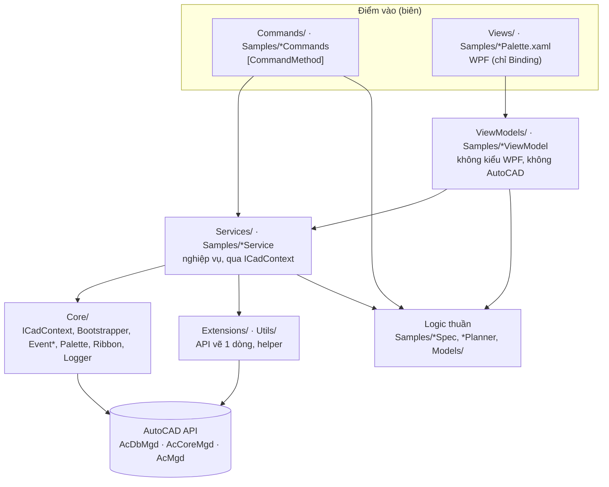
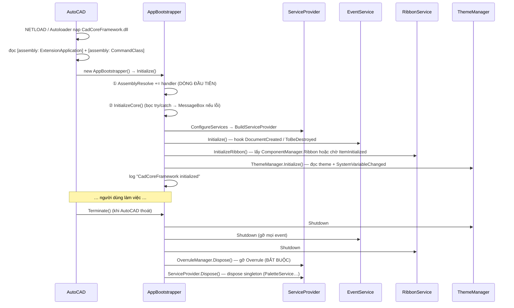
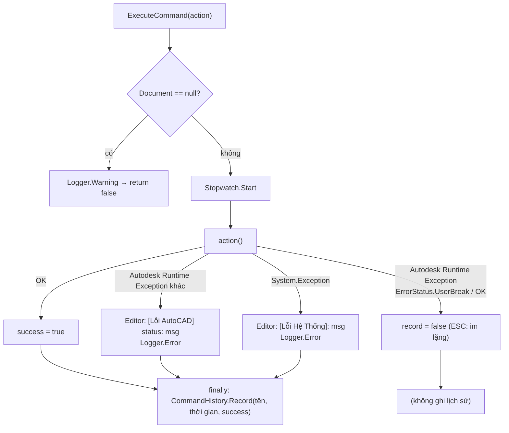
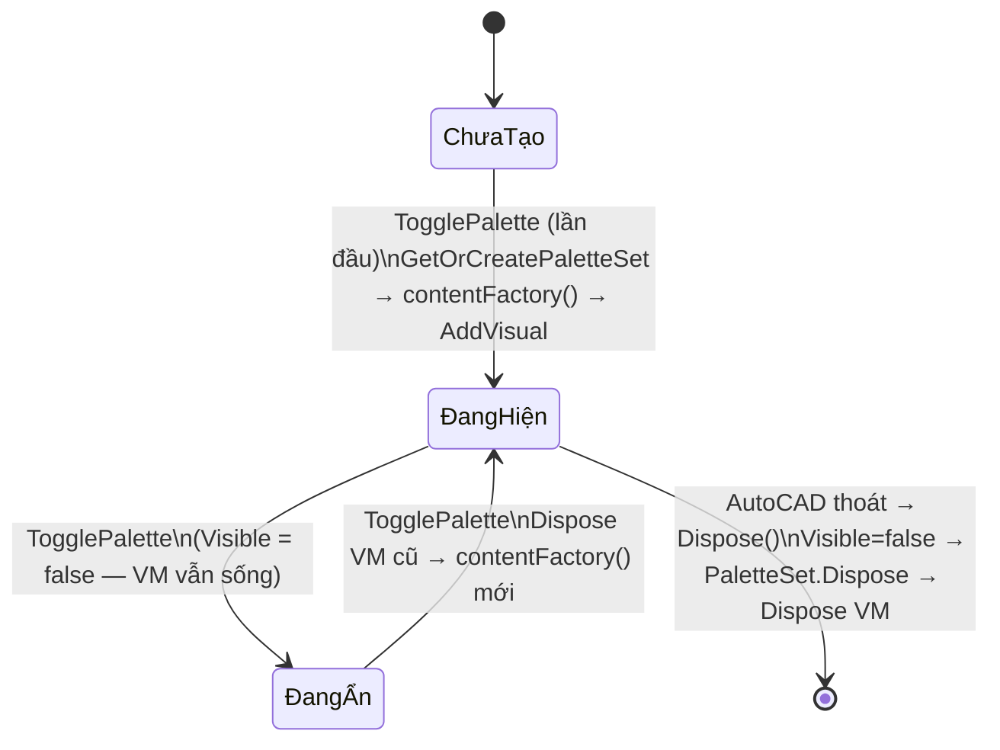
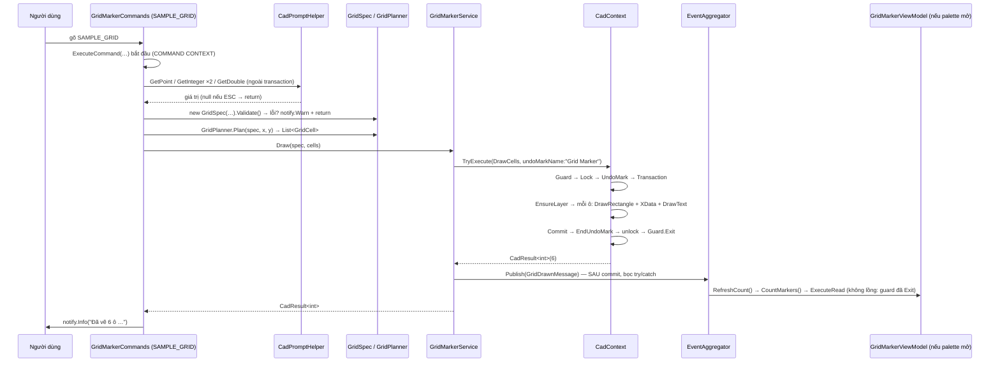

> **🎓 Học viện CadCoreFramework** · [Lộ trình](README.md) · [← T01](T01_AUTOCAD_NET_FOUNDATIONS.md) · **T02** · [T03 →](T03_PITFALLS_CASEBOOK.md)

# T02 — Mổ Xẻ Kiến Trúc CadCoreFramework

[T01](T01_AUTOCAD_NET_FOUNDATIONS.md) dạy luật chơi của AutoCAD. Module này cho thấy framework **áp dụng các luật đó ở đâu, bằng dòng code nào**, và những chỗ nó chưa làm trọn. Hãy đọc với file nguồn mở bên cạnh: mọi link 🔎 đều trỏ vào code thật.

**Sau module này bạn phải làm được:**
1. Vẽ lại (không nhìn tài liệu) sơ đồ khởi động từ `NETLOAD` đến lúc lệnh đầu tiên chạy được.
2. Giải thích từng dòng của `CadContext.ExecuteCore` và lý do tồn tại của nó.
3. Theo dấu lệnh `SAMPLE_GRID` qua mọi tầng, nói được tầng nào test được và test bằng gì.
4. Chỉ ra ít nhất 3 chỗ framework *chưa* tuân thủ chính nguyên tắc của nó (gợi ý: [T09 §3](T09_SENIOR_PLAYBOOK.md#3-backlog-kỹ-thuật-đã-kiểm-chứng)).

---

## 1. Bản đồ dự án và quy tắc phụ thuộc



| Thư mục | Vai trò | Được phụ thuộc vào | **Không** được |
| :--- | :--- | :--- | :--- |
| `Commands/` | Điểm vào lệnh. Prompt → gọi service → báo kết quả | Service, logic thuần, `CadPromptHelper` | Chứa nghiệp vụ dài |
| `Views/` | XAML + code-behind hạ tầng (gán DataContext, nạp style) | ViewModel | Logic AutoCAD |
| `ViewModels/` | Trạng thái UI, lệnh UI, validate | Interface service, logic thuần | Kiểu WPF (`Brush`, `Visibility`), AutoCAD API, prompt |
| `Services/` | Nghiệp vụ chạm bản vẽ | `ICadContext`, Extensions | `MdiActiveDocument` (CAD001), prompt |
| `Samples/GridMarker/` | **Golden Sample**: mẫu một tính năng trọn vẹn | — | — |
| `Core/` | Hạ tầng | AutoCAD API | Nghiệp vụ cụ thể |
| `Extensions/`, `Utils/` | API vẽ, helper | AutoCAD API | Trạng thái toàn cục |
| `Demos/` | Lệnh minh họa `DEMO_*`, có thể gỡ bằng `IncludeDemos=false` | Mọi thứ | Bị code lõi tham chiếu ngược lại |

> [!TIP]
> Quy tắc "mũi tên chỉ đi một chiều" là thứ giúp dự án **test được**. ViewModel không biết AutoCAD, nên test được bằng xUnit thường. Logic thuần không biết gì, nên test được 100%. Phần phụ thuộc AutoCAD bị dồn vào lớp vỏ mỏng nhất có thể.

---

## 2. Khởi động và tắt: AppBootstrapper

🔎 **Đọc code:** [`Core/AppBootstrapper.cs`](../../Core/AppBootstrapper.cs), [`Properties/AssemblyInfo.cs`](../../Properties/AssemblyInfo.cs)



Những quyết định đáng chú ý:

| Dòng code | Vì sao |
| :--- | :--- |
| `AssemblyResolve +=` ở **dòng đầu** `Initialize()`, logic thật nằm trong `InitializeCore()` | JIT biên dịch cả method trước khi chạy nó. Nếu `Initialize` tham chiếu trực tiếp `ServiceCollection`, việc phân giải DLL DI có thể xảy ra *trước khi* handler kịp đăng ký |
| Toàn bộ `InitializeCore` trong try/catch, hiện MessageBox | `Initialize` không được ném exception ra AutoCAD. Người dùng phải *thấy* lỗi khởi động thay vì plugin "câm" |
| `FindLoadedAssembly` ưu tiên assembly **đã nạp** đúng tên + version | Sửa lỗi palette khi plugin được nạp từ byte array ([T03 A2](T03_PITFALLS_CASEBOOK.md#a2-palette-lỗi-does-not-have-a-resource-identified-by-the-uri)) |
| `Terminate` gỡ theo **thứ tự ngược** khởi động, có try/catch | Lỗi lúc tắt không được làm crash AutoCAD |
| `OverruleManager` được Dispose tường minh trước khi Dispose container | Overrule còn đăng ký khi AutoCAD thoát có thể gây Fatal Error |
| `RegisteredServices` giữ bản chụp `ServiceCollection` | `IServiceProvider` không có API liệt kê service. Debug Inspector (`CORE_DEBUG`) cần danh sách này |
| `SetServiceProviderForTesting` chỉ có ở bản `DEBUG`, là `internal` | Cho unit test tiêm container giả mà không mở API ra ngoài |

### 2.1 Hot-reload: tên assembly có timestamp

🔎 [`CadCoreFramework.csproj`](../../CadCoreFramework.csproj): ở cấu hình Debug, `AssemblyName = CadCoreFramework_yyyyMMdd_HHmmss`. Target `PostBuild` copy file đó về `CadCoreFramework.dll` (kèm `.pdb`) để đường dẫn nạp luôn cố định. Vì .NET Framework không gỡ được assembly ([T01 §12](T01_AUTOCAD_NET_FOUNDATIONS.md#12-vòng-đời-plugin-và-cơ-chế-nạp-assembly)), mỗi lần build sinh ra một *identity* mới, nên nạp lại được mà không tắt AutoCAD.

Hệ quả bạn phải biết: tên assembly **không cố định** ở bản Debug. Mọi chỗ cần tên assembly (pack URI của WPF) phải lấy **lúc runtime**. Xem [`GridMarkerPalette.LoadStyles`](../../Samples/GridMarker/GridMarkerPalette.xaml.cs): `Assembly.GetExecutingAssembly().GetName().Name`.

---

## 3. Dependency Injection

🔎 `AppBootstrapper.ConfigureServices`

| Lifetime | Dùng cho | Ví dụ |
| :--- | :--- | :--- |
| `Singleton` | Service, hạ tầng (một instance suốt phiên) | `ICadContext`, `ILoggerService`, `IEventAggregator`, `IGridMarkerService` |
| `Transient` | ViewModel (mỗi lần mở palette một instance mới) | `GridMarkerViewModel`, `LayerManagerViewModel` |
| `Scoped` | **Không dùng.** AutoCAD không có khái niệm "request scope" | — |

Vì sao ViewModel là Transient? `PaletteService.TogglePalette` tạo **content mới mỗi lần mở** và **Dispose ViewModel cũ**. Một ViewModel Singleton đã bị Dispose sẽ mất hết subscription.

### 3.1 Service locator ở biên: được phép và có giới hạn

AutoCAD tự tạo instance class lệnh và WPF tự tạo `UserControl` (cả hai đều bằng constructor không tham số), nên **hai biên này không nhận được constructor injection**. Framework cho phép lấy service từ container *chỉ ở biên*:

| Biên | Cách lấy | Hành vi khi thiếu |
| :--- | :--- | :--- |
| Lệnh (`CadCommandBase`) | `GetRequiredService<T>()` | **Ném** `InvalidOperationException` có thông điệp rõ, được `ExecuteCommand` bắt |
| Palette code-behind | `ServiceProvider?.GetService<TViewModel>() ?? throw …` | **Ném** (fail-loud), lệnh mở palette báo lỗi |
| `ViewModelLocator` (XAML) | `ServiceProvider?.GetService<…>()` | Trả `null` âm thầm (ngoại lệ còn sót, chỉ dùng cho `CommonControlsPalette`) |

Bên trong (Service, ViewModel) **luôn** dùng constructor injection. Đây là ranh giới để code nghiệp vụ test được.

---

## 4. ICadContext: hợp đồng giao dịch

🔎 [`Core/ICadContext.cs`](../../Core/ICadContext.cs), [`Core/CadContext.cs`](../../Core/CadContext.cs), [`Core/ICadScope.cs`](../../Core/ICadScope.cs)

### 4.1 `ExecuteCore` từng dòng

Mọi biến thể ghi (`Execute`, `TryExecute`, `TryExecute<T>`, `ExecuteAsync`, `ExecuteBatch`) cuối cùng đều đi vào **một** method: `ExecuteCore<T>(Document doc, Func<ICadScope,T> cadFunc, bool autoRegen, string? undoMarkName)`.

```text
CadContextGuard.Enter()                       ← chặn Execute lồng nhau (§4.6)
try
  using (doc.LockDocument())                  ← luôn lock: đúng cho cả 2 ngữ cảnh (T01 §5)
    if undoMarkName: comDoc.StartUndoMark()   ← COM; lỗi → log Warning, vẫn chạy tiếp
    try
      using (tr = StartTransaction())
        currentSpace = GetObject(CurrentSpaceId, ForRead)   ← ForRead, upgrade lười
        scope = new CadScope(doc, tr, currentSpace, readOnly:false)
        result = cadFunc(scope)               ← CODE CỦA BẠN
        tr.Commit()                           ← chỉ khi lambda không ném lỗi
      if autoRegen: doc.Editor.Regen()        ← SAU commit, ngoài transaction
      return result
    finally
      if comDoc: comDoc.EndUndoMark()         ← luôn đóng mark, kể cả khi lỗi
finally
  CadContextGuard.Exit()
```

Câu hỏi để đọc kỹ (đáp án ở cuối mục):
- (a) Vì sao `Regen()` nằm **ngoài** `using (tr)`?
- (b) Nếu lambda ném lỗi, `EndUndoMark` có chạy không? Transaction có commit không?
- (c) Vì sao `comDoc` khai báo kiểu `dynamic`?

### 4.2 Quy ước lỗi: `Execute*` ném, `TryExecute*` trả `CadResult`

| Method | Lỗi | Dùng ở |
| :--- | :--- | :--- |
| `Execute(Action)` | **Ném** exception | Lệnh (vì `ExecuteCommand` bắt và báo giúp) |
| `TryExecute(Action)` → `CadResult` | **Không** ném | Service muốn trả lỗi thành giá trị |
| `TryExecute<T>(Func)` → `CadResult<T>` | **Không** ném | Service có giá trị trả về ([`GridMarkerService.Draw`](../../Samples/GridMarker/GridMarkerService.cs)) |
| `Execute<T>(Func)` | `[Obsolete]`: tên "Execute" nhưng lại trả `CadResult`, trái quy ước | Không dùng |

> [!WARNING]
> **Bẫy overload:** `Execute(scope => scope.DrawCircle(…))` là lambda *biểu thức trả về giá trị* (`ObjectId`), nên C# chọn overload **generic** chứ không chọn `Execute(Action)`. Trước đây overload đó là `Execute<T>`, tức âm thầm *không ném lỗi*. Giờ nó `[Obsolete]` và gây cảnh báo CS0618; với `-warnaserror` thì build sẽ fail. Khi muốn overload ném lỗi, viết **lambda khối**: `Execute(scope => { scope.DrawCircle(…); })`.

### 4.3 `ExecuteRead`

- Lock **chỉ khi** `DocumentManager.IsApplicationContext` (palette, modeless). Trong lệnh, AutoCAD đã lock sẵn.
- Scope có `IsReadOnly = true`. `AppendEntityToCurrentSpace`, `SetXRecord`, `RemoveXRecord` ném `InvalidOperationException`.
- Kết thúc bằng `Commit()` (rẻ hơn Abort với transaction chỉ đọc).
- ⚠️ "Read-only" là **quy ước có hàng rào một phần**, không phải bảo đảm tuyệt đối: `scope.Transaction.GetObject(id, ForWrite)` rồi sửa vẫn được commit ([B-07](T09_SENIOR_PLAYBOOK.md#3-backlog-kỹ-thuật-đã-kiểm-chứng)).

### 4.4 `ExecuteAsync`: hai giai đoạn

```csharp
Task ExecuteAsync(Func<Task<Action<ICadScope>>> asyncPreparation, bool autoRegen = false,
                  string? undoMarkName = null, CancellationToken cancellationToken = default);
```

1. **Chụp `Document` trước `await`.** Đây là điểm giá trị nhất: người dùng đổi tab trong lúc chờ cũng không vẽ nhầm.
2. Kiểm tra hủy (`ThrowIfCancellationRequested`) trước và sau giai đoạn chuẩn bị.
3. `await asyncPreparation()`: tải dữ liệu / tính toán, **không** lock gì.
4. Nếu `doc.IsDisposed` (bản vẽ đã đóng) thì ném lỗi rõ ràng, thay vì `LockDocument()` trên đối tượng đã hủy.
5. `ExecuteCore(doc, drawAction, …)` chạy giai đoạn vẽ như bình thường.

Chỉ dùng khi **thật sự có việc async** (I/O, HTTP). Bọc code đồng bộ trong `Task.FromResult` để gọi `ExecuteAsync` là sai mục đích ([quy tắc dự án](../../.agents/rules/project_rules.md)). ⚠️ Method này *không* xác nhận đang có `SynchronizationContext` của main thread ([B-06](T09_SENIOR_PLAYBOOK.md#3-backlog-kỹ-thuật-đã-kiểm-chứng)).

### 4.5 `ExecuteBatch`

Vẽ N phần tử trong **một** transaction, **một** bước Undo (mặc định tên `"Batch"`), có `IProgress<int>`. Bên dưới nó gọi `Execute` với một lambda lặp. Vì là một transaction, một phần tử lỗi thì **cả batch rollback**. Đó là tính năng (atomic), nhưng phải nói rõ với người dùng.

### 4.6 CadContextGuard: chặn lồng nhau

🔎 [`Core/CadContextGuard.cs`](../../Core/CadContextGuard.cs): một cờ `[ThreadStatic] bool`. `Enter()` ném lỗi nếu cờ đang bật.

**Vì sao cấm**, khi AutoCAD *cho phép* transaction lồng nhau và lock lồng nhau ([T01 §4.3](T01_AUTOCAD_NET_FOUNDATIONS.md#43-transaction-lồng-nhau))? Vì một `Execute` là **một đơn vị công việc**: một lock, một transaction, một bước Undo, một kết quả. Lồng nhau thường là triệu chứng thiết kế sai (Service A gọi Service B *bên trong* lambda), và tạo ra những câu hỏi không có câu trả lời tốt: transaction trong commit rồi mà ngoài rollback thì sao? Undo mark lồng nhau tính thế nào? Guard biến lỗi thiết kế thành một exception có thông điệp hướng dẫn cách sửa.

> [!NOTE]
> Comment trong `CadContextGuard.cs` giải thích bằng "AutoCAD sẽ ném eLockViolation hoặc deadlock". Đó **không** phải lý do thực sự (lock và transaction lồng nhau đều hợp lệ với AutoCAD). Lý do đúng là *đơn vị công việc* như trên ([B-19](T09_SENIOR_PLAYBOOK.md#3-backlog-kỹ-thuật-đã-kiểm-chứng)). Hiểu đúng lý do giúp bạn quyết định đúng khi gặp trường hợp biên.

Cờ áp dụng cho cả `ExecuteRead`: gọi `ExecuteRead` bên trong `Execute` cũng bị chặn. Đọc cần thiết thì làm ngay trong cùng scope. Đây cũng là lý do Service **publish message sau khi `TryExecute` đã trả về**: subscriber như `GridMarkerViewModel.RefreshCount` sẽ gọi `ExecuteRead` mà không bị coi là lồng nhau.

### 4.7 `CadResult` / `CadResult<T>`

🔎 [`Core/CadResult.cs`](../../Core/CadResult.cs): `IsSuccess`, `Value`, `ErrorMessage`, `Exception`. Factory: `CadResult<T>.Success(v)`, `CadResult<T>.Fail(msg, ex)`, `CadResult.Ok()`, `CadResult.Fail(msg, ex)`.

Khi nào dùng Result, khi nào dùng exception:
- **Result**: lỗi *có thể dự đoán* ở tầng nghiệp vụ (layer bị khóa, bản vẽ read-only), để caller quyết định hiển thị.
- **Exception**: lỗi lập trình hoặc lỗi bất ngờ (argument null, trạng thái không hợp lệ). Để nó nổi lên tới biên (`ExecuteCommand`, `RunSafe`).
- Benchmark trong [`CadCoreFramework.Benchmarks`](../../CadCoreFramework.Benchmarks/README.md) chứng minh Result rẻ hơn throw/catch.

<details><summary>Đáp án câu hỏi §4.1</summary>

(a) Regen là thao tác hiển thị, không thuộc dữ liệu. Chạy *sau* commit để thấy dữ liệu mới, và không giữ transaction mở trong lúc regen (tốn thời gian).
(b) `EndUndoMark` nằm trong `finally` nên **luôn chạy**. `tr.Commit()` không được gọi (exception nhảy qua), nên `using` Dispose transaction và rollback toàn bộ.
(c) `GetAcadDocument()` trả về đối tượng COM. Dùng `dynamic` thì không cần tham chiếu thư viện interop COM của AutoCAD (late binding). Cái giá là cần `Microsoft.CSharp` (đã thêm cho net48 trong csproj) và không có kiểm tra lúc biên dịch.
</details>

---

## 5. CadCommandBase: biên giới của mọi lệnh

🔎 [`Commands/CadCommandBase.cs`](../../Commands/CadCommandBase.cs)



| Thành phần | Chi tiết |
| :--- | :--- |
| `ExecuteCommand(Action, [CallerMemberName])` | Bọc try/catch như sơ đồ. Tên lệnh trong lịch sử lấy từ tên method nhờ `CallerMemberName` |
| `ExecuteWithScope(Action<ICadScope>, undoMarkName)` | Rút gọn của `ExecuteCommand(() => CadContext.Execute(...))`, cho lệnh nhỏ không prompt |
| `ExecuteWithScopeAsync(...)` | Biến thể async. **Chụp `Document` trước `await`** và in lỗi ra đúng bản vẽ đã chạy lệnh (`WriteMessageSafe` bỏ qua nếu bản vẽ đã đóng) |
| `GetRequiredService<T>()` | Lấy service, ném lỗi rõ ràng nếu thiếu. Gọi **bên trong** `ExecuteCommand` để lỗi được bắt |
| `Logger`, `CadContext`, `CommandHistory` | `Lazy<>` từ container. `CadContext` ném lỗi nếu DI chưa sẵn sàng |
| Constructor `(ILoggerService, ICadContext, ICommandHistoryService? = null)` | Constructor injection **cho unit test**. AutoCAD không dùng constructor này |

Ghi chú:
- `Document`, `Database`, `Editor` của base class đọc `MdiActiveDocument` **mỗi lần truy cập**. Trong một lệnh đồng bộ thì an toàn (người dùng không đổi tab giữa chừng được), nhưng **không** dùng chúng sau `await`.
- Lệnh async kiểu "fire-and-forget" được ghi lịch sử là *thành công* ngay khi phần đồng bộ kết thúc ([T01 §8.3](T01_AUTOCAD_NET_FOUNDATIONS.md#83-lệnh-async-thực-chất-chạy-thế-nào)).

---

## 6. Extensions và Utils: API vẽ một dòng

🔎 `Extensions/CadScope*Extensions.cs`, `Extensions/CadScopeDrawingHelpers.cs`, `Utils/*`

### 6.1 Mẫu chung của mọi hàm `Draw*`

```csharp
public static ObjectId DrawLine(this ICadScope scope, Point3d startPoint, Point3d endPoint,
    string layer = null, short? colorIndex = null, LineWeight lineWeight = LineWeight.ByLayer,
    Action<Line> configure = null)
{
    var line = new Line(startPoint, endPoint);
    line.SetDatabaseDefaults(scope.Database);          // 1. thuộc tính mặc định của bản vẽ
    line.LineWeight = lineWeight;
    CadScopeDrawingHelpers.ApplyCommonProperties(      // 2. layer (tự EnsureLayer) + màu
        scope, line, layer, colorIndex);
    configure?.Invoke(line);                            // 3. hook tùy biến của caller
    return scope.AppendEntityToCurrentSpace(line);      // 4. append + AddNewlyCreatedDBObject
}
```

| Đặc điểm | Ý nghĩa |
| :--- | :--- |
| Là **extension method của `ICadScope`** | Chỉ gọi được *bên trong* lambda `Execute`, tức đã có lock + transaction. **Không** tự mở transaction (một bản cũ của Phần 7 từng nói sai điều này) |
| Trả `ObjectId` | Không lộ `DBObject` ra ngoài transaction |
| Tham số `configure` | Lối thoát cho mọi thuộc tính chưa có tham số riêng |
| Tọa độ **WCS** | Chuyển từ UCS ở bước prompt (`CadPromptHelper`) |
| Trả `ObjectId.Null` khi input không hợp lệ (ví dụ polyline < 2 điểm) | Caller phải kiểm tra `IsNull` |

⚠️ Bước 3 chạy **trước** bước 4. Nếu `configure` ném lỗi, entity chưa vào DB và không được `Dispose` ([B-14](T09_SENIOR_PLAYBOOK.md#3-backlog-kỹ-thuật-đã-kiểm-chứng)). ⚠️ `ApplyCommonProperties` gọi `EnsureLayer` cho **mỗi** entity: đúng nhưng tốn khi vẽ hàng nghìn entity ([T07 §3](T07_PERFORMANCE_AND_SCALE.md#3-chi-phí-ẩn-trong-vòng-lặp)).

### 6.2 Nhóm chức năng

| File | Nội dung |
| :--- | :--- |
| [`CadScopeLayerExtensions`](../../Extensions/CadScopeLayerExtensions.cs) | `EnsureLayer/TextStyle/Linetype/DimStyle` (idempotent: có thì trả Id, chưa có thì tạo), `SetLayerStatus`, `CreateBlockDefinition` |
| [`CadScopeLineExtensions`](../../Extensions/CadScopeLineExtensions.cs) | Line, Polyline (cả bulge), Rectangle, Fillet rectangle, Polygon, Slot, Circle, Arc, Ellipse, Spline, Wipeout |
| [`CadScopeTextExtensions`](../../Extensions/CadScopeTextExtensions.cs) | DBText, MText, MLeader |
| [`CadScopeDimensionExtensions`](../../Extensions/CadScopeDimensionExtensions.cs) | Aligned, Linear, Diametric, Radial, Jogged, Angular, Ordinate |
| [`CadScopeBlockExtensions`](../../Extensions/CadScopeBlockExtensions.cs) | `InsertBlock` (kèm attribute + dynamic property), Table, Hatch, Group, Copy, Mirror |
| [`CadScopeQueryExtensions`](../../Extensions/CadScopeQueryExtensions.cs) | `GetEntities<T>(layer)`; các `Ask*` **[Obsolete]** (prompt trong transaction) |
| [`XRecordExtensions`](../../Extensions/XRecordExtensions.cs) | `SetXRecord/GetXRecord/RemoveXRecord` trên scope (chặn ghi khi `IsReadOnly`) |
| [`EntityExtensions`](../../Extensions/EntityExtensions.cs) | Move/Rotate/Scale/Mirror, `GetSafeExtents`, `SetMetadata/GetMetadata` (XData) |
| [`BlockHelper`](../../Utils/BlockHelper.cs) | Chèn block **tạo đủ `AttributeReference`** từ `AttributeDefinition` (bỏ qua `Constant`) |
| [`XDataHelper`](../../Utils/XDataHelper.cs) / [`XRecordHelper`](../../Utils/XRecordHelper.cs) | JSON chia khúc vào XData (≤ 250 ký tự/khúc, chặn ở 15.000) / Xrecord (2000 ký tự/khúc) |
| [`CadPromptHelper`](../../Utils/CadPromptHelper.cs) | Prompt trả `null` khi hủy; tự đổi UCS ↔ WCS |
| [`SelectionFilterBuilder`](../../Utils/SelectionFilterBuilder.cs) | Fluent `OfTypes/OnLayers/WithBlockNames/WithColor/WithXData/Custom` → `SelectionFilter` |
| [`CadAsyncHelper`](../../Utils/CadAsyncHelper.cs) | `ExecuteSafeAsync` (marshal tường minh về main thread), `FireAndForget` có xử lý lỗi |
| `Utils/Jigs/` | `RectangleJig`, `BlockPlacementJig`, base class cho EntityJig/DrawJig |

`Sampler` và `Update` của Jig chạy **tuần tự trên main thread** bên trong `Editor.Drag`, không chạy song song như một bản cũ của Phần 3 từng viết.

---

## 7. EventAggregator và EventService

### 7.1 EventAggregator: pub/sub trong tiến trình

🔎 [`Core/EventAggregator.cs`](../../Core/EventAggregator.cs)

| Đặc điểm | Hệ quả |
| :--- | :--- |
| Giữ **tham chiếu mạnh** tới delegate (không phải WeakReference) | Subscriber không gỡ đăng ký sẽ **không bao giờ được GC** (rò rỉ bộ nhớ, và còn nhận message sau khi đã "chết") |
| `Subscribe` trả `IDisposable` **one-shot** (Dispose nhiều lần chỉ gỡ 1 lần) | Dùng với `TrackSubscription` trong ViewModel |
| `Publish` chạy **đồng bộ trên thread của người publish** | Subscriber chạm UI/AutoCAD thì người publish phải đang ở main thread |
| Snapshot danh sách trước khi gọi | Subscriber tự gỡ đăng ký trong lúc nhận message không làm hỏng vòng lặp |
| **Cô lập lỗi:** gọi đủ mọi subscriber, gom lỗi, sau đó ném lại (1 lỗi giữ nguyên kiểu, nhiều lỗi thành `AggregateException`) | Một subscriber hỏng không chặn các subscriber khác. Service bọc `Publish` trong try/catch vì dữ liệu đã commit ([`GridMarkerService.PublishSafely`](../../Samples/GridMarker/GridMarkerService.cs)) |
| `GetSubscriberSnapshot()` | Debug Inspector hiển thị "ai đang nghe gì" |

### 7.2 EventService: sự kiện AutoCAD, an toàn với MDI

🔎 [`Core/EventService.cs`](../../Core/EventService.cs)
- Hook `DocumentCreated` / `DocumentToBeDestroyed` khi `Initialize()`.
- Sự kiện cấp đối tượng `ObjectAppended` / `ObjectErased` được hook **lười**: chỉ khi có ít nhất một subscriber, và gỡ khi subscriber cuối cùng rời đi (custom `add`/`remove` accessor).
- Lưu delegate **theo từng Document** để gỡ chính xác, và bọc args kèm `Document` nguồn (`DocumentObjectEventArgs`) để subscriber lọc đúng bản vẽ.

---

## 8. PaletteService và vòng đời ViewModel

🔎 [`Core/PaletteService.cs`](../../Core/PaletteService.cs)



| Điểm | Chi tiết |
| :--- | :--- |
| `contentFactory` (lazy) | View chỉ được tạo khi người dùng thật sự mở palette |
| Dispose ViewModel cũ trước khi thay content | Gỡ subscription, tránh rò rỉ (lỗi khi Dispose được **log**, không nuốt) |
| `TogglePalette` **ném lại** lỗi | Lệnh mở palette báo lỗi và ghi FAIL vào lịch sử, thay vì palette âm thầm không mở |
| `ShowPalette` chỉ **log** lỗi | Không nhất quán với Toggle ([B-15](T09_SENIOR_PLAYBOOK.md#3-backlog-kỹ-thuật-đã-kiểm-chứng)) |
| `GetOrCreatePaletteSet(name, guid?)` | Có tham số Guid để AutoCAD **nhớ vị trí/kích thước** palette. ⚠️ `TogglePalette`/`ShowPalette` **không truyền Guid**, nên palette của dự án không được nhớ vị trí ([B-04](T09_SENIOR_PLAYBOOK.md#3-backlog-kỹ-thuật-đã-kiểm-chứng)) |
| Khi người dùng đóng bằng nút X | Chỉ ẩn. ViewModel vẫn sống và vẫn nhận message tới lần Toggle sau |

Code-behind palette ([`GridMarkerPalette.xaml.cs`](../../Samples/GridMarker/GridMarkerPalette.xaml.cs)) chỉ làm hạ tầng: `InitializeComponent()`, nạp `Styles.xaml` bằng pack URI dựng lúc runtime, áp theme, lấy ViewModel từ DI (fail-loud), và gọi `RefreshCount` khi `Loaded`.

> [!IMPORTANT]
> Style từ `Styles.xaml` được merge **sau** `InitializeComponent()`, nên XAML phải tham chiếu chúng bằng **`{DynamicResource}`**. `{StaticResource}` tới các key đó đã từng làm palette không mở được ([T03 A3](T03_PITFALLS_CASEBOOK.md#a3-show_ui_template-lỗi-provide-value-on-staticresourceextension)).

---

## 9. RibbonService

🔎 [`Core/RibbonService.cs`](../../Core/RibbonService.cs)

- `InitializeRibbon()`: lấy `ComponentManager.Ribbon`. Nếu Ribbon chưa sẵn sàng (plugin nạp lúc AutoCAD đang khởi động), đăng ký `ComponentManager.ItemInitialized` để dựng sau.
- Theo dõi `CommandEnded` của mọi bản vẽ. Sau các lệnh reset giao diện (`CUI`, `MENULOAD`, `WSCURRENT`…), nó đăng ký `Application.Idle` **một lần** để dựng lại Ribbon khi AutoCAD rảnh.
- `AddTab` / `AddPanel` tìm theo Id/Name trước khi tạo nên **idempotent**. `AddButton` / `AddSplitButton` thì **không** kiểm tra trùng: gọi lại trên panel còn tồn tại sẽ tạo nút trùng. Build action phải tự xóa hoặc kiểm tra trước khi thêm nút ([T08 §6](T08_RECIPES_EXTENDING.md#6-thêm-ribbon-tab)).
- Nút bấm dùng `RibbonCommandHandler`: `SendStringToExecute("\x03\x03_.LỆNH ")` ([T01 §5.3](T01_AUTOCAD_NET_FOUNDATIONS.md#53-đi-từ-application-context-sang-command-context)).

> [!WARNING]
> **Hiện trạng v1.0.0:** không có chỗ nào gọi `AddTab`/`AddButton`/`RegisterBuildAction`. Hạ tầng đã sẵn nhưng **plugin chưa hiện Ribbon nào** ([B-05](T09_SENIOR_PLAYBOOK.md#3-backlog-kỹ-thuật-đã-kiểm-chứng)). Công thức dựng Ribbon đúng chuẩn nằm ở [T08 §6](T08_RECIPES_EXTENDING.md#6-thêm-ribbon-tab); lab L11 yêu cầu bạn làm việc này.

---

## 10. ThemeManager, Styles và hệ màu

🔎 [`Themes/ThemeManager.cs`](../../Themes/ThemeManager.cs), [`Themes/Styles.xaml`](../../Themes/Styles.xaml), [`Utils/CadApplicationHelper.cs`](../../Utils/CadApplicationHelper.cs)

Thiết kế dự định: đọc theme AutoCAD → nạp `AutoCadTheme.xaml` (tối) hoặc `AutoCadLightTheme.xaml` (sáng) → nghe `SystemVariableChanged` để đổi theme lúc đang chạy.

Thực tế v1.0.0 (đã kiểm chứng, đây là bài học "đọc toàn cục"):

| Phát hiện | Bằng chứng | Mã |
| :--- | :--- | :---: |
| `IsDarkMode` đọc sysvar **`DARKMODE`**, biến **không tồn tại**. Theme thật của AutoCAD là **`COLORTHEME`** (0 = tối, 1 = sáng) | `(getvar "DARKMODE")` → `nil`; `(getvar "COLORTHEME")` → `0` trên AutoCAD 2024 | B-01 |
| `Styles.xaml` **cố định một bảng màu tối riêng** (`#1E1E2E`, accent tím) và palette chủ yếu dùng các key này | Đọc file | B-02 |
| Không ai subscribe `ThemeManager.ThemeChanged`; palette chỉ áp theme **một lần** lúc tạo | grep `ThemeChanged` | B-23 |
| `LayerManagerControl.xaml` dùng 3 key **không được định nghĩa** (`Brush.Surface.Default`, `Brush.Surface.Elevated`, `Brush.Text.Default`). `DynamicResource` thiếu key thì **im lặng** | Script so khớp key | B-03 |

Đây là ví dụ kinh điển cho việc một tính năng "trông như chạy": palette vẫn hiện, không ai báo lỗi, nhưng thiết kế dự định không bao giờ được thực thi. Senior phát hiện loại lỗi này bằng cách **kiểm chứng giả định** (hỏi thẳng AutoCAD giá trị sysvar), không phải bằng cách đọc comment.

---

## 11. Analyzer CAD001

🔎 [`CadCoreFramework.Analyzers/MdiActiveDocumentInServiceAnalyzer.cs`](../../CadCoreFramework.Analyzers/MdiActiveDocumentInServiceAnalyzer.cs)

- Roslyn analyzer, chạy **lúc build**, được tham chiếu dạng `OutputItemType="Analyzer"` nên không đóng gói vào DLL plugin.
- Báo **warning** (thành lỗi trên CI vì `-warnaserror`) khi một class trong namespace `*.Services` / `*.ViewModels`, hoặc tên kết thúc bằng `Service` / `ViewModel`, truy cập `.MdiActiveDocument`. Bỏ qua `CadContext` và `AppBootstrapper`.
- Ngoại lệ có chủ đích được đánh dấu bằng `#pragma warning disable CAD001` kèm comment giải thích (ví dụ `NotificationService`).

Giới hạn ([B-18](T09_SENIOR_PLAYBOOK.md#3-backlog-kỹ-thuật-đã-kiểm-chứng)): phân tích theo **cú pháp**, chỉ bắt chuỗi `.MdiActiveDocument` xuất hiện trực tiếp. Service gọi `CadPromptHelper.GetPoint` (gián tiếp dùng `MdiActiveDocument`, và còn **prompt trong service**) sẽ lọt qua. Đây là đề bài tốt cho người muốn học viết analyzer.

---

## 12. Logger, Notification, Settings, Path

| Service | File | Điểm cần biết |
| :--- | :--- | :--- |
| `ILoggerService` | [`LoggerService.cs`](../../Core/LoggerService.cs) | Tự viết (không Serilog, xem T03 A1). File `%AppData%\CadCoreFramework\Logs\log-yyyyMMdd.txt`, định dạng `2026-10-12 19:30:00.123 +07:00 [INF] …`. Mức tối thiểu: Debug ở bản Debug, Information ở bản Release. Giữ 31 file. Mở/đóng file mỗi lần ghi với `FileShare.ReadWrite` (nhiều phiên AutoCAD ghi chung). **Không bao giờ ném lỗi** |
| `INotificationService` | [`NotificationService.cs`](../../Core/NotificationService.cs) | In `[✔]` / `[⚠]` / `[✖]` lên dòng lệnh **và** ghi log. `Confirm` dùng MessageBox |
| `ISettingsService` | [`SettingsService.cs`](../../Services/SettingsService.cs) | `%AppData%\CadCoreFramework\settings.json`, `Dictionary<string, object>` có lock. `GetSetting<T>` round-trip JSON để đổi kiểu (Newtonsoft đọc số thành `Int64`). Ghi file không atomic ([B-22](T09_SENIOR_PLAYBOOK.md#3-backlog-kỹ-thuật-đã-kiểm-chứng)) |
| `IPathProvider` | [`PathProvider.cs`](../../Services/PathProvider.cs) | `GetPluginDirectory()` dựa vào `Assembly.Location`, chuỗi **rỗng** khi nạp từ byte array, và `Path.GetDirectoryName("")` ném `ArgumentException` trên .NET Framework. Hiện chưa có code sản phẩm gọi nó ([B-11](T09_SENIOR_PLAYBOOK.md#3-backlog-kỹ-thuật-đã-kiểm-chứng)) |
| `IFileSystemService` | [`FileSystemService.cs`](../../Services/FileSystemService.cs) | Bọc `System.IO` để mock được trong test (`SettingsServiceTests`) |
| `ICommandHistoryService` | [`CommandHistoryService.cs`](../../Core/CommandHistoryService.cs) | 50 bản ghi gần nhất trong bộ nhớ, thread-safe. Hiện trong Debug Inspector |

---

## 13. Golden Sample: theo dấu một lệnh từ đầu đến cuối

🔎 [`Samples/GridMarker/`](../../Samples/GridMarker/) và [Phần 9](../09_GOLDEN_SAMPLE.md). Đọc theo thứ tự: `GridSpec` → `GridPlanner` → `IGridMarkerService` → `GridMarkerService` → `GridMarkerCommands` → `GridMarkerViewModel` → `GridMarkerPalette`.



| Tầng | Test bằng | Kiểm tra gì |
| :--- | :--- | :--- |
| `GridSpec` | xUnit thuần | Mọi luật validate, báo nhiều lỗi cùng lúc |
| `GridPlanner` | xUnit thuần | **Kết quả**: tọa độ, nhãn A…Z/AA, thứ tự |
| `GridMarkerService` | `FakeCadContext { ExecuteAction = false }` | **Hợp đồng**: đúng một `TryExecute`, đúng undo mark, publish khi thành công |
| `GridMarkerViewModel` | Mock `IGridMarkerService` | `CanExecute` theo validate, trạng thái, Dispose thì ngừng nghe |
| `GridMarkerPalette` | `XamlPaletteTests` (STA thread) | XAML + resource + DI dựng được |
| `GridMarkerCommands` | **Chạy tay trong AutoCAD** | Prompt, ESC, Undo, đa bản vẽ |

---

## 14. Lộ trình đọc code

Đọc theo thứ tự. Mỗi bước có một câu hỏi bạn phải tự trả lời được trước khi sang bước sau.

| # | File | Câu hỏi kiểm tra |
| :---: | :--- | :--- |
| 1 | `Properties/AssemblyInfo.cs` | AutoCAD tìm thấy lệnh `DEMO_HELP` qua dòng nào? |
| 2 | `Core/AppBootstrapper.cs` | Thứ tự trong `Terminate` là gì và vì sao? |
| 3 | `Core/ICadScope.cs`, `Core/ICadContext.cs` | Vì sao scope không được giữ ngoài lambda? |
| 4 | `Core/CadContext.cs` | Lambda ném lỗi thì những gì vẫn chạy? |
| 5 | `Core/CadContextGuard.cs` | Vì sao `Publish` phải nằm ngoài `TryExecute`? |
| 6 | `Commands/CadCommandBase.cs` | ESC được xử lý ở hai chỗ nào? |
| 7 | `Extensions/CadScopeLineExtensions.cs` + `CadScopeDrawingHelpers.cs` | `DrawRectangle(layer: "X")` mở `LayerTable` mấy lần trong một transaction vẽ 100 ô? |
| 8 | `Utils/CadPromptHelper.cs` + `CoordinateHelper.cs` | `basePoint` được đổi hệ theo chiều nào? |
| 9 | `Utils/XDataHelper.cs` | Vì sao chặn ở 15.000 ký tự mà không phải 16.384? |
| 10 | `Core/EventAggregator.cs` | Điều gì xảy ra nếu ViewModel quên `TrackSubscription`? |
| 11 | `Core/PaletteService.cs` | Đóng palette bằng nút X có Dispose ViewModel không? |
| 12 | `Samples/GridMarker/*` | Tầng nào sẽ hỏng nếu đổi `Point3d` vào `GridCell`? |
| 13 | `CadCoreFramework.Testing/Fakes/*` | Vì sao test Service đặt `ExecuteAction = false`? |
| 14 | `CadCoreFramework.Analyzers/*` | CAD001 bỏ sót trường hợp nào? |

---

## ✅ Tự kiểm tra T02

1. Liệt kê theo thứ tự những gì `TryExecute<T>` làm khi lambda chạy tốt, và khi lambda ném lỗi.
2. Vì sao `GridMarkerViewModel` là Transient? Chuyện gì xảy ra nếu đổi thành Singleton?
3. Palette của bạn hiện màu nền trắng dù XAML ghi `Background="{DynamicResource MyBackground}"`. Nghi ngờ gì đầu tiên?
4. Vì sao service locator được chấp nhận trong `CadCommandBase` nhưng bị cấm trong Service?

<details><summary>Đáp án</summary>

1. Tốt: Guard.Enter → Lock → StartUndoMark (nếu có tên) → StartTransaction → mở CurrentSpace ForRead → lambda → Commit → (Regen nếu bật) → EndUndoMark → unlock → Guard.Exit → `CadResult.Success(v)`. Lỗi: như trên tới lambda → exception → Dispose transaction (rollback) → EndUndoMark (finally) → unlock → Guard.Exit → bắt exception ở `TryExecute<T>` → `CadResult.Fail(msg, ex)`.
2. Mỗi lần mở palette, PaletteService **Dispose** ViewModel cũ. Một Singleton sau lần Dispose đầu đã mất subscription (không còn cập nhật số ô), và còn bị dùng lại trong trạng thái đã Dispose.
3. Key `MyBackground` không tồn tại trong các dictionary đã merge, hoặc merge sai thời điểm. `DynamicResource` thiếu key không báo lỗi (xem B-03).
4. AutoCAD tạo instance lệnh bằng constructor không tham số, nên ở biên không có lựa chọn nào khác. Service do DI tạo, nhận được constructor injection. Dùng service locator trong Service làm phụ thuộc bị ẩn và không mock được trong test.
</details>

---

**Tiếp theo:** [T03 — Sổ tay sự cố & bẫy →](T03_PITFALLS_CASEBOOK.md)
