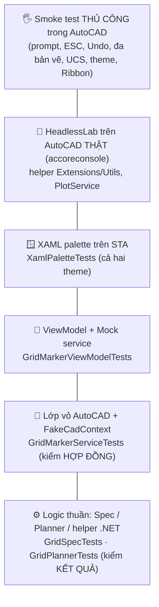

> **🎓 Học viện CadCoreFramework** · [Lộ trình](README.md) · [← T04](T04_DEBUGGING_TROUBLESHOOTING.md) · **T05** · [T06 →](T06_BUILD_RELEASE_DEVOPS.md)

# T05 — Chiến Lược Kiểm Thử

> **Cấp độ:** 🌿 Junior → 🌳 Middle · **Cần trước:** [T02](T02_ARCHITECTURE_DEEP_DIVE.md); viết unit test xUnit ([C05 §2](C05_ASYNC_TESTING_GIT.md#2-unit-test-với-xunit)) · **Trong lộ trình:** tuần 6 ([README §3](README.md#3-lộ-trình-đào-tạo))

Plugin AutoCAD **không thể** unit test theo kiểu thông thường: hầu hết API cần lõi C++ của AutoCAD đang chạy. Chiến lược của dự án vì vậy không phải "mock AutoCAD", mà là **thiết kế để phần cần AutoCAD càng mỏng càng tốt**, rồi test mỗi tầng bằng công cụ phù hợp với nó.

> [!IMPORTANT]
> Nguyên tắc: **nếu một đoạn code không bắt buộc phải gọi AutoCAD API, nó không được nằm trong lambda của `ICadContext.Execute`.** Code trong lambda chỉ test được *"có gọi Execute không"*. Code ngoài lambda test được *"kết quả có đúng không"*. ([R05 §2](../reference/R05_GOLDEN_SAMPLE.md#2-nguyên-tắc-1--functional-core-imperative-shell))

---

## Mục lục

1. [Vì sao khó](#1-vì-sao-khó)
2. [Kim tự tháp test của dự án](#2-kim-tự-tháp-test-của-dự-án)
3. [Logic thuần: kiểm kết quả](#3-logic-thuần-kiểm-kết-quả)
4. [Lớp vỏ AutoCAD: `FakeCadContext` kiểm hợp đồng](#4-lớp-vỏ-autocad-fakecadcontext-kiểm-hợp-đồng)
5. [ViewModel: Mock service](#5-viewmodel-mock-service)
6. [XAML palette trên STA](#6-xaml-palette-trên-sta)
7. [Những gì chỉ AutoCAD thật mới kiểm được](#7-những-gì-chỉ-autocad-thật-mới-kiểm-được)
8. [Chạy test và coverage](#8-chạy-test-và-coverage)
9. [Integration test headless: hiện trạng và hướng đi](#9-integration-test-headless-hiện-trạng-và-hướng-đi)
10. [Quy tắc viết test](#10-quy-tắc-viết-test)

---

## 1. Vì sao khó

| Có trong test process (`dotnet test`) | Không có |
| :--- | :--- |
| Kiểu thuần .NET của AutoCAD: `Point3d`, `Vector3d`, `TypedValue`, `ObjectId` (struct) | Lõi C++: tạo `new Line()`, mở `Database`, `Transaction` thật |
| Kiểu của plugin: `GridSpec`, `CadResult`, ViewModel | `Application.DocumentManager`, `Editor`, sysvar |
| WPF (trên thread STA) | PaletteSet, Ribbon của AutoCAD |

Project test tham chiếu `AutoCAD.NET` **không** có `ExcludeAssets`, nên các DLL managed được copy vào thư mục test và dùng được cho *kiểu dữ liệu*. Còn mọi thứ chạm tới lõi C++ sẽ hỏng ngay khi chạy.

---

## 2. Kim tự tháp test của dự án



| Tầng | Số lượng nên có | Tốc độ | Bắt được | Không bắt được |
| :--- | :---: | :---: | :--- | :--- |
| Logic thuần | **Nhiều nhất** | ms | Sai công thức, biên, validate | Tương tác AutoCAD |
| Vỏ AutoCAD (FakeCadContext) | Vừa | ms | Gọi sai overload, sai undo mark, publish sai thời điểm, không xử lý lỗi | Nội dung lambda |
| ViewModel (Mock) | Vừa | ms | `CanExecute`, trạng thái, subscription | Binding XAML |
| XAML (STA) | 1 / palette (+ test theme chung) | 100 ms | XAML sai, resource thiếu ở theme nào, DI chưa đăng ký, ô số bind sai kiểu | Hành vi trong PaletteSet thật |
| HeadlessLab | 1 / hành vi API đáng ngờ | giây | Hành vi **thật** của API AutoCAD (Erase, DeepClone, căn attribute, wildcard, in PDF…) | Lệnh, palette, Ribbon, `CadContext`; chỉ chạy trên máy có AutoCAD ([§9](#9-integration-test-headless-hiện-trạng-và-hướng-đi)) |
| Thủ công trong AutoCAD | Checklist | phút | Mọi thứ còn lại | — |

Tổng hiện tại (sau PR #13): **320 test × 2 runtime** (`net48`, `net8.0-windows`) chạy trên CI mỗi PR, cộng **18 kiểm thử HeadlessLab** chạy trên máy có AutoCAD 2024 (CI chỉ biên dịch lab).

---

## 3. Logic thuần: kiểm kết quả

🔎 [`GridPlannerTests`](../../CadCoreFramework.Tests/Samples/GridMarker/GridPlannerTests.cs), [`GridSpecTests`](../../CadCoreFramework.Tests/Samples/GridMarker/GridSpecTests.cs)

Tên test mô tả **hành vi**, không mô tả cách cài đặt: `Plan_FirstCellIsAtOrigin`, `Plan_ColumnsGoRight_RowsGoDown`, `Plan_IsRowMajorOrdered`, `ToRowLetters_MatchesSpreadsheetConvention`, `Plan_InvalidSpec_ThrowsWithValidationMessage`.

```csharp
// Từ GridPlannerTests.cs — code nguyên văn; chú thích cuối dòng là của tài liệu
[Fact]
public void Plan_ColumnsGoRight_RowsGoDown()
{
    var cells = GridPlanner.Plan(new GridSpec(2, 3, spacing: 20), 0, 0);

    var b3 = cells.Single(c => c.Row == 1 && c.Column == 2);
    b3.CenterX.Should().Be(40);    // cột thứ 3 (index 2) → +2 × 20
    b3.CenterY.Should().Be(-20);   // hàng B (index 1) → −1 × 20
    b3.Label.Should().Be("B3");
}
```

Vì sao `GridCell` dùng `double CenterX/CenterY` thay vì `Point3d`? `Point3d` *dùng được* trong test, nhưng để logic thuần **không phụ thuộc kiểu AutoCAD**: chuyển sang dự án khác, dùng ở server, hay test bằng framework bất kỳ đều không vướng.

Kỹ thuật nên dùng:
- `[Theory]` + `[InlineData]` cho bảng giá trị (`ToRowLetters`: 0→A, 25→Z, 26→AA, 701→ZZ, 702→AAA).
- Test **biên**: 1 ô, tối đa (`MaxDimension`, `MaxCells`), giá trị 0/âm.
- Validate trả **danh sách lỗi**: kiểm rằng *nhiều* lỗi được báo cùng lúc.

---

## 4. Lớp vỏ AutoCAD: `FakeCadContext` kiểm hợp đồng

🔎 [`CadCoreFramework.Testing/Fakes/FakeCadContext.cs`](../../CadCoreFramework.Testing/Fakes/FakeCadContext.cs), [`GridMarkerServiceTests`](../../CadCoreFramework.Tests/Samples/GridMarker/GridMarkerServiceTests.cs)

| Thành viên | Dùng để |
| :--- | :--- |
| `ExecuteCount`, `ExecuteReadCount`, `ExecuteAsyncCount`, `ExecuteBatchCount` | Kiểm số lần / overload được gọi (`TryExecute` cũng tăng `ExecuteCount`) |
| `LastUndoMarkName`, `LastAutoRegen` | Kiểm tham số |
| `ExceptionToThrow` | Giả lập lỗi AutoCAD. `TryExecute` trả `Fail`, `Execute` ném |
| `ExecuteAction = false` | **Không chạy lambda**. Bắt buộc khi lambda dùng `scope.Transaction`/`Database` (đều là `null` trong `FakeCadScope`) |
| `LastScope.AppendedEntities` | Chỉ dùng khi lambda tự tạo entity mà không cần lõi C++ (hiếm) |

```csharp
// Từ GridMarkerServiceTests.cs — code nguyên văn; chú thích cuối dòng là của tài liệu
private readonly FakeCadContext _ctx = new FakeCadContext { ExecuteAction = false };

[Fact]
public void Draw_UsesSingleExecute_WithUndoMark()
{
    var (spec, cells) = Grid();          // helper: GridSpec(2, 2) + GridPlanner.Plan(spec, 0, 0)
    NewService().Draw(spec, cells);

    _ctx.ExecuteCount.Should().Be(1);
    _ctx.ExecuteBatchCount.Should().Be(0);
    _ctx.LastUndoMarkName.Should().Be(GridMarkerService.UndoMarkName);
    _ctx.LastAutoRegen.Should().BeFalse();
}
```

Giới hạn cần biết:
- `FakeCadContext` **không mô phỏng** `CadContextGuard`. Test không bắt được lỗi "Execute lồng nhau", nên phải review code và chạy thử trong AutoCAD.
- Không kiểm được nội dung bên trong lambda, nên logic phải được đưa ra ngoài (§3).
- `ExecuteAsync` của Fake `await` phần chuẩn bị nhưng không mô phỏng việc đổi bản vẽ hay đóng bản vẽ.

Các kịch bản *hợp đồng* đáng test cho mọi Service:
1. Gọi đúng **một** `TryExecute`/`Execute` (không vô tình mở N transaction).
2. **Đúng undo mark** (Service dùng chung cho palette).
3. Input rỗng thì **không mở transaction** (`Draw_EmptyCells_DoesNotTouchDrawing`).
4. Publish message **chỉ khi thành công**, sau khi `TryExecute` trả về.
5. Subscriber ném lỗi **không** làm kết quả thành thất bại (`PublishSafely`).

---

## 5. ViewModel: Mock service

🔎 [`GridMarkerViewModelTests`](../../CadCoreFramework.Tests/Samples/GridMarker/GridMarkerViewModelTests.cs)

Các test thật: `NewViewModel_DefaultsAreValid_DrawEnabled`, `InvalidInput_DisablesDraw_AndShowsErrors`, `FixingInput_ReenablesDraw`, `InputChange_RaisesCanExecuteChanged`, `Draw_PassesSpecAndPlannedCellsToService`, `Draw_ServiceReturnsFail_SetsErrorStatus`, `Draw_ServiceThrows_SetsErrorStatus_DoesNotCrash`, `GridDrawnMessage_RefreshesMarkerCount`, `Dispose_StopsListeningToMessages`, `Constructor_NullDependency_Throws`. Từ PR #11, ô số bind vào chuỗi ([U01 §5.3](U01_WPF_MVVM_BASICS.md#53-cách-sửa-2080-ô-số-bind-vào-chuỗi)), nên có thêm các test như `CommaDecimal_IsAnError_NotTwentyFive`, `UnreadableRows_DisablesDraw_InsteadOfKeepingTheOldValue` và `SettingANumberFromCode_UpdatesTheText`.

```csharp
// Từ GridMarkerViewModelTests.cs — code nguyên văn; chú thích cuối dòng là của tài liệu
// (_events là EventAggregator thật, _service là Mock<IGridMarkerService>)
[Fact]
public void Dispose_StopsListeningToMessages()
{
    var vm = NewViewModel();
    vm.Dispose();

    _events.Publish(new GridDrawnMessage(12, "SAMPLE_GRID"));

    _service.Verify(s => s.CountMarkers(), Times.Never);   // không còn nghe sau Dispose
}
```

ViewModel test được *vì* nó tuân thủ quy tắc: **không kiểu WPF, không AutoCAD API** ([T02 §1](T02_ARCHITECTURE_DEEP_DIVE.md#1-bản-đồ-dự-án-và-quy-tắc-phụ-thuộc)). Trạng thái là enum `GridMarkerStatus`, màu sắc do XAML tự chọn.

---

## 6. XAML palette trên STA

🔎 [`XamlPaletteTests`](../../CadCoreFramework.Tests/XamlPaletteTests.cs)

Test **dựng thật** từng palette (`InitializeComponent` + nạp `Styles.xaml` + theme + lấy ViewModel từ DI), nhờ ba kỹ thuật:
1. **Container giả**: `ServiceCollection` với Mock service + ViewModel thật, gán vào `AppBootstrapper.ServiceProvider` bằng **reflection** (setter là private). Không dùng `SetServiceProviderForTesting` vì nó chỉ tồn tại ở bản `DEBUG`, còn CI chạy test ở Release. Khôi phục giá trị cũ trong `finally`.
2. **Thread STA**: WPF bắt buộc. Exception được chuyển về thread test bằng `ExceptionDispatchInfo`.
3. **Đăng ký scheme `pack://`** (đọc `PackUriHelper.UriSchemePack`): WPF tự làm khi có `Application`, còn test không có.

Test này **đã tái hiện đúng** lỗi [A3](T03_PITFALLS_CASEBOOK.md#a3-show_ui_template-lỗi-provide-value-on-staticresourceextension) trên markup cũ. Thêm palette mới thì phải thêm một test ở đây **và** thêm nó vào mảng `Palettes` — các test theme sau đó tự chạy cho nó:

| Test theme | Bảo vệ điều gì |
| :--- | :--- |
| `ThemeDictionaries_DefineExactlyTheSameKeys` | Hai file theme cùng bộ key (key chỉ có một bên sẽ biến mất khi đổi theme) |
| `StylesDictionary_DefinesNoColors` | Một nguồn màu: `Styles.xaml` chỉ có Style |
| `EveryResourceKeyReferencedByPalettesAndStyles_Resolves` (tối + sáng) | Mọi `{Dynamic/StaticResource X}` trong XAML (đọc file như text) đều resolve được — bắt lỗi kiểu B-03 |
| `AttachedPalette_FollowsThemeChangesWhileLoaded_AndStopsAfterUnloaded` | Palette đang hiện đổi màu theo theme; đã đóng thì thôi nghe (không rò rỉ) |

Test ViewModel không bắt được lỗi nằm ở **binding**. Lỗi B-31/B-32 nằm đúng ở đó: WPF tự đổi chuỗi thành số trước khi ViewModel thấy gì. Vì vậy, từ PR #11, `XamlPaletteTests` còn **gõ vào ô thật** của palette: `GridMarkerPalette_CommaDecimalInSpacing_IsAnError_NotTwentyFive` và `GridMarkerPalette_ClearedRows_DisablesDraw`. Hai kỹ thuật cần nhớ:
- Tìm ô theo **nhãn hiển thị** ("KHOẢNG CÁCH"), không theo tên property. Nhờ vậy, cùng một test chạy được trên code cũ (để thấy nó FAIL) lẫn code mới.
- Gọi `Measure`, `Arrange` **và** `UpdateLayout()` trước khi gõ. Thiếu `UpdateLayout()` thì binding chưa được gắn, gán `TextBox.Text` không tới ViewModel, và test đỏ vì lý do sai.

`EveryPaletteTextBox_BindsToAStringProperty` chặn lỗi này tái phát ở **mọi** palette: không TextBox nào được bind thẳng vào property số.

Test không thay được **mắt người**: khi đổi UI, render palette ở cả hai theme rồi nhìn (lần đầu làm việc này đã lộ 4 lỗi hiển thị — B-29).

---

## 7. Những gì chỉ AutoCAD thật mới kiểm được

Chạy checklist này **trên phiên AutoCAD sạch** trước mỗi release và sau mọi thay đổi ở lớp vỏ/biên:

| # | Kịch bản | Kỳ vọng |
| :---: | :--- | :--- |
| 1 | `CORE_INFO` | `[CadCoreFramework] Hạ tầng plugin đã sẵn sàng.` |
| 2 | `CORE_TEST_ALL` | Layer `CORE_TEST`, hình chữ nhật, MText, DBText, đọc lại XData; dòng cuối "TẤT CẢ BÀI TEST HẠ TẦNG ĐÃ VƯỢT QUA" |
| 3 | `DRAW_CIRCLE_SAMPLE` | `Đã vẽ đường tròn (ID: …)` |
| 4 | `SAMPLE_GRID` → `0,0`, `2`, `3`, `20` | `Đã vẽ 6 ô trên layer …`; **một** lần Ctrl+Z xóa cả lưới |
| 5 | `SAMPLE_GRID` → nhấn **ESC** ở prompt bất kỳ | Thoát êm, không in lỗi, không ghi vào lịch sử lệnh |
| 6 | `DEMO_HELP` | Danh sách lệnh demo (xác nhận namespace `Demos`) |
| 7 | `SHOW_PALETTE` → bấm *Vẽ lưới* | Vẽ được; Ctrl+Z một lần xóa cả lưới (undo mark từ palette) |
| 8 | Mở **2 bản vẽ**, chạy palette ở bản thứ 2 | Vẽ đúng bản vẽ đang active |
| 9 | Xoay UCS (`UCS Z 30`), chạy `SAMPLE_GRID`, pick điểm | Ô đầu tiên nằm đúng chỗ click (WCS) |
| 10 | Khóa layer `SAMPLE_GRID`, vẽ từ palette | Báo lỗi thân thiện (Status = Error), không crash |
| 11 | `CORE_DEBUG` | Thấy lịch sử các lệnh trên, số subscriber hợp lý |
| 12 | Đóng/mở palette 5 lần, xem `CORE_DEBUG` | Số subscriber **không tăng dần** (không rò rỉ) |
| 13 | Mở `SHOW_PALETTE`, `SHOW_UI_TEMPLATE`, `CADCORE_LAYER_MANAGER`, `CORE_DEBUG` ở theme tối (`COLORTHEME` = 0), rồi đổi sang sáng (`COLORTHEME` = 1) **khi palette đang mở** | Palette theo theme AutoCAD, đổi màu ngay khi đổi theme; chữ đọc rõ ở cả hai theme |
| 14 | Tab Ribbon **"CadCore"**: NETLOAD khi AutoCAD đã mở; chạy `CUI` rồi đóng; nạp lúc khởi động (bundle) | Tab xuất hiện cả ba trường hợp, **không** nhân đôi nút; mỗi nút chạy đúng lệnh |
| 15 | Dời / đổi kích thước palette Grid Marker → đóng AutoCAD → mở lại → `SHOW_PALETTE` | Palette ở đúng vị trí, kích thước cũ |
| 16 | `DEMO_ASYNC_AWAIT` ở bản vẽ A, **chuyển sang bản vẽ B** trong 3 giây chờ; lần sau thì **đóng A** trong lúc chờ | Đường tròn ở bản vẽ **A**; ở B (đang mở) hiện "… Đã vẽ một đường tròn … vào bản vẽ 'A'". Đóng A: ở B hiện lỗi "[A] … Bản vẽ đã bị đóng …", không crash. Log không có `eNotApplicable` ([T03 B31](T03_PITFALLS_CASEBOOK.md#b31-gọi-editor-của-bản-vẽ-không-active)) |
| 17 | `SHOW_PALETTE` → gõ `2,5` vào KHOẢNG CÁCH; sửa lại thành `2.5`; rồi xóa trắng SỐ HÀNG | `2,5`: hiện "Khoảng cách: nhập một số, phần thập phân dùng dấu chấm (ví dụ 2.5).", nút *Vẽ lưới* tắt. `2.5`: hết lỗi, nút bật. Ô trống: hiện "Số hàng: nhập một số nguyên.", nút tắt ([U01 §5](U01_WPF_MVVM_BASICS.md#5-ba-bẫy-khi-nhập-số), B-31/B-32) |

Ghi kết quả vào mô tả PR, ví dụ: *"Smoke 1–17 pass trên AutoCAD 2024, commit abc1234"*.

---

## 8. Chạy test và coverage

```powershell
# Toàn bộ, cả hai runtime
dotnet test CadCoreFramework.Tests/CadCoreFramework.Tests.csproj

# Một nhóm test
dotnet test CadCoreFramework.Tests/CadCoreFramework.Tests.csproj --filter "FullyQualifiedName~GridMarker"

# Coverage + báo cáo HTML (giống CI)
dotnet test CadCoreFramework.Tests/CadCoreFramework.Tests.csproj --collect:"XPlat Code Coverage" --results-directory coverage
dotnet tool restore
dotnet reportgenerator -reports:"coverage/**/coverage.cobertura.xml" -targetdir:"coverage/report" -reporttypes:"Html"
```

**Coverage hiện khoảng 21% (line).** Số đo bằng chính lệnh trên, ngày 2026-10-14 sau PR #13: 1.257/5.884 dòng, như nhau ở cả hai TFM. Con số thấp là **có lý do**: phần lớn code (Extensions, Utils, Core vỏ) gọi thẳng AutoCAD API nên không chạy được ngoài AutoCAD. Đừng chạy theo con số. Hãy đặt câu hỏi: *"logic nào đang kẹt trong lambda mà lẽ ra phải tách ra?"* Mỗi lần tách được một Planner là một lần coverage tăng **có ý nghĩa**.

---

## 9. Integration test headless: hiện trạng và hướng đi

- **Plugin** vẫn không nạp được trong accoreconsole: nó là một DLL tham chiếu `AcMgd`, mà accoreconsole không nạp được `AcMgd` ([A5](T03_PITFALLS_CASEBOOK.md#a5-accoreconsole-crash-0xc00000fd-khi-netload-plugin)). Runner smoke trả exit code 3.
- **HeadlessLab** (PR #6, [ADR-015](T09_SENIOR_PLAYBOOK.md#1-adr-vì-sao-kiến-trúc-như-hiện-tại)) giải quyết phần lớn nhu cầu mà **không** đổi việc phát hành một DLL: [`tests/integration/HeadlessLab`](../../tests/integration/README.md#headlesslab--kiểm-thử-headless-trên-autocad-thật) là một DLL chỉ dành cho kiểm thử, **link** lại mã không-UI (`Extensions/`, `Utils/`, `PlotService`…) và chỉ tham chiếu `AcDbMgd` + `AcCoreMgd`. Mỗi kiểm thử chạy trên AutoCAD thật trong transaction riêng rồi rollback; in `LAB|tên|PASS|FAIL`. Lab chạy được cả **prompt thật**: runner ghi sẵn câu trả lời vào file `.scr`, rồi đọc output để kiểm chuỗi AutoCAD đã in ra (`KEYWORDS_PROMPT_LISTS_ONCE`, B-33).

```powershell
.\tests\integration\run-headless-lab.ps1     # exit 0 = mọi kiểm thử PASS
```

| Tầng kim tự tháp | Công cụ | Kiểm được gì |
| :--- | :--- | :--- |
| Logic thuần | xUnit | Kết quả (Spec, Planner, ViewModel, SymbolNameRules…) |
| Vỏ AutoCAD | `FakeCadContext` | Hợp đồng gọi `ICadContext` |
| **Helper trên AutoCAD thật** | **HeadlessLab** | Hành vi thật của API: Erase, DeepClone, căn attribute, wildcard filter, in PDF, câu nhắc từ khóa… |
| Lệnh, palette, Ribbon, `CadContext` | AutoCAD GUI (smoke tay) | Phần còn lại ([§7](#7-những-gì-chỉ-autocad-thật-mới-kiểm-được)) |

HeadlessLab đã chứng minh giá trị ngay lần đầu: bắt được lỗi `PlotService` luôn thất bại (B-28) mà không unit test nào thấy được, và **bác bỏ** một giả thuyết sai trong tài liệu (B-13: `Clone()` không làm mất attribute). Quy tắc: sửa helper → viết kiểm thử lab **FAIL trên code cũ** trước.
- Còn lại của hướng đi ([B-20](T09_SENIOR_PLAYBOOK.md#3-backlog-kỹ-thuật-đã-kiểm-chứng)): phủ `CadContext` (cần tách phần COM undo mark/`AcMgd` khỏi nó), hoặc tách hẳn `CadCoreFramework.Core.dll` + `CadCoreFramework.UI.dll` để smoke test cả lệnh. Cái giá: hai DLL cần nạp, cơ chế đăng ký DI cho module UI, thay đổi quy trình nạp của nhóm — quyết định kiến trúc, cần ADR ([T09 §1](T09_SENIOR_PLAYBOOK.md#1-adr-vì-sao-kiến-trúc-như-hiện-tại)).

---

## 10. Quy tắc viết test

1. **Tên = hành vi**: `Method_Condition_ExpectedResult`.
2. **AAA** (Arrange, Act, Assert), mỗi test kiểm **một** hành vi.
3. **Xác định**: không phụ thuộc giờ hệ thống (`LoggerService` nhận `Func<DateTimeOffset>` để giả lập đồng hồ), file thật (dùng thư mục tạm + dọn dẹp), thứ tự chạy.
4. **FluentAssertions** cho thông điệp lỗi dễ đọc. **Moq** chỉ cho interface.
5. **Test phải chứng minh nó đã chạy** ([A6](T03_PITFALLS_CASEBOOK.md#a6-integration-test-báo-passed-dù-không-lệnh-nào-chạy)): khi viết test mới cho một bug, chạy nó **trên code cũ trước** và xác nhận nó **fail**.
6. Test chạy trên **cả hai TFM**. Đừng dùng API chỉ có ở một runtime mà không `#if`.

---

## ✅ Tự kiểm tra T05

1. Viết (trên giấy) 3 test hợp đồng cho `LayerService.ToggleLayerVisibility` bằng `FakeCadContext`.
2. Một đồng nghiệp muốn tăng coverage bằng cách mock `ICadScope` để chạy lambda. Bạn phản hồi thế nào?
3. Vì sao checklist thủ công có kịch bản "đóng/mở palette 5 lần"?

<details><summary>Gợi ý đáp án</summary>

1. (a) Gọi đúng 1 `TryExecute` với `undoMarkName == LayerService.ToggleUndoMarkName` và `autoRegen == true`; (b) `layerName` rỗng thì ném `ArgumentException` và **không** gọi `TryExecute`; (c) `ExceptionToThrow` được set thì trả `CadResult` thất bại, không ném.
2. Lambda dùng `scope.Transaction`/`Database` (kiểu AutoCAD thật), nên mock scope không giúp được: bạn sẽ mock lại cả AutoCAD. Test sẽ giòn và chỉ kiểm cách mình mock. Hãy **tách logic ra khỏi lambda** (Planner) rồi test kết quả của nó.
3. Để phát hiện rò rỉ subscription. EventAggregator giữ tham chiếu mạnh, nên ViewModel không được Dispose sẽ làm số subscriber trong `CORE_DEBUG` tăng dần.
</details>

---

**Tiếp theo:** [T06 — Build, phát hành & DevOps →](T06_BUILD_RELEASE_DEVOPS.md)
