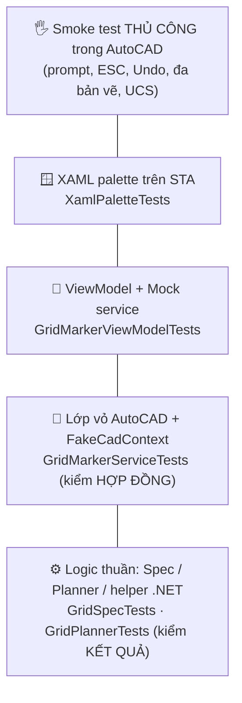

> **🎓 Học viện CadCoreFramework** · [Lộ trình](README.md) · [← T04](T04_DEBUGGING_TROUBLESHOOTING.md) · **T05** · [T06 →](T06_BUILD_RELEASE_DEVOPS.md)

# T05 — Chiến Lược Kiểm Thử

Plugin AutoCAD **không thể** unit test theo kiểu thông thường: hầu hết API cần lõi C++ của AutoCAD đang chạy. Chiến lược của dự án vì vậy không phải "mock AutoCAD", mà là **thiết kế để phần cần AutoCAD càng mỏng càng tốt**, rồi test mỗi tầng bằng công cụ phù hợp với nó.

> [!IMPORTANT]
> Nguyên tắc: **nếu một đoạn code không bắt buộc phải gọi AutoCAD API, nó không được nằm trong lambda của `ICadContext.Execute`.** Code trong lambda chỉ test được *"có gọi Execute không"*. Code ngoài lambda test được *"kết quả có đúng không"*. ([Phần 9 §9.2](../09_GOLDEN_SAMPLE.md))

---

## 1. Vì sao khó

| Có trong test process (`dotnet test`) | Không có |
| :--- | :--- |
| Kiểu thuần .NET của AutoCAD: `Point3d`, `Vector3d`, `TypedValue`, `ObjectId` (struct) | Lõi C++: tạo `new Line()`, mở `Database`, `Transaction` thật |
| Kiểu của plugin: `GridSpec`, `CadResult`, ViewModel | `Application.DocumentManager`, `Editor`, sysvar |
| WPF (trên thread STA) | PaletteSet, Ribbon của AutoCAD |

Project test tham chiếu `AutoCAD.NET` **không** có `ExcludeAssets`, nên các DLL managed được copy vào thư mục test và dùng được cho *kiểu dữ liệu*. Còn mọi thứ chạm tới lõi C++ sẽ hỏng ngay khi chạy.

---

## 2. Kim tự tháp test của dự án



| Tầng | Số lượng nên có | Tốc độ | Bắt được | Không bắt được |
| :--- | :---: | :---: | :--- | :--- |
| Logic thuần | **Nhiều nhất** | ms | Sai công thức, biên, validate | Tương tác AutoCAD |
| Vỏ AutoCAD (FakeCadContext) | Vừa | ms | Gọi sai overload, sai undo mark, publish sai thời điểm, không xử lý lỗi | Nội dung lambda |
| ViewModel (Mock) | Vừa | ms | `CanExecute`, trạng thái, subscription | Binding XAML |
| XAML (STA) | 1 / palette | 100 ms | XAML sai, resource thiếu, DI chưa đăng ký | Hành vi trong PaletteSet thật |
| Thủ công trong AutoCAD | Checklist | phút | Mọi thứ còn lại | — |

Tổng hiện tại: **196 test × 2 runtime** (`net48`, `net8.0-windows`), chạy trên CI mỗi PR.

---

## 3. Logic thuần: kiểm kết quả

🔎 [`GridPlannerTests`](../../CadCoreFramework.Tests/Samples/GridMarker/GridPlannerTests.cs), [`GridSpecTests`](../../CadCoreFramework.Tests/Samples/GridMarker/GridSpecTests.cs)

Tên test mô tả **hành vi**, không mô tả cách cài đặt: `Plan_FirstCellIsAtOrigin`, `Plan_ColumnsGoRight_RowsGoDown`, `Plan_IsRowMajorOrdered`, `ToRowLetters_MatchesSpreadsheetConvention`, `Plan_InvalidSpec_ThrowsWithValidationMessage`.

```csharp
// Nguyên văn từ GridPlannerTests.cs
[Fact]
public void Plan_ColumnsGoRight_RowsGoDown()
{
    var cells = GridPlanner.Plan(new GridSpec(2, 3, spacing: 20), 0, 0);

    var b3 = cells.Single(c => c.Row == 1 && c.Column == 2);
    b3.CenterX.Should().Be(40);    // cột thứ 3 (index 2) → +2 × 20
    b3.CenterY.Should().Be(-20);   // hàng B (index 1) → −1 × 20
    b3.Label.Should().Be("B3");
}
```

Vì sao `GridCell` dùng `double CenterX/CenterY` thay vì `Point3d`? `Point3d` *dùng được* trong test, nhưng để logic thuần **không phụ thuộc kiểu AutoCAD**: chuyển sang dự án khác, dùng ở server, hay test bằng framework bất kỳ đều không vướng.

Kỹ thuật nên dùng:
- `[Theory]` + `[InlineData]` cho bảng giá trị (`ToRowLetters`: 0→A, 25→Z, 26→AA, 701→ZZ, 702→AAA).
- Test **biên**: 1 ô, tối đa (`MaxDimension`, `MaxCells`), giá trị 0/âm.
- Validate trả **danh sách lỗi**: kiểm rằng *nhiều* lỗi được báo cùng lúc.

---

## 4. Lớp vỏ AutoCAD: `FakeCadContext` kiểm hợp đồng

🔎 [`CadCoreFramework.Testing/Fakes/FakeCadContext.cs`](../../CadCoreFramework.Testing/Fakes/FakeCadContext.cs), [`GridMarkerServiceTests`](../../CadCoreFramework.Tests/Samples/GridMarker/GridMarkerServiceTests.cs)

| Thành viên | Dùng để |
| :--- | :--- |
| `ExecuteCount`, `ExecuteReadCount`, `ExecuteAsyncCount`, `ExecuteBatchCount` | Kiểm số lần / overload được gọi (`TryExecute` cũng tăng `ExecuteCount`) |
| `LastUndoMarkName`, `LastAutoRegen` | Kiểm tham số |
| `ExceptionToThrow` | Giả lập lỗi AutoCAD. `TryExecute` trả `Fail`, `Execute` ném |
| `ExecuteAction = false` | **Không chạy lambda**. Bắt buộc khi lambda dùng `scope.Transaction`/`Database` (đều là `null` trong `FakeCadScope`) |
| `LastScope.AppendedEntities` | Chỉ dùng khi lambda tự tạo entity mà không cần lõi C++ (hiếm) |

```csharp
// Nguyên văn từ GridMarkerServiceTests.cs
private readonly FakeCadContext _ctx = new FakeCadContext { ExecuteAction = false };

[Fact]
public void Draw_UsesSingleExecute_WithUndoMark()
{
    var (spec, cells) = Grid();          // helper: GridSpec(2, 2) + GridPlanner.Plan(spec, 0, 0)
    NewService().Draw(spec, cells);

    _ctx.ExecuteCount.Should().Be(1);
    _ctx.ExecuteBatchCount.Should().Be(0);
    _ctx.LastUndoMarkName.Should().Be(GridMarkerService.UndoMarkName);
    _ctx.LastAutoRegen.Should().BeFalse();
}
```

Giới hạn cần biết:
- `FakeCadContext` **không mô phỏng** `CadContextGuard`. Test không bắt được lỗi "Execute lồng nhau", nên phải review code và chạy thử trong AutoCAD.
- Không kiểm được nội dung bên trong lambda, nên logic phải được đưa ra ngoài (§3).
- `ExecuteAsync` của Fake `await` phần chuẩn bị nhưng không mô phỏng việc đổi bản vẽ hay đóng bản vẽ.

Các kịch bản *hợp đồng* đáng test cho mọi Service:
1. Gọi đúng **một** `TryExecute`/`Execute` (không vô tình mở N transaction).
2. **Đúng undo mark** (Service dùng chung cho palette).
3. Input rỗng thì **không mở transaction** (`Draw_EmptyCells_DoesNotTouchDrawing`).
4. Publish message **chỉ khi thành công**, sau khi `TryExecute` trả về.
5. Subscriber ném lỗi **không** làm kết quả thành thất bại (`PublishSafely`).

---

## 5. ViewModel: Mock service

🔎 [`GridMarkerViewModelTests`](../../CadCoreFramework.Tests/Samples/GridMarker/GridMarkerViewModelTests.cs)

Các test thật: `NewViewModel_DefaultsAreValid_DrawEnabled`, `InvalidInput_DisablesDraw_AndShowsErrors`, `FixingInput_ReenablesDraw`, `InputChange_RaisesCanExecuteChanged`, `Draw_PassesSpecAndPlannedCellsToService`, `Draw_ServiceReturnsFail_SetsErrorStatus`, `Draw_ServiceThrows_SetsErrorStatus_DoesNotCrash`, `GridDrawnMessage_RefreshesMarkerCount`, `Dispose_StopsListeningToMessages`, `Constructor_NullDependency_Throws`.

```csharp
// Nguyên văn từ GridMarkerViewModelTests.cs (_events là EventAggregator thật, _service là Mock<IGridMarkerService>)
[Fact]
public void Dispose_StopsListeningToMessages()
{
    var vm = NewViewModel();
    vm.Dispose();

    _events.Publish(new GridDrawnMessage(12, "SAMPLE_GRID"));

    _service.Verify(s => s.CountMarkers(), Times.Never);   // không còn nghe sau Dispose
}
```

ViewModel test được *vì* nó tuân thủ quy tắc: **không kiểu WPF, không AutoCAD API** ([T02 §1](T02_ARCHITECTURE_DEEP_DIVE.md#1-bản-đồ-dự-án-và-quy-tắc-phụ-thuộc)). Trạng thái là enum `GridMarkerStatus`, màu sắc do XAML tự chọn.

---

## 6. XAML palette trên STA

🔎 [`XamlPaletteTests`](../../CadCoreFramework.Tests/XamlPaletteTests.cs)

Test **dựng thật** từng palette (`InitializeComponent` + nạp `Styles.xaml` + theme + lấy ViewModel từ DI), nhờ ba kỹ thuật:
1. **Container giả**: `ServiceCollection` với Mock service + ViewModel thật, gán vào `AppBootstrapper.ServiceProvider` bằng **reflection** (setter là private). Không dùng `SetServiceProviderForTesting` vì nó chỉ tồn tại ở bản `DEBUG`, còn CI chạy test ở Release. Khôi phục giá trị cũ trong `finally`.
2. **Thread STA**: WPF bắt buộc. Exception được chuyển về thread test bằng `ExceptionDispatchInfo`.
3. **Đăng ký scheme `pack://`** (đọc `PackUriHelper.UriSchemePack`): WPF tự làm khi có `Application`, còn test không có.

Test này **đã tái hiện đúng** lỗi [A3](T03_PITFALLS_CASEBOOK.md#a3-show_ui_template-lỗi-provide-value-on-staticresourceextension) trên markup cũ. Thêm palette mới thì phải thêm một test ở đây.

---

## 7. Những gì chỉ AutoCAD thật mới kiểm được

Chạy checklist này **trên phiên AutoCAD sạch** trước mỗi release và sau mọi thay đổi ở lớp vỏ/biên:

| # | Kịch bản | Kỳ vọng |
| :---: | :--- | :--- |
| 1 | `CORE_INFO` | `[CadCoreFramework] Hạ tầng plugin đã sẵn sàng.` |
| 2 | `CORE_TEST_ALL` | Layer `CORE_TEST`, hình chữ nhật, MText, DBText, đọc lại XData; dòng cuối "TẤT CẢ BÀI TEST HẠ TẦNG ĐÃ VƯỢT QUA" |
| 3 | `DRAW_CIRCLE_SAMPLE` | `Đã vẽ đường tròn (ID: …)` |
| 4 | `SAMPLE_GRID` → `0,0`, `2`, `3`, `20` | `Đã vẽ 6 ô trên layer …`; **một** lần Ctrl+Z xóa cả lưới |
| 5 | `SAMPLE_GRID` → nhấn **ESC** ở prompt bất kỳ | Thoát êm, không in lỗi, không ghi vào lịch sử lệnh |
| 6 | `DEMO_HELP` | Danh sách lệnh demo (xác nhận namespace `Demos`) |
| 7 | `SHOW_PALETTE` → bấm *Vẽ lưới* | Vẽ được; Ctrl+Z một lần xóa cả lưới (undo mark từ palette) |
| 8 | Mở **2 bản vẽ**, chạy palette ở bản thứ 2 | Vẽ đúng bản vẽ đang active |
| 9 | Xoay UCS (`UCS Z 30`), chạy `SAMPLE_GRID`, pick điểm | Ô đầu tiên nằm đúng chỗ click (WCS) |
| 10 | Khóa layer `SAMPLE_GRID`, vẽ từ palette | Báo lỗi thân thiện (Status = Error), không crash |
| 11 | `CORE_DEBUG` | Thấy lịch sử các lệnh trên, số subscriber hợp lý |
| 12 | Đóng/mở palette 5 lần, xem `CORE_DEBUG` | Số subscriber **không tăng dần** (không rò rỉ) |

Ghi kết quả vào mô tả PR, ví dụ: *"Smoke 1–12 pass trên AutoCAD 2024, commit abc1234"*.

---

## 8. Chạy test và coverage

```powershell
# Toàn bộ, cả hai runtime
dotnet test CadCoreFramework.Tests/CadCoreFramework.Tests.csproj

# Một nhóm test
dotnet test CadCoreFramework.Tests/CadCoreFramework.Tests.csproj --filter "FullyQualifiedName~GridMarker"

# Coverage + báo cáo HTML (giống CI)
dotnet test CadCoreFramework.Tests/CadCoreFramework.Tests.csproj --collect:"XPlat Code Coverage" --results-directory coverage
dotnet tool restore
dotnet reportgenerator -reports:"coverage/**/coverage.cobertura.xml" -targetdir:"coverage/report" -reporttypes:"Html"
```

**Coverage hiện khoảng 16% (line).** Con số thấp là **có lý do**: phần lớn code (Extensions, Utils, Core vỏ) gọi thẳng AutoCAD API nên không chạy được ngoài AutoCAD. Đừng chạy theo con số. Hãy đặt câu hỏi: *"logic nào đang kẹt trong lambda mà lẽ ra phải tách ra?"* Mỗi lần tách được một Planner là một lần coverage tăng **có ý nghĩa**.

---

## 9. Integration test headless: hiện trạng và hướng đi

- Hiện **không khả thi**: plugin là một DLL tham chiếu `AcMgd`, mà accoreconsole không nạp được `AcMgd` ([A5](T03_PITFALLS_CASEBOOK.md#a5-accoreconsole-crash-0xc00000fd-khi-netload-plugin)). Runner trả exit code 3.
- Hướng đi ([B-20](T09_SENIOR_PLAYBOOK.md#3-backlog-kỹ-thuật-đã-kiểm-chứng)): tách `CadCoreFramework.Core.dll` (chỉ `AcDbMgd` + `AcCoreMgd`: Core không UI, Extensions, Utils, Services, logic Samples, lệnh không palette) và `CadCoreFramework.UI.dll` (palette, ribbon, theme). Smoke test NETLOAD **DLL Core** trong accoreconsole. Cái giá: hai DLL cần nạp, cơ chế đăng ký DI cho module UI, và thay đổi quy trình nạp của nhóm. Đây là quyết định kiến trúc, cần ADR ([T09 §1](T09_SENIOR_PLAYBOOK.md#1-adr-vì-sao-kiến-trúc-như-hiện-tại)).

---

## 10. Quy tắc viết test

1. **Tên = hành vi**: `Method_Condition_ExpectedResult`.
2. **AAA** (Arrange, Act, Assert), mỗi test kiểm **một** hành vi.
3. **Xác định**: không phụ thuộc giờ hệ thống (`LoggerService` nhận `Func<DateTimeOffset>` để giả lập đồng hồ), file thật (dùng thư mục tạm + dọn dẹp), thứ tự chạy.
4. **FluentAssertions** cho thông điệp lỗi dễ đọc. **Moq** chỉ cho interface.
5. **Test phải chứng minh nó đã chạy** ([A6](T03_PITFALLS_CASEBOOK.md#a6-integration-test-báo-passed-dù-không-lệnh-nào-chạy)): khi viết test mới cho một bug, chạy nó **trên code cũ trước** và xác nhận nó **fail**.
6. Test chạy trên **cả hai TFM**. Đừng dùng API chỉ có ở một runtime mà không `#if`.

---

## ✅ Tự kiểm tra T05

1. Viết (trên giấy) 3 test hợp đồng cho `LayerService.ToggleLayerVisibility` bằng `FakeCadContext`.
2. Một đồng nghiệp muốn tăng coverage bằng cách mock `ICadScope` để chạy lambda. Bạn phản hồi thế nào?
3. Vì sao checklist thủ công có kịch bản "đóng/mở palette 5 lần"?

<details><summary>Gợi ý đáp án</summary>

1. (a) Gọi đúng 1 `TryExecute` với `undoMarkName == LayerService.ToggleUndoMarkName` và `autoRegen == true`; (b) `layerName` rỗng thì ném `ArgumentException` và **không** gọi `TryExecute`; (c) `ExceptionToThrow` được set thì trả `CadResult` thất bại, không ném.
2. Lambda dùng `scope.Transaction`/`Database` (kiểu AutoCAD thật), nên mock scope không giúp được: bạn sẽ mock lại cả AutoCAD. Test sẽ giòn và chỉ kiểm cách mình mock. Hãy **tách logic ra khỏi lambda** (Planner) rồi test kết quả của nó.
3. Để phát hiện rò rỉ subscription. EventAggregator giữ tham chiếu mạnh, nên ViewModel không được Dispose sẽ làm số subscriber trong `CORE_DEBUG` tăng dần.
</details>

---

**Tiếp theo:** [T06 — Build, phát hành & DevOps →](T06_BUILD_RELEASE_DEVOPS.md)
