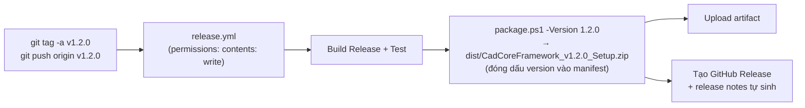

> **🎓 Học viện CadCoreFramework** · [Lộ trình](README.md) · [← T05](T05_TESTING_STRATEGY.md) · **T06** · [T07 →](T07_PERFORMANCE_AND_SCALE.md)

# T06 — Build, Phát Hành & DevOps

> **Cấp độ:** 🌿 Junior → 🏔️ Senior · **Cần trước:** [T05](T05_TESTING_STRATEGY.md); Git & PR ([C05 §4](C05_ASYNC_TESTING_GIT.md#4-git-và-pull-request)) · **Trong lộ trình:** tuần 13 ([README §3](README.md#3-lộ-trình-đào-tạo))

Code chạy được trên máy bạn mới là một nửa. Nửa còn lại là **build tái lập được**, **CI chặn được lỗi**, và **bản phát hành đến tay người dùng đúng như bạn nghĩ**. Module này giải thích từng mắt xích, và chỉ ra những mắt xích đã từng đứt ([T03 A7–A12](T03_PITFALLS_CASEBOOK.md#a7-init-templateps1-không-parse-được-trên-windows-powershell-51)).

---

## Mục lục

1. [Cấu trúc solution](#1-cấu-trúc-solution)
2. [Giải phẫu `CadCoreFramework.csproj`](#2-giải-phẫu-cadcoreframeworkcsproj)
3. [Build và chất lượng mã](#3-build-và-chất-lượng-mã)
4. [CI: `build-and-test.yml`](#4-ci-build-and-testyml)
5. [Quy trình phát hành (release)](#5-quy-trình-phát-hành-release)
6. [Bundle Autoloader và cài đặt](#6-bundle-autoloader-và-cài-đặt)
7. [Chính sách dependency](#7-chính-sách-dependency)
8. [Template: tạo dự án mới](#8-template-tạo-dự-án-mới)
9. [Quy trình Git](#9-quy-trình-git)

---

## 1. Cấu trúc solution

| Project | Target | Vai trò | Đóng gói vào plugin? |
| :--- | :--- | :--- | :---: |
| `CadCoreFramework` (gốc repo) | `net48;net8.0-windows`, x64, WPF + WinForms | **Plugin** | ✅ |
| `CadCoreFramework.Analyzers` | `netstandard2.0` | Roslyn analyzer CAD001–CAD003 (chạy lúc build) | ❌ |
| `CadCoreFramework.Testing` | `net48;net8.0-windows`, x64 | Test double: `FakeCadContext`, `FakeCadScope` | ❌ |
| `CadCoreFramework.Tests` | `net48;net8.0-windows`, x64, WPF | xUnit + FluentAssertions + Moq (+ Roslyn cho `AnalyzerTests`) | ❌ |
| `CadCoreFramework.Benchmarks` | `net8.0-windows` | BenchmarkDotNet cho code thuần | ❌ |
| `HeadlessLab` (`tests/integration/HeadlessLab`) | `net48`, x64 | Kiểm thử trên AutoCAD thật trong accoreconsole; **link** mã không-UI, chỉ `AcDbMgd` + `AcCoreMgd`. CI chỉ biên dịch | ❌ |

Project plugin nằm **ở gốc repo**, nên các thư mục project khác phải bị loại khỏi glob biên dịch (`DefaultItemExcludes`). Nếu không, code test sẽ bị biên dịch lẫn vào plugin. (Chính lỗi này đã xảy ra khi thêm HeadlessLab: `obj/` của nó lọt vào plugin, gây `CS0579 Duplicate attribute` — sửa bằng `tests\**`.)

---

## 2. Giải phẫu `CadCoreFramework.csproj`

🔎 [`CadCoreFramework.csproj`](../../CadCoreFramework.csproj)

| Thiết lập | Giá trị | Vì sao |
| :--- | :--- | :--- |
| `TargetFrameworks` | `net48;net8.0-windows` | AutoCAD 2021–2024 / 2025+ |
| `UseWPF`, `UseWindowsForms` | `true` | Palette WPF; `MessageBox`/`PaletteSet` cần WinForms |
| `EnableDynamicLoading` (chỉ net8) | `true` | Copy dependency NuGet ra output cho plugin nạp động ([A4](T03_PITFALLS_CASEBOOK.md#a4-bản-net8-thiếu-toàn-bộ-dll-phụ-thuộc)) |
| `Platforms` / `PlatformTarget` | `x64` | AutoCAD chỉ 64-bit; tham chiếu DLL AutoCAD AMD64 |
| `LangVersion` | `10.0` | Cùng một cú pháp cho cả hai TFM |
| `Nullable` | `annotations` | Cho phép chú thích `?` trên API công khai mà không ngập cảnh báo từ AutoCAD API (chưa có annotation) |
| `EnforceCodeStyleInBuild`, `AnalysisLevel=latest`, `AnalysisMode=Recommended` | | Rule IDE/CA chạy **lúc build**, không chỉ trong IDE |
| `GenerateDocumentationFile` + `NoWarn CS1591` | | Bắt buộc để IDE0005 (using thừa) chạy khi build; không bắt doc cho mọi member |
| `AssemblyName` (Debug) | `CadCoreFramework_yyyyMMdd_HHmmss` | Hot-reload ([T02 §2.1](T02_ARCHITECTURE_DEEP_DIVE.md#21-hot-reload-tên-assembly-có-timestamp)). Target `PostBuild` copy về tên cố định |
| `DefaultItemExcludes` | các project khác + `Templates\**` + `tests\**` | Không biên dịch lẫn code test / template |
| `IncludeDemos` | mặc định `true` | `false` thì loại `Demos/**` khỏi DLL |
| `MSBuildWarningsAsMessages` | `MSB3277` | Xung đột version vô hại khi có thư mục `dist/` cạnh NuGet |
| `PackageReference AutoCAD.NET*` | `24.0.0` (net48) / `25.0.1`+`25.0.0` (net8), `ExcludeAssets="runtime"` | Biên dịch theo API, **không** copy DLL AutoCAD ra output. `25.0.1` để tránh NU1608 (bản `25.0.0` ghim `Core` pre-release) |
| `Reference Microsoft.CSharp` (net48) | | `dynamic` cho COM UndoMark. Trước đây có gián tiếp nhờ Serilog |
| `ProjectReference` Analyzers `OutputItemType="Analyzer"`, `ReferenceOutputAssembly="false"` | | Chạy analyzer khi build, không đóng gói DLL analyzer |

---

## 3. Build và chất lượng mã

```powershell
dotnet build CadCoreFramework.sln -c Release -warnaserror      # đúng lệnh CI dùng
dotnet build CadCoreFramework.csproj -c Debug -f net48         # vòng lặp dev nhanh
dotnet build CadCoreFramework.csproj -c Release -p:IncludeDemos=false   # kiểm tra build không demo
```

**Chính sách 0 warning.** CI build với `-warnaserror`, nên một warning mới (using thừa, XML doc sai, API `[Obsolete]`, CAD001, MSB3270…) làm CI đỏ. [`.editorconfig`](../../.editorconfig) quy định mức độ: naming interface/async, `IDE0005`, `CA1050` là `warning`, còn rule chỉ mang tính phong cách thì để `suggestion`/`none`.

Quy ước file: 4 dấu cách, CRLF trong working tree, `utf-8-bom`. Riêng `*.ps1` **bắt buộc BOM** ([A7](T03_PITFALLS_CASEBOOK.md#a7-init-templateps1-không-parse-được-trên-windows-powershell-51)), và `.gitattributes` ép `*.bat`/`*.cmd` dùng CRLF.

---

## 4. CI: `build-and-test.yml`

🔎 [`.github/workflows/build-and-test.yml`](../../.github/workflows/build-and-test.yml). Chạy trên mọi push/PR vào `main`, runner `windows-latest`.

| Bước | Làm gì | Ghi chú |
| :--- | :--- | :--- |
| Checkout, Setup .NET 8.0.x, Cache NuGet | | Cache theo hash các `*.csproj` |
| `dotnet tool restore` | Cài ReportGenerator (khai báo trong `.config/dotnet-tools.json`) | |
| Build Release `-warnaserror` | | 0 warning hoặc đỏ |
| Test + coverage (cả 2 TFM) | `--collect:"XPlat Code Coverage"`, `--logger "trx;LogFilePrefix=test-results"` | `LogFilePrefix` (không phải `LogFileName`) để hai TFM không ghi đè `.trx` của nhau |
| ReportGenerator | HTML + Cobertura | |
| Upload artifact | `test-results`, `coverage-report` | Xem trong trang run của Actions |

Runner **không có AutoCAD**. CI chỉ kiểm build + unit test, nên smoke test trong AutoCAD vẫn là trách nhiệm của người phát hành ([T05 §7](T05_TESTING_STRATEGY.md#7-những-gì-chỉ-autocad-thật-mới-kiểm-được)).

Xem trạng thái nhanh: `gh run list --limit 5`. Xem log bước lỗi: `gh run view <id> --log-failed`.

**Dependabot** ([`.github/dependabot.yml`](../../.github/dependabot.yml)): mỗi thứ Hai mở PR nâng version cho GitHub Actions và NuGet. Các bản nâng được gộp thành tối đa 3 PR: `github-actions`, `plugin-runtime` (package đi theo bundle vào AutoCAD) và `dev-tools` (test, benchmark, ReportGenerator). CI ở trên chạy trên từng PR. Những package bị loại khỏi tự động, và lý do, xem [§7](#7-chính-sách-dependency).

---

## 5. Quy trình phát hành (release)

### 5.1 Version và CHANGELOG

- **SemVer**: `MAJOR.MINOR.PATCH`. Đổi API công khai không tương thích thì tăng MAJOR. Thêm tính năng thì MINOR. Sửa lỗi thì PATCH.
- [`CHANGELOG.md`](../../CHANGELOG.md) theo *Keep a Changelog*. Mọi PR thay đổi hành vi ghi vào mục `[Unreleased]`. Khi phát hành, đổi `[Unreleased]` thành `[x.y.z] — YYYY-MM-DD`, tạo mục `[Unreleased]` mới trống, và cập nhật link so sánh ở cuối file.
- Version **của bundle** (`AppVersion`, `Version` trong `PackageContents.xml`) được `package.ps1` **đóng dấu từ tag** lúc phát hành. Không sửa tay trong repo.

### 5.2 Luồng tự động



🔎 [`release.yml`](../../.github/workflows/release.yml), [`package.ps1`](../../package.ps1):
- `package.ps1` build `-p:Platform=x64`, nên output nằm ở `bin\x64\Release\<tfm>\`. Nó copy DLL plugin + dependency (bỏ `Ac*`/`Ad*`) vào `CadCoreFramework.bundle\Contents\{net48,net8.0-windows}\`, copy `PackageContents.xml` + `Install.bat` + `Uninstall.bat` + `HDSD.txt`, rồi nén thành **một** zip.
- Đóng dấu version bằng `-creplace` (phân biệt hoa/thường), để khai báo `<?xml version="1.0"?>` không bị đổi ([A11](T03_PITFALLS_CASEBOOK.md#a11-packageps1-làm-hỏng-xml-version-khi-đóng-dấu-version)).
- Workflow upload **chính zip của `package.ps1`**, không nén lại `dist\*`. Nén lại sẽ tạo zip lồng zip.

### 5.3 Checklist phát hành

| # | Việc | Ai |
| :---: | :--- | :--- |
| 1 | `main` xanh CI, không còn PR dở dang cho bản này | Người phát hành |
| 2 | **HeadlessLab** (`.\tests\integration\run-headless-lab.ps1`) exit 0, rồi **smoke test thủ công** 17 bước ([T05 §7](T05_TESTING_STRATEGY.md#7-những-gì-chỉ-autocad-thật-mới-kiểm-được)) trên AutoCAD sạch, từ commit sắp gắn tag | Người phát hành |
| 3 | Chạy `package.ps1` **trên bản sao** của repo (không làm bẩn `dist/` thật), đọc lại mọi file người dùng sẽ thấy: `HDSD.txt`, thông điệp `Install.bat` ([A12](T03_PITFALLS_CASEBOOK.md#a12-gói-phát-hành-kèm-hướng-dẫn-của-một-sản-phẩm-khác)) | Người phát hành |
| 4 | Thử `Install.bat`/`Uninstall.bat` với `APPDATA` trỏ thư mục tạm, **đếm số file đã cài** so với số file trong `CadCoreFramework.bundle` của zip. Thử cả một đường dẫn **dài** (giải nén vào thư mục sâu): trước v1.1.0, `xcopy` bỏ sót file ở đường dẫn dài hơn khoảng 254 ký tự mà script vẫn báo thành công | Người phát hành |
| 5 | PR đổi CHANGELOG `[Unreleased]` → `[x.y.z] — ngày`; merge | Owner merge |
| 6 | `git tag -a vx.y.z -m "…"` trên commit merge; `git push origin vx.y.z` | Người phát hành |
| 7 | Theo dõi `release.yml`; **tải zip từ trang Release về kiểm tra** (version trong manifest, đủ DLL hai TFM) | Người phát hành |
| 8 | Cài từ zip vào AutoCAD thật; gỡ cài đặt lại nếu máy dev dùng tool nạp DLL (tránh nạp 2 bản) | Người phát hành |

> [!WARNING]
> **Tag đã công khai thì không được chuyển** sang commit khác *sau khi* đã có Release / có người tải. Ngoại lệ duy nhất (đã dùng một lần với `v1.0.0`, xem [A10](T03_PITFALLS_CASEBOOK.md#a10-release-workflow-lỗi-403-resource-not-accessible-by-integration)): workflow lỗi **trước khi** tạo được Release. Khi đó xóa tag rồi tạo lại trên commit đã sửa. Trường hợp khác thì phát hành bản PATCH mới.

---

## 6. Bundle Autoloader và cài đặt

🔎 [`Deployment/PackageContents.xml`](../../Deployment/PackageContents.xml)

```text
CadCoreFramework.bundle/
├── PackageContents.xml           ← manifest Autoloader đọc
└── Contents/
    ├── net48/CadCoreFramework.dll (+ DI, MVVM, Newtonsoft, System.*)
    └── net8.0-windows/CadCoreFramework.dll (+ dependency)
```

| Trường | Ý nghĩa |
| :--- | :--- |
| `ProductCode` / `UpgradeCode` | Danh tính sản phẩm. **Mỗi dự án tạo từ template phải có GUID riêng** (template/`init-template.ps1` tự sinh). `UpgradeCode` được giữ đồng bộ với file WiX |
| `RuntimeRequirements SeriesMin/SeriesMax` | Dải phiên bản AutoCAD áp dụng (R24.0–R24.3 cho net48; R25.0–R26.0 cho net8) |
| `ComponentEntry ModuleName` | Đường dẫn DLL **tương đối với bundle** |
| `LoadOnAutoCADStartup="True"` | Nạp khi AutoCAD khởi động |
| `<Commands>` | Khai báo lệnh cho cơ chế demand-load. Mỗi `ComponentEntry` (net48, net8) liệt kê **đúng** mọi lệnh không phải demo (hiện 9 lệnh). Test `PackageManifestTests` quét `[CommandMethod]` trong mã nguồn và đỏ nếu thiếu hay thừa lệnh |

- [`Install.bat`](../../Deployment/Install.bat): copy bundle vào `%APPDATA%\Autodesk\ApplicationPlugins\` (theo người dùng, không cần admin). [`Uninstall.bat`](../../Deployment/Uninstall.bat) xóa nó.
- `Deployment/installer/`: khung MSI bằng WiX 4 (tùy chọn) cho người cần trình cài đặt chuẩn Windows.

---

## 7. Chính sách dependency

Plugin sống chung AppDomain với AutoCAD và các plugin khác ([T01 §1](T01_AUTOCAD_NET_FOUNDATIONS.md#1-plugin-sống-ở-đâu-autocad-net-và-appdomain-dùng-chung)). Vì vậy mỗi dependency là một **rủi ro xung đột**.

**Trước khi thêm một NuGet package:**
1. **Có thật cần không?** Vài chục dòng tự viết (như `LoggerService`) thường rẻ hơn một rủi ro xung đột.
2. **Thư mục cài AutoCAD có DLL cùng tên không?** Kiểm tra `C:\Program Files\Autodesk\AutoCAD 20xx\`. Nếu có **cùng `AssemblyVersion`** thì **không dùng được** bản khác của bạn ([A1](T03_PITFALLS_CASEBOOK.md#a1-serilog-missingmethodexception-ngay-khi-khởi-động)). Khác `AssemblyVersion` thì nạp song song được (Newtonsoft 12 của AutoCAD cạnh 13 của plugin).

   ```powershell
   $name = 'Serilog'
   Get-ChildItem "C:\Program Files\Autodesk\AutoCAD 2024" -Filter "$name*.dll" |
     ForEach-Object { "{0}  {1}" -f $_.Name, [Reflection.AssemblyName]::GetAssemblyName($_.FullName).Version }
   ```
3. **Dependency bắc cầu** của nó là gì (`System.Memory`, `System.Runtime.CompilerServices.Unsafe`…)?
4. Có bản cho **cả `net48` và `net8`** không?
5. **Kiểm thử trong AutoCAD thật**, vì CI không phát hiện được xung đột với host.

Dependency hiện tại: `CommunityToolkit.Mvvm 8.2.2`, `Microsoft.Extensions.DependencyInjection 8.0.0`, `Newtonsoft.Json 13.0.3`, `MiniExcel 1.44.1` (+ dependency bắc cầu `System.*` cho net48).

**Nâng version (Dependabot, xem [§4](#4-ci-build-and-testyml)):**

| Package | Dependabot | Lý do |
| :--- | :--- | :--- |
| `AutoCAD.NET*` | Bỏ qua | Version gắn với dải AutoCAD đích: 24.x cho net48 (AutoCAD 2024), 25.x cho net8. Đổi là quyết định có chủ đích |
| `MiniExcel` | Bỏ qua (ghim 1.44.1) | Từ 1.45, trên net48 nó kéo theo `Microsoft.Bcl.AsyncInterfaces` 10.x; 1.44.1 không có dependency |
| `Microsoft.CodeAnalysis*` | Bỏ qua (ghim 4.6.0) | Là mức sàn của analyzer: analyzer không được đòi Roslyn mới hơn VS/SDK của người dùng |
| `FluentAssertions` | Chỉ tới 7.x | Từ v8 dùng license của Xceed, phải trả phí khi dùng thương mại; v7 vẫn Apache 2.0 |
| `CommunityToolkit.Mvvm`, `Microsoft.Extensions.DependencyInjection`, `Newtonsoft.Json` | Minor + patch (nhóm `plugin-runtime`) | Bản major thường đổi dependency bắc cầu cho net48 |
| Còn lại (test, benchmark, tool) | Mọi bản (nhóm `dev-tools`) | Chỉ chạy trên máy dev/CI; CI xanh là đủ |

> [!WARNING]
> **PR `plugin-runtime` xanh CI vẫn chưa được merge ngay.** CI không có AutoCAD, nên không thấy được xung đột với host. Trước khi merge, làm bước 2–5 của checklist trên với bản mới: so danh sách DLL trong `bin\x64\Release\net48\` trước và sau khi nâng, rồi thử trong AutoCAD thật. `ignore` trong `dependabot.yml` cũng chặn PR security update của chính package đó, nên package bị bỏ qua phải tự theo dõi cảnh báo bảo mật.

---

## 8. Template: tạo dự án mới

| Cách | Lệnh |
| :--- | :--- |
| `dotnet new` | `dotnet new install .` rồi `dotnet new cad-plugin -n MyPlugin --GitHubRepo owner/repo --IncludeDemos false` |
| Clone + script | `.\init-template.ps1 -ProjectName "MyPlugin" -GitHubRepo "owner/repo" -RemoveDemos` |

Cả hai đều: đổi tên project/namespace/file, sinh GUID mới (assembly, solution, ProductCode/UpgradeCode bundle + MSI), đặt repo cho badge CI và help link CAD001 (bỏ trống thì dùng placeholder `YOUR_ORG/YOUR_REPO`, không trỏ về repo template), và tùy chọn bỏ `Demos/`.

> [!TIP]
> **Thử template mà không làm bẩn máy:** `dotnet new install . --debug:custom-hive "$env:TEMP\hive"` và `dotnet new cad-plugin … --debug:custom-hive "$env:TEMP\hive"`. Sau đó **build + test dự án sinh ra** (và `init-template.ps1` trên một bản sao repo). Đó là cách lỗi [A9](T03_PITFALLS_CASEBOOK.md#a9-dotnet-new-cad-plugin--n-myplugin-sinh-ra-authorcsproj), [A15](T03_PITFALLS_CASEBOOK.md#a15-dự-án-tạo-bằng-dotnet-new-mất-các-khối-if) và [A16](T03_PITFALLS_CASEBOOK.md#a16-test-chỉ-pass-nhờ-thứ-tự-chạy) được tìm ra.

> [!WARNING]
> **Template engine xử lý `#if` trong file `.cs`** như điều kiện template (ký hiệu lạ = `false`) và dò cả trong comment. Khối biên dịch có điều kiện phải được bao bằng `//-:cnd:noEmit` … `//+:cnd:noEmit` (xem `Properties/AssemblyInfo.cs`), và comment không được viết token đó ([A15](T03_PITFALLS_CASEBOOK.md#a15-dự-án-tạo-bằng-dotnet-new-mất-các-khối-if)). Mẫu loại trừ trong `.template.config/template.json` dùng `**/` để khớp mọi thư mục (`*.log` chỉ khớp thư mục gốc).

Lệnh mới đơn lẻ: `dotnet new install .\Templates\cad-command` rồi `dotnet new cad-command -n PanelDrawCommand --AutoCadCommandName DRAW_PANEL` ([Templates/README.md](../../Templates/README.md)). Snippet Visual Studio / VS Code: `cadcmd`, `cadscope`, `cadsvc`, `cadvm` ([snippets/README.md](../../snippets/README.md)).

---

## 9. Quy trình Git

1. **Không commit thẳng vào `main`.** Tạo branch: `feat/…`, `fix/…`, `docs/…`.
2. Commit message theo kiểu *conventional* như lịch sử repo: `feat:`, `fix:`, `refactor:`, `docs:`, `chore:`, `fix(ci):`. Thân commit giải thích **vì sao**.
3. Mở PR: mô tả *Summary* + *Verification* (đã chạy gì, kết quả). Với thay đổi hành vi, ghi kết quả smoke test.
4. CI phải xanh. **Owner review và merge.** Người viết PR không tự merge bản quan trọng.
5. Sau merge: `git checkout main && git pull --ff-only` và xóa branch đã merge (`git branch -d …`).

---

## ✅ Tự kiểm tra T06

1. Vì sao project plugin ở gốc repo lại cần `DefaultItemExcludes`?
2. Bạn cần phát hành bản sửa lỗi cho `v1.0.0` đã có người tải. Tag gì? Có được chuyển tag `v1.0.0` không?
3. Nêu 2 lỗi mà CI **không bao giờ** bắt được với cấu hình hiện tại.

<details><summary>Gợi ý đáp án</summary>

1. Glob mặc định của SDK lấy mọi `*.cs` trong thư mục project và thư mục con, tức cả code của `CadCoreFramework.Tests/`, `Templates/`… Phải loại chúng ra để không biên dịch lẫn vào plugin.
2. `v1.0.1` (PATCH). Không chuyển `v1.0.0`, vì người dùng đã tải bản ứng với tag đó.
3. Ví dụ: xung đột DLL với host AutoCAD (A1); lỗi chỉ xuất hiện khi prompt/ESC/Undo/đa bản vẽ; theme sai (A13); file người dùng thấy bị sai nội dung (A12); hành vi thật của API AutoCAD (B-28 — CI không có AutoCAD nên chỉ biên dịch HeadlessLab; phải chạy `run-headless-lab.ps1` trên máy có AutoCAD).
</details>

---

**Tiếp theo:** [T07 — Hiệu năng & quy mô →](T07_PERFORMANCE_AND_SCALE.md)
