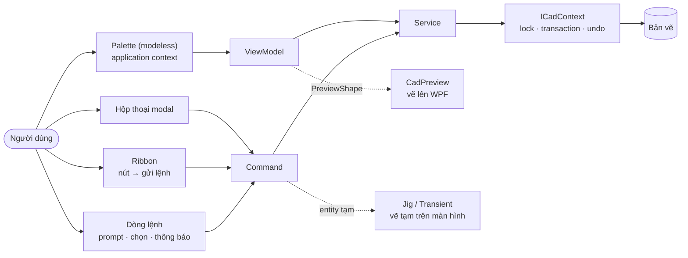

> **🎓 Học viện CadCoreFramework** · [Lộ trình](README.md) · **U00** · [U01 →](U01_WPF_MVVM_BASICS.md)

# U00 — Nhánh UI: Bắt Đầu Từ Đây (Quy Tắc 20/80)

> **Cấp độ:** 🌱 Fresher → 🌳 Middle · **Cần trước:** [C05](C05_ASYNC_TESTING_GIT.md) (C# và `async`), [T01 §5](T01_AUTOCAD_NET_FOUNDATIONS.md#5-document-lock-và-hai-ngữ-cảnh-thực-thi) và [§7](T01_AUTOCAD_NET_FOUNDATIONS.md#7-editor-prompt-hệ-tọa-độ-selection) · **Trong lộ trình:** tuần 7–9 ([README §3](README.md#3-lộ-trình-đào-tạo))

**Nhánh UI** dạy phần người dùng *nhìn thấy và bấm vào* của một tool AutoCAD .NET: dòng lệnh, palette, hộp thoại, Ribbon. Nhánh này cũng dạy **vẽ thực thể lên giao diện**, tức là xem trước kết quả trên palette và trên màn hình bản vẽ trước khi chốt vào bản vẽ. Cũng như Giai đoạn 0, nhánh này đi theo **quy tắc 20/80**: dồn sức vào phần nhỏ API và kỹ thuật mà tool AutoCAD dùng nhiều nhất (đã đếm, xem §2), bỏ qua phần còn lại cho tới khi gặp.

**Sau nhánh UI bạn làm được (đo được, mentor kiểm):**
1. Đọc và sửa XAML của 4 palette trong dự án; tự làm một palette MVVM mới đúng chuẩn (`DynamicResource`, `CanExecute`, validate).
2. Chọn đúng bề mặt UI (prompt, palette, hộp thoại, Ribbon) cho một yêu cầu, và nói được hệ quả về **context** và **lock**.
3. Thêm khung **xem trước** vào palette Grid Marker: vẽ đúng thứ sẽ được vẽ vào bản vẽ, theo theme sáng/tối (lab [L17](T10_LABS_AND_ASSESSMENT.md#l17--xem-trước-trên-palette)).
4. Đọc entity trong bản vẽ thành hình xem trước (cả block, màu ByLayer/ByBlock), và vẽ **tạm** lên màn hình bản vẽ bằng jig hoặc transient ([L19](T10_LABS_AND_ASSESSMENT.md#l19--xem-trước-trên-màn-hình-bản-vẽ)).
5. Nhận ra và sửa các bẫy UI **đã kiểm chứng trên chính dự án**: dấu phẩy thập phân, ô số bị xóa trắng, cập nhật từ luồng nền… ([L18](T10_LABS_AND_ASSESSMENT.md#l18--sửa-bẫy-ô-nhập-số)).

---

## Mục lục

1. [Bản đồ UI của một tool AutoCAD](#1-bản-đồ-ui-của-một-tool-autocad)
2. [Quy tắc 20/80: số liệu](#2-quy-tắc-2080-số-liệu)
3. [Bảy quy tắc vàng](#3-bảy-quy-tắc-vàng)
4. [Lộ trình 3 tuần](#4-lộ-trình-3-tuần)
5. [Chuẩn bị](#5-chuẩn-bị)
6. [Bài kiểm tra đầu vào](#6-bài-kiểm-tra-đầu-vào)
7. [Sau nhánh UI](#7-sau-nhánh-ui)

---

## 1. Bản đồ UI của một tool AutoCAD



| Bề mặt | Có sẵn trong dự án | Ngữ cảnh | Học ở |
| :--- | :--- | :--- | :---: |
| Dòng lệnh: prompt, chọn đối tượng, thông báo | [`CadPromptHelper`](../../Utils/CadPromptHelper.cs), lệnh `SAMPLE_GRID`, `DEMO_PROMPT` | Command context | [U02 §2](U02_UI_IN_AUTOCAD.md#2-dòng-lệnh-bề-mặt-ui-dùng-nhiều-nhất) |
| Palette (modeless, neo được) | 4 palette: Grid Marker, UI Template, Layer Manager, Debug Inspector | Application context | [U01](U01_WPF_MVVM_BASICS.md), [U02 §3](U02_UI_IN_AUTOCAD.md#3-palette) |
| Hộp thoại modal | `DEMO_SHOW_WINDOW_DIALOG` | Chặn AutoCAD tới khi đóng | [U02 §4](U02_UI_IN_AUTOCAD.md#4-hộp-thoại-modal) |
| Ribbon | Tab "CadCore" ([`CadCoreRibbon.cs`](../../Commands/CadCoreRibbon.cs)) | Nút gửi lệnh vào hàng đợi | [U02 §6](U02_UI_IN_AUTOCAD.md#6-ribbon) |
| Vẽ thực thể lên WPF (xem trước) | — bạn tự làm ở L17 | Không chạm bản vẽ | [U03 §1–6](U03_DRAWING_ON_UI.md) |
| Vẽ tạm trên màn hình bản vẽ | [`RectangleJig`](../../Utils/Jigs/RectangleJig.cs), [`BlockPlacementJig`](../../Utils/Jigs/BlockPlacementJig.cs) (`DEMO_JIG_*`) | Command context | [U03 §9](U03_DRAWING_ON_UI.md#9-vẽ-tạm-lên-màn-hình-bản-vẽ) |

---

## 2. Quy tắc 20/80: số liệu

Giai đoạn 0 đếm tính năng C# **trong dự án**. Với UI, chỉ đếm trong dự án là chưa đủ: dự án là một template, mỗi demo chỉ gọi mỗi API một lần. Vì vậy bảng dưới dùng **hai nguồn**, đếm ngày 2026-10-14:

1. **Code C# công khai trên GitHub** (tìm kiếm code của GitHub): số file chứa chữ `Autodesk.AutoCAD` **và** tên API. Có 18.496 file chứa `Autodesk.AutoCAD`. Tên chung như `GetString` hay `GetDouble` trùng với API khác (`Encoding.GetString`, `DataReader.GetDouble`…), nên với prompt bảng dùng lớp `Prompt…Options`: chỉ AutoCAD có lớp này, nên số đếm "sạch".
2. **Code của dự án**: 4 file XAML của palette và 111 file `.cs` (không tính test). Số liệu của dự án đã cập nhật theo PR #11: thêm `NumberText.cs` và 7 property chuỗi cho ô số.

| Tầng | API — số file trên GitHub | Học ở |
| :--- | :--- | :---: |
| 🥇 **Tầng 1** — gần như mọi tool | `WriteMessage` (4.008) · `LockDocument` (1.544) · `MessageBox` (1.168) · `SelectionFilter` (1.050) · `PromptEntityOptions` (1.036) · `PromptPointOptions` (1.002) · `PromptSelectionOptions` (808) | [U02 §2–3](U02_UI_IN_AUTOCAD.md), [T01 §5, §7](T01_AUTOCAD_NET_FOUNDATIONS.md#5-document-lock-và-hai-ngữ-cảnh-thực-thi) |
| 🥈 **Tầng 2** — tool có giao diện | `ShowAlertDialog` (712) · `SendStringToExecute` (674) · `PromptKeywordOptions` (539) · `PromptStringOptions` (471) · `PromptDoubleOptions` (440) · `DocumentActivated` (398) · `SetImpliedSelection` (381) · `PaletteSet` (365) · `JigPromptPointOptions` (342) · `PromptIntegerOptions` (293) · `ShowModalDialog` (278, WinForms) · `SetCurrentView` (271) · `PromptDistanceOptions` (258) · `EntityJig` (213) · `DrawJig` (212) · `ObservableCollection` (205) · `RibbonTab` (199) · `ShowModalWindow` (189, WPF) | [U01](U01_WPF_MVVM_BASICS.md), [U02](U02_UI_IN_AUTOCAD.md), [U03 §9](U03_DRAWING_ON_UI.md#9-vẽ-tạm-lên-màn-hình-bản-vẽ) |
| 🥉 **Tầng 3** — biết là có, học khi gặp | `PromptAngleOptions` (159) · `ContextMenuExtension` (155) · `PointMonitor` (133) · `TransientManager` (121) · `ProgressMeter` (91) · `ShowModelessWindow` (86) · `ExecuteInCommandContextAsync` (56) · `StartUserInteraction` (27) · `PreviewIcon` (18) · `GetBlockTRThumbnail` (6) | [U02 §7–8](U02_UI_IN_AUTOCAD.md), [U03 §8–9](U03_DRAWING_ON_UI.md) |

**Trong dự án:**
- XAML (4 palette): `TextBlock` 35 · `StackPanel` 14 · `TextBox` 10 · `Grid` 10 · `Button` 7 · `DataGrid` 4 · `ComboBox`, `CheckBox`, `RadioButton` mỗi loại 2.
- Markup trong XAML: `{Binding` 56 lần · `DynamicResource` 105 · `StaticResource` 10.
- C#: `[ObservableProperty]` 39 · `CadPromptHelper.Get…` 27 · `SelectionFilterBuilder` 21 · `WriteMessage` 19 · `ObservableCollection` 14 · `TogglePalette` 10 · `[RelayCommand]` 7 · `Editor.Drag` 4 · `TransientManager` 0.

> [!TIP]
> 💡 **20/80:** phần lớn UI của một tool AutoCAD là **ba thứ**: prompt trên dòng lệnh (Tầng 1), một palette hoặc hộp thoại WPF dùng binding, và **kỷ luật context/lock** khi UI ghi vào bản vẽ. Học kỹ ba thứ đó trước (U01–U02). Jig, transient, xem trước (U03) là bước sau, trên cùng nền đó.

Hai nhận xét từ số liệu:
- **WinForms hay WPF?** Code công khai dùng `System.Windows.Forms` (1.948 file) nhiều hơn `System.Windows.Controls` (448 file) khoảng 4 lần, vì có nhiều code cũ. Dự án dùng **WPF** vì có theme, binding/MVVM và co giãn theo DPI. Gặp code WinForms thì các nguyên tắc AutoCAD (context, lock, `ShowModal…`) vẫn y như vậy.
- **Vẽ thực thể lên WPF** hiếm trong code công khai: chỉ 36 file có cả `Canvas` lẫn `Autodesk.AutoCAD`. Nhưng đó là phần cốt lõi của tool kiểu "nhập thông số → xem trước → vẽ" (tủ điện, lưới, mặt bằng). Vì vậy U03 dạy riêng chủ đề này, và áp 20/80 *bên trong* nó: chỉ 5 khái niệm (dữ liệu thuần, biến đổi tọa độ, `OnRender`, màu theo theme, kiểm thử).

Đây là số đếm bằng **tìm kiếm văn bản**, nên chỉ là xấp xỉ: code công khai không phải mọi tool; một file có thể lặp lại ở nhiều repo. Dùng bảng để so **thứ tự quan trọng**, không phải con số tuyệt đối. Đếm lại một dòng của bảng (cần [GitHub CLI](https://cli.github.com/) đã đăng nhập; GitHub cho 10 lượt tìm mỗi phút):

```powershell
gh api -X GET search/code -f q='"Autodesk.AutoCAD" PromptKeywordOptions language:C#' --jq .total_count
```

Đếm lại trong dự án, ví dụ số lần dùng `DynamicResource` trong XAML của palette:

```powershell
Get-ChildItem Views,Samples -Recurse -Filter *.xaml | Select-String -Pattern 'DynamicResource' -AllMatches |
    ForEach-Object { $_.Matches.Count } | Measure-Object -Sum
```

---

## 3. Bảy quy tắc vàng

20% quy tắc này tránh được 80% lỗi UI mà dự án đã gặp hoặc đã kiểm chứng:

| # | Quy tắc | Vì sao | Đọc thêm |
| :---: | :--- | :--- | :--- |
| 1 | **HỎI trước, VẼ sau**: prompt xong mới mở transaction | Prompt trong transaction giữ lock trong lúc người dùng chần chừ | [T01 §7.2](T01_AUTOCAD_NET_FOUNDATIONS.md#72-luật-thép-hỏi-trước-vẽ-sau), [T03 B4](T03_PITFALLS_CASEBOOK.md#b4-autocad-đơ-khi-chờ-người-dùng) |
| 2 | **Palette và cửa sổ modeless là application context**: ghi bản vẽ chỉ qua `ICadContext`; không prompt từ ViewModel | Không có lock thì `eLockViolation`; prompt từ palette là sai ngữ cảnh (analyzer CAD002) | [T01 §5](T01_AUTOCAD_NET_FOUNDATIONS.md#5-document-lock-và-hai-ngữ-cảnh-thực-thi), [T03 B1](T03_PITFALLS_CASEBOOK.md#b1-elockviolation-khi-bấm-nút-trên-palette) |
| 3 | **ViewModel không biết WPF, cũng không biết AutoCAD**: chỉ dữ liệu và command | Test được bằng xUnit, không cần AutoCAD | [T05 §5](T05_TESTING_STRATEGY.md#5-viewmodel-mock-service) |
| 4 | **Màu chỉ lấy từ theme, qua `DynamicResource`** | Theme đổi được lúc palette đang mở; key thiếu thì WPF im lặng | [Phần 5 §5.3](../05_WPF_UI_AND_MVVM.md#53-autocad-theme-tự-động-darklight), [T03 B28](T03_PITFALLS_CASEBOOK.md#b28-resource-wpf-thiếu-nhưng-không-báo-lỗi) |
| 5 | **Mọi thứ chạm UI hoặc AutoCAD chạy trên main thread**; luồng nền chỉ để tính toán | WPF ném lỗi khi collection hoặc `CanExecute` đổi từ luồng khác (đã kiểm chứng ở [U01 §8](U01_WPF_MVVM_BASICS.md#8-luồng-thread)) | [T03 B8](T03_PITFALLS_CASEBOOK.md#b8-gọi-autocad-api-từ-thread-nền) |
| 6 | **UI không giữ `DBObject`**: giữ `ObjectId`, hoặc bản sao dữ liệu thuần (`PreviewShape`) | `DBObject` chỉ dùng được trong transaction đã mở nó | [U03 §1](U03_DRAWING_ON_UI.md#1-kiến-trúc-một-kế-hoạch-hai-nơi-vẽ), [T03 B5](T03_PITFALLS_CASEBOOK.md#b5-dùng-dbobject-sau-khi-transaction-kết-thúc) |
| 7 | **Ô nhập số bind vào chuỗi**, rồi tự đọc số bằng `NumberText` (dấu chấm thập phân, như dòng lệnh) | Bind thẳng vào `double` thì WPF đọc `2,5` thành 25 và lặng lẽ giữ số cũ khi ô trống: lỗi thật của dự án (B-31, B-32) | [U01 §5](U01_WPF_MVVM_BASICS.md#5-ba-bẫy-khi-nhập-số), lab [L18](T10_LABS_AND_ASSESSMENT.md#l18--sửa-bẫy-ô-nhập-số) |

---

## 4. Lộ trình 3 tuần

Nhánh UI chiếm **tuần 7–9** của Giai đoạn 2 ([README §3](README.md#3-lộ-trình-đào-tạo)). Mỗi tuần ≈ 60% đọc và thực hành, 40% làm lab.

| Tuần | Đọc | Luyện tập / Lab ([T10](T10_LABS_AND_ASSESSMENT.md)) | Đầu ra kiểm chứng được |
| :---: | :--- | :--- | :--- |
| 7 | U00, [U01](U01_WPF_MVVM_BASICS.md), [Phần 5](../05_WPF_UI_AND_MVVM.md) | Bài tập U01 (không cần AutoCAD); L18 Sửa bẫy ô nhập số | Form WPF có validate và `CanExecute`; bản sửa B-31/B-32 (trên `632a6c1`) kèm test fail-trước, đối chiếu với PR #11 |
| 8 | [U02](U02_UI_IN_AUTOCAD.md), [T08 §4–6](T08_RECIPES_EXTENDING.md#4-thêm-một-palette) | L08 Palette nhớ vị trí, L11 Ribbon | Palette mới đúng chuẩn; Ribbon còn nguyên sau `CUI` |
| 9 | [U03](U03_DRAWING_ON_UI.md) | L17 Xem trước trên palette, L19 Xem trước trên màn hình bản vẽ | Palette Grid Marker có khung xem trước (ảnh hai theme); lệnh xem trước bằng transient, đặt bằng jig |

Đã quen WPF và MVVM: làm bài kiểm tra §6. Đạt 7–8 điểm thì gộp tuần 7 vào tuần 8, nhưng **vẫn làm L18**: bẫy dấu thập phân xảy ra với cả người đã quen WPF.

---

## 5. Chuẩn bị

- **U01 không cần AutoCAD.** Tạo một project WPF riêng để luyện, cùng thiết lập ngôn ngữ với dự án:

  ```powershell
  dotnet new wpf -n HocWpf -f net8.0
  cd HocWpf
  dotnet add package CommunityToolkit.Mvvm --version 8.2.2
  ```

  Rồi mở `HocWpf.csproj`, thêm vào `<PropertyGroup>`: `<LangVersion>10.0</LangVersion>`, `<Nullable>annotations</Nullable>`, `<ImplicitUsings>disable</ImplicitUsings>`. Đó là thiết lập của dự án ([C04](C04_CSHARP_IN_THIS_PROJECT.md)), và `CommunityToolkit.Mvvm` 8.2.2 là đúng phiên bản dự án dùng.
- **U02–U03 cần AutoCAD 2024** và repo build được ([README §4](README.md#4-chuẩn-bị-môi-trường)).

---

## 6. Bài kiểm tra đầu vào

Tự trả lời trước, rồi mới mở đáp án. Mỗi câu 1 điểm.

1. `TextBox` bind tới property `PanelName` (không ghi gì thêm). Người dùng gõ chữ. Khi nào ViewModel nhận giá trị mới?
2. ViewModel có `List<string> Items` làm `ItemsSource` của một `ListBox` đang hiển thị. Gọi `Items.Add("B")` thì `ListBox` có hiện dòng mới không?
3. `[RelayCommand] private void Draw()` sinh ra thứ gì để XAML bind vào?
4. `CanDraw()` phụ thuộc `Columns`, nhưng đặt `Columns = 0` thì nút Vẽ vẫn sáng. Thiếu gì?
5. Vì sao không gọi `Editor.GetPoint` trong handler của nút bấm trên palette?
6. Nút trên palette ghi vào bản vẽ bằng transaction tự mở, không lock. Lỗi gì?
7. `{StaticResource X}` và `{DynamicResource X}` khác nhau thế nào khi key `X` không tồn tại?
8. Muốn một hình chữ nhật chạy theo chuột trước khi người dùng click, dùng gì?

<details><summary>Đáp án</summary>

1. Khi `TextBox` **mất focus**: `UpdateSourceTrigger` mặc định của `TextBox.Text` là `LostFocus` (đã kiểm chứng, [U01 §4](U01_WPF_MVVM_BASICS.md#4-binding-nối-view-với-viewmodel)). Muốn cập nhật theo từng phím thì ghi `UpdateSourceTrigger=PropertyChanged`, như mọi ô nhập của palette Grid Marker.
2. **Không.** `List<T>` không báo thay đổi; phải dùng `ObservableCollection<T>` ([U01 §7](U01_WPF_MVVM_BASICS.md#7-danh-sách-observablecollection)).
3. Property `DrawCommand` (kiểu `IRelayCommand`), do source generator của CommunityToolkit.Mvvm viết thêm.
4. Thiếu thông báo cho command: gọi `DrawCommand.NotifyCanExecuteChanged()`, hoặc gắn `[NotifyCanExecuteChangedFor(nameof(DrawCommand))]` lên field `_columns` ([U01 §6](U01_WPF_MVVM_BASICS.md#6-mvvm-với-communitytoolkitmvvm)).
5. Palette chạy ở **application context**. Prompt ở đó sai ngữ cảnh. Hãy đưa input lên form, hoặc để nút gửi một lệnh, và lệnh đó prompt ([U02 §3](U02_UI_IN_AUTOCAD.md#3-palette)).
6. `eLockViolation` ([T01 §5](T01_AUTOCAD_NET_FOUNDATIONS.md#5-document-lock-và-hai-ngữ-cảnh-thực-thi)).
7. `StaticResource` ném `XamlParseException` ngay khi nạp XAML. `DynamicResource` **im lặng** dùng giá trị mặc định, ví dụ chữ đen trên nền tối ([U01 §9](U01_WPF_MVVM_BASICS.md#9-resource-style-và-theme)).
8. Một **jig** (`EntityJig`), như [`RectangleJig`](../../Utils/Jigs/RectangleJig.cs) ([U03 §9](U03_DRAWING_ON_UI.md#9-vẽ-tạm-lên-màn-hình-bản-vẽ)).
</details>

| Điểm | Bắt đầu từ |
| :---: | :--- |
| 0–4 | [U01](U01_WPF_MVVM_BASICS.md) từ đầu, làm đủ bài tập |
| 5–6 | Lướt U01 §1–3, đọc kỹ §4–9, làm bài tập |
| 7–8 | [U02](U02_UI_IN_AUTOCAD.md); vẫn đọc [U01 §5](U01_WPF_MVVM_BASICS.md#5-ba-bẫy-khi-nhập-số) và làm L18 |

---

## 7. Sau nhánh UI

- Tuần 10: [T01 §10–11](T01_AUTOCAD_NET_FOUNDATIONS.md#10-events-sự-kiện) (events, Undo), lab L09: palette tự cập nhật khi người dùng xóa entity.
- Đồ án cuối khóa ([T10 §3](T10_LABS_AND_ASSESSMENT.md#3-đồ-án-cuối-khóa-bộ-công-cụ-tủ-điện-msb)) có yêu cầu palette **xem trước tủ điện**: dùng lại đúng kiến trúc của U03.

---

**Tiếp theo:** [U01 — WPF & MVVM cho tool AutoCAD →](U01_WPF_MVVM_BASICS.md) · **Quay về:** [Lộ trình đào tạo](README.md) · [Thuật ngữ](GLOSSARY.md)
