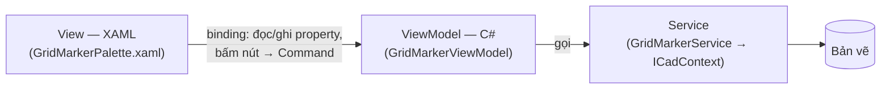

> **🎓 Học viện CadCoreFramework** · [Lộ trình](README.md) · [← U00](U00_UI_START_HERE.md) · **U01** · [U02 →](U02_UI_IN_AUTOCAD.md)

# U01 — WPF & MVVM Cho Tool AutoCAD (Chưa Cần AutoCAD)

> **Cấp độ:** 🌱 Fresher → 🌿 Junior · **Cần trước:** [C03](C03_OBJECT_ORIENTED.md) (class, interface), [C04](C04_CSHARP_IN_THIS_PROJECT.md) (lambda, event, attribute), [C05 §1](C05_ASYNC_TESTING_GIT.md#1-async-và-await-chờ-mà-không-đứng-hình) (`async`) · **Trong lộ trình:** tuần 7 ([README §3](README.md#3-lộ-trình-đào-tạo))

**WPF** (Windows Presentation Foundation) là thư viện giao diện của .NET mà dự án dùng cho mọi palette. Module này dạy đúng **phần WPF mà 4 palette của dự án dùng** (đã đếm ở [U00 §2](U00_UI_START_HERE.md#2-quy-tắc-2080-số-liệu)): bố cục `Grid`/`StackPanel`, 8 control, binding, MVVM với CommunityToolkit.Mvvm, `ObservableCollection`, resource và theme. Module cũng chỉ ra các **bẫy đã kiểm chứng trên chính palette của dự án**.

Mọi khẳng định về hành vi WPF ở đây đều đã **chạy thật** trên .NET Framework 4.8 (môi trường của AutoCAD 2024) và .NET 8, với C# 10. Hai nền tảng cho kết quả giống hệt nhau. Thông báo lỗi được chép nguyên văn.

---

## Mục lục

1. [WPF trong 5 phút](#1-wpf-trong-5-phút)
2. [Bố cục: `Grid` và `StackPanel`](#2-bố-cục-grid-và-stackpanel)
3. [Tám control dùng nhiều](#3-tám-control-dùng-nhiều)
4. [Binding: nối View với ViewModel](#4-binding-nối-view-với-viewmodel)
5. [Ba bẫy khi nhập số](#5-ba-bẫy-khi-nhập-số)
6. [MVVM với CommunityToolkit.Mvvm](#6-mvvm-với-communitytoolkitmvvm)
7. [Danh sách: `ObservableCollection`](#7-danh-sách-observablecollection)
8. [Luồng (thread)](#8-luồng-thread)
9. [Resource, style và theme](#9-resource-style-và-theme)
10. [Gỡ lỗi binding](#10-gỡ-lỗi-binding)
11. [Code-behind: chỉ làm hạ tầng](#11-code-behind-chỉ-làm-hạ-tầng)
12. [Bài tập](#12-bài-tập)

---

## 1. WPF trong 5 phút

Một palette có ba lớp. **MVVM** (Model–View–ViewModel) là tên của cách chia này:



- **View** (file `.xaml`): *trông thế nào*. Không có logic.
- **ViewModel** (file `.cs`): *dữ liệu và hành động* của màn hình: số hàng, số cột, lỗi validate, nút Vẽ. Không biết WPF, không biết AutoCAD, nên test được bằng xUnit ([T05 §5](T05_TESTING_STRATEGY.md#5-viewmodel-mock-service)).
- **Binding**: sợi dây tự động nối hai bên. Người dùng gõ vào ô thì property của ViewModel đổi; ViewModel đổi property thì ô hiển thị theo.

**XAML là một cây đối tượng.** Mỗi thẻ là một `new`, mỗi thuộc tính là gán một property:

```xml
<StackPanel Margin="20">
    <TextBlock Text="Đây là cửa sổ WPF Modal Dialog!" FontSize="16"/>
</StackPanel>
```

tương đương đúng đoạn C# mà [`DemoUiCommands.cs`](../../Demos/DemoUiCommands.cs) viết tay (trích):

```csharp
var stack = new StackPanel { Margin = new Thickness(20) };
stack.Children.Add(new TextBlock
{
    Text = "Đây là cửa sổ WPF Modal Dialog!",
    FontSize = 16,
```

Dấu ngoặc nhọn trong thuộc tính, như `{Binding Rows}` hay `{DynamicResource InputStyle}`, là **markup extension**: giá trị không viết thẳng mà được *tính ra* lúc chạy. Ba loại bạn sẽ gặp trong dự án: `{Binding}` (56 lần), `{DynamicResource}` (105 lần), `{StaticResource}` (10 lần).

File XAML có cặp là một file C# **code-behind** (`GridMarkerPalette.xaml.cs`). Hai file cùng khai báo một `partial class`. Hàm `InitializeComponent()` (do trình biên dịch sinh ra) dựng cây đối tượng từ XAML.

---

## 2. Bố cục: `Grid` và `StackPanel`

20% bố cục đủ cho mọi palette của dự án:

| Phần tử | Làm gì | Số lần trong dự án |
| :--- | :--- | :---: |
| `StackPanel` | Xếp con thành một cột (hoặc một hàng nếu `Orientation="Horizontal"`) | 14 |
| `Grid` | Chia hàng và cột | 10 |
| `ScrollViewer` | Cuộn khi palette ngắn hơn nội dung | 2 |
| `Border` | Viền, nền, bo góc cho **một** phần tử con | 6 |

Kích thước cột của `Grid`: `Auto` (vừa nội dung) · `*` (chia phần còn lại; `2*` được gấp đôi `*`) · một số (đơn vị là *pixel độc lập thiết bị*, 1/96 inch, tự co giãn theo DPI). `Margin` là khoảng **ngoài** phần tử, `Padding` là khoảng **trong**.

🔎 **Đọc code:** hai ô nhập cạnh nhau trong [`GridMarkerPalette.xaml`](../../Samples/GridMarker/GridMarkerPalette.xaml) (nguyên văn, dòng 58–74). Cột giữa rộng `8` chỉ để làm khe hở. Ô số bind vào property **chuỗi** (`RowsText`), vì sao thì xem [§5](#5-ba-bẫy-khi-nhập-số):

```xml
<Grid>
    <Grid.ColumnDefinitions>
        <ColumnDefinition Width="*"/>
        <ColumnDefinition Width="8"/>
        <ColumnDefinition Width="*"/>
    </Grid.ColumnDefinitions>
    <StackPanel Grid.Column="0">
        <TextBlock Text="SỐ HÀNG" Style="{DynamicResource LabelStyle}"/>
        <TextBox Style="{DynamicResource InputStyle}"
                 Text="{Binding RowsText, UpdateSourceTrigger=PropertyChanged}"/>
    </StackPanel>
    <StackPanel Grid.Column="2">
        <TextBlock Text="SỐ CỘT" Style="{DynamicResource LabelStyle}"/>
        <TextBox Style="{DynamicResource InputStyle}"
                 Text="{Binding ColumnsText, UpdateSourceTrigger=PropertyChanged}"/>
    </StackPanel>
</Grid>
```

`Grid.Column="2"` là **attached property**: `StackPanel` không có property `Column`, nhưng `Grid` cha "gắn" thêm cho nó để biết đặt vào cột nào.

---

## 3. Tám control dùng nhiều

| Control | Property thường bind | Có trong dự án |
| :--- | :--- | :--- |
| `TextBlock` | `Text` (chỉ hiển thị) | Nhãn, thông báo trạng thái (35 lần) |
| `TextBox` | `Text` | Mọi ô nhập của Grid Marker (10) |
| `Button` | `Command` (+ `CommandParameter`) | Vẽ lưới, Làm mới (7) |
| `ComboBox` | `ItemsSource` + `SelectedItem` | Kiểu nhãn, danh sách layer |
| `CheckBox` | `IsChecked` | UI Template |
| `RadioButton` | `IsChecked`, `GroupName` | UI Template |
| `DataGrid` | `ItemsSource` + các cột | Debug Inspector (2), Layer Manager, UI Template |
| `ListBox` | `ItemsSource` + `SelectedItem` | Debug Inspector |

Xem cả 8 control đang chạy: lệnh `SHOW_UI_TEMPLATE` mở palette [`CommonControlsPalette.xaml`](../../Views/CommonControlsPalette.xaml).

---

## 4. Binding: nối View với ViewModel

**`DataContext`** là đối tượng mà mọi `{Binding}` bên trong đọc dữ liệu từ đó. Gán **một lần** ở gốc palette, các phần tử con tự thừa hưởng. Golden Sample gán trong code-behind, lấy ViewModel từ DI ([§11](#11-code-behind-chỉ-làm-hạ-tầng)). `{Binding Rows}` nghĩa là "property `Rows` của `DataContext`".

**Chiều của binding.** Mỗi property có chiều mặc định riêng. Đây là giá trị thật, đọc từ metadata của WPF:

| Property | Hai chiều mặc định? | Đẩy về ViewModel khi |
| :--- | :---: | :--- |
| `TextBox.Text` | ✅ | **`LostFocus`** — khi ô mất focus |
| `TextBlock.Text` | — (một chiều) | — |
| `CheckBox.IsChecked`, `ComboBox.SelectedItem`, `Slider.Value` | ✅ | ngay khi đổi |
| `Run.Text` | ✅ | ngay khi đổi |
| `ItemsControl.ItemsSource` | — (một chiều) | — |

Thí nghiệm thật với `TextBox` bind tới `PanelName` (giá trị ban đầu "Tủ 1"):

| Binding | Gõ "Tủ 2" xong, chưa rời ô | Sau khi rời ô |
| :--- | :--- | :--- |
| `{Binding PanelName}` | ViewModel vẫn là "Tủ 1" | "Tủ 2" |
| `{Binding PanelName, UpdateSourceTrigger=PropertyChanged}` | "Tủ 2" ngay | "Tủ 2" |

Palette Grid Marker luôn ghi `UpdateSourceTrigger=PropertyChanged`, để validate và bật/tắt nút Vẽ theo từng phím gõ.

⚠️ **Bẫy `Run.Text`:** `Run.Text` mặc định là hai chiều. Bind nó vào property **chỉ đọc** mà không ghi `Mode` thì binding hỏng:

```text
InvalidOperationException: A TwoWay or OneWayToSource binding cannot work on the read-only property 'Count' of type 'WpfLab.ReadOnlyCount'.
```

Vì vậy palette ghi rõ `Mode=OneWay`: `<Run Text="{Binding MarkerCount, Mode=OneWay}" FontWeight="Bold"/>`.

**Ba công cụ đi kèm binding** (đều có trong dự án):

1. **`StringFormat`**: định dạng khi hiển thị, ví dụ `{Binding SliderValue, StringFormat=N0}` (UI Template).
2. **Converter**: đổi kiểu dữ liệu giữa hai bên. Có sẵn `BooleanToVisibilityConverter` (`true` thì hiện, `false` thì ẩn). Lớp phủ "Đang vẽ..." của Golden Sample dùng nó (nguyên văn):

   ```xml
   <Grid Panel.ZIndex="99" Background="{DynamicResource OverlayBrush}"
         Visibility="{Binding IsBusy, Converter={StaticResource BoolToVis}}">
   ```

   Tự viết converter thì cài interface `IValueConverter`. Ví dụ nguyên văn từ [`LayerManagerControl.xaml.cs`](../../Views/LayerManagerControl.xaml.cs):

   ```csharp
   public class InvertBooleanConverter : IValueConverter
   {
       public object Convert(object value, Type targetType, object parameter, CultureInfo culture)
       {
           if (value is bool b) return !b;
           return value;
       }
       public object ConvertBack(object value, Type targetType, object parameter, CultureInfo culture) => throw new NotImplementedException();
   }
   ```

3. **`DataTrigger`**: đổi giao diện theo giá trị. ViewModel chỉ có enum `GridMarkerStatus`; **View** tự chọn màu. Nhờ vậy ViewModel không phải biết `Brush` là gì (nguyên văn, [`GridMarkerPalette.xaml`](../../Samples/GridMarker/GridMarkerPalette.xaml)):

   ```xml
   <DataTrigger Binding="{Binding Status}" Value="{x:Static local:GridMarkerStatus.Success}">
       <Setter Property="Foreground" Value="{DynamicResource SuccessBrush}"/>
   </DataTrigger>
   ```

**Bind tới ViewModel cha từ trong một dòng của bảng.** Trong `DataGrid`, `DataContext` của mỗi dòng là *phần tử của dòng đó*, không phải ViewModel. Muốn nút trên mỗi dòng gọi command của ViewModel thì đi ngược lên cây bằng `RelativeSource` (nguyên văn, [`LayerManagerControl.xaml`](../../Views/LayerManagerControl.xaml)):

```xml
<Button Content="{Binding IsOn, Converter={StaticResource BooleanToOnOffConverter}}"
        Command="{Binding DataContext.ToggleLayerCommand, RelativeSource={RelativeSource AncestorType=DataGrid}}"
        CommandParameter="{Binding}"
```

`CommandParameter="{Binding}"` truyền chính `LayerModel` của dòng đó vào command.

---

## 5. Ba bẫy khi nhập số

Ba bẫy này **từng có thật trên palette Grid Marker**, cho tới PR #11 (kiểm bằng cách dựng palette thật, gõ vào ô rồi đọc ViewModel, trên cả net48 lẫn net8). Chúng là mục [B-31 và B-32](T09_SENIOR_PLAYBOOK.md#3-backlog-kỹ-thuật-đã-kiểm-chứng) trong backlog. PR #11 sửa chúng đúng theo cách ở [§5.3](#53-cách-sửa-2080-ô-số-bind-vào-chuỗi). Lab [L18](T10_LABS_AND_ASSESSMENT.md#l18--sửa-bẫy-ô-nhập-số) cho bạn tự sửa lại trên code cũ rồi so với bản đã merge.

### 5.1 Dấu phẩy thập phân: gõ "2,5" thành 25

WPF đổi chuỗi thành số theo `Language` của phần tử, **mặc định là `en-US`**. Nó **không** dùng culture của Windows: máy này là `vi-VN`, nhưng palette vẫn ra `en-US`. Kết quả thật khi gõ vào một ô bind tới property `double` (giá trị trước đó là 20):

| Gõ vào ô | `Language` mặc định (`en-US`) | Nếu đặt `Language="vi-VN"` |
| :--- | :--- | :--- |
| `1.5` | 1.5 | **15**, không báo lỗi |
| `1,5` | **15**, không báo lỗi | 1.5 |
| `abc` hoặc ô trống | giữ 20, ô viền đỏ | giữ 20, ô viền đỏ |

Trên palette thật, trước PR #11: gõ **`2,5`** vào ô KHOẢNG CÁCH thì `Spacing` thành **25**. Không có lỗi validate nào, và nút Vẽ vẫn bật. Nguyên nhân là dấu phẩy được hiểu là *dấu phân cách hàng nghìn* của `en-US`. WPF còn nhận cả chuỗi `NaN` (và `∞`) mà không báo lỗi: `Spacing` thành `NaN`, mà `GridSpec.Validate()` khi đó cũng không chặn ([B-34](T09_SENIOR_PLAYBOOK.md#3-backlog-kỹ-thuật-đã-kiểm-chứng), sửa ở PR #13).

Dòng lệnh AutoCAD thì khác: luôn dùng dấu chấm, vì dấu phẩy là dấu ngăn cách tọa độ (`10,5` là một điểm). Gõ `1,5` vào `GetDouble` thì AutoCAD **từ chối** (đã chạy thật trên AutoCAD 2024):

```text
Khoảng cách: 1,5
Requires numeric value.
```

Đặt `Language="vi-VN"` cho palette **không** sửa được bẫy, chỉ đổi chiều nó: người quen gõ dấu chấm như trên dòng lệnh AutoCAD sẽ bị `1.5` thành 15.

### 5.2 Ô bị xóa trắng: ViewModel vẫn giữ giá trị cũ

Xóa trắng ô SỐ HÀNG (đang là 3) trên palette thật, trước PR #11:
- Ô viền đỏ (WPF không đổi được `""` thành `int`).
- `Rows` **vẫn là 3**, `ValidationSummary` rỗng, nút Vẽ **vẫn bật**. Palette có khung xem trước như ở U03 thì khung vẫn hiện lưới 3 hàng.

Người dùng bấm Vẽ thì được lưới 3 hàng trong khi ô đang trống. Lỗi chuyển đổi nằm ở **binding**, ViewModel không bao giờ thấy nó, nên `GridSpec.Validate()` (nơi giữ mọi luật) cũng không thấy.

### 5.3 Cách sửa 20/80: ô số bind vào chuỗi

Cho ViewModel thấy **đúng thứ người dùng gõ** bằng cách bind ô vào một property `string`. ViewModel tự đổi sang số theo **một quy tắc duy nhất**: chỉ nhận dấu chấm, giống dòng lệnh AutoCAD. Lỗi đi vào cùng chỗ với các lỗi validate khác. Ví dụ hoàn chỉnh (đã chạy):

```csharp
using System.Collections.Generic;
using System.Globalization;
using CommunityToolkit.Mvvm.ComponentModel;
using CommunityToolkit.Mvvm.Input;

namespace HocWpf
{
    public partial class PanelFormViewModel : ObservableObject
    {
        // Ô số bind vào CHUỖI: ViewModel thấy đúng thứ người dùng gõ — kể cả ô trống hay "2,5".
        [ObservableProperty]
        [NotifyPropertyChangedFor(nameof(ValidationSummary))]
        [NotifyCanExecuteChangedFor(nameof(DrawCommand))]
        private string _widthText = "600";

        public string ValidationSummary => string.Join("\n", Validate());

        /// <summary>Như dòng lệnh AutoCAD: chỉ nhận dấu chấm thập phân. "2,5" bị từ chối thay vì âm thầm thành 25.</summary>
        public static bool TryParseNumber(string text, out double value)
            => double.TryParse(text, NumberStyles.Float, CultureInfo.InvariantCulture, out value);

        private List<string> Validate()
        {
            var errors = new List<string>();
            if (!TryParseNumber(WidthText, out double width))
                errors.Add("Rộng: nhập một số, phần thập phân dùng dấu chấm (ví dụ 2.5).");
            else if (width <= 0)
                errors.Add("Rộng phải lớn hơn 0.");
            return errors;
        }

        private bool CanDraw() => Validate().Count == 0;

        [RelayCommand(CanExecute = nameof(CanDraw))]
        private void Draw()
        {
            TryParseNumber(WidthText, out double width);
            // … giao width (đã chắc chắn hợp lệ) cho Service vẽ
        }
    }
}
```

XAML: `<TextBox Text="{Binding WidthText, UpdateSourceTrigger=PropertyChanged}"/>`. Kết quả thật:

| Gõ | Nút Vẽ | `ValidationSummary` |
| :--- | :---: | :--- |
| `2,5` | tắt | Rộng: nhập một số, phần thập phân dùng dấu chấm (ví dụ 2.5). |
| (trống) / `abc` | tắt | (như trên) |
| `-1` | tắt | Rộng phải lớn hơn 0. |
| `2.5` / ` 600 ` | **bật** | (rỗng) |

Chìa khóa là `NumberStyles.Float`: nó cho phép dấu chấm, dấu âm, số mũ và khoảng trắng, nhưng **không** cho dấu phân cách hàng nghìn. Thêm `NumberStyles.AllowThousands` thì `"2,5"` lại thành 25. Đó chính là kiểu mà WPF dùng mặc định.

🔎 **Golden Sample làm đúng như vậy, từ PR #11.** Chỉ khác một điểm: [`GridMarkerViewModel`](../../Samples/GridMarker/GridMarkerViewModel.cs) vẫn giữ các property số (`Rows`, `Spacing`…) để `GridSpec`, code và test khác dùng tiếp. Mỗi ô số có thêm một property chuỗi (`RowsText`, `SpacingText`…) để TextBox bind vào, và hai bên đồng bộ hai chiều. Bộ đọc số dùng chung nằm ở [`ViewModels/NumberText.cs`](../../ViewModels/NumberText.cs); nó chặn cả `NaN` và vô cực. Khi người dùng gõ, chuỗi được đổi thành số (nguyên văn):

```csharp
partial void OnSpacingTextChanged(string value)
{
    if (NumberText.TryParseDouble(value, out double spacing)) Spacing = spacing;
    Revalidate();
}
```

Khi code gán số (test, thiết lập đã lưu…), số được đổi ngược thành chuỗi, trừ khi chuỗi đang có đã ghi đúng số đó, ví dụ giữ nguyên `20.0` mà người dùng đang gõ:

```csharp
partial void OnSpacingChanged(double value) => SpacingText = Shown(SpacingText, value);
```

Test `EveryPaletteTextBox_BindsToAStringProperty` trong `XamlPaletteTests` kiểm **mọi** palette: không TextBox nào được bind thẳng vào property số.

> [!TIP]
> 💡 **20/80:** ô nhập **số** trên palette thì bind vào `string` và tự parse bằng `CultureInfo.InvariantCulture` + `NumberStyles.Float`. Mọi lỗi, kể cả lỗi "không phải số", đi về **một chỗ** validate. Ô chữ (tên layer, tên tủ) thì bind thẳng như bình thường.

---

## 6. MVVM với CommunityToolkit.Mvvm

Dự án dùng **CommunityToolkit.Mvvm 8.2.2**. Gói này có *source generator*: bạn viết vài dòng có attribute, nó viết thay phần code lặp lại ([C04 §10](C04_CSHARP_IN_THIS_PROJECT.md#10-attribute-nhãn-cho-công-cụ-đọc)).

**Property thông báo thay đổi.** Nguyên văn từ [`GridMarkerViewModel.cs`](../../Samples/GridMarker/GridMarkerViewModel.cs):

```csharp
[ObservableProperty] private int _rows = 3;
[ObservableProperty] private int _columns = 4;
[ObservableProperty] private double _spacing = 20;
```

Từ field `_rows`, generator viết property `Rows`. Khi `Rows` được gán giá trị **khác**, nó bắn sự kiện `PropertyChanged` để binding cập nhật View. Class phải là `partial`, vì generator viết thêm vào chính class đó. Generator cũng sinh *hook* `partial void OnRowsChanged(int value)`. Viết thân cho hook này thì nó chạy mỗi lần `Rows` đổi (đã kiểm: đặt `Rows = 0` thì hook chạy với giá trị 0).

**Command.** Nguyên văn:

```csharp
private bool CanDraw() => !HasValidationErrors && !IsBusy;

[RelayCommand(CanExecute = nameof(CanDraw))]
private void Draw()
```

Từ method `Draw()`, generator viết property `DrawCommand`. XAML bind vào đó: `Command="{Binding DrawCommand}"`. Khi `CanDraw()` trả `false`, nút **tự mờ đi**.

⚠️ **Bẫy: `CanExecute` không tự cập nhật.** WPF chỉ hỏi lại `CanDraw()` khi command báo "điều kiện đã đổi". Thí nghiệm thật (một nút bind tới command, `CanDraw` phụ thuộc `Rows` và `Columns`):

| Bước | `CanDraw()` | `Button.IsEnabled` |
| :--- | :---: | :---: |
| Ban đầu | true | true |
| Đặt `Columns = 0` (không báo gì) | **false** | **true**: nút vẫn sáng, sai |
| Gọi `DrawCommand.NotifyCanExecuteChanged()` | false | false |
| Đặt `Rows = 0`, field `_rows` có `[NotifyCanExecuteChangedFor(nameof(DrawCommand))]` | false | false (tự báo) |

Golden Sample báo bằng tay trong `Revalidate()`, vì **7 property** đều ảnh hưởng tới validate. Một `override` duy nhất gọn hơn gắn attribute lên 7 field (nguyên văn):

```csharp
protected override void OnPropertyChanged(PropertyChangedEventArgs e)
{
    base.OnPropertyChanged(e);

    if (e.PropertyName != null && SpecInputs.Contains(e.PropertyName))
        Revalidate();
    else if (e.PropertyName == nameof(IsBusy))
        DrawCommand.NotifyCanExecuteChanged();
}
```

**Command bất đồng bộ.** Đặt `[RelayCommand]` lên một method `async Task` thì generator sinh ra `AsyncRelayCommand`. Lệnh này **tự khóa nút trong lúc đang chạy** (đã kiểm: khi đang chạy thì `IsRunning = true` và `CanExecute = false`; chạy xong thì `CanExecute = true`), nên người dùng không bấm hai lần được. Muốn có thêm lớp phủ "đang bận" và ô báo lỗi thì dùng `RunSafeAsync` của [`ViewModelBase`](../../ViewModels/ViewModelBase.cs) ([R04 §2](../reference/R04_UI.md#2-viewmodel-viewmodelbase-và-runsafe)).

---

## 7. Danh sách: `ObservableCollection`

Thí nghiệm thật trên một cửa sổ **đang hiển thị**: hai `ListBox`, mỗi cái bind tới một danh sách có sẵn 1 phần tử. Gọi `Add("B")` cho cả hai:

| `ItemsSource` | Số dòng hiển thị sau `Add` |
| :--- | :---: |
| `List<string>` | **1**: giao diện không biết có phần tử mới |
| `ObservableCollection<string>` | 2 |

`ObservableCollection<T>` bắn sự kiện `CollectionChanged` mỗi khi thêm, xóa hay xếp lại. `List<T>` không bắn gì. Nhưng `ObservableCollection` chỉ báo khi **danh sách** đổi. Muốn một **dòng** cập nhật khi property của phần tử đổi (ví dụ nút Bật/Tắt layer) thì chính phần tử cũng phải báo thay đổi. [`LayerModel`](../../Models/LayerModel.cs) kế thừa `ObservableObject` vì lý do đó.

Khi nào thì thay **cả danh sách** thay vì `Add`/`Remove`? Khi danh sách được tính lại toàn bộ mỗi lần, như hình xem trước của lưới: tạo danh sách mới rồi gán vào property ([U03 §5](U03_DRAWING_ON_UI.md#5-bước-4--nối-vào-golden-sample)).

---

## 8. Luồng (thread)

WPF chỉ cho **luồng đã tạo ra control** chạm vào control đó. Trong AutoCAD, đó là main thread, cũng là luồng chạy lệnh và handler của nút bấm. Ba thí nghiệm thật (cây hiển thị đang sống):

| Từ luồng nền (`Task.Run`), làm… | Kết quả |
| :--- | :--- |
| Gán một property của ViewModel (`PanelName = "…"`) | Binding **tự** chuyển cập nhật về UI thread. `TextBlock` đổi **sau một nhịp**, khi UI thread rảnh |
| `ObservableCollection.Add(…)` | `NotSupportedException: This type of CollectionView does not support changes to its SourceCollection from a thread different from the Dispatcher thread.` |
| `DrawCommand.NotifyCanExecuteChanged()` | `InvalidOperationException: The calling thread cannot access this object because a different thread owns it.` |

Quy tắc 20/80: **chỉ đổi trạng thái ViewModel trên UI thread.** Trong AutoCAD điều này gần như tự nhiên: handler của nút bấm chạy trên main thread, và sau `await` (không có `ConfigureAwait(false)`) code quay lại main thread ([C05 §1](C05_ASYNC_TESTING_GIT.md#1-async-và-await-chờ-mà-không-đứng-hình), [T01 §8](T01_AUTOCAD_NET_FOUNDATIONS.md#8-threading-và-async-trong-autocad)). Việc nặng thì tính ở luồng nền, rồi **trả kết quả** về để gán.

⚠️ **Đừng bắt chước** đoạn "giả lập" trong [`CommonControlsViewModel.cs`](../../ViewModels/CommonControlsViewModel.cs) (nguyên văn):

```csharp
IsBusy = true;
// Giả lập lưu dữ liệu
System.Threading.Tasks.Task.Delay(1000).ContinueWith(_ =>
{
    IsBusy = false;
});
```

`ContinueWith` chạy `IsBusy = false` trên **thread pool**. Ở palette UI Template nó vẫn chạy được (đã kiểm bằng đúng mẫu code này: lớp phủ vẫn ẩn đi), vì `IsBusy` chỉ được bind vào `Visibility`, thuộc dòng đầu của bảng trên. Chép đúng mẫu này sang `GridMarkerViewModel` thì hỏng: ở đó đổi `IsBusy` sẽ gọi `NotifyCanExecuteChanged()` (đoạn `OnPropertyChanged` ở §6), tức dòng cuối của bảng, và ném `InvalidOperationException`. Viết đúng: `await Task.Delay(1000); IsBusy = false;` trong một method `async`.

---

## 9. Resource, style và theme

`{StaticResource X}` tìm key `X` **một lần, lúc nạp XAML**. `{DynamicResource X}` tìm **lúc chạy** và tìm lại khi resource đổi. Khi `X` không tồn tại (đã kiểm):

| | Kết quả |
| :--- | :--- |
| `{StaticResource KhongCoKeyNay}` | `XamlParseException: 'Provide value on 'System.Windows.StaticResourceExtension' threw an exception.'` — bên trong: `Cannot find resource named 'KhongCoKeyNay'. Resource names are case sensitive.` |
| `{DynamicResource KhongCoKeyNay}` | **Không lỗi**: `Foreground` giữ màu mặc định `#FF000000`. Chữ đen trên palette tối nghĩa là **không nhìn thấy** |

Dự án nạp `Styles.xaml` và theme **sau** `InitializeComponent()` (`ThemeManager.Attach`), nên mọi key màu/style **bắt buộc** dùng `DynamicResource`. Dùng `StaticResource` cho các key đó từng làm palette không mở được ([T03 A3](T03_PITFALLS_CASEBOOK.md#a3-show_ui_template-lỗi-provide-value-on-staticresourceextension)). `StaticResource` chỉ dành cho key khai báo **ngay trong file đó** (ví dụ `BoolToVis`). Danh sách key màu, và vì sao không bao giờ viết `Background="White"`: [R04 §4](../reference/R04_UI.md#4-theme-sángtối-tự-động). Test `XamlPaletteTests` tự kiểm mọi key mà XAML tham chiếu, ở cả hai theme ([T05 §6](T05_TESTING_STRATEGY.md#6-xaml-palette-trên-sta)).

---

## 10. Gỡ lỗi binding

Gõ sai tên property trong `{Binding}` **không** gây exception. Ô chỉ trống, và cửa sổ **Output** của Visual Studio (khi đang debug) có một dòng như sau (nguyên văn, trừ mã băm):

```text
System.Windows.Data Error: 40 : BindingExpression path error: 'Rowz' property not found on 'object' ''PanelFormViewModel' (HashCode=…)'. BindingExpression:Path=Rowz; DataItem='PanelFormViewModel' (HashCode=…); target element is 'TextBlock' (Name=''); target property is 'Text' (type 'String')
```

Đọc nó theo ba phần: **tên sai** (`'Rowz'`), **đối tượng nguồn** (`DataItem='PanelFormViewModel'`), và **chỗ dùng** (`TextBlock.Text`). Palette chạy trong AutoCAD thì attach debugger vào `acad.exe` để thấy cửa sổ Output ([T04 §2](T04_DEBUGGING_TROUBLESHOOTING.md#2-vòng-lặp-phát-triển-build--nạp--thử)).

---

## 11. Code-behind: chỉ làm hạ tầng

Code-behind của palette chỉ làm **bốn việc hạ tầng**. Mọi logic nằm trong ViewModel. Nguyên văn [`GridMarkerPalette.xaml.cs`](../../Samples/GridMarker/GridMarkerPalette.xaml.cs):

```csharp
public GridMarkerPalette()
{
    InitializeComponent();

    // Styles + theme hiện hành; tự áp lại khi người dùng đổi COLORTHEME lúc palette đang mở.
    ThemeManager.Attach(this);

    // Fail loud: palette không có ViewModel là lỗi cấu hình DI, không được hiện UI "chết".
    DataContext = AppBootstrapper.ServiceProvider?.GetService<GridMarkerViewModel>()
        ?? throw new InvalidOperationException(
            "GridMarkerViewModel chưa được đăng ký trong AppBootstrapper.ConfigureServices.");

    Loaded += OnLoaded;
}
```

1. `InitializeComponent()`: dựng cây từ XAML.
2. `ThemeManager.Attach(this)`: nạp style và theme.
3. Gán `DataContext` cho **chính UserControl**. Nhờ vậy `PaletteService` tìm được ViewModel để `Dispose` khi đóng ([T02 §8](T02_ARCHITECTURE_DEEP_DIVE.md#8-paletteservice-và-vòng-đời-viewmodel)).
4. `Loaded`: gọi một command của ViewModel (đếm số ô trong bản vẽ).

Câu hỏi để tự kiểm: một đoạn code-behind có `if`, có tính toán, hay gọi Service thì gần như chắc chắn nó thuộc về ViewModel.

---

## 12. Bài tập

Làm trên project `HocWpf` ([U00 §5](U00_UI_START_HERE.md#5-chuẩn-bị)), không cần AutoCAD. Gõ lại code, đừng copy.

**U01-E1 — Form tủ điện.** Ba ô: Tên tủ (chữ), Số ngăn (số nguyên 1–30), Rộng (số thực > 0). Thêm một dòng báo lỗi và nút Vẽ. Tên tủ bind thẳng; hai ô số bind vào chuỗi theo §5.3.
- **DoD:** gõ `2,5` vào Rộng thì có thông báo và nút tắt; xóa trắng Số ngăn thì nút tắt; mọi ô đúng thì nút bật. Nút đổi trạng thái **theo từng phím gõ**.

**U01-E2 — Danh sách tủ.** Thêm `ObservableCollection<PanelItem>`, một `DataGrid` hiển thị, nút "Thêm" (thêm từ form E1) và nút "Xóa" trên **mỗi dòng** (dùng `RelativeSource` như §4).
- **DoD:** thêm/xóa thấy ngay; đổi `List` thay cho `ObservableCollection` rồi quan sát và ghi lại điều xảy ra; trả lời vì sao cần `CommandParameter="{Binding}"`.

**U01-E3 — Hai theme.** Tạo `Dark.xaml` và `Light.xaml`, cùng bộ key (`BackgroundBrush`, `TextPrimaryBrush`…). Thêm một nút đổi theme lúc đang chạy bằng cách thay dictionary trong `Resources.MergedDictionaries` (giống `ThemeManager.SwapThemeDictionary`).
- **DoD:** mọi màu dùng `DynamicResource`; bấm nút thì cả form đổi màu ngay; cố ý sửa một key thành tên sai rồi chỉ ra chỗ nào im lặng sai màu.

---

## ✅ Tự kiểm tra

1. Vì sao mọi ô nhập của Grid Marker ghi `UpdateSourceTrigger=PropertyChanged`?
2. Người dùng gõ `2,5` vào một ô bind thẳng vào `double` (như palette Grid Marker trước PR #11). Giá trị thành bao nhiêu, và vì sao không ai báo lỗi?
3. Nút Vẽ vẫn sáng dù `CanDraw()` đã trả `false`. Kể hai cách sửa.
4. Bạn `Add` vào một `List<T>` đang làm `ItemsSource`. Giao diện có đổi không? Còn `ObservableCollection<T>` gọi `Add` từ `Task.Run`?
5. Vì sao `{DynamicResource}` với key sai lại nguy hiểm hơn `{StaticResource}` với key sai?

<details><summary>Đáp án</summary>

1. `TextBox.Text` mặc định chỉ đẩy giá trị về ViewModel khi ô mất focus. Grid Marker cần validate và bật/tắt nút Vẽ theo từng phím gõ ([§4](#4-binding-nối-view-với-viewmodel)).
2. Thành **25**. WPF đổi số theo `Language` mặc định `en-US`, coi dấu phẩy là dấu phân cách hàng nghìn. Giá trị 25 hợp lệ nên `GridSpec.Validate()` không có lý do báo lỗi ([§5.1](#51-dấu-phẩy-thập-phân-gõ-25-thành-25)). Sửa bằng cách bind vào chuỗi và tự parse ([§5.3](#53-cách-sửa-2080-ô-số-bind-vào-chuỗi)).
3. Gọi `DrawCommand.NotifyCanExecuteChanged()` mỗi khi điều kiện có thể đổi (Golden Sample làm trong `Revalidate`), hoặc gắn `[NotifyCanExecuteChangedFor(nameof(DrawCommand))]` lên các field liên quan ([§6](#6-mvvm-với-communitytoolkitmvvm)).
4. `List<T>`: giao diện **không** đổi. `ObservableCollection<T>.Add` từ luồng nền: `NotSupportedException` ([§7](#7-danh-sách-observablecollection), [§8](#8-luồng-thread)).
5. `StaticResource` sai key thì palette không mở được: lỗi lộ ngay khi thử. `DynamicResource` sai key thì palette vẫn chạy, chỉ âm thầm sai màu (chữ đen trên nền tối). Lỗi kiểu này dễ lọt qua review, vì vậy có test `XamlPaletteTests` ([§9](#9-resource-style-và-theme)).
</details>

---

**Tiếp theo:** [U02 — Giao diện trong AutoCAD →](U02_UI_IN_AUTOCAD.md) · **Quay về:** [U00](U00_UI_START_HERE.md) · [Lộ trình](README.md)
