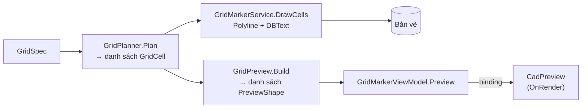
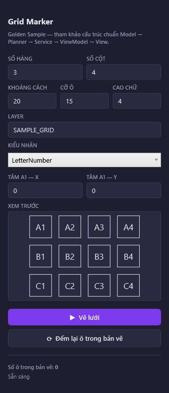
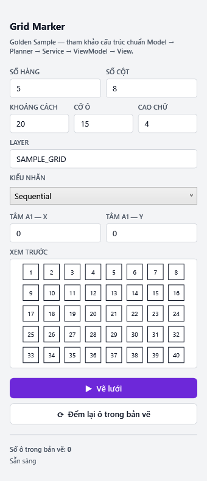

> **🎓 Học viện CadCoreFramework** · [Lộ trình](README.md) · [← U02](U02_UI_IN_AUTOCAD.md) · **U03**

# U03 — Vẽ Thực Thể Lên UI: Xem Trước Trên Palette Và Trên Màn Hình Bản Vẽ

> **Cấp độ:** 🌿 Junior → 🌳 Middle · **Cần trước:** [U01](U01_WPF_MVVM_BASICS.md), [U02](U02_UI_IN_AUTOCAD.md), [T01 §3–4](T01_AUTOCAD_NET_FOUNDATIONS.md#3-bên-trong-database-objectid-bảng-ký-hiệu-dictionary) · **Trong lộ trình:** tuần 9 ([README §3](README.md#3-lộ-trình-đào-tạo))

Tool kiểu "nhập thông số → **xem trước** → vẽ" (tủ điện, lưới, mặt bằng) cần vẽ hình ở những chỗ **không phải bản vẽ**: một khung trên palette, hay hình tạm trên màn hình trước khi người dùng xác nhận. Module này là hướng dẫn từng bước cho việc đó.

| Vẽ ở đâu | Công cụ | Vào database? | Dùng khi | Mục |
| :--- | :--- | :---: | :--- | :---: |
| Khung WPF trên palette / hộp thoại | `CadPreview` (tự viết, `OnRender`) | Không | Người dùng đang chỉnh thông số; thumbnail block; sơ đồ | [§1–8](#1-kiến-trúc-một-kế-hoạch-hai-nơi-vẽ) |
| Màn hình bản vẽ, **chạy theo chuột** | Jig (`EntityJig`, `DrawJig`) | Chưa, tới khi chốt | Đặt hoặc kéo một đối tượng theo con trỏ | [§9.1](#91-jig-hình-chạy-theo-chuột) |
| Màn hình bản vẽ, **đứng yên** | `TransientManager` | Không | Xem trước kết quả của cả lệnh; đánh dấu tạm | [§9.2](#92-transient-hình-tạm-đứng-yên) |
| Bản vẽ thật | `ICadContext` | Có | Chốt kết quả | [T01 §4](T01_AUTOCAD_NET_FOUNDATIONS.md#4-transaction-trái-tim-của-mọi-thao-tác) |

> [!TIP]
> 💡 **20/80 của chủ đề này là 5 khái niệm:** (1) vẽ từ **dữ liệu thuần**, không phải từ `Entity`; (2) **biến đổi tọa độ** bản vẽ → màn hình (fit khung, lật trục Y); (3) **một control tự vẽ** bằng `OnRender`; (4) **màu theo theme**, màu 7 của AutoCAD là màu chữ của theme; (5) **kiểm thử bằng số và bằng ảnh**. Phần còn lại của module là chi tiết của 5 điều đó.

**Mọi code trong module đã chạy thật**, với C# 10, trên net48 và net8.0-windows:
- **Phần WPF (§2–6):** đã áp đúng các bước vào một bản sao của dự án, lần gần nhất trên code sau PR #11. Kết quả: build `-warnaserror` sạch; 330/330 test xanh (315 test có sẵn + 15 test của module); palette Grid Marker được render ra ảnh ở cả hai theme. Ảnh trong module là ảnh thật, và render lại trên code sau PR #11 vẫn ra đúng từng byte.
- **Phần đọc entity (§7):** chạy trên AutoCAD 2024 bằng HeadlessLab, 20/20 kiểm thử xanh (18 có sẵn + 2 của module).
- **Phần vẽ tạm (§9):** đã gọi API thật trong accoreconsole.
- **Trong AutoCAD 2024 có giao diện:** `CadPreview` trong một palette thật, xem trước các đối tượng đang chọn, và hình transient hiện ra rồi biến mất đều đã kiểm ([trạng thái kiểm chứng](#trạng-thái-kiểm-chứng)).

---

## Mục lục

1. [Kiến trúc: một kế hoạch, hai nơi vẽ](#1-kiến-trúc-một-kế-hoạch-hai-nơi-vẽ)
2. [Bước 1 — Mô hình hình học thuần](#2-bước-1--mô-hình-hình-học-thuần)
3. [Bước 2 — Biến đổi tọa độ](#3-bước-2--biến-đổi-tọa-độ)
4. [Bước 3 — Control `CadPreview`](#4-bước-3--control-cadpreview)
5. [Bước 4 — Nối vào Golden Sample](#5-bước-4--nối-vào-golden-sample)
6. [Bước 5 — Kiểm thử](#6-bước-5--kiểm-thử)
7. [Đọc entity trong bản vẽ thành hình xem trước](#7-đọc-entity-trong-bản-vẽ-thành-hình-xem-trước)
8. [Xem trước block (thumbnail)](#8-xem-trước-block-thumbnail)
9. [Vẽ tạm lên màn hình bản vẽ](#9-vẽ-tạm-lên-màn-hình-bản-vẽ)
10. [Hiệu năng](#10-hiệu-năng)
11. [Bẫy](#11-bẫy)
12. [Bài tập và tự kiểm tra](#12-bài-tập-và-tự-kiểm-tra)

---

## 1. Kiến trúc: một kế hoạch, hai nơi vẽ

Golden Sample đã tách sẵn phần "tính toán" (`GridPlanner`) khỏi phần "vẽ vào bản vẽ" (`GridMarkerService`). Xem trước chỉ cần thêm **một nơi vẽ thứ hai** cho cùng kết quả tính toán đó:



Vì sao không vẽ thẳng các `Entity` lên WPF?
- **`DBObject` chỉ sống trong transaction** đã mở nó ([T03 B5](T03_PITFALLS_CASEBOOK.md#b5-dùng-dbobject-sau-khi-transaction-kết-thúc)). Palette thì sống lâu hơn mọi transaction.
- **ViewModel không được biết AutoCAD.** Dữ liệu thuần thì ViewModel giữ được, và test được bằng xUnit.
- **Xem trước phải khớp với thứ sẽ vẽ.** Cả hai nhánh cùng đọc kết quả của `GridPlanner`, nên không thể lệch nhau.

Khi dữ liệu nằm sẵn **trong bản vẽ** (người dùng chọn entity, thư viện block), đường đi là: đọc entity **trong một transaction đọc** → đổi thành cùng loại dữ liệu thuần → đóng transaction → vẽ ([§7](#7-đọc-entity-trong-bản-vẽ-thành-hình-xem-trước)).

---

## 2. Bước 1 — Mô hình hình học thuần

Tạo file `Models/Preview/PreviewShape.cs`. Chỉ **ba loại hình**: đường gấp khúc, đường tròn, chữ. Cung tròn được chia thành nhiều đoạn thẳng ngắn ngay khi tạo. Nhờ vậy renderer không phải xử lý cung, và tránh được bẫy chiều quét của cung khi lật trục Y.

```csharp
using System;
using System.Collections.Generic;

namespace CadCoreFramework.Models.Preview
{
    /// <summary>Ba loại hình mà bộ xem trước biết vẽ — đủ cho phần lớn bản vẽ 2D.</summary>
    public enum PreviewShapeKind
    {
        /// <summary>Đường gấp khúc: đoạn thẳng, polyline, và cả cung tròn (đã chia thành đoạn ngắn).</summary>
        Polyline,
        Circle,
        Text
    }

    /// <summary>Điểm neo của chữ so với điểm chèn.</summary>
    public enum PreviewTextAnchor
    {
        /// <summary>Góc trái, trên đường chân chữ — như DBText mặc định.</summary>
        BaselineLeft,
        /// <summary>Góc dưới bên trái — như MText vẽ bằng DrawMText của framework.</summary>
        BottomLeft,
        /// <summary>Góc trên bên trái — như MText tạo bằng lệnh MTEXT.</summary>
        TopLeft,
        /// <summary>Chính giữa — như nhãn ô của Grid Marker.</summary>
        MiddleCenter
    }

    /// <summary>Một điểm trong tọa độ bản vẽ (WCS, đơn vị bản vẽ). Cố ý không dùng Point3d (AutoCAD) hay Point (WPF).</summary>
    public readonly struct PreviewPoint
    {
        public PreviewPoint(double x, double y)
        {
            X = x;
            Y = y;
        }

        public double X { get; }
        public double Y { get; }
    }

    /// <summary>
    /// Một hình cần xem trước, trong tọa độ bản vẽ. Logic thuần: không AutoCAD, không WPF
    /// → ViewModel dùng được, test được bằng xUnit. Tạo bằng các hàm static bên dưới.
    /// </summary>
    public sealed class PreviewShape
    {
        private PreviewShape(PreviewShapeKind kind, IReadOnlyList<PreviewPoint> points, bool isClosed,
            double radius, string text, double textHeight, PreviewTextAnchor anchor, double rotation, int? rgb)
        {
            Kind = kind;
            Points = points;
            IsClosed = isClosed;
            Radius = radius;
            Text = text;
            TextHeight = textHeight;
            Anchor = anchor;
            Rotation = rotation;
            Rgb = rgb;
        }

        public PreviewShapeKind Kind { get; }

        /// <summary>Polyline: các đỉnh · Circle: [tâm] · Text: [điểm chèn].</summary>
        public IReadOnlyList<PreviewPoint> Points { get; }

        public bool IsClosed { get; }
        public double Radius { get; }
        public string Text { get; }
        public double TextHeight { get; }
        public PreviewTextAnchor Anchor { get; }

        /// <summary>Góc xoay của chữ, radian, ngược chiều kim đồng hồ (như DBText.Rotation).</summary>
        public double Rotation { get; }

        /// <summary>Màu 0xRRGGBB; null = màu chữ của theme (giống màu 7 "trắng/đen theo nền" của AutoCAD).</summary>
        public int? Rgb { get; }

        public static PreviewShape Line(double x1, double y1, double x2, double y2, int? rgb = null)
            => Polyline(new[] { new PreviewPoint(x1, y1), new PreviewPoint(x2, y2) }, isClosed: false, rgb);

        public static PreviewShape Polyline(IReadOnlyList<PreviewPoint> points, bool isClosed, int? rgb = null)
        {
            if (points == null) throw new ArgumentNullException(nameof(points));
            if (points.Count < 2) throw new ArgumentException("Polyline cần ít nhất 2 điểm.", nameof(points));
            return new PreviewShape(PreviewShapeKind.Polyline, points, isClosed, 0, string.Empty, 0, PreviewTextAnchor.BaselineLeft, 0, rgb);
        }

        public static PreviewShape Rectangle(double minX, double minY, double maxX, double maxY, int? rgb = null)
            => Polyline(new[]
            {
                new PreviewPoint(minX, minY), new PreviewPoint(maxX, minY),
                new PreviewPoint(maxX, maxY), new PreviewPoint(minX, maxY)
            }, isClosed: true, rgb);

        public static PreviewShape Circle(double centerX, double centerY, double radius, int? rgb = null)
        {
            if (radius <= 0) throw new ArgumentOutOfRangeException(nameof(radius), "Bán kính phải > 0.");
            return new PreviewShape(PreviewShapeKind.Circle, new[] { new PreviewPoint(centerX, centerY) }, true,
                radius, string.Empty, 0, PreviewTextAnchor.BaselineLeft, 0, rgb);
        }

        /// <summary>
        /// Cung tròn đi NGƯỢC chiều kim đồng hồ từ startAngle tới endAngle (radian) — đúng quy ước của Arc trong AutoCAD.
        /// Cung được chia thành các đoạn ≤ 5°: đủ mịn ở cỡ palette, và renderer chỉ cần biết vẽ đường gấp khúc.
        /// </summary>
        public static PreviewShape Arc(double centerX, double centerY, double radius,
            double startAngle, double endAngle, int? rgb = null)
        {
            if (radius <= 0) throw new ArgumentOutOfRangeException(nameof(radius), "Bán kính phải > 0.");

            double sweep = endAngle - startAngle;
            while (sweep <= 0) sweep += 2 * Math.PI;   // AutoCAD cho phép endAngle < startAngle: cung đi qua góc 0
            int segments = Math.Max(2, (int)Math.Ceiling(sweep / (5 * Math.PI / 180)));

            var points = new PreviewPoint[segments + 1];
            for (int i = 0; i <= segments; i++)
            {
                double angle = startAngle + sweep * i / segments;
                points[i] = new PreviewPoint(centerX + radius * Math.Cos(angle), centerY + radius * Math.Sin(angle));
            }
            return Polyline(points, isClosed: false, rgb);
        }

        public static PreviewShape Label(string text, double x, double y, double height,
            PreviewTextAnchor anchor = PreviewTextAnchor.BaselineLeft, double rotation = 0, int? rgb = null)
        {
            if (height <= 0) throw new ArgumentOutOfRangeException(nameof(height), "Chiều cao chữ phải > 0.");
            return new PreviewShape(PreviewShapeKind.Text, new[] { new PreviewPoint(x, y) }, false,
                0, text ?? string.Empty, height, anchor, rotation, rgb);
        }
    }
}
```

Ba quyết định thiết kế cần hiểu:
1. **Hàm tạo là `private`**, chỉ tạo hình qua các hàm `static` đã kiểm tham số. Không thể có một `Circle` bán kính âm ([C03 §3](C03_OBJECT_ORIENTED.md#3-đóng-gói-đối-tượng-tự-giữ-luật-của-mình)).
2. **Tên `Label`, không phải `Text`**: class đã có property `Text`, nên đặt một hàm cũng tên `Text` sẽ gây lỗi `CS0102: The type 'PreviewShape' already contains a definition for 'Text'`.
3. **`Rgb = null` nghĩa là "màu chữ của theme"**. Màu 7 của AutoCAD hiển thị *trắng trên nền tối, đen trên nền sáng*. Màu cố định sẽ biến mất ở một trong hai theme ([§7](#7-đọc-entity-trong-bản-vẽ-thành-hình-xem-trước)).

---

## 3. Bước 2 — Biến đổi tọa độ

Bản vẽ và màn hình dùng hai hệ trục khác nhau:

| | Gốc | Trục Y | Đơn vị |
| :--- | :--- | :--- | :--- |
| Bản vẽ (WCS) | Tùy bản vẽ, có thể rất xa: 600 000, 1 200 000 với hệ VN-2000 | **Hướng lên** | mm, m… |
| Màn hình WPF | Góc trên-trái của control | **Hướng xuống** | pixel độc lập thiết bị |

"Zoom extents" lên một khung `W × H`, chừa lề `m`, cần **một** hệ số chung cho cả hai trục để hình không bị méo:

```text
scale = min( (W − 2m) / rộng_bản_vẽ ,  (H − 2m) / cao_bản_vẽ )
x_màn = lệch_x + (x − MinX) × scale
y_màn = lệch_y + (MaxY − y) × scale      ← "MaxY − y": chỗ lật trục Y
```

Hai `lệch` căn hình vào giữa khung. Trừ `MinX`/`MaxY` **trước** khi nhân là cố ý: tọa độ lớn được đưa về số nhỏ trước, nên không mất chính xác. Tạo file `Models/Preview/PreviewViewport.cs`:

```csharp
using System;
using System.Collections.Generic;

namespace CadCoreFramework.Models.Preview
{
    /// <summary>Khung bao (bounding box) của một tập hình, trong tọa độ bản vẽ.</summary>
    public readonly struct PreviewBounds
    {
        public PreviewBounds(double minX, double minY, double maxX, double maxY)
        {
            MinX = minX;
            MinY = minY;
            MaxX = maxX;
            MaxY = maxY;
        }

        public double MinX { get; }
        public double MinY { get; }
        public double MaxX { get; }
        public double MaxY { get; }
        public double Width => MaxX - MinX;
        public double Height => MaxY - MinY;

        /// <summary>Khung bao của mọi hình. Chữ được ước lượng: rộng ≈ 0,7 × cao × số ký tự của dòng dài nhất.</summary>
        public static PreviewBounds Of(IEnumerable<PreviewShape> shapes)
        {
            if (shapes == null) throw new ArgumentNullException(nameof(shapes));

            double minX = double.MaxValue, minY = double.MaxValue, maxX = double.MinValue, maxY = double.MinValue;
            void Include(double x, double y)
            {
                if (x < minX) minX = x;
                if (y < minY) minY = y;
                if (x > maxX) maxX = x;
                if (y > maxY) maxY = y;
            }

            foreach (PreviewShape shape in shapes)
            {
                PreviewPoint p = shape.Points[0];
                switch (shape.Kind)
                {
                    case PreviewShapeKind.Circle:
                        Include(p.X - shape.Radius, p.Y - shape.Radius);
                        Include(p.X + shape.Radius, p.Y + shape.Radius);
                        break;
                    case PreviewShapeKind.Text:
                        string[] lines = shape.Text.Split('\n');
                        int longest = 1;
                        foreach (string line in lines) longest = Math.Max(longest, line.TrimEnd('\r').Length);
                        double w = 0.7 * shape.TextHeight * longest;
                        double h = shape.TextHeight * (1 + 1.7 * (lines.Length - 1));   // khoảng cách dòng ≈ 1,7 × cao chữ
                        switch (shape.Anchor)
                        {
                            case PreviewTextAnchor.MiddleCenter: Include(p.X - w / 2, p.Y - h / 2); Include(p.X + w / 2, p.Y + h / 2); break;
                            case PreviewTextAnchor.TopLeft: Include(p.X, p.Y - h); Include(p.X + w, p.Y); break;
                            default: Include(p.X, p.Y); Include(p.X + w, p.Y + h); break;
                        }
                        break;
                    default:
                        foreach (PreviewPoint q in shape.Points) Include(q.X, q.Y);
                        break;
                }
            }

            return minX > maxX ? new PreviewBounds(0, 0, 0, 0) : new PreviewBounds(minX, minY, maxX, maxY);
        }
    }

    /// <summary>
    /// Biến tọa độ bản vẽ thành tọa độ màn hình (pixel WPF) sao cho TOÀN BỘ hình vừa khung:
    /// một hệ số scale chung cho X và Y (không méo hình), chừa lề, căn giữa, và LẬT TRỤC Y
    /// (bản vẽ: Y hướng lên · màn hình WPF: Y hướng xuống). Logic thuần → test bằng xUnit.
    /// </summary>
    public sealed class PreviewViewport
    {
        private readonly PreviewBounds _world;
        private readonly double _offsetX;
        private readonly double _offsetY;

        private PreviewViewport(PreviewBounds world, double scale, double offsetX, double offsetY)
        {
            _world = world;
            Scale = scale;
            _offsetX = offsetX;
            _offsetY = offsetY;
        }

        /// <summary>Số pixel cho một đơn vị bản vẽ.</summary>
        public double Scale { get; }

        /// <summary>Tạo viewport "zoom extents": hình nằm giữa khung width × height, cách mép ít nhất margin pixel.</summary>
        public static PreviewViewport Fit(PreviewBounds world, double width, double height, double margin = 8)
        {
            double usableWidth = Math.Max(width - 2 * margin, 1);
            double usableHeight = Math.Max(height - 2 * margin, 1);

            // Hình chỉ là một điểm (rộng = cao = 0): không có gì để co giãn → scale 1, đặt điểm vào giữa.
            // Hình là đường nằm ngang/thẳng đứng: chiều bằng 0 không được giới hạn scale.
            double scale;
            if (world.Width <= 0 && world.Height <= 0) scale = 1;
            else if (world.Width <= 0) scale = usableHeight / world.Height;
            else if (world.Height <= 0) scale = usableWidth / world.Width;
            else scale = Math.Min(usableWidth / world.Width, usableHeight / world.Height);

            double offsetX = (width - world.Width * scale) / 2;
            double offsetY = (height - world.Height * scale) / 2;
            return new PreviewViewport(world, scale, offsetX, offsetY);
        }

        /// <summary>Điểm bản vẽ → điểm màn hình. Trừ MinX/MaxY TRƯỚC khi nhân: số nhỏ, không mất chính xác với tọa độ lớn.</summary>
        public (double X, double Y) ToScreen(PreviewPoint p)
            => (_offsetX + (p.X - _world.MinX) * Scale,
                _offsetY + (_world.MaxY - p.Y) * Scale);

        /// <summary>Độ dài bản vẽ → pixel (bán kính, chiều cao chữ).</summary>
        public double ToScreenLength(double worldLength) => worldLength * Scale;
    }
}
```

**Tính thử bằng tay** (đây cũng là một test ở [§6](#6-bước-5--kiểm-thử)): hình 100 × 50, khung 220 × 220, lề 10 → vùng dùng được 200 × 200, `scale = min(200/100; 200/50) = 2`. Hình cao 50 × 2 = 100 px, căn giữa trong 220, nên mép trên ở y = 60. Vậy điểm (0; 50), góc trên-trái của bản vẽ, ra **(10; 60)**, và (100; 0) ra (210; 160). Với tọa độ kiểu VN-2000 (600 000; 1 200 000), kết quả vẫn **đúng tuyệt đối**: 8,000 và 192,000 trong khung 200, lề 8 (đã chạy).

⚠️ **Bẫy: "lật Y cho nhanh" bằng một phép biến đổi cho cả khung.** Đặt `ScaleTransform(1, −1)` (hay một ma trận có hệ số Y âm) lên cả `Canvas` trông có vẻ gọn, nhưng **mọi thứ** bị lật theo, kể cả chữ. Và độ dày nét cũng bị nhân theo scale. Ảnh thật, với scale 4: chữ lộn ngược, nét dày 4 px:


`PreviewViewport` đổi **từng điểm** sang pixel trước khi vẽ. Nhờ vậy chữ được vẽ thẳng, và nét luôn dày đúng 1 px ở mọi mức zoom.

---

## 4. Bước 3 — Control `CadPreview`

Tạo file `Views/Controls/CadPreview.cs`. Đây là một `FrameworkElement` **tự vẽ** trong `OnRender`: một phần tử WPF duy nhất, thay vì hàng nghìn `Line`/`Rectangle`/`TextBlock` trên `Canvas`.

```csharp
using System;
using System.Collections.Generic;
using System.Globalization;
using System.Windows;
using System.Windows.Media;
using CadCoreFramework.Models.Preview;

namespace CadCoreFramework.Views.Controls
{
    /// <summary>
    /// Vẽ danh sách <see cref="PreviewShape"/> lên palette/dialog, tự "zoom extents" theo kích thước hiện tại.
    /// Tự vẽ bằng OnRender (một phần tử WPF duy nhất) thay vì hàng nghìn Line/Rectangle trên Canvas.
    /// Màu nền và màu nét nhận từ XAML — gán bằng {DynamicResource} để theo theme AutoCAD.
    /// </summary>
    public sealed class CadPreview : FrameworkElement
    {
        private static readonly Typeface LabelTypeface = new Typeface("Segoe UI");

        // AffectsRender: đổi giá trị → WPF tự gọi lại OnRender. Đổi kích thước cũng tự vẽ lại.
        public static readonly DependencyProperty ShapesProperty = DependencyProperty.Register(
            nameof(Shapes), typeof(IReadOnlyList<PreviewShape>), typeof(CadPreview),
            new FrameworkPropertyMetadata(null, FrameworkPropertyMetadataOptions.AffectsRender));

        public static readonly DependencyProperty BackgroundProperty = DependencyProperty.Register(
            nameof(Background), typeof(Brush), typeof(CadPreview),
            new FrameworkPropertyMetadata(Brushes.Transparent, FrameworkPropertyMetadataOptions.AffectsRender));

        public static readonly DependencyProperty ForegroundProperty = DependencyProperty.Register(
            nameof(Foreground), typeof(Brush), typeof(CadPreview),
            new FrameworkPropertyMetadata(Brushes.Gray, FrameworkPropertyMetadataOptions.AffectsRender));

        /// <summary>Các hình cần vẽ, trong tọa độ bản vẽ. Thay CẢ danh sách để vẽ lại (đổi phần tử bên trong thì không).</summary>
        public IReadOnlyList<PreviewShape> Shapes
        {
            get => (IReadOnlyList<PreviewShape>)GetValue(ShapesProperty);
            set => SetValue(ShapesProperty, value);
        }

        public Brush Background
        {
            get => (Brush)GetValue(BackgroundProperty);
            set => SetValue(BackgroundProperty, value);
        }

        /// <summary>Màu cho hình có Rgb = null (màu 7 của AutoCAD) — thường là màu chữ của theme.</summary>
        public Brush Foreground
        {
            get => (Brush)GetValue(ForegroundProperty);
            set => SetValue(ForegroundProperty, value);
        }

        protected override void OnRender(DrawingContext dc)
        {
            var area = new Rect(0, 0, ActualWidth, ActualHeight);
            dc.DrawRectangle(Background, null, area);   // vẽ cả nền: vùng trống cũng nhận chuột (hit-test)

            IReadOnlyList<PreviewShape> shapes = Shapes;
            if (shapes == null || shapes.Count == 0 || area.Width < 1 || area.Height < 1) return;

            PreviewViewport viewport = PreviewViewport.Fit(PreviewBounds.Of(shapes), area.Width, area.Height);
            double pixelsPerDip = VisualTreeHelper.GetDpi(this).PixelsPerDip;
            var pens = new Dictionary<int, Pen>();     // một Pen cho mỗi màu, không phải mỗi hình

            dc.PushClip(new RectangleGeometry(area)); // chữ dài không tràn ra ngoài khung
            foreach (PreviewShape shape in shapes)
            {
                Brush brush = BrushOf(shape.Rgb);
                switch (shape.Kind)
                {
                    case PreviewShapeKind.Polyline:
                        dc.DrawGeometry(null, PenOf(shape.Rgb, brush, pens), PolylineGeometry(shape, viewport));
                        break;
                    case PreviewShapeKind.Circle:
                        var (cx, cy) = viewport.ToScreen(shape.Points[0]);
                        double r = viewport.ToScreenLength(shape.Radius);
                        dc.DrawEllipse(null, PenOf(shape.Rgb, brush, pens), new Point(cx, cy), r, r);
                        break;
                    case PreviewShapeKind.Text:
                        DrawLabel(dc, shape, viewport, brush, pixelsPerDip);
                        break;
                }
            }
            dc.Pop();
        }

        private static Geometry PolylineGeometry(PreviewShape shape, PreviewViewport viewport)
        {
            var geometry = new StreamGeometry();
            using (StreamGeometryContext ctx = geometry.Open())
            {
                var (x0, y0) = viewport.ToScreen(shape.Points[0]);
                ctx.BeginFigure(new Point(x0, y0), isFilled: false, isClosed: shape.IsClosed);
                for (int i = 1; i < shape.Points.Count; i++)
                {
                    var (x, y) = viewport.ToScreen(shape.Points[i]);
                    ctx.LineTo(new Point(x, y), isStroked: true, isSmoothJoin: false);
                }
            }
            geometry.Freeze();   // đối tượng WPF đã Freeze: không đổi được nữa, vẽ nhanh hơn
            return geometry;
        }

        private static void DrawLabel(DrawingContext dc, PreviewShape shape, PreviewViewport viewport,
            Brush brush, double pixelsPerDip)
        {
            // Chiều cao chữ AutoCAD ≈ chiều cao chữ HOA ≈ 0,7 cỡ font (em) → em = cao / 0,7.
            double emSize = viewport.ToScreenLength(shape.TextHeight) / 0.7;
            if (emSize < 4) return;   // nhỏ hơn ~4 px thì không đọc được: bỏ qua cho nhanh và đỡ rối

            var text = new FormattedText(shape.Text, CultureInfo.CurrentUICulture, FlowDirection.LeftToRight,
                LabelTypeface, emSize, brush, pixelsPerDip);

            var (ax, ay) = viewport.ToScreen(shape.Points[0]);
            Point origin;   // DrawText nhận góc TRÊN-TRÁI của khối chữ
            switch (shape.Anchor)
            {
                case PreviewTextAnchor.MiddleCenter: origin = new Point(ax - text.Width / 2, ay - text.Height / 2); break;
                case PreviewTextAnchor.TopLeft: origin = new Point(ax, ay); break;
                case PreviewTextAnchor.BottomLeft: origin = new Point(ax, ay - text.Height); break;
                default: origin = new Point(ax, ay - text.Baseline); break;   // BaselineLeft
            }

            // Bản vẽ quay ngược chiều kim đồng hồ; RotateTransform của WPF quay THUẬN chiều (vì Y hướng xuống) → đổi dấu.
            bool rotated = shape.Rotation != 0;
            if (rotated) dc.PushTransform(new RotateTransform(-shape.Rotation * 180 / Math.PI, ax, ay));
            dc.DrawText(text, origin);
            if (rotated) dc.Pop();
        }

        private Brush BrushOf(int? rgb)
        {
            if (rgb == null) return Foreground;
            var brush = new SolidColorBrush(Color.FromRgb((byte)(rgb.Value >> 16), (byte)(rgb.Value >> 8), (byte)rgb.Value));
            brush.Freeze();
            return brush;
        }

        private static Pen PenOf(int? rgb, Brush brush, Dictionary<int, Pen> cache)
        {
            int key = rgb ?? -1;
            if (!cache.TryGetValue(key, out Pen pen))
            {
                pen = new Pen(brush, 1);   // 1 pixel ở MỌI mức zoom: tọa độ đã đổi sang pixel trước khi vẽ
                if (pen.CanFreeze) pen.Freeze();
                cache[key] = pen;
            }
            return pen;
        }
    }
}
```

Những dòng đáng đọc kỹ:

| Dòng | Vì sao |
| :--- | :--- |
| `DependencyProperty.Register(…, FrameworkPropertyMetadataOptions.AffectsRender)` | Property phải là **DependencyProperty** thì mới bind được từ XAML và nhận `{DynamicResource}`. `AffectsRender` bảo WPF tự gọi lại `OnRender` mỗi khi giá trị đổi |
| `Shapes` nhận **cả danh sách mới** | WPF chỉ thấy "property đổi" khi bạn gán một đối tượng khác. Sửa phần tử *bên trong* danh sách cũ thì không ai vẽ lại ([U01 §7](U01_WPF_MVVM_BASICS.md#7-danh-sách-observablecollection)) |
| `PreviewViewport.Fit(…)` mỗi lần vẽ | Palette đổi kích thước thì hình tự fit lại |
| `geometry.Freeze()`, `pen.Freeze()` | Đối tượng WPF đã "đóng băng" thì WPF không phải theo dõi thay đổi của nó, nên vẽ nhanh hơn |
| `emSize = cao / 0,7` | Chiều cao chữ AutoCAD đo theo chữ **hoa**, khoảng 0,7 cỡ font. Đây là ước lượng: font WPF khác font AutoCAD (`txt.shx`…), nên chữ trên preview chỉ *gần đúng* bề rộng |
| `if (emSize < 4) return;` | 2.500 ô của lưới lớn nhất làm chữ chỉ còn ~3 px: bỏ qua cho rõ hình và nhanh hơn |
| `RotateTransform(-…)` | Góc trong AutoCAD dương = ngược chiều kim đồng hồ. Trên màn hình WPF (Y hướng xuống), góc dương = **thuận** chiều. Nên phải đổi dấu |

Đã kiểm hướng trục, chiều cung và chữ xoay bằng một ảnh thật:
- Trục +X (đỏ) đi sang phải, trục +Y (xanh lá) đi **lên**.
- Cung 0° → 90° nằm ở góc phần tư trên-phải.
- Chữ xoay 90° đọc từ dưới lên, như AutoCAD.
- `\r\n` xuống dòng đúng; chữ `BottomLeft` đặt đáy khối chữ lên đúng vạch hồng.


---

## 5. Bước 4 — Nối vào Golden Sample

**4a — Biến kết quả của `GridPlanner` thành hình.** Tạo file `Samples/GridMarker/GridPreview.cs`. Nó dùng *cùng* hình học với `GridMarkerService.DrawCells`: khung vuông cạnh `CellSize` quanh tâm ô, nhãn ở giữa.

```csharp
using System;
using System.Collections.Generic;
using CadCoreFramework.Models.Preview;

namespace CadCoreFramework.Samples.GridMarker
{
    /// <summary>
    /// GOLDEN SAMPLE — XEM TRƯỚC (logic thuần).
    /// Biến kết quả của GridPlanner thành hình để vẽ lên palette — CÙNG hình học với
    /// GridMarkerService.DrawCells (khung vuông cạnh CellSize quanh tâm ô, nhãn ở giữa),
    /// nhưng không chạm AutoCAD: một kế hoạch, hai nơi vẽ.
    /// </summary>
    public static class GridPreview
    {
        public static IReadOnlyList<PreviewShape> Build(GridSpec spec, IReadOnlyList<GridCell> cells)
        {
            if (spec == null) throw new ArgumentNullException(nameof(spec));
            if (cells == null) throw new ArgumentNullException(nameof(cells));

            double half = spec.CellSize / 2.0;
            var shapes = new List<PreviewShape>(cells.Count * 2);
            foreach (GridCell cell in cells)
            {
                shapes.Add(PreviewShape.Rectangle(
                    cell.CenterX - half, cell.CenterY - half,
                    cell.CenterX + half, cell.CenterY + half));
                shapes.Add(PreviewShape.Label(
                    cell.Label, cell.CenterX, cell.CenterY, spec.TextHeight, PreviewTextAnchor.MiddleCenter));
            }
            return shapes;
        }
    }
}
```

**4b — ViewModel giữ danh sách hình.** Trong [`GridMarkerViewModel.cs`](../../Samples/GridMarker/GridMarkerViewModel.cs): thêm `using CadCoreFramework.Models.Preview;` và một property. Trong `Revalidate()`, đưa `BuildSpec()` ra một biến `spec` để dùng lại, rồi thêm ba dòng gán `Preview`:

```csharp
/// <summary>Hình xem trước của lưới theo input hiện tại; rỗng khi input sai. View vẽ bằng CadPreview.</summary>
[ObservableProperty] private IReadOnlyList<PreviewShape> _preview = Array.Empty<PreviewShape>();
```

```csharp
private void Revalidate()
{
    GridSpec spec = BuildSpec();
    List<string> errors = NumberInputErrors();    // ô số không đọc được (B-31/B-32)…
    errors.AddRange(spec.Validate());             // …cộng luật của GridSpec — một nguồn luật duy nhất
    ValidationSummary = string.Join(Environment.NewLine, errors);
    HasValidationErrors = errors.Count > 0;

    // Cùng GridPlanner với nút Vẽ → xem trước đúng thứ sẽ được vẽ. Gốc (0, 0): preview luôn tự
    // "zoom extents", dời cả lưới không đổi hình — nên đổi OriginX/OriginY không cần vẽ lại.
    Preview = HasValidationErrors
        ? Array.Empty<PreviewShape>()
        : GridPreview.Build(spec, GridPlanner.Plan(spec, 0, 0));

    DrawCommand.NotifyCanExecuteChanged();
}
```

`Revalidate()` đã chạy mỗi khi một trong 7 input đổi ([U01 §6](U01_WPF_MVVM_BASICS.md#6-mvvm-với-communitytoolkitmvvm)), và mỗi khi người dùng gõ vào một ô số ([U01 §5.3](U01_WPF_MVVM_BASICS.md#53-cách-sửa-2080-ô-số-bind-vào-chuỗi)). Vì vậy xem trước tự cập nhật **theo từng phím gõ** mà không cần thêm code nào. Input sai thì `Preview` rỗng. Ô số đang trống hay đang ghi `2,5` cũng tính là input sai, nên khung xem trước không bao giờ hiện lưới cũ khi ô đang sai. `GridPlanner.Plan` ném exception khi spec sai, nên phải kiểm `HasValidationErrors` **trước** khi gọi. ViewModel vẫn chỉ có dữ liệu thuần: không `Brush`, không `Entity`.

**4c — View.** Trong [`GridMarkerPalette.xaml`](../../Samples/GridMarker/GridMarkerPalette.xaml): khai báo namespace của control ở thẻ gốc, rồi đặt khung xem trước ngay trên dòng báo lỗi validate:

```xml
xmlns:controls="clr-namespace:CadCoreFramework.Views.Controls"
```

```xml
<!-- Xem trước: vẽ lại mỗi khi ViewModel gán Preview mới; màu theo theme (DynamicResource) -->
<TextBlock Text="XEM TRƯỚC" Style="{DynamicResource LabelStyle}"/>
<Border Background="{DynamicResource SurfaceBrush}" BorderBrush="{DynamicResource BorderBrush}"
        BorderThickness="1" CornerRadius="4" Height="180">
    <controls:CadPreview Shapes="{Binding Preview}" Foreground="{DynamicResource TextPrimaryBrush}"/>
</Border>
```

Nền đặt trên `Border`, không đặt trên `CadPreview`, để góc bo tròn của `Border` không bị nền vuông của control che mất. Đây là kết quả thật của palette sau 3 bước trên. Bên trái: theme tối, lưới mặc định 3 × 4. Bên phải: theme sáng, sau khi đổi thành 5 × 8 với nhãn đánh số.

| Theme tối, 3 × 4 | Theme sáng, 5 × 8, `Sequential` |
| :---: | :---: |
|  |  |

**4d — HeadlessLab.** Nếu bạn cũng thêm `Utils/EntityPreviewBuilder.cs` ([§7](#7-đọc-entity-trong-bản-vẽ-thành-hình-xem-trước)), thì [`HeadlessLab.csproj`](../../tests/integration/HeadlessLab/HeadlessLab.csproj) cần **link thêm** mô hình. Project đó link `Utils/**` nhưng không link `Models/`, nên thiếu dòng này thì build cả solution, và CI, sẽ đỏ với lỗi `error CS0234: The type or namespace name 'Models' does not exist in the namespace 'CadCoreFramework'`:

```xml
<!-- Mô hình xem trước (logic thuần) — Utils/EntityPreviewBuilder.cs dùng nó. -->
<Compile Include="..\..\..\Models\Preview\*.cs" Link="Linked\Models\Preview\%(Filename)%(Extension)" />
```

---

## 6. Bước 5 — Kiểm thử

Ba tầng test, theo đúng kim tự tháp ở [T05 §2](T05_TESTING_STRATEGY.md#2-kim-tự-tháp-test-của-dự-án). Tất cả đã chạy xanh trên net48 và net8.0-windows.

**Tầng 1 — logic thuần: kiểm bằng số.** `CadCoreFramework.Tests/PreviewViewportTests.cs` có sáu test; đây là hai trong số đó. `Box100x50` là `new PreviewBounds(0, 0, 100, 50)`:

```csharp
[Fact]
public void ToScreen_FlipsY_AndCentres()
{
    PreviewViewport vp = PreviewViewport.Fit(Box100x50, 220, 220, margin: 10);

    // Hình cao 50 × 2 = 100 px, căn giữa trong 220 → mép trên ở y = 60, mép dưới ở y = 160.
    vp.ToScreen(new PreviewPoint(0, 50)).Should().Be((10.0, 60.0));    // góc trên-trái bản vẽ → trên-trái màn hình
    vp.ToScreen(new PreviewPoint(100, 0)).Should().Be((210.0, 160.0)); // góc dưới-phải
}
```

```csharp
[Fact]
public void ToScreen_LargeCoordinates_StaySharp()
{
    // Tọa độ kiểu VN-2000: trừ MinX/MaxY trước khi nhân nên không mất chính xác.
    var far = new PreviewBounds(600000, 1200000, 600010, 1200010);
    PreviewViewport vp = PreviewViewport.Fit(far, 200, 200, margin: 8);

    vp.ToScreen(new PreviewPoint(600000, 1200010)).Should().Be((8.0, 8.0));
    vp.ToScreen(new PreviewPoint(600010, 1200000)).Should().Be((192.0, 192.0));
}
```

Và `CadCoreFramework.Tests/Samples/GridMarker/GridPreviewTests.cs`: xem trước phải **trùng** với thứ Service vẽ.

```csharp
[Fact]
public void Build_FrameMatchesWhatTheServiceDraws()
{
    // GridMarkerService vẽ khung từ (tâm − CellSize/2) tới (tâm + CellSize/2): preview phải trùng khớp.
    var shapes = GridPreview.Build(Spec, GridPlanner.Plan(Spec, 100, 200));

    PreviewShape a1 = shapes[0];
    a1.IsClosed.Should().BeTrue();
    a1.Points.Select(p => (p.X, p.Y)).Should().Equal((92.5, 192.5), (107.5, 192.5), (107.5, 207.5), (92.5, 207.5));
}
```

**Tầng 2 — ViewModel: kiểm hợp đồng với View.** Thêm vào [`GridMarkerViewModelTests.cs`](../../CadCoreFramework.Tests/Samples/GridMarker/GridMarkerViewModelTests.cs):

```csharp
[Fact]
public void Preview_InvalidInput_IsEmpty_AndComesBackWhenFixed()
{
    var vm = NewViewModel();

    vm.Rows = 0;
    vm.Preview.Should().BeEmpty();

    vm.Rows = 2;
    vm.Preview.Should().HaveCount(16);   // 2 × 4 ô × (khung + nhãn)
}

[Fact]
public void Preview_ReplacedAsAWholeList_SoBindingRedraws()
{
    // CadPreview chỉ vẽ lại khi property Shapes nhận một danh sách MỚI (AffectsRender).
    var vm = NewViewModel();
    var raised = new List<string>();
    vm.PropertyChanged += (_, e) => raised.Add(e.PropertyName!);

    vm.Columns = 5;

    raised.Should().Contain(nameof(GridMarkerViewModel.Preview));
}

[Fact]
public void Preview_ClearedBox_IsEmpty_NotTheOldGrid()
{
    var vm = NewViewModel();

    vm.RowsText = "";   // ô SỐ HÀNG bị xóa trắng: Rows vẫn là 3, nhưng input đang sai (B-32)

    vm.Preview.Should().BeEmpty();
}
```

**Tầng 3 — vẽ thật ra ảnh, đọc pixel.** WPF vẽ được ra ảnh mà không cần mở cửa sổ: dùng `RenderTargetBitmap` trên một luồng STA ([T05 §6](T05_TESTING_STRATEGY.md#6-xaml-palette-trên-sta)). Test **tính trước** pixel mà nét phải nằm, rồi đọc ảnh để đối chiếu. `CadCoreFramework.Tests/CadPreviewRenderTests.cs` (trích):

```csharp
// Khung bao 0..100 × 0..50 trên màn hình 220 × 120, lề mặc định 8: scale = min(204/100; 104/50) = 2,04,
// mép trên y = (120 − 50 × 2,04) / 2 = 9 → đường Y = 10 nằm ở y = 9 + (50 − 10) × 2,04 = 90,6 (hàng pixel 90).
var shapes = new[]
{
    PreviewShape.Rectangle(0, 0, 100, 50, rgb: 0x808080),
    PreviewShape.Line(0, 10, 100, 10, rgb: 0xFF0000),
};
var preview = new CadPreview { Shapes = shapes, Background = Brushes.Black };

BitmapSource bmp = Render(preview, 220, 120);

Color onLine = PixelAt(bmp, 110, 90);
onLine.R.Should().BeGreaterThan(100, "nét đỏ phải nằm ở y = 90");
onLine.G.Should().BeLessThan(60);
PixelAt(bmp, 110, 50).Should().Be(Colors.Black, "giữa khung chỉ có nền");
PixelAt(bmp, 110, 70).Should().Be(Colors.Black, "nét không được lệch lên trên");
```

⚠️ **Bẫy khi viết test pixel:** bản đầu của test này dùng **nền trắng** và kiểm `R > 200`. Trên nền trắng, kênh đỏ **vốn đã** bằng 255, nên test luôn pass, kể cả khi không vẽ gì. Cũng chính lỗi đó: nếu tính sai lề (8 chứ không phải 10) thì vẫn "đúng" nhờ may mắn. Một test chỉ có giá trị khi **nó fail được**: hãy thử làm hỏng code và xác nhận test đỏ ([T10 Q17](T10_LABS_AND_ASSESSMENT.md#5-ngân-hàng-câu-hỏi)).

Không cần test gì thêm cho XAML: [`XamlPaletteTests`](../../CadCoreFramework.Tests/XamlPaletteTests.cs) đọc file XAML và tự kiểm mọi key `DynamicResource` mới (`SurfaceBrush`, `BorderBrush`, `TextPrimaryBrush`, `LabelStyle`) ở cả hai theme.

---

## 7. Đọc entity trong bản vẽ thành hình xem trước

Khi hình nằm **sẵn trong bản vẽ**, ví dụ "xem trước các đối tượng vừa chọn" hay thư viện block, thì đọc chúng **trong một transaction** thành `PreviewShape`, rồi mới vẽ. Tạo file `Utils/EntityPreviewBuilder.cs`:

```csharp
using System.Collections.Generic;
using Autodesk.AutoCAD.Colors;
using Autodesk.AutoCAD.DatabaseServices;
using Autodesk.AutoCAD.Geometry;
using CadCoreFramework.Models.Preview;

namespace CadCoreFramework.Utils
{
    /// <summary>
    /// Đọc hình học của entity trong bản vẽ thành <see cref="PreviewShape"/> để vẽ lên UI.
    /// Gọi BÊN TRONG transaction (ví dụ trong ICadContext.ExecuteRead). Kết quả không giữ DBObject nào
    /// → dùng thoải mái sau khi transaction đóng, kể cả gán vào ViewModel.
    ///
    /// Hỗ trợ: Line, Arc, Circle, Polyline (cả đoạn cong), DBText, MText, BlockReference (đệ quy, kèm attribute),
    /// Dimension, và mọi Curve khác (Ellipse, Spline…) bằng cách lấy mẫu điểm.
    /// Bỏ qua: Hatch, Solid, ảnh raster, Xline/Ray (dài vô hạn), entity ẩn hoặc nằm trên layer tắt/đóng băng.
    /// </summary>
    public sealed class EntityPreviewBuilder
    {
        private const int MaxNestingDepth = 8;   // block lồng block: dừng ở độ sâu 8 cho an toàn
        private const int ArcSamples = 16;       // số điểm cho mỗi đoạn cong của Polyline
        private const int CurveSamples = 64;     // số điểm cho Ellipse, Spline…

        private readonly Transaction _tr;
        private readonly List<PreviewShape> _shapes = new List<PreviewShape>();
        private readonly Dictionary<ObjectId, LayerTableRecord> _layers = new Dictionary<ObjectId, LayerTableRecord>();

        private EntityPreviewBuilder(Transaction tr) => _tr = tr;

        /// <summary>Hình của các entity được chọn, tọa độ WCS.</summary>
        public static List<PreviewShape> FromEntities(Transaction tr, IEnumerable<ObjectId> ids)
        {
            var builder = new EntityPreviewBuilder(tr);
            foreach (ObjectId id in ids)
                if (tr.GetObject(id, OpenMode.ForRead) is Entity entity)
                    builder.Add(entity, inheritedRgb: null, depth: 0);
            return builder._shapes;
        }

        /// <summary>Hình của một định nghĩa block (thư viện block, thumbnail), tọa độ của block (gốc = điểm chèn).</summary>
        public static List<PreviewShape> FromBlockDefinition(Transaction tr, ObjectId blockTableRecordId)
        {
            var builder = new EntityPreviewBuilder(tr);
            var definition = (BlockTableRecord)tr.GetObject(blockTableRecordId, OpenMode.ForRead);
            foreach (ObjectId id in definition)
                if (tr.GetObject(id, OpenMode.ForRead) is Entity entity)
                    builder.Add(entity, inheritedRgb: null, depth: 1);
            return builder._shapes;
        }

        private void Add(Entity entity, int? inheritedRgb, int depth)
        {
            if (!entity.Visible || IsHiddenLayer(entity.LayerId)) return;
            int? rgb = ResolveRgb(entity, inheritedRgb, depth > 0);

            switch (entity)
            {
                case Line line:
                    _shapes.Add(PreviewShape.Line(line.StartPoint.X, line.StartPoint.Y, line.EndPoint.X, line.EndPoint.Y, rgb));
                    break;
                case Arc arc:   // góc của Arc đo trong mặt phẳng của nó — đúng với bản vẽ 2D (Normal = trục Z)
                    _shapes.Add(PreviewShape.Arc(arc.Center.X, arc.Center.Y, arc.Radius, arc.StartAngle, arc.EndAngle, rgb));
                    break;
                case Circle circle:
                    _shapes.Add(PreviewShape.Circle(circle.Center.X, circle.Center.Y, circle.Radius, rgb));
                    break;
                case Polyline polyline:
                    AddPolyline(polyline, rgb);
                    break;
                case AttributeDefinition _:
                    break;   // chỉ là "khuôn" của attribute; giá trị thật nằm ở AttributeReference của từng block
                case DBText text:
                    AddText(text, rgb);
                    break;
                case MText mtext:   // MText.Text: chữ thuần, không mã định dạng; xuống dòng \P thành "\r\n"
                    _shapes.Add(PreviewShape.Label(mtext.Text, mtext.Location.X, mtext.Location.Y, mtext.TextHeight,
                        AnchorOf(mtext.Attachment), mtext.Rotation, rgb));
                    break;
                case BlockReference block when depth < MaxNestingDepth:
                    AddExploded(block, rgb, depth);
                    // Attribute là entity RIÊNG của BlockReference (không nằm trong định nghĩa block): Explode không trả
                    // về chúng, và quy tắc "layer 0 lấy màu block" không áp dụng — chỉ màu ByBlock mới thừa hưởng.
                    foreach (ObjectId attId in block.AttributeCollection)
                        if (_tr.GetObject(attId, OpenMode.ForRead) is AttributeReference att
                            && !att.Invisible && att.Visible && !IsHiddenLayer(att.LayerId))
                            AddText(att, ResolveRgb(att, rgb, insideBlock: false));
                    break;
                case Dimension dimension when depth < MaxNestingDepth:
                    AddExploded(dimension, rgb, depth);
                    break;
                case Xline _:
                case Ray _:
                    break;   // dài vô hạn: không có khung bao để "zoom extents"
                case Curve curve:
                    AddSampledCurve(curve, rgb);
                    break;
            }
        }

        /// <summary>Explode trả về bản sao NẰM NGOÀI database, đã biến đổi sang WCS → đọc xong phải Dispose.</summary>
        private void AddExploded(Entity composite, int? rgb, int depth)
        {
            using (var parts = new DBObjectCollection())
            {
                composite.Explode(parts);
                foreach (DBObject part in parts)
                {
                    if (part is Entity entity) Add(entity, rgb, depth + 1);
                    part.Dispose();
                }
            }
        }

        private void AddPolyline(Polyline polyline, int? rgb)
        {
            int vertexCount = polyline.NumberOfVertices;
            if (vertexCount < 2) return;

            var points = new List<PreviewPoint>();
            Point3d first = polyline.GetPoint3dAt(0);
            points.Add(new PreviewPoint(first.X, first.Y));

            int segmentCount = polyline.Closed ? vertexCount : vertexCount - 1;
            for (int i = 0; i < segmentCount; i++)
            {
                if (polyline.GetSegmentType(i) == SegmentType.Arc)
                {
                    // Đoạn cong (bulge ≠ 0): lấy mẫu theo tham số. Với Polyline, đỉnh thứ i có tham số đúng bằng i.
                    for (int k = 1; k <= ArcSamples; k++)
                    {
                        Point3d p = polyline.GetPointAtParameter(i + (double)k / ArcSamples);
                        points.Add(new PreviewPoint(p.X, p.Y));
                    }
                }
                else
                {
                    Point3d p = polyline.GetPoint3dAt((i + 1) % vertexCount);
                    points.Add(new PreviewPoint(p.X, p.Y));
                }
            }
            _shapes.Add(PreviewShape.Polyline(points, isClosed: false, rgb));   // đoạn khép kín (nếu có) đã nằm trong points
        }

        private void AddText(DBText text, int? rgb)
        {
            // Chữ căn giữa (như nhãn Grid Marker): neo ở AlignmentPoint — font WPF khác font AutoCAD nên
            // tự căn giữa đẹp hơn là đặt theo Position (góc trái do AutoCAD tính bằng font của nó).
            bool centered = text.HorizontalMode == TextHorizontalMode.TextMid
                || (text.HorizontalMode == TextHorizontalMode.TextCenter && text.VerticalMode == TextVerticalMode.TextVerticalMid);
            Point3d anchor = centered ? text.AlignmentPoint : text.Position;
            _shapes.Add(PreviewShape.Label(text.TextString, anchor.X, anchor.Y, text.Height,
                centered ? PreviewTextAnchor.MiddleCenter : PreviewTextAnchor.BaselineLeft, text.Rotation, rgb));
        }

        private static PreviewTextAnchor AnchorOf(AttachmentPoint attachment)
        {
            switch (attachment)
            {
                case AttachmentPoint.MiddleCenter: return PreviewTextAnchor.MiddleCenter;   // chữ của Dimension
                case AttachmentPoint.BottomLeft: return PreviewTextAnchor.BottomLeft;       // DrawMText của framework
                default: return PreviewTextAnchor.TopLeft;                                  // lệnh MTEXT; gần đúng cho kiểu khác
            }
        }

        private void AddSampledCurve(Curve curve, int? rgb)
        {
            double start = curve.StartParam, end = curve.EndParam;
            var points = new PreviewPoint[CurveSamples + 1];
            for (int i = 0; i <= CurveSamples; i++)
            {
                Point3d p = curve.GetPointAtParameter(start + (end - start) * i / CurveSamples);
                points[i] = new PreviewPoint(p.X, p.Y);
            }
            _shapes.Add(PreviewShape.Polyline(points, curve.Closed, rgb));
        }

        /// <summary>
        /// Màu hiển thị thật, dạng 0xRRGGBB; null = màu 7 (trắng trên nền tối, đen trên nền sáng) → để theme quyết định.
        /// ByBlock và "layer 0 trong block" lấy màu của block chứa nó — đúng quy tắc hiển thị của AutoCAD.
        /// </summary>
        private int? ResolveRgb(Entity entity, int? inheritedRgb, bool insideBlock)
        {
            Color color = entity.Color;
            if (color.IsByBlock) return inheritedRgb;
            if (color.IsByLayer)
            {
                if (entity.LayerId.IsNull) return null;
                if (insideBlock && entity.Layer == "0") return inheritedRgb;
                color = Layer(entity.LayerId).Color;
            }
            if (color.IsByAci) return color.ColorIndex == 7 ? (int?)null : EntityColor.LookUpRgb((byte)color.ColorIndex);
            if (color.IsByColor) return (color.Red << 16) | (color.Green << 8) | color.Blue;
            return null;
        }

        private bool IsHiddenLayer(ObjectId layerId)
        {
            if (layerId.IsNull) return false;
            LayerTableRecord layer = Layer(layerId);
            return layer.IsOff || layer.IsFrozen;
        }

        private LayerTableRecord Layer(ObjectId layerId)
        {
            if (!_layers.TryGetValue(layerId, out LayerTableRecord layer))
            {
                layer = (LayerTableRecord)_tr.GetObject(layerId, OpenMode.ForRead);
                _layers[layerId] = layer;
            }
            return layer;
        }
    }
}
```

**Hành vi AutoCAD mà code này dựa vào.** Mọi dòng dưới đây đã chạy trên AutoCAD 2024 (HeadlessLab), không phải đoán:

| Hành vi | Kết quả thật | Hệ quả trong code |
| :--- | :--- | :--- |
| `BlockReference.Explode` | Trả về `Line`, `Circle`… **và `AttributeDefinition`**; **không** có `AttributeReference`. Mọi phần trả về có `ObjectId.IsNull` (nằm ngoài database) | Bỏ qua `AttributeDefinition`; đọc `AttributeCollection` riêng; `Dispose` mọi phần |
| Tọa độ sau `Explode` | Block chèn tại (100; 100), xoay 90°, scale 2: Line (0;0)–(10;0) trong định nghĩa ra **(100;100)–(100;120)** | Đã là WCS, không phải tự nhân ma trận |
| Màu của entity ByLayer | `entity.Color.ColorValue` trả về **trắng (255, 255, 255)**, không phải màu của layer | Phải tự đọc `LayerTableRecord.Color` |
| Bảng màu ACI | `EntityColor.LookUpRgb(1) = 0xFF0000`, `(5) = 0x0000FF`, `(7) = 0xFFFFFF` | Màu 7 trả `null`: theme quyết định, nếu không sẽ là trắng trên palette sáng |
| Layer 0 và ByBlock trong block | Block trên layer đỏ: Line ByLayer trên layer 0 → đỏ; Circle ByBlock → đỏ; Line màu 3 → xanh lá | Truyền màu của block xuống (`inheritedRgb`) |
| Polyline có bulge | Bulge 1 từ (0;0) tới (10;0): `GetPointAtParameter(0.5)` = **(5; −5)**, cung đi phía dưới (ngược chiều kim đồng hồ) | Lấy mẫu theo tham số; đỉnh `i` có tham số `i` |
| `DrawText` căn giữa của framework | `Position` = (46,587; 48), `AlignmentPoint` = (50; 50) | Chữ căn giữa thì neo ở `AlignmentPoint` |
| `MText` | `Contents` = `Dòng 1\PDòng 2`, `Text` = `Dòng 1` + CRLF + `Dòng 2`; `DrawMText` của framework đặt `Attachment = BottomLeft` | Dùng `Text`; thêm neo `BottomLeft` |
| Dimension tạo bằng lệnh `DIMALIGNED` | `Explode`: `Line×3, Solid×2, MText×1` → preview: 3 đường + chữ "100" ở giữa | Mũi tên (`Solid`) không có trên preview |
| `Ellipse`, `Spline` | 65 điểm; Ellipse `Closed = True`, tham số 0 → 2π | Nhánh chung `Curve` |
| Entity trên layer tắt | 0 hình | `IsHiddenLayer` |

**Dùng từ một lệnh.** `ExecuteRead` không trả về giá trị, nên gán kết quả ra một biến bên ngoài lambda (closure, [C04 §2](C04_CSHARP_IN_THIS_PROJECT.md#2-lambda-và-closure)). Transaction đóng xong thì `shapes` vẫn dùng được, vì đó là dữ liệu thuần:

```csharp
ObjectId[] ids = CadPromptHelper.GetSelection("Chọn đối tượng cần xem trước:");
if (ids.Length == 0) return;

List<PreviewShape> shapes = null;
CadContext.ExecuteRead(scope => shapes = EntityPreviewBuilder.FromEntities(scope.Transaction, ids));
// shapes giờ gán được vào ViewModel của một palette, hay vào CadPreview của một hộp thoại
```

**Kiểm trên AutoCAD thật.** Thêm hai kiểm thử vào [`LabCommands.cs`](../../tests/integration/HeadlessLab/LabCommands.cs) của HeadlessLab (đã chạy: 20/20 PASS trên code sau PR #11), ví dụ:

```csharp
// U03: đoạn cong của Polyline được lấy mẫu đúng chiều (bulge > 0 = ngược chiều kim đồng hồ).
("PREVIEW_POLYLINE_BULGE_SAMPLED_COUNTERCLOCKWISE", scope =>
{
    var pl = new Polyline();
    pl.AddVertexAt(0, new Point2d(0, 0), 1, 0, 0);   // bulge 1 = nửa đường tròn
    pl.AddVertexAt(1, new Point2d(10, 0), 0, 0, 0);
    ObjectId id = scope.AppendEntityToCurrentSpace(pl);

    var points = EntityPreviewBuilder.FromEntities(scope.Transaction, new[] { id })[0].Points;
    var middle = points[points.Count / 2];
    Assert(Math.Abs(middle.X - 5) < 1e-9 && Math.Abs(middle.Y + 5) < 1e-9, $"Điểm giữa cung ({middle.X}; {middle.Y}), kỳ vọng (5; -5)");
}),
```

Chạy bằng `tests/integration/run-headless-lab.ps1` ([cách chạy](../../tests/integration/README.md#headlesslab--kiểm-thử-headless-trên-autocad-thật)).

---

## 8. Xem trước block (thumbnail)

Thư viện block trên palette (chọn thiết bị điện, ký hiệu…) cần một ảnh nhỏ cho từng block. Có ba cách:

| Cách | API | Ưu | Nhược |
| :--- | :--- | :--- | :--- |
| **A. Tự vẽ** (khuyên dùng) | `EntityPreviewBuilder.FromBlockDefinition(tr, btrId)` → `CadPreview` | Theo theme; chạy cả trong accoreconsole; test được; không phụ thuộc block đã có ảnh hay chưa | Không có hatch, solid, font thật |
| B. Ảnh do AutoCAD dựng | `CMLContentSearchPreviews.GetBlockTRThumbnail(btr)` → `ImageSource` (namespace `Autodesk.AutoCAD.Windows.Data`) | Trông đúng như AutoCAD vẽ | Nằm trong `AcMgd.dll`, nên **chỉ chạy trong AutoCAD có giao diện**; 6 file công khai dùng |
| C. Ảnh lưu sẵn trong block | `BlockTableRecord.PreviewIcon` (`System.Drawing.Bitmap`), `HasPreviewIcon` | Có sẵn với block tạo bằng lệnh `BLOCK` | Block **tạo bằng code không có ảnh**: đã kiểm, `HasPreviewIcon = False`, `PreviewIcon = null`. Phải chạy lệnh `BLOCKICON`, và tự đổi `Bitmap` sang ảnh WPF |

Cách A dùng lại đúng hai phần bạn đã có (`EntityPreviewBuilder` + `CadPreview`), nên là lựa chọn 20/80. Chữ ký của cách B và C đã kiểm trong metadata của AutoCAD 2024. Hành vi lúc chạy của cách B chưa được kiểm trong tài liệu này.

---

## 9. Vẽ tạm lên màn hình bản vẽ

### 9.1 Jig: hình chạy theo chuột

Dự án có sẵn hai jig dùng được ngay và hai lớp nền: [`RectangleJig`](../../Utils/Jigs/RectangleJig.cs) (`DEMO_JIG_RECTANGLE`), [`BlockPlacementJig`](../../Utils/Jigs/BlockPlacementJig.cs) (`DEMO_JIG_BLOCK`), [`CadEntityJigBase<T>`](../../Utils/Jigs/CadEntityJigBase.cs), [`CadDrawJigBase`](../../Utils/Jigs/CadDrawJigBase.cs). Cơ chế (`Sampler` lấy vị trí chuột, `Update`/`WorldDraw` vẽ lại) và cách gọi đã có ở [R03 §6](../reference/R03_API.md#6-jig-hình-chạy-theo-chuột). Mục này chỉ thêm những điều 20/80 cần biết:

| | `EntityJig` | `DrawJig` |
| :--- | :--- | :--- |
| Vẽ được gì | **Một** entity (đổi hình học của nó trong `Update`) | **Bao nhiêu hình cũng được** (`WorldDraw`: `draw.Geometry.Draw(entity)`…) |
| Dùng khi | Đặt một block, kéo một hình chữ nhật | Kéo cả một lưới, một dãy tủ theo chuột |
| Số file công khai | 213 | 212 |

1. **`AcquirePoint` trả WCS.** Đã kiểm: UCS xoay 90°, gõ `10,0` vào jig thì `AcquirePoint` trả **(0; 10)**, tức WCS. Trong cùng tình huống, `GetPoint` trả (10; 0), tức UCS ([U02 §2.4](U02_UI_IN_AUTOCAD.md#24-hệ-tọa-độ-getpoint-trả-về-ucs)). Đừng đổi hệ hai lần.
2. **Kiểm `Status` trong `Sampler`.** Mẫu chuẩn (302 trên 367 file công khai dùng `AcquirePoint` có viết `SamplerStatus.Cancel`):

   ```csharp
   PromptPointResult r = prompts.AcquirePoint(options);
   if (r.Status != PromptStatus.OK) return SamplerStatus.Cancel;
   if (r.Value.IsEqualTo(_last)) return SamplerStatus.NoChange;
   _last = r.Value;
   return SamplerStatus.OK;
   ```

   Ba jig của dự án (`RectangleJig`, `BlockPlacementJig`, `CadDrawJigBase`) **không** kiểm `Status`. Code jig mới nên theo mẫu trên.
3. **Entity của jig nằm ngoài database tới khi chốt.** `Editor.Drag` trả về khác `OK` thì `Dispose()` nó. Trả `OK` thì đưa vào bản vẽ bằng `ICadContext` ([T03 B11](T03_PITFALLS_CASEBOOK.md#b11-rò-rỉ-đối-tượng-chưa-vào-database)).

### 9.2 Transient: hình tạm đứng yên

`TransientManager` vẽ entity lên màn hình **mà không thêm vào database**: không có Undo, không được lưu, biến mất khi bạn xóa nó. Đây là cách xem trước **kết quả của cả một lệnh** rồi hỏi người dùng "vẽ thật không?". Tạo file `Utils/TransientPreview.cs`:

```csharp
using System;
using System.Collections.Generic;
using Autodesk.AutoCAD.DatabaseServices;
using Autodesk.AutoCAD.Geometry;
using Autodesk.AutoCAD.GraphicsInterface;

namespace CadCoreFramework.Utils
{
    /// <summary>
    /// Vẽ TẠM entity lên màn hình bản vẽ: không vào database, không có Undo, không được lưu.
    /// Dùng để xem trước kết quả của một lệnh trước khi người dùng xác nhận.
    /// Entity đưa vào thuộc quyền của đối tượng này: Dispose() xóa hình tạm VÀ giải phóng entity → luôn dùng với using.
    /// </summary>
    public sealed class TransientPreview : IDisposable
    {
        private readonly IntegerCollection _allViewports = new IntegerCollection();   // rỗng = mọi viewport
        private readonly List<Entity> _entities = new List<Entity>();

        /// <summary>Hiện một entity CHƯA nằm trong database lên màn hình.</summary>
        public void Add(Entity entity)
        {
            if (entity == null) throw new ArgumentNullException(nameof(entity));
            if (!entity.ObjectId.IsNull)
                throw new ArgumentException("Chỉ đưa vào entity tạo bằng new, chưa thêm vào database.", nameof(entity));

            _entities.Add(entity);
            TransientManager.CurrentTransientManager.AddTransient(
                entity, TransientDrawingMode.DirectShortTerm, 128, _allViewports);
        }

        /// <summary>Báo AutoCAD vẽ lại một entity đã sửa (đổi màu, dời vị trí…).</summary>
        public void Update(Entity entity)
            => TransientManager.CurrentTransientManager.UpdateTransient(entity, _allViewports);

        public void Dispose()
        {
            TransientManager manager = TransientManager.CurrentTransientManager;
            foreach (Entity entity in _entities)
            {
                manager.EraseTransient(entity, _allViewports);
                entity.Dispose();
            }
            _entities.Clear();
        }
    }
}
```

Dùng trong một lệnh. Xem trước cả lưới, hỏi, rồi mới vẽ. File chứa lệnh cần một dòng alias ở đầu (vì sao: xem bảng bên dưới):

```csharp
using Polyline = Autodesk.AutoCAD.DatabaseServices.Polyline;   // GraphicsInterface cũng có Polyline → CS0104
```

```csharp
// … trong ExecuteCommand(() => { … }), sau khi đã có spec và cells như SAMPLE_GRID:
using (var preview = new TransientPreview())
{
    double half = spec.CellSize / 2;
    foreach (GridCell cell in cells)
    {
        var frame = new Polyline();
        frame.AddVertexAt(0, new Point2d(cell.CenterX - half, cell.CenterY - half), 0, 0, 0);
        frame.AddVertexAt(1, new Point2d(cell.CenterX + half, cell.CenterY - half), 0, 0, 0);
        frame.AddVertexAt(2, new Point2d(cell.CenterX + half, cell.CenterY + half), 0, 0, 0);
        frame.AddVertexAt(3, new Point2d(cell.CenterX - half, cell.CenterY + half), 0, 0, 0);
        frame.Closed = true;
        frame.ColorIndex = 4;
        preview.Add(frame);
    }

    var options = new PromptKeywordOptions("\nVẽ lưới này?");
    options.Keywords.Add("Yes");
    options.Keywords.Add("No");
    options.Keywords.Default = "Yes";
    PromptResult answer = Editor.GetKeywords(options);
    if (answer.Status != PromptStatus.OK || answer.StringResult != "Yes") return;   // using xóa hình tạm
}
GetRequiredService<IGridMarkerService>().Draw(spec, cells);
```

| Điều cần biết | Chi tiết |
| :--- | :--- |
| `TransientManager` nằm ở đâu | `AcDbMgd.dll`, namespace `Autodesk.AutoCAD.GraphicsInterface` (đã kiểm trong metadata), nên dùng được cả trong HeadlessLab |
| ⚠️ `CS0104: 'Polyline' is an ambiguous reference between 'Autodesk.AutoCAD.DatabaseServices.Polyline' and 'Autodesk.AutoCAD.GraphicsInterface.Polyline'` | Khi `using` cả hai namespace, việc luôn xảy ra với code jig hoặc transient. Sửa bằng một **alias**: `using Polyline = Autodesk.AutoCAD.DatabaseServices.Polyline;` (lỗi đã gặp thật khi viết lab cho module này) |
| `TransientDrawingMode.DirectShortTerm`, `128` | Trong 119 file công khai có `AddTransient`, mode hay gặp nhất là `Main` (55 file) và `DirectShortTerm` (41); `128` xuất hiện ở 64 file, là giá trị phổ biến nhất của tham số thứ ba. `IntegerCollection` rỗng nghĩa là mọi viewport |
| Giá trị trả về (đã chạy) | `AddTransient` → `True`; `EraseTransient` → `True`; xóa lần hai → `False` |
| Dọn dẹp | Hình tạm **không** tự mất khi lệnh kết thúc. `using` + `Dispose()` xóa hình và giải phóng entity ở mọi đường ra, kể cả ESC và exception |
| Chặn dùng sai | `Add` một entity đã nằm trong database thì ném `ArgumentException`: hình tạm phải là bản tạo bằng `new` |

### 9.3 Làm nổi bật entity có sẵn

Muốn chỉ cho người dùng "đây là đối tượng đang nói tới" mà không vẽ gì mới, có hai cách. Một là chọn sẵn đối tượng bằng `SetImpliedSelection` ([U02 §7.3](U02_UI_IN_AUTOCAD.md#73-chọn-sẵn-và-zoom-tới-entity)). Hai là `Entity.Highlight()` / `Unhighlight()` (130 file công khai có `Unhighlight`). Highlight là trạng thái hiển thị, phải gỡ (`Unhighlight`) khi xong.

---

## 10. Hiệu năng

Đo thật: lưới 50 × 50 (giới hạn `MaxCells` = 2.500 ô, tức 5.000 hình), dựng rồi vẽ ra ảnh 600 × 600, lấy trung vị của 5 lần, trên máy phát triển của dự án:

| Cách vẽ | net48 | net8.0-windows |
| :--- | ---: | ---: |
| `CadPreview` (`OnRender`, một phần tử) | **21 ms** | **24 ms** |
| `Canvas` + một `Rectangle` và một `TextBlock` cho mỗi ô | 178 ms | 212 ms |

Chênh lệch khoảng 8 lần, và nó lớn dần theo số hình. Với vài chục hình, `Canvas` + `Shape` vẫn ổn, và có thêm cái lợi: mỗi hình là một phần tử riêng nên bắt sự kiện chuột riêng được. Quy tắc 20/80 cho preview:
1. Vẽ bằng **một** control `OnRender`; `Freeze()` geometry và pen.
2. **Thay cả danh sách** khi dữ liệu đổi, đừng sửa từng phần tử.
3. Bỏ qua chữ quá nhỏ (dưới ~4 px).
4. **Đừng đọc bản vẽ theo từng phím gõ.** Preview của Grid Marker chỉ chạy `GridPlanner` (logic thuần, rẻ). Preview đọc entity (§7) thì chỉ chạy khi người dùng chọn lại đối tượng.

---

## 11. Bẫy

| Triệu chứng | Gốc rễ | Sửa | Xem |
| :--- | :--- | :--- | :--- |
| Hình xem trước lộn ngược | Quên lật trục Y | `MaxY − y` trong `ToScreen` | [§3](#3-bước-2--biến-đổi-tọa-độ) |
| Chữ lộn ngược, nét dày bất thường | Lật Y bằng một transform cho cả canvas | Đổi từng điểm sang pixel trước khi vẽ | [§3](#3-bước-2--biến-đổi-tọa-độ) |
| Preview không đổi khi input đổi | Sửa phần tử trong danh sách cũ | Gán một danh sách **mới** | [§4](#4-bước-3--control-cadpreview) |
| Hình màu 7 biến mất ở theme sáng | Đổi màu 7 thành trắng cố định | `Rgb = null`: theme quyết định | [§7](#7-đọc-entity-trong-bản-vẽ-thành-hình-xem-trước) |
| Mọi entity ByLayer đều trắng | Dùng `entity.Color.ColorValue` | Đọc màu của `LayerTableRecord` | [§7](#7-đọc-entity-trong-bản-vẽ-thành-hình-xem-trước) |
| Block mất attribute hoặc hiện tên tag | Tin rằng `Explode` trả về attribute | Bỏ `AttributeDefinition`; đọc `AttributeCollection` | [§7](#7-đọc-entity-trong-bản-vẽ-thành-hình-xem-trước) |
| `ObjectDisposedException` hoặc lỗi lạ khi vẽ preview | Giữ `Entity` để vẽ sau khi transaction đóng | Đổi sang `PreviewShape` **trong** transaction | [§1](#1-kiến-trúc-một-kế-hoạch-hai-nơi-vẽ), [T03 B5](T03_PITFALLS_CASEBOOK.md#b5-dùng-dbobject-sau-khi-transaction-kết-thúc) |
| CI đỏ `CS0234 … 'Models'` sau khi thêm `EntityPreviewBuilder` | HeadlessLab link `Utils/**` nhưng không link `Models/` | Link `Models/Preview/*.cs` | [§5 4d](#5-bước-4--nối-vào-golden-sample) |
| `CS0104: 'Polyline' is an ambiguous reference` | `using` cả `DatabaseServices` và `GraphicsInterface` | Alias `using Polyline = …DatabaseServices.Polyline;` | [§9.2](#92-transient-hình-tạm-đứng-yên) |
| Hình tạm còn trên màn hình sau khi lệnh xong | Không `EraseTransient` ở mọi đường ra | `using (var preview = new TransientPreview())` | [§9.2](#92-transient-hình-tạm-đứng-yên) |
| Điểm của jig lệch khi UCS xoay | Đổi UCS → WCS cho kết quả của `AcquirePoint` | `AcquirePoint` đã là WCS | [§9.1](#91-jig-hình-chạy-theo-chuột) |
| Test pixel "luôn pass" | Nền trắng, kiểm kênh màu mà nền đã có sẵn | Nền đen, kiểm cả pixel *không được* có nét | [§6](#6-bước-5--kiểm-thử) |

---

## 12. Bài tập và tự kiểm tra

- **[L17 — Xem trước trên palette](T10_LABS_AND_ASSESSMENT.md#l17--xem-trước-trên-palette):** làm trọn §2–6 trên palette Grid Marker, cộng một mở rộng.
- **[L19 — Xem trước trên màn hình bản vẽ](T10_LABS_AND_ASSESSMENT.md#l19--xem-trước-trên-màn-hình-bản-vẽ):** lệnh xem trước lưới bằng transient (§9.2) và đặt lưới bằng `DrawJig` (§9.1).

### ✅ Tự kiểm tra

1. Vì sao `GridMarkerViewModel` giữ `IReadOnlyList<PreviewShape>` chứ không giữ `List<Polyline>`?
2. Một hình 100 × 50 trong khung 220 × 220, lề 10. Điểm (0; 50) ra pixel nào? Vì sao không phải (10; 10)?
3. Vì sao không lật trục Y bằng `ScaleTransform(1, −1)` cho cả canvas?
4. `entity.Color.ColorValue` của một Line ByLayer trên layer đỏ trả về gì? Màu đúng lấy ở đâu?
5. Bạn thêm `Utils/EntityPreviewBuilder.cs`, build plugin xanh, nhưng CI đỏ. Đoán lỗi và chỗ sửa.
6. `AcquirePoint` trong jig và `GetPoint` trả về hệ tọa độ nào?
7. Vì sao `TransientPreview` phải dùng với `using`?

<details><summary>Đáp án</summary>

1. `Polyline` là `DBObject`, chỉ dùng được trong transaction; ViewModel không được biết AutoCAD và phải test được. `PreviewShape` là dữ liệu thuần ([§1](#1-kiến-trúc-một-kế-hoạch-hai-nơi-vẽ)).
2. **(10; 60)**: scale = min(200/100; 200/50) = 2, hình cao 100 px được căn giữa theo chiều dọc trong 220 px, nên mép trên ở y = 60 ([§3](#3-bước-2--biến-đổi-tọa-độ)).
3. Transform lật **mọi thứ**, kể cả chữ (lộn ngược), và nhân độ dày nét theo scale ([§3](#3-bước-2--biến-đổi-tọa-độ), ảnh thật).
4. Trắng (255, 255, 255), không phải đỏ. Màu đúng nằm ở `LayerTableRecord.Color` của layer đó ([§7](#7-đọc-entity-trong-bản-vẽ-thành-hình-xem-trước)).
5. `CS0234 … 'Models' does not exist`, trong HeadlessLab: project đó link `Utils/**` nhưng không link `Models/`. Thêm dòng link `Models/Preview/*.cs` ([§5 4d](#5-bước-4--nối-vào-golden-sample)).
6. `AcquirePoint`: **WCS**. `GetPoint`: **UCS** ([§9.1](#91-jig-hình-chạy-theo-chuột)).
7. Hình tạm không tự mất khi lệnh kết thúc. `using` gọi `Dispose()` ở mọi đường ra (OK, ESC, exception): xóa hình tạm và giải phóng entity nằm ngoài database ([§9.2](#92-transient-hình-tạm-đứng-yên)).
</details>

---

### Trạng thái kiểm chứng

- **§2–6 (WPF):** áp vào bản sao của dự án; build Release `-warnaserror` sạch; ảnh palette được render từ chính palette đó; đo hiệu năng trên cùng máy. Áp lại trên code sau PR #11 (ô số bind vào chuỗi): 330/330 test xanh trên net48 và net8.0-windows, ảnh render ra trùng từng byte với ảnh cũ. Trên palette đó, gõ `2,5` vào KHOẢNG CÁCH hay xóa trắng SỐ HÀNG thì nút Vẽ tắt và khung xem trước rỗng. Ảnh được render bằng một test tạm riêng, không tính vào 330.
- **§7 (đọc entity):** chạy trên AutoCAD 2024 bằng HeadlessLab (20/20 trên code sau PR #11), cộng một lab riêng in giá trị thật cho bảng ở §7.
- **§9 (vẽ tạm):** chữ ký API kiểm trong metadata; `AddTransient`/`EraseTransient` và `Editor.Drag` (jig) đã chạy trong accoreconsole.
- **AutoCAD 2024 có giao diện** (2026-10-14, bằng một DLL kiểm thử chứa nguyên văn code của module; mọi bước đạt kỳ vọng):
  - `CadPreview` trong một `PaletteSet` thật: gõ số hàng/cột thì khung vẽ lại ngay; kéo giãn palette thì hình tự fit, nét vẫn mảnh (§4–5).
  - `EntityPreviewBuilder` + `CadPreview` trong hộp thoại modal: hình xem trước các đối tượng đang chọn khớp bản vẽ về vị trí, góc xoay và màu (§7).
  - `TransientPreview` (§9.2): 12 khung hiện ra trong lúc dòng lệnh hỏi "Vẽ lưới này?", biến mất sau khi trả lời; số entity trong bản vẽ trước và sau bằng nhau.
- **Chưa kiểm:** hành vi lúc chạy của `GetBlockTRThumbnail` (§8, cách B); jig trong AutoCAD có giao diện (accoreconsole đã chạy `Editor.Drag`). Mentor kiểm jig khi chấm L19 (bước smoke trong DoD).

---

**Quay về:** [U00 — Nhánh UI](U00_UI_START_HERE.md) · [Lộ trình đào tạo](README.md) · [Bài lab T10](T10_LABS_AND_ASSESSMENT.md)
